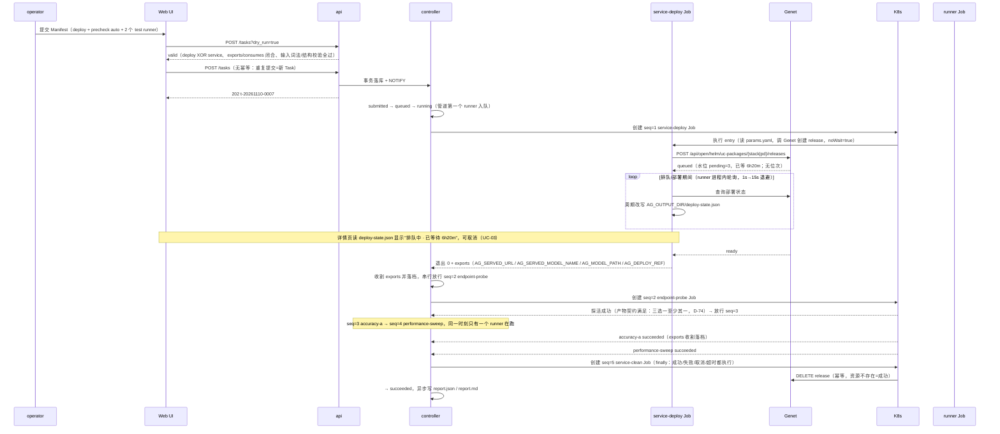
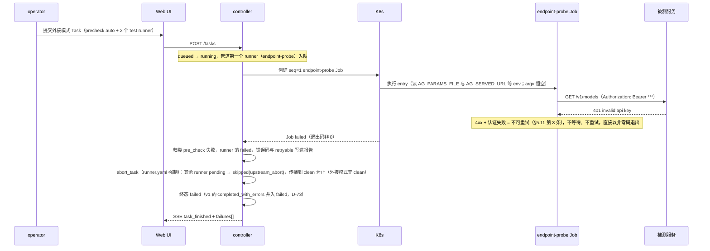

# Argus 场景视图（4+1 · Scenarios）

> **文档类型：** 4+1 视图中的场景/用例视图（开发指导基线）
> **定位：** 回答"谁在什么条件下做什么，成功路径与失败路径分别长什么样"，并把这些场景钉到状态机、表、时序与端点上。
> **效力：** 不新增设计裁决。与 [`ARCHITECTURE.md`](../ARCHITECTURE.md)（v2.0）冲突时以它为准；与 [`impl/`](../impl/) 重复处以本目录为准。
> **覆盖：** P0（ARCHITECTURE §14.1 的 18 项验收）的全部人机与平台自身场景。
> **不覆盖：** 类图与不变量（见 [02](02-logical-view.md)）、DDL（见 [03](03-data-view.md)）、循环与时序细节（见 [04](04-process-view.md)）、端点契约（见 [07](07-api.md)）。
> **术语：** 本文按 v2 术语书写（Run→Task、旧 Task→runner、Tester→Runner，映射见 ARCHITECTURE §0.2）；文中引用的 `impl/` 分册编号沿用其成文版本，该分册未随 v2 更名前，以其章节号定位、以本文术语理解。

---

## 1. 读法与边界

### 1.1 本视图回答什么

| 回答 | 不回答 |
|---|---|
| 有哪些参与者，各自能做什么、**不能**做什么 | 权限模型怎么实现（07 · 鉴权） |
| 一次 Task 从提交到终态的完整路径与分支 | 状态转移表的全部合法边（02 · 状态机） |
| 失败路径下 Task / runner 各落什么终态、错误码是什么 | 表结构与索引（03） |
| 每个用例要动哪些端点、哪些表、哪条验收 | 调度循环的并发实现（04） |
| 哪些事**明确不做**，以及理由 | 排期与人力（不在设计文档内） |

**编号约定：** `UC-xx` 用例、`EX-xx` 扩展/异常场景；状态 token 一律小写（`queued`、`skipped`），正文用大写概念名，UI 展示为大写徽标（§7.1、D-34）。验收列编号对齐 ARCHITECTURE §14.1 的 1–18 排序（v2 新增"泄漏重放""exports"等条目后重排；与 `IMPLEMENTATION.md` §9 的对齐待其随 v2 更新后复核，见 §9-3）。

### 1.2 已拍板前提（场景的硬边界，不再讨论）

| 前提 | 在场景里的表现 | 出处 |
|---|---|---|
| 控制面 **Go** 单二进制，`api` / `controller` / `collector` 三角色 | 场景里的"平台"由三个角色分工承担；`controller` 是唯一推进状态的角色 | K-1、I-4.1 |
| 前端 **Tailwind + shadcn/ui** | 所有页面交互都是 API 的消费方，不存在"只有 UI 能做"的动作 | K-2、§11.1 |
| **Runner 白名单注册，镜像内构建，无运行时上传** | 目录只读；没有"上传 Runner / 同步注册表"的用例；`deploy` / `clean` 角色仅内置，用户注册直接拒绝 | K-3、§5.1、§11.3 |
| **日志明文，平台不脱敏** | 查看日志不需要额外解密；凭据可能出现在日志里的风险由团队显式接受 | K-5、§12.4 |
| **部署可排队，窗口默认 72h** | 排队可见性由 service-deploy runner 周期写的 `deploy-state.json` 承载；平台状态机**没有** `deploying` 阶段；必须有"排队中 + 已等待时长 + 可取消" | K-6、§7.4、§9.1 |
| **Task 内 runner 严格串行（线性管道）** | `service-deploy → pre_check → tests → service-clean`；无门控 + 并发模型；`endpoint_exclusive` 仅外接模式有效 | §7.1、§6.7、D-69 |
| **runner 级无平台重试；重试 = 整 Task 新 attempt** | 重试全量重跑含 fresh deploy；`attempt_no` 上限默认 3 | §7.8、D-69 |
| **P0 单副本** | 对账靠 Lease 选主；崩溃场景靠"新 leader 重建 + 对账"，clean 未被调度靠 `argus clean --task` 重放 | K-7、I-4.1、§9.3 |
| **指标 P0 落文件，P1 可选 MongoDB** | 跨 Task 指标对比不是 P0 用例；P0 只读三选一产物（`result.json` / `result.html` / `result.csv` 至少其一，D-74） | K-8、I-13 |

---

## 2. 参与者与外部系统

| 参与者 | 是什么 | 能做什么 | 不能做什么 | 依据 |
|---|---|---|---|---|
| **operator** | OIDC 登录的人 | 提交 Task、取消、重试（整 Task 新 attempt）、填写 `env` 与 `secrets` 引用、查看全部报告与日志 | 改注册表 / Profile / Secret；看 Secret 值；绕过校验；判定指标是否达标。可取消他人的 Task，但必须留痕 | §12.1、§12.4、§13.1 |
| **admin** | OIDC 登录的人 | operator 全部 + 登记 Cluster / Profile、登记与轮换 Secret 引用、查审计、人工清产物、触发泄漏重放 | 运行时上传 Runner 或改已发布版本；注册 `deploy` / `clean` 角色；直接改 Secret 值（值只在 Secret Store 侧换）；判定指标是否达标 | §12.1、§13.1、K-3、C-10 |
| **viewer** | OIDC 登录的人 | 读 Task / runner / 报告 / 日志 / Runner 目录 / 环境信息 | 任何写操作；看到 Secret 值（只看得到变量名） | §12.1、§12.4 |
| **流水线客户端**（Jenkins / Agent） | 服务令牌 JWT | 与 operator 同权：提交、查询、下载报告、订阅事件 | 无后门、无特权路径；不再自己拼测试命令与解析结果 | §9.4、§12.1 |
| **Genet** | 外部部署平台 | 受理部署（Helm release）、返回部署状态轴、执行卸载；**不提供排队位次** | 被平台或 runner 直连改 Helm / 加 sidecar（交互只走 OpenAPI，且由内置 runner 执行）；判定测试结果；`blocked` 是终态，不可续跑 | §9.1 |
| **K8s / Volcano** | 执行与调度底座 | 跑 Job、拉起 Pod、暴露队列与节点只读快照、给出 `Pending` 原因 | 平台改队列权重 / 抢占 / 插队；`Unschedulable` 被平台判为失败 | §6.9、G-5 |
| **镜像仓库** | 外部镜像服务 | 提供 CI 产出的 Runner 镜像（tag / digest 均可） | 平台 build 或 push；运行时替换镜像版本 | §6.2、K-3、D-22 |
| **OIDC / 身份源** | 统一身份 | 签发用户令牌、组声明（映射 `viewer/operator/admin`）、JWKS | 平台自建账号体系、密码模式、token 透传给 Runner | §12.1、C-10 |
| **Runner**（镜像内 entry） | 被测执行体 | 读输入文件（`AG_PARAMS_FILE`）与环境变量（公共参数 `AG_SERVED_*`、元信息、exports 注入、secrets）、写 `/workspace/output`、产出三选一产物（`result.json` / `result.html` / `result.csv` 至少其一，由 Runner 决定，test / pre_check）与 `exports.env` | 感知 K8s、依赖 `endpoint.json`、声明执行时限、输出完整 Job 清单、要求平台按 argv 传参（argv 恒空） | §5.3、§5.10、§6.6、D-74 |
| **NFS `<storage-root>`** | 共享存储 | 全节点可读写同一份产物（subPath 直挂最终路径） | 退化为容器本地盘（emptyDir + 打包上传）；不可写时只能保持 `queued` 等待重试 | §6.8、I-4.3 |

---

## 3. 用例目录（UC-01 … UC-22）

| # | 用例 | 参与者 | 前置条件 | 主成功场景（一句话） | 涉及 API | 涉及表 | 验收（§14.1） |
|---|---|---|---|---|---|---|---|
| UC-01 | 提交 Task（部署模式） | operator / 流水线 | Runner、Profile 已登记；`precheck: auto` 时注册表恰有一个 `pre_check`；`deploy` XOR `service` | dry-run（含 exports/consumes 闭合与输入结构校验）通过后落库，Task 进 `running` 由 service-deploy 拉起管道 | `POST /tasks?dry_run` → `POST /tasks` | `tasks` `task_runners` `state_events` `audit_log` | #1 #2 |
| UC-02 | 提交 Task（外接模式） | operator / 流水线 | `service` 块有值且与 `deploy` 互斥 | 静态 service 作为"序号 0 的导出"注入全部 runner，管道从 pre_check（或首个 test runner）直接开始 | `POST /tasks` | `tasks` `task_runners` `state_events` | #1 #7 |
| UC-03 | 部署排队等待与排队中取消 | operator | Task 在 `running` 且 service-deploy 持续改写 `deploy-state.json`（`phase=queued`） | 展示水位/原因与已等待时长（**无位次**，D-46）；取消则终止当前 runner，已创建资源由 service-clean finally 幂等拆除 | `GET /tasks/{id}/deploy-state`、`GET /tasks/{id}/events`、`POST /tasks/{id}/cancel` | `task_runners` `state_events` `audit_log` | #2 #17 |
| UC-04 | 部署 `blocked` / 窗口耗尽 | operator（观察） | `deploy-state.json` 归类 `blocked`，或部署窗口（默认 72h）内未 `ready` | service-deploy 以 `DEPLOY_BLOCKED` 失败退出，Task 落 `service_unavailable`，未执行 runner `skipped` | `GET /tasks/{id}`、`GET /tasks/{id}/deploy-state` | `task_runners.error` | #2 |
| UC-05 | pre_check 通过、管道串行推进 | 平台（controller） | service-deploy 已成功且 exports 四件套收割落档 | 后续 runner 按 seq 严格串行执行（`seq+1` 以 `seq` 终态为前提），失败按 `on_failure` 传播 | `GET /tasks/{id}/runners` | `task_runners` `state_events` | #5 #10 |
| UC-06 | pre_check 可重试失败 | 平台 / operator | 窗口内一直 `ENDPOINT_UNREACHABLE` / 5xx / 429 | 其余 runner `skipped(upstream_abort)`（到 clean 为止），Task 归 `service_unavailable` | `GET /tasks/{id}/runners/{seq}` | `task_runners.error` `state_events` | #5 #14 |
| UC-07 | pre_check 不可重试失败（401） | 平台 / operator | 服务在，但鉴权/配置不对（4xx、认证失败） | Task 归 `failed`，失败 runner 带 `PRECHECK_FAILED` + `retryable: false` | `GET /tasks/{id}/runners/{seq}`、`GET /tasks/{id}/events` | `task_runners.error` `state_events` | #5 #14 |
| UC-08 | 外接模式 Endpoint 独占排队 | 平台 | 外接模式下同 `AG_SERVED_URL`（规范化 host:port）上有多个 Task | `endpoint_exclusive: true` 的 runner 执行期间，同 Endpoint 上其他 Task 的 runner 排队，等待期写 `slot_waiting`；部署模式下该声明冗余无害 | `GET /queue-status` | `endpoint_leases` `task_runners.waiting_reason` | #7 #10 |
| UC-09 | 部分失败（`continue`） | operator | 某 runner `failed` 且策略为 `continue` | 后续 runner 继续执行，Task 终态 `failed`（v1 `completed_with_errors` 并入），`failures[]` 列出错误码 | `GET /tasks/{id}/report` | `task_runners` `state_events` | #12 #14 |
| UC-10 | `abort_task` 终止本 attempt 其余 runner | operator（观察） | 失败 runner 的 `on_failure=abort_task`（pre_check 与内置角色强制） | 未执行 `skipped(upstream_abort)`（传播到 clean 为止）、在跑被终止，随后 service-clean finally 执行 | `GET /tasks/{id}/events`、`GET /tasks/{id}/report` | `task_runners` `state_events` | #12 |
| UC-11 | 取消 Task | operator | Task 非终态（含部署排队期） | 终止当前 runner → 执行 service-clean（若含部署）→ Task 落 `canceled`；未执行 runner `skipped(canceled)` | `POST /tasks/{id}/cancel` | `state_events` `audit_log` `task_runners` | #3 #10 |
| UC-12 | 整 Task 重试（新 attempt） | operator | Task 已终态且 `attempt_no` 未达上限（默认 3） | 二次确认"将重新部署"后创建新 attempt，全量重跑含 fresh deploy；历史 attempt 不覆盖 | `POST /tasks/{id}/retry` | `task_runners` `state_events` | #11 |
| UC-13 | 泄漏重放（`argus clean --task`） | admin / 平台 | 平台崩溃 / 节点丢失导致 clean 未被调度；exports 与 `deploy-state.json` 已按 attempt 落档 | CLI 用落档导出重新拉起一次内置 service-clean Job；不做平台 GC | CLI `argus clean --task <id> [--attempt <n>]` | `task_runners` `state_events` `audit_log` | #4 |
| UC-14 | 报告查看 | viewer | 存在终态 runner 或其三选一产物（D-74） | 指标表按 `labels` 分组（`result.json` 产出时）；`report.md` 与产物可下载 | `GET /tasks/{id}/report`、`/report.md`、`/artifacts`、`/files` | `artifacts` `tasks` 快照 | #14 #15 |
| UC-15 | 日志查看（runner + 部署多 Pod） | viewer | 有 runner 执行日志，或 service-deploy 已产出 Pod 清单快照 | 尾部跟随 / 分页；部署 Pod 日志在 deploy runner 节点下按 Pod 一文件、测试期间持续追加、重启与 gap 标记可见 | `GET /tasks/{id}/runners/{seq}/logs` | `artifacts(kind=log)`、`runners/<seq>/logs/` | #16 |
| UC-16 | Runner 目录浏览 | viewer | 注册表已随镜像扫描入库 | 只读展示 role、版本、`entry`、`input_format`、exports/consumes、参数清单与示例；`deploy`/`clean` 角色不在用户目录 | `GET /runners`、`GET /runners/{name}` | `runners` | #6 #17 |
| UC-17 | Profile / Cluster 登记 | admin | kubeconfig 已挂进 `CLUSTERS_DIR` | 登记后 Manifest 可引用；连通性检查结果可查 | `POST /admin/clusters`、`POST/PUT/DELETE /admin/profiles`、`GET /profiles` | `clusters` `execution_profiles` `audit_log` | #18 |
| UC-18 | Secret 登记与轮换 | admin | Secret 已登记引用；值在 Secret Store 侧更新 | `rotate` 后校验引用可读并记审计；只影响新 attempt | `GET/POST /admin/secrets`、`POST /admin/secrets/{name}/rotate` | `secret_refs` `audit_log` | #18 |
| UC-19 | 审计查询 | admin | 已有写操作发生 | 按 actor / action / 对象 / 时间检索，失败尝试也在内 | `GET /admin/audit` | `audit_log` | #18 |
| UC-20 | controller 重启对账 | 平台（SRE 观察） | 控制面崩溃后新 leader 接管（Lease 15s） | `preparing` / `running` 对账恢复真实状态，不直接判失败；clean 未被调度的 attempt 进重放清单（§9.3） | `GET /tasks/{id}/events` | `task_runners` `state_events` `tasks` | #10 |
| UC-21 | 产物保留期清理 | 平台 / admin | Task 已终态 | 保留期（默认 30 天，平台配置）到期后整目录清理；admin 可人工删产物；`cleanup.policy` 已取消（v2） | `DELETE /admin/tasks/{id}/artifacts` | `artifacts` `audit_log` | #15 |
| UC-22 | SSE 断线重连与回放 | viewer（前端） | 详情页持有一条事件流连接 | 带 `Last-Event-ID` 回放；越窗则 `resync_required` 整页重建 | `GET /tasks/{id}/events`、`GET /tasks/{id}/events/history` | `state_events` | #17 #18 |

> 说明：**不存在**运行时上传 / 同步 Runner 的端点（K-3；`deploy` / `clean` 角色仅内置，§5.1）。部署总窗口由平台配置（默认 72 小时，§7.4、§12.7），Manifest 不提供覆盖字段；部署排队的唯一可见载体是 `deploy-state.json`（UC-03）。

---

## 4. 主场景 A：部署 + pre_check + 串行管道 + finally 清理的完整 Task

### 4.1 场景设定

| 项 | 取值 |
|---|---|
| Manifest | `deploy`（Genet 部署描述）；`precheck: auto`；`runners[]`: `accuracy-a`（`continue`）+ `performance-sweep`（`abort_task`） |
| runner 管道 | seq=1 `service-deploy`（注入）→ seq=2 `endpoint-probe`（注入）→ seq=3 `accuracy-a` → seq=4 `performance-sweep` → seq=5 `service-clean`（注入）；严格串行 |
| 环境 | `execution.profile: k8s-npu`；Task 级 `env` 明文 + `secrets` 引用；全局并发上限 20 |
| 预期终态 | `succeeded`；5 个 runner 全 `succeeded`；service-clean 幂等拆除完成 |

### 4.2 时序



### 4.3 编号步骤与分支

| 步 | 触发 / 动作 | Task 状态 | runner 状态 | 事件与落库 | 用户可见 |
|---|---|---|---|---|---|
| 1 | dry-run 与提交（同一份 Manifest） | `submitted` | runner 列表落库（注入的 deploy/precheck/clean 不计入用户列表） | `submitted`；`tasks` + `task_runners` + `audit_log` 同事务 | 202 + Task ID |
| 2 | 首个 runner 入队（有 `deploy`） | `queued → running` | service-deploy `queued → preparing → running` | **没有独立的 `deploying` 阶段**：`running` 即"管道第一个 runner 在跑"（§7.4） | 时间线显示 service-deploy 节点 RUNNING |
| 3 | Genet 排队 | `running` | service-deploy 保持 `running`（Job 内存活轮询） | `deploy-state.json` 周期改写，平台归档副本 | "排队中 · 已等待 6h20m"，**排队期可取消** |
| 4 | 服务 ready | `running` | service-deploy → `succeeded` | exports 四件套收割落档（`exports_harvested`） | 部署节点转 SUCCEEDED，服务信息可见 |
| 5 | pre_check 探活 | `running` | endpoint-probe `queued → preparing → running → succeeded` | `runner_finished`；exports 合并注入下游 | pre_check 节点 SUCCEEDED |
| 6 | test runner 串行执行 | `running` | accuracy-a → performance-sweep 逐个执行 | 前一 runner 终态同事务放行下一 seq | 时间线逐节点点亮（串行链，不渲染并行） |
| 7 | 测试类 runner 全部终态 | `running` | service-clean `queued → running` | clean finally 入队 | 清理节点 RUNNING |
| 8 | clean 完成 | `succeeded` | 全部 `succeeded` | `clean_finished`、`task_finished`、报告异步 | 报告可下载 |

### 4.4 该场景必须成立的三件事

- **串行是常态，没有并发分支**：Task 内 runner 严格串行（§6.7、D-69）；部署模式下服务是 Task 私有，隔离由拓扑保证；`endpoint_exclusive` 在部署模式下冗余无害。UI 渲染串行链，不渲染并行泳道。
- **排队与槽位是两层等待**：部署排队（Genet 侧）由 service-deploy 的 `deploy-state.json` 承载（§6.9、§9.1）；外接模式的 Endpoint 槽位与全局并发归平台，`QUEUED` 必须带原因。
- **clean 不改变结论**：service-clean 失败只产生 `cleanup_failed` 标记与 `CLEANUP_FAILED` 事件，Task 终态由测试类 runner 决定（§7.5、§7.6）。

---

## 5. 主场景 B：pre_check 以 401 失败

### 5.1 场景设定

外接模式 Task（静态 `service` 给出 `url` / `model_name`）：服务本身可达，但鉴权配置错误，pre_check 第一次请求即返回 `401 invalid api key`。按 §5.11 第 3 条，**4xx / 认证失败必须立即失败并置 `retryable: false`**，不进入"等就绪"的循环。它失败后 `abort_task` 传播：其余 runner `skipped(upstream_abort)`（外接模式无 clean，传播即到头），Task 落 `failed`。

### 5.2 时序



### 5.3 为什么是 `failed` 而不是 `service_unavailable`

| 判断项 | 取值 | 依据 |
|---|---|---|
| 服务返回 | `401 invalid api key`（4xx / 认证失败） | §5.11 第 3 条 |
| 平台记录的错误码 | `PRECHECK_FAILED`，`detail.http_status: 401`，`retryable: false` | 附录 D、§5.11 |
| 失败策略 | `abort_task`（`runner.yaml` 强制，不可被 Manifest 弱化） | §7.3、D-09 |
| 其余 runner | `skipped(upstream_abort)`，传播到 clean 为止（外接模式无 clean） | §7.3、§7.1 |
| Task 终态判定 | pre_check 以**不可重试**错误失败 → `failed`（v1 的 `completed_with_errors` 并入此态） | §7.5、D-35 |
| 反例 | 若窗口内一直 `ENDPOINT_UNREACHABLE`（可重试）→ `service_unavailable` | §7.5 |
| 排查方向 | "服务在、配置/权限不对"：查 Secret 引用与 `Authorization` 头，不找部署方 | §7.5 |

### 5.4 用户看到什么

```json
{ "code": "PRECHECK_FAILED", "message": "探测返回 401",
  "detail": { "task_id": "t-000003", "runner_seq": 1, "attempt": 1, "http_status": 401 },
  "retryable": false }
```

| 位置 | 呈现 |
|---|---|
| Task 详情页头 | 红色横幅：流程已结束、存在失败；附 Task 终态徽标 `FAILED` 与"重试（新 attempt，将全量重跑）"入口 |
| pre_check 节点 | `FAILED` + `PRECHECK_FAILED` + `401` |
| 其余两个 runner | `SKIPPED` + `upstream_abort`；卡片写"未执行"，绝不显示 0 |
| 处置 | `admin` 修 Secret 引用后**整 Task 重试**（新 attempt 全量重跑），或改 `service` 配置重新提交 |

> 注意：附录 D 的"可重试"是**码级默认值**；v2 中它只用于 §9.3 重放与告警分级，**不再**触发 runner 级自动重试。实例上以错误对象里的 `retryable` 为准，pre_check 的 4xx 必须覆盖为 `false`（§5.11）。
>
> 若实现尚未补齐 pre_check 的错误码归类，`code` 会退化为 `RUNNER_NONZERO_EXIT`（`retryable` 仍为 false）：**本场景的终态不变**，但 UC-06 的可重试分支会失去区分，见 §9-1。

---

## 6. 扩展与异常场景

| # | 触发 | 系统响应 | 用户可见结果 |
|---|---|---|---|
| EX-01 | Genet 调用失败（网络 / 5xx / 鉴权） | service-deploy 在 `deploy-state.json` 写 `genet_call_failed` 并以非 0 退出 → `DEPLOY_FAILED`；Task `failed`（平台侧），未执行 runner `skipped(platform_error)` | 横幅"平台侧失败"，附 Genet 原因；**不是** `service_unavailable` |
| EX-02 | 部署终态 `blocked` | service-deploy 归类 blocked → `DEPLOY_BLOCKED`；Task `service_unavailable`（终态）；未执行 runner `skipped` | 显示后端原因；不进入测试 runner，不浪费 GPU |
| EX-03 | 排队超过部署窗口（默认 72h） | 超窗 service-deploy 判失败（`DEPLOY_BLOCKED`，`detail.reason=timeout`）→ `service_unavailable`；排队期间允许先取消（service-clean 对已创建资源幂等拆除） | "部署窗口已耗尽"；`deploy-state.json` 的 `waited_seconds` 触发告警 |
| EX-04 | runner 超过 `timeout_seconds` | watchdog 每 10s 扫描 → 删 Job → `failed` / `RUNNER_TIMEOUT`；**无 runner 级重试**（v2 取消 `retry_on`），只能整 Task 重试成新 attempt | 节点 FAILED + 超时说明；重试入口给"整 Task 新 attempt"确认（含"将重新部署"提示） |
| EX-05 | 取消与自然结束同时到达 | CAS + 先落库者胜；失败方 `ErrConflict` 后重读，不覆盖 | 终态以先落库的为准；clean finally 执行后落 `canceled`，不悬挂在 `CANCELLING` |
| EX-06 | K8s API 不可达 | 建/查 Job 失败：runner 停在 `queued` / `preparing`，由对账按平台内部操作安全重试；持续不可达告警 `EXECUTOR_UNAVAILABLE`（可重试标记用于告警分级），不判 runner 失败 | 内联错误码 + "平台执行层不可达"；区分平台侧故障与测试失败 |
| EX-07 | NFS 不可写 | 预创建目录前做可写探测，失败保持 `queued` + `EXECUTOR_UNAVAILABLE`；仅 Profile 挂载缺失才是 `MOUNT_UNAVAILABLE`（不可重试） | "存储不可写，稍后重试"；不会出现"跑完了但产物没落盘" |
| EX-08 | 控制面崩溃（单副本） | Lease 15s 过期后新 leader 接管，`preparing` / `running` 全部进对账；Job 不存在且已过 90s 需连续 3 次确认才判失败；clean 未被调度的 attempt 进 §9.3 重放清单（UC-13） | 页面短暂停更后恢复；**绝不**"凭空 SUCCEEDED"，也不直接假定失败 |
| EX-09 | 日志断档：Pod 重启 / collector 崩溃 | 续写同一文件并插 `--- [container restarted #3 ...] ---`；collector 恢复后写 `--- [log gap: ...] ---`；超 200MB 分段 | 页签角标显示重启次数；缺口用红虚线框标出，不伪造连续 |
| EX-10 | 镜像拉取失败 | runner `failed` / `IMAGE_PULL_FAILED`；**无自动重试**（`retryable: true` 仅用于告警分级） | 内联错误码 + 镜像引用；历史 attempt 保留 |
| EX-11 | 结果缺失 / 非法 | 退出码 0 但三选一产物全缺失 → `RESULT_MISSING`；产出了 `result.json` 但不合法 → `RESULT_INVALID`，runner 判失败（D-74：`result.json` 不再强制；失败时推荐产出带 `error` 的 `result.json`，软要求） | 明确"执行了但结果不合格"；不允许被当作成功 |
| EX-12 | `exports.env` 解析失败 | 退出码 0 但导出行非法 → 整体拒绝收割，runner 判失败（`EXPORT_INVALID`），下游不注入 | 明确"导出不合规"；声明级缺口（consumes 无来源）已在提交期被 `VALIDATION_ERROR` 拦截 |

---

## 7. 用例 → 视图文档追溯矩阵

> 章节号以各文档成文版本为准，这里按**主题**定位；同一主题在 02/03/04/07 只允许一处定义，其余引用（见 [README](README.md) §5）。API 路径按 D-73 映射书写（`/runs→/tasks`、`/testers→/runners`、`/tasks/{id}/runners/{seq}`），准确形状以 07 定稿为准。

| UC | [02 逻辑视图](02-logical-view.md)（状态机 / 接口） | [03 数据视图](03-data-view.md)（表） | [04 进程视图](04-process-view.md)（时序） | [07 API](07-api.md)（端点） |
|---|---|---|---|---|
| UC-01 | 编排器 · 提交组合期校验顺序（deploy XOR service、exports/consumes、输入结构）；Task 状态机 | `tasks` `task_runners` `state_events` | 时序：提交落库 | `POST /tasks`、`?dry_run` |
| UC-02 | 编排器 · 静态 service 作为"序号 0 的导出" | `tasks.service` | 时序：无部署的直接入管道 | 同上 |
| UC-03 | Task 状态机 · 无 `deploying` 阶段；deploy-state.json 承载排队可见性 | `task_runners`（deploy 产物归档） | 时序：service-deploy 轮询与排队 | `GET /tasks/{id}/deploy-state`、`POST /tasks/{id}/cancel` |
| UC-04 | Task 终态判定 · 部署分支（`DEPLOY_BLOCKED`） | `task_runners.error` | 时序：部署终态收口 | `GET /tasks/{id}/deploy-state` |
| UC-05 | runner 状态机 · 严格串行放行 | `task_runners` | 时序：管道线性推进 | `GET /tasks/{id}/runners` |
| UC-06 | Task 终态判定 · 可重试 precheck → `service_unavailable` | `task_runners.error` | 时序：abort_task 传播 | `GET /tasks/{id}/runners/{seq}` |
| UC-07 | 同上 · 不可重试 precheck → `failed` | `task_runners.error` | 同上 | 同上 |
| UC-08 | 调度器 · Endpoint 槽位（仅外接模式） | `endpoint_leases` | 时序：槽位排队与 `slot_waiting` | `GET /queue-status` |
| UC-09 | 失败策略 · `continue`；Task 汇总结构 | `task_runners`、`state_events` | 时序：runner 终态判定 | `GET /tasks/{id}/report` |
| UC-10 | 失败策略 · `abort_task` | `task_runners` | 时序：abort 传播到 clean 为止 | `GET /tasks/{id}/events` |
| UC-11 | 取消语义 · CAS 竞态；clean finally | `state_events`、`audit_log` | 时序：取消与 clean | `POST /tasks/{id}/cancel` |
| UC-12 | attempt 模型 · 新 attempt 全量重跑（fresh deploy） | `task_runners`（`attempt_no`） | 时序：重试入口 | `POST /tasks/{id}/retry` |
| UC-13 | 泄漏重放 · 重放内置 clean（§9.3） | `task_runners`、exports / deploy-state 落档 | —（CLI 触发一次 Job） | CLI `argus clean --task` |
| UC-14 | 报告分工 · runner / Task report | `artifacts` | 时序：报告生成 | `GET /tasks/{id}/report`、`/report.md`、`/files` |
| UC-15 | 日志位置 · runner 日志与部署 Pod 日志（`runners/<deploy_seq>/logs/`） | `artifacts(kind=log)` | 时序：日志采集与分段 | `GET /tasks/{id}/runners/{seq}/logs` |
| UC-16 | Registry · 白名单注册与版本不可覆盖（`RUNNER_VERSION_PINNED`） | `runners` | —（启动期扫描一次） | `GET /runners`、`/runners/{name}` |
| UC-17 | 环境登记 · 凭据只存文件名 | `clusters`、`execution_profiles` | 时序：kubeconfig 热加载 | `POST /admin/clusters`、`/admin/profiles` |
| UC-18 | 凭据 · 只存引用、不回显 | `secret_refs`、`audit_log` | 时序：轮换只影响新 attempt | `POST /admin/secrets/{name}/rotate` |
| UC-19 | 审计 · 写操作同事务留痕 | `audit_log` | — | `GET /admin/audit` |
| UC-20 | 对账 · 状态恢复不重建内存；重放清单 | `task_runners`、`state_events` | 时序：Lease 选主与对账 | `GET /tasks/{id}/events` |
| UC-21 | 保留期 · 由平台配置统一决定（`cleanup.policy` 已取消） | `artifacts` | 时序：retention sweeper | `DELETE /admin/tasks/{id}/artifacts` |
| UC-22 | SSE 网关 · 事件信封与 seq 去重 | `state_events` | 时序：事件推送与回放 | `GET /tasks/{id}/events`、`/events/history` |

**覆盖自检（§14.1 18 项）：** #1 UC-01/02 · #2 UC-01/03/04 · #3 UC-10/11 · #4 UC-13 · #5 UC-05/06/07 · #6 UC-16 · #7 UC-02/05/08 · #8 平台外运行（**无平台交互，故无 UC**，见 §8）· #9 UC-11/20 · #10 UC-05/06/07/08/11/20 · #11 UC-12 · #12 UC-09/10 · #13 UC-05（+ EX-12）· #14 UC-07/09/14 · #15 UC-14/21 · #16 UC-15 · #17 UC-03/14/22 · #18 全部 UC 的端点列。

---

## 8. 不做的用例（Non-Goals）

| 不做 | 在场景中的表现 | 为什么 | 依据 |
|---|---|---|---|
| **Gate 判定 / 门禁** | 报告只出指标，不出"通过 / 不通过"；没有 `GATING` 阶段与 `GATE_FAILED` 终态 | 阈值属业务判断，固化进平台即失效 | §13.1、D-02 |
| **拖拽式流程编排** | 编排只能由 Manifest 表达；管道拓扑是固定线性形态，链路图是只读展示，不是画布 | 编排器复杂度不划算；v2 管道严格串行 | §11.3、§13.2、D-69 |
| **参数语义校验 / 表单渲染** | 提交页每个 runner 一个文本输入框（按 `input_format` 占位）；平台只做词法 + 结构校验（jsonl 类型与 required，报错带行号+字段名），枚举/范围/跨字段归 Runner | 平台不解析业务语义，守住 §5.4 边界 | §5.4、§11.2、D-67（部分取代 D-21） |
| **运行时上传 Runner / 运行时 build** | 没有上传入口；新 Runner = 新目录 + CI 校验 + 注册；`deploy` / `clean` 角色仅内置 | 保证"跑的到底是哪个版本"可追溯 | §11.3、K-3、D-22、§5.1 |
| **SSH / Docker 执行后端** | 平台上没有"选一台主机跑"的入口；这类运行不产生平台记录 | 平台只有 K8s 一种 Executor | §13.1、§6.4、D-18 |
| **runner 级平台重试 / 部署模式跨 Task 部分续跑** | runner 失败即本次 attempt 的事实；重试 = 整 Task 新 attempt 全量重跑含 fresh deploy；P1 续跑仅外接模式 | warm cache / 残留连接污染测量，结果可信度优先 | §7.7、§7.8、D-69 |
| **多租户隔离** | 不做租户维度、不做资源配额隔离；只有 `viewer/operator/admin` 三组 | 对内单团队，RBAC 已够 | §13.2 |
| **指标聚合 / 自定义报表 / BI** | Task 报告只做组织与索引，不做加减乘除 | 下游分析系统负责 | §8.4、§13.2 |
| **数据集 / 模型 / 镜像仓库托管** | 输入与公共参数里的路径是不透明字符串，平台不解析、不校验存在性 | 沿用现有资源管理 | §10.4、§13.1 |
| **用户注册与自助开户** | 只能走统一身份源登录 | 不自建账号体系 | §11.3、§12.1 |
| **结果可复现承诺** | 报告标注 Runner 版本、镜像 digest、输入快照、exports 注入清单，但不保证重放得到同样数字 | 只保证执行逻辑可追溯 | §5.7 |
| **优先级 / 插队 / 抢占** | `QUEUED` 只展示原因，不提供"优先跑我的" | 平台没有调度决策权 | §6.9 |
| **平台日志脱敏** | 日志原样落盘；平台不读 Secret 做替换 | 团队显式接受该风险 | K-5、D-30 |
| **平台侧 GC 机制** | 部署拆除由 service-clean（finally + 重放）承载；不发明资源回收器 | 平台仍是哑平台，只是重放一个 Job | §9.3、D-72 |

> §14.1 #8 "Runner 独立运行" 是**平台外**能力（`docker run <image> <entry> --params-file ... --url ...`），不进平台生命周期，因此不设 UC——它出现在场景里的唯一形态是"使用者在自己机器上跑，产物结构与本平台一致"（§5.10）。

---

## 9. 遗留口径（实现前需确认）

| # | 事项 | 当前口径 | 影响 |
|---|---|---|---|
| 1 | ~~pre_check 失败码缺映射~~ **已解决**：非零退出时平台仍尝试读 `result.json`（若产出——失败时产出它是 D-74 软要求），取 `error.code`（限定附录 D、带实例 `retryable`）归类；未产出/不合法才回退 `RUNNER_NONZERO_EXIT`（见 E-8.1、C-7.1、07 §3） | 平台在非零退出时读失败结果做归类；pre_check 的 4xx 由 Runner 写 `PRECHECK_FAILED(retryable=false)`，不可重试失败归 `failed`，可重试失败归 `service_unavailable` | 两个终态都有产生路径 |
| 2 | `skipped` 的 `reason` 枚举（`upstream_abort` / `canceled` / `deploy_failed` / `service_unavailable` / `platform_error`） | v2 沿用五值口径（abort_task 传播、取消、部署失败收口、blocked 收口、平台侧错误），落成 03 的 CHECK 约束；具体取值以 03 定稿为准 | 报告与 UI 文案依赖它区分"没跑"的原因 |
| 3 | 端点形状（部署状态、runner 日志、重试等）按 D-73 映射书写（`/tasks`、`/runners`、`/tasks/{id}/runners/{seq}`）；07 正另行更新 | 本文 API 列以 D-73 为准，07 定稿后需回扫本文端点列与验收编号（§14.1 v2 为 18 项） | 与 07/IMPLEMENTATION 的编号对齐 |
