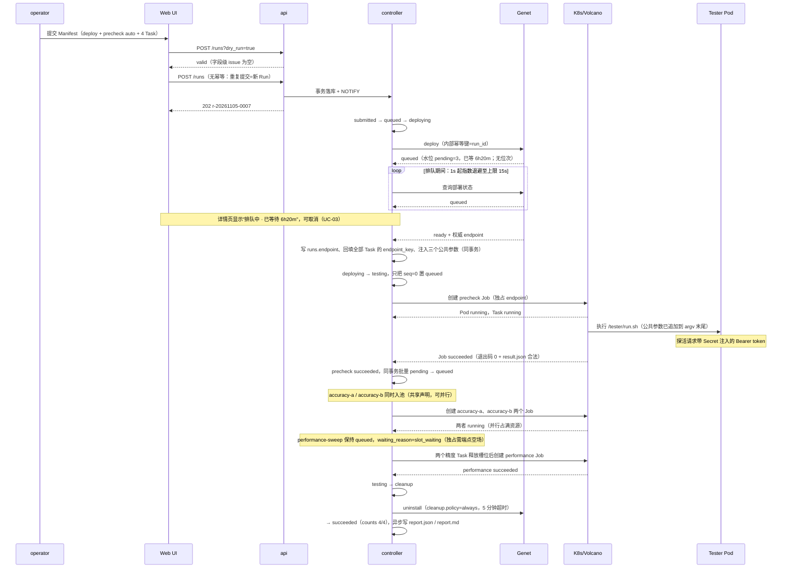
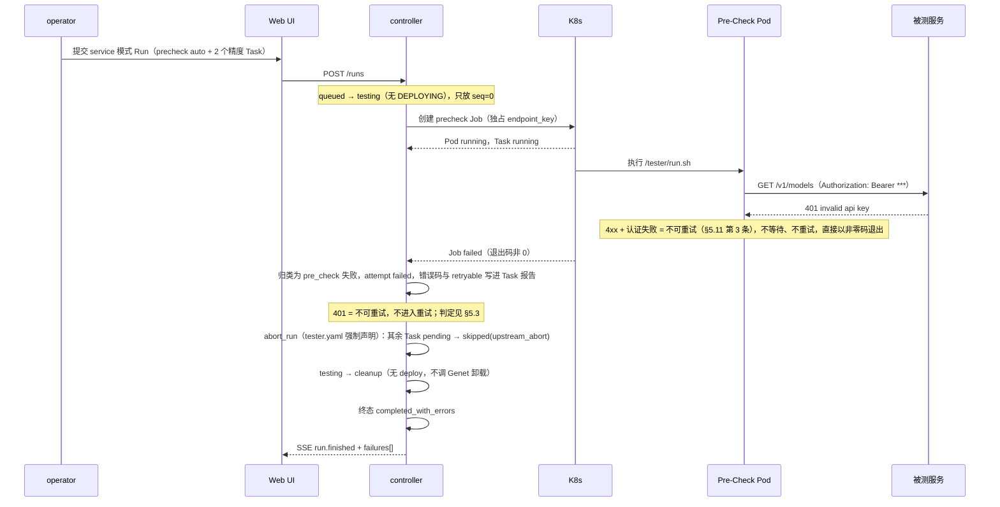

# TestPlane 场景视图（4+1 · Scenarios）

> **文档类型：** 4+1 视图中的场景/用例视图（开发指导基线）
> **定位：** 回答"谁在什么条件下做什么，成功路径与失败路径分别长什么样"，并把这些场景钉到状态机、表、时序与端点上。
> **效力：** 不新增设计裁决。与 [`ARCHITECTURE.md`](../ARCHITECTURE.md)（v0.5）冲突时以它为准；与 [`impl/`](../impl/) 重复处以本目录为准。
> **覆盖：** P0（ARCHITECTURE §14.1 的 17 项验收）的全部人机与平台自身场景。
> **不覆盖：** 类图与不变量（见 [02](02-logical-view.md)）、DDL（见 [03](03-data-view.md)）、循环与时序细节（见 [04](04-process-view.md)）、端点契约（见 [07](07-api.md)）。

---

## 1. 读法与边界

### 1.1 本视图回答什么

| 回答 | 不回答 |
|---|---|
| 有哪些参与者，各自能做什么、**不能**做什么 | 权限模型怎么实现（07 · 鉴权） |
| 一次 Run 从提交到终态的完整路径与分支 | 状态转移表的全部合法边（02 · 状态机） |
| 失败路径下 Run / Task 各落什么终态、错误码是什么 | 表结构与索引（03） |
| 每个用例要动哪些端点、哪些表、哪条验收 | 调度循环的并发实现（04） |
| 哪些事**明确不做**，以及理由 | 排期与人力（不在设计文档内） |

**编号约定：** `UC-xx` 用例、`EX-xx` 扩展/异常场景；状态 token 一律小写（`queued`、`skipped`），正文用大写概念名，UI 展示为大写徽标（§7.1、D-34）。验收列编号对齐 `IMPLEMENTATION.md` §9 对 §14.1 的 1–17 排序。

### 1.2 已拍板前提（场景的硬边界，不再讨论）

| 前提 | 在场景里的表现 | 出处 |
|---|---|---|
| 控制面 **Go** 单二进制，`api` / `controller` / `collector` 三角色 | 场景里的"平台"由三个角色分工承担；`controller` 是唯一推进状态的角色 | K-1、I-4.1 |
| 前端 **Tailwind + shadcn/ui** | 所有页面交互都是 API 的消费方，不存在"只有 UI 能做"的动作 | K-2、§11.1 |
| **Tester 镜像内构建，无运行时注册** | 目录只读；没有"上传 Tester / 同步注册表"的用例 | K-3、§11.3 |
| **日志明文，平台不脱敏** | 查看日志不需要额外解密；凭据可能出现在日志里的风险由团队显式接受 | K-5、§12.4 |
| **Deploy 可排队，窗口默认 72h** | `deploying` 可持续数天；必须有"排队中 + 已等待时长 + 可取消" | K-6、§9.1 |
| **Pre-Check 门控 + 其余 Task 并行** | 门控是 Run 内唯一序化点；是否并行由 Tester 的 `endpoint_exclusive` 决定 | K-12、§6.7、§7.4 |
| **P0 单副本** | 对账靠 Lease 选主；崩溃场景靠"新 leader 重建 + 对账"，不靠多主 | K-7、I-4.1 |
| **指标 P0 落文件，P1 可选 MongoDB** | 跨 Run 指标对比不是 P0 用例；P0 只读 `result.json` | K-8、I-13 |

---

## 2. 参与者与外部系统

| 参与者 | 是什么 | 能做什么 | 不能做什么 | 依据 |
|---|---|---|---|---|
| **operator** | OIDC 登录的人 | 提交 Run / Task、取消、重试、填写 `env` 与 `secrets` 引用、查看全部报告与日志 | 改注册表 / Profile / Secret；看 Secret 值；绕过校验；判定指标是否达标。可取消他人的 Run，但必须留痕 | §12.1、§12.4、§13.1 |
| **admin** | OIDC 登录的人 | operator 全部 + 登记 Cluster / Profile、登记与轮换 Secret 引用、查审计、人工清产物 | 运行时上传 Tester 或改已发布版本；直接改 Secret 值（值只在 Secret Store 侧换）；判定指标是否达标 | §12.1、§13.1、K-3、C-10 |
| **viewer** | OIDC 登录的人 | 读 Run / Task / 报告 / 日志 / Tester 目录 / 环境信息 | 任何写操作；看到 Secret 值（只看得到变量名） | §12.1、§12.4 |
| **流水线客户端**（Jenkins / Agent） | 服务令牌 JWT | 与 operator 同权：提交、查询、下载报告、订阅事件 | 无后门、无特权路径；不再自己拼测试命令与解析结果 | §9.2、§12.1 |
| **Genet** | 外部部署平台 | 受理部署（Helm release）、返回两根轴状态（helm `status` + `endpoint.status`）、给出**权威 Endpoint**、执行卸载；**不提供排队位次** | 判定测试结果；被平台改 Helm / 加 sidecar；`blocked` 是终态，不可续跑 | §9.1 |
| **K8s / Volcano** | 执行与调度底座 | 跑 Job、拉起 Pod、暴露队列与节点只读快照、给出 `Pending` 原因 | 平台改队列权重 / 抢占 / 插队；`Unschedulable` 被平台判为失败 | §6.9、G-5 |
| **镜像仓库** | 外部镜像服务 | 提供 CI 产出的 Tester 镜像（tag / digest 均可） | 平台 build 或 push；运行时替换镜像版本 | §6.2、K-3、D-22 |
| **OIDC / 身份源** | 统一身份 | 签发用户令牌、组声明（映射 `viewer/operator/admin`）、JWKS | 平台自建账号体系、密码模式、token 透传给 Tester | §12.1、C-10 |
| **Tester**（镜像内 `run.sh`） | 被测执行体 | 读 argv 与 env、写 `/workspace/output`、产出 `result.json` | 感知 K8s、依赖 `endpoint.json`、声明执行时限、输出完整 Job 清单 | §5.3、§5.10、§6.6 |
| **NFS `<storage-root>`** | 共享存储 | 全节点可读写同一份产物（subPath 直挂最终路径） | 退化为容器本地盘（emptyDir + 打包上传）；不可写时任务只能判可重试失败 | §6.8、I-4.3 |

---

## 3. 用例目录（UC-01 … UC-22）

| # | 用例 | 参与者 | 前置条件 | 主成功场景（一句话） | 涉及 API | 涉及表 | 验收（§14.1） |
|---|---|---|---|---|---|---|---|
| UC-01 | 提交 Run（deploy 模式） | operator / 流水线 | Tester、Profile 已登记；`precheck: auto` 时注册表恰有一个 `pre_check` | dry-run 通过后落库，Run 进 `deploying` 并开始调 Genet | `POST /runs?dry_run` → `POST /runs` | `runs` `tasks` `state_events` `audit_log` | #1 #12 |
| UC-02 | 提交 Run（service 模式） | operator / 流水线 | `service.url` 有值且三个公共参数无冲突 | 提交时即算出 `endpoint_key`，跳过 `DEPLOYING` 直接进 `testing` | `POST /runs` | `runs` `tasks` `state_events`（+ `tasks.endpoint_key`） | #1 #2 |
| UC-03 | Deploy 排队等待与排队中取消 | operator | Run 在 `deploying` 且 Genet 返回 `queued` | 展示水位/原因与已等待时长（**无位次**，D-46）；取消则先落取消意图再向 Genet 发 `DELETE`（404=尚未创建，由对账补偿） | `GET /runs/{id}/deploy`、`GET /runs/{id}/events`、`POST /runs/{id}/cancel` | `runs.deploy` `state_events` `audit_log` | #3 #1 |
| UC-04 | Deploy `blocked` / 窗口耗尽 | operator（观察） | Genet 终态 `blocked`，或 72h 内未 `ready` | Run 直接 `service_unavailable`，全部 Task `skipped`，**不产生 Attempt** | `GET /runs/{id}`、`GET /runs/{id}/deploy` | `runs.error` `tasks.status_reason` | #3 #12 |
| UC-05 | Pre-Check 门控通过 | 平台（controller） | Run 进 `testing` 且 `precheck ≠ off` | 只放 `seq=0` 独占执行；成功后其余 Task 同事务批量入 `queued` | `GET /runs/{id}/tasks` | `tasks.waiting_reason` `endpoint_leases` `state_events` | #4 #12 |
| UC-06 | Pre-Check 可重试失败 | 平台 / operator | 窗口内一直 `ENDPOINT_UNREACHABLE` / 5xx / 429 | 其余 Task `skipped(upstream_abort)`，Run 归 `service_unavailable` | `GET /tasks/{id}/attempts/{n}/result` | `tasks.error` `state_events` | #4 #11 |
| UC-07 | Pre-Check 不可重试失败（401） | 平台 / operator | 服务在，但鉴权/配置不对（4xx、认证失败） | Run 归 `completed_with_errors`，失败 Task 带 `PRECHECK_FAILED` + `retryable: false` | `GET /tasks/{id}/attempts/{n}/result`、`GET /runs/{id}/events` | `tasks.error` `attempts.error` `state_events` | #4 #13 |
| UC-08 | Task 并行执行与独占排队 | 平台 | 同 `endpoint_key` 上存在多个 Task | 非独占 Task 并行；独占 Task 需端点空场，等待期写 `slot_waiting` | `GET /queue-status` | `endpoint_leases` `tasks.waiting_reason` | #11 #15 |
| UC-09 | 部分失败（`continue`） | operator | 某 Task `failed` 且策略为 `continue` | 其余 Task 不受影响跑完，Run `completed_with_errors`，`failures[]` 列出错误码 | `GET /runs/{id}/report` | `tasks` `attempts` `state_events` | #15 #13 |
| UC-10 | `abort_run` 终止同 Run 其余 Task | operator（观察） | 失败 Task 的 `on_failure=abort_run`（Pre-Check 强制） | 未开始 `skipped(upstream_abort)`、在跑 `canceled`，随后 `cleanup` | `GET /runs/{id}/events`、`GET /runs/{id}/report` | `tasks` `attempts` `state_events` | #11 |
| UC-11 | 取消 Run / 取消单个 Task | operator | 对象非终态（含 Deploy 排队中） | `cancelling → canceled`；未开始 `skipped(canceled)`，在跑删 Job 后 `canceled` | `POST /runs/{id}/cancel`、`POST /tasks/{id}/cancel` | `state_events` `audit_log` `attempts` | #1 #8 |
| UC-12 | 重试失败 Task | operator | Run / Task 已终态且存在 `failed` / `skipped` | 预览"复用 / 重跑"后追加新 Attempt，历史 Attempt 不覆盖 | `GET /runs/{id}/retry-plan`、`POST /runs/{id}/retry`、`POST /tasks/{id}/retry` | `attempts` `tasks.current_attempt` | #10 #15 |
| UC-13 | 独立 Task 提交 | operator / Jenkins | 无 `deploy`，`service.url` 必填 | 合成 `kind=task` 的占位 Run，产物与报告结构与 Run 内同构 | `POST /tasks` | `runs(kind='task')` `tasks` `attempts` | #2 |
| UC-14 | 报告查看 | viewer | 存在终态 Task 或其 `result.json` | 指标表按 `labels` 分组；`report.md` 与产物可下载 | `GET /runs/{id}/report`、`/report.md`、`/artifacts`、`/files` | `artifacts` `runs` `tasks` 快照 | #13 #16 |
| UC-15 | 日志查看（Attempt + Deploy 多 Pod） | viewer | 有 Attempt 日志，或 Deploy 已产出 `pods.json` | 尾部跟随 / 分页；每 Pod 一个页签；重启与 gap 标记可见 | `GET /tasks/{id}/attempts/{n}/logs`、`GET /runs/{id}/deploy/logs` | `artifacts(kind=log)`、`deploy/pods.json` | #16 #14 |
| UC-16 | Tester 目录浏览 | viewer | 注册表已随镜像扫描入库 | 只读展示 role、版本、失败策略、独占声明、参数清单与示例 | `GET /testers`、`GET /testers/{name}` | `testers` | #5 #16 |
| UC-17 | Profile / Cluster 登记 | admin | kubeconfig 已挂进 `CLUSTERS_DIR` | 登记后 Manifest 可引用；连通性检查结果可查 | `POST /admin/clusters`、`POST/PUT/DELETE /admin/profiles`、`GET /profiles` | `clusters` `execution_profiles` `audit_log` | #17 |
| UC-18 | Secret 登记与轮换 | admin | Secret 已登记引用；值在 Secret Store 侧更新 | `rotate` 后校验引用可读并记审计；只影响新 Attempt | `GET/POST /admin/secrets`、`POST /admin/secrets/{name}/rotate` | `secret_refs` `audit_log` | #17 |
| UC-19 | 审计查询 | admin | 已有写操作发生 | 按 actor / action / 对象 / 时间检索，失败尝试也在内 | `GET /admin/audit` | `audit_log` | #17 |
| UC-20 | controller 重启对账 | 平台（SRE 观察） | 控制面崩溃后新 leader 接管（Lease 15s） | `preparing` / `running` 对账恢复真实状态，不直接判失败 | `GET /runs/{id}/events` | `attempts` `state_events` `runs` | #9 |
| UC-21 | 清理与保留期 | 平台 / admin | Run 已终态 | 按 `cleanup.policy` 卸载服务；30 天后整目录清理；admin 可人工删产物 | `DELETE /admin/runs/{id}/artifacts` | `runs.cleanup_policy` `artifacts` | #14 |
| UC-22 | SSE 断线重连与回放 | viewer（前端） | 详情页持有一条事件流连接 | 带 `Last-Event-ID` 回放；越窗则 `resync_required` 整页重建 | `GET /runs/{id}/events`、`GET /runs/{id}/events/history` | `state_events` | #16 #17 |

> 说明：`POST /admin/testers/sync` **不存在**（K-3）。UC-17 的 `deploy_timeout_seconds` 可在 Profile 上覆盖 72h 默认值，这是"排队更久"的唯一合法入口。

---

## 4. 主场景 A：部署 + 门控 + 并行 + 独占的完整 Run

### 4.1 场景设定

| 项 | 取值 |
|---|---|
| Manifest | `deploy.parameters: {model: Qwen3-32B}`；`precheck: auto`；`cleanup.policy: always` |
| Task 链 | `precheck`（注入，`seq=0`）+ `accuracy-a`、`accuracy-b`（`endpoint_exclusive=false`）+ `performance-sweep`（`endpoint_exclusive=true`） |
| 环境 | `execution.profile: k8s-npu`；Run 级 `env` 明文 + `secrets` 引用；全局并发上限 20 |
| 预期终态 | `succeeded`；4 个 Task 全 `succeeded`；Deploy 卸载完成 |

### 4.2 时序



### 4.3 编号步骤与分支

| 步 | 触发 / 动作 | Run 状态 | Task 状态 | 事件与落库 | 用户可见 |
|---|---|---|---|---|---|
| 1 | dry-run 与提交（同一份 Manifest） | `submitted` | `pending` ×4 | `run.submitted`；`runs` + `tasks` + `audit_log` 同事务 | 202 + Run ID |
| 2 | 无 `deploy` 的分支 | `queued → testing` | `pending` | 跳过 `deploying` | 链路图直接从 Pre-Check 起 |
| 3 | 有 `deploy` | `queued → deploying` | `pending` | `run.state_changed` | 节点显示"部署中" |
| 4 | Genet `queued` | 保持 `deploying` | `pending`（`precheck_gate`） | `deploy.state_changed`（水位/原因/时长） | "排队中 · 已等待 6h20m"，**排队期可取消** |
| 5 | Genet `ready` | `deploying → testing` | `seq=0` 转 `queued` | `runs.endpoint`、`tasks.endpoint_key`、`injected_argv` | 出现 Endpoint 与 Pod 页签 |
| 6 | Pre-Check 运行 | `testing` | `queued → preparing → running` | `attempt.started`；`endpoint_leases` 插独占行 | 节点 RUNNING，其余显示"等待探活" |
| 7 | 门控通过 | `testing` | 其余 3 个批量 `pending → queued` | 同事务批量转移 + `task.state_changed` ×3 | 节点同时转 QUEUED |
| 8 | 两个精度 Task 抢槽 | `testing` | 两个 `running`，一个 `queued` | `endpoint_leases` 两行共享 | 两个节点并行 RUNNING（不是串行链） |
| 9 | 独占 Task 等空场 | `testing` | 性能 Task `queued`，`slot_waiting` | 每轮调度刷新 `waiting_reason` | 卡片头显示"平台槽位" |
| 10 | 全部 Task 终态 | `testing → cleanup` | 4×`succeeded` | `cleanup.started` | 链路图全绿，页头"清理中" |
| 11 | 卸载被测服务 | `cleanup` | 不变 | 失败只记 `CLEANUP_FAILED`，不改结果 | 清理失败提示不影响 Task |
| 12 | 终态 | `succeeded` | 4×`succeeded` | `run.finished`、`report.written` | 报告可下载 |

### 4.4 该场景必须成立的三件事

- **并行是例外而非常态**：Pre-Check 与性能类都独占，真正同时运行的只有两个精度 Task（§6.7）；UI 不假设"一批同时开跑"，但**也不能把并行渲染成串行链**。
- **排队与槽位是两层等待**：`deploying` 里的排队归 Genet/Volcano，`queued` 里的 `slot_waiting` 归平台槽位，必须分开显示（§6.9）。
- **清理不改变结论**：卸载失败只产生 `CLEANUP_FAILED` 事件与告警，Run 仍是 `succeeded`（§6.6、C-5.7）。

---

## 5. 主场景 B：Pre-Check 以 401 失败

### 5.1 场景设定

服务已部署（`blocked` 之外的另一类问题）：鉴权配置错误，Pre-Check 第一次请求即返回 `401 invalid api key`。按 §5.11 第 3 条，**4xx / 认证失败必须立即失败并置 `retryable: false`**，不进入"等就绪"的循环——它独占着 Endpoint，空等会把后面所有正式测试挡住。

### 5.2 时序



### 5.3 为什么是 `completed_with_errors` 而不是 `service_unavailable`

| 判断项 | 取值 | 依据 |
|---|---|---|
| 服务返回 | `401 invalid api key`（4xx / 认证失败） | §5.11 第 3 条 |
| 平台记录的错误码 | `PRECHECK_FAILED`，`detail.http_status: 401`，`retryable: false` | 附录 D、§5.11 |
| 失败策略 | `abort_run`（`tester.yaml` 强制，不可被 Manifest 弱化） | §7.3、D-09 |
| 其余 Task | `skipped(upstream_abort)`，**不产生 Attempt** | C-5.5、§7.1 |
| Run 终态判定 | 命中 C-5.8 第 6 条（非可重试的 precheck 失败）→ `completed_with_errors` | §7.5、D-35 |
| 反例 | 若窗口内一直 `ENDPOINT_UNREACHABLE`（可重试）→ `service_unavailable` | §7.5、C-5.8 第 4 条 |
| 排查方向 | "服务在、配置/权限不对"：查 Secret 引用与 `Authorization` 头，不找部署方 | §7.5 |

### 5.4 用户看到什么

```json
{ "code": "PRECHECK_FAILED", "message": "探测返回 401",
  "detail": { "task_id": "t-000003", "http_status": 401, "attempt": 1 },
  "retryable": false }
```

| 位置 | 呈现 |
|---|---|
| Run 详情页头 | 红色横幅：流程已结束、存在失败；附"看具体失败 Task"与 Run 终态徽标 `COMPLETED_WITH_ERRORS` |
| Pre-Check 节点 | `FAILED` + `PRECHECK_FAILED` + `401`；`retryable=false` 时**不出**"重试"按钮 |
| 其余两个 Task | `SKIPPED` + `upstream_abort`；卡片写"未执行"，绝不显示 0 |
| 处置 | `admin` 修 Secret 引用后重试 Run（新 Attempt），或改 `service` 配置重新提交 |

> 注意：附录 D 的"可重试"是**码级默认值**；实例上以错误对象里的 `retryable` 为准，Pre-Check 的 4xx 必须覆盖为 `false`（§5.11、C-5.8）。这是判定终态的唯一依据。
>
> 若 P0 实现尚未补齐 pre_check 的错误码归类，`code` 会退化为 `TESTER_NONZERO_EXIT`（`retryable` 仍为 false）：**本场景的终态不变**，但 UC-06 的可重试分支会失去区分，见 §9-1。

---

## 6. 扩展与异常场景

| # | 触发 | 系统响应 | 用户可见结果 |
|---|---|---|---|
| EX-01 | Genet 调用失败（网络 / 5xx / 鉴权） | 归平台侧错误，Run `failed`；未终态 Task 收口为 `skipped(platform_error)` | 横幅"平台侧失败"，附 Genet 原因；**不是** `service_unavailable` |
| EX-02 | 部署终态 `blocked` | Run `service_unavailable`（终态）；全部 Task `skipped`，不产生 Attempt | 显示后端原因；不进入 Task，不浪费 GPU |
| EX-03 | 排队超过 72h 窗口 | 窗口耗尽即 `service_unavailable`；排队期间允许先取消（先向 Genet 撤排队） | "部署窗口已耗尽"；`deploy_wait_seconds` 触发告警 |
| EX-04 | Task 超过 `timeout_seconds` | watchdog 每 10s 扫描 → 删 Job → `failed` / `TASK_TIMEOUT`，再按 `retry_on` 决定是否新 Attempt | 节点 FAILED + 超时说明；`retryable` 为真才出"重试" |
| EX-05 | 取消与自然结束同时到达 | CAS + 先落库者胜；失败方 `ErrConflict` 后重读，不覆盖 | 终态以先落库的为准；2 分钟兜底收口，不悬挂在 `CANCELLING` |
| EX-06 | K8s API 不可达 | 建/查 Job 失败：Task 停 `preparing` 或按 `retry_on` 判 `EXECUTOR_UNAVAILABLE`（可重试） | 内联错误码 + "平台执行层不可达"；单个 Task 失败**不**升级成 Run `failed` |
| EX-07 | NFS 不可写 | 建 Attempt 前做可写探测，失败即 `EXECUTOR_UNAVAILABLE`；仅 Profile 挂载缺失才是 `MOUNT_UNAVAILABLE`（不可重试） | "存储不可写，稍后重试"；不会出现"跑完了但产物没落盘" |
| EX-08 | 控制面崩溃（单副本） | Lease 15s 过期后新 leader 接管，`preparing` / `running` 全部进对账；Job 不存在且已过 90s 需连续 3 次确认才判失败 | 页面短暂停更后恢复；**绝不**"凭空 SUCCEEDED"，也不直接假定失败 |
| EX-09 | 日志断档：Pod 重启 / collector 崩溃 | 续写同一文件并插 `--- [container restarted #3 ...] ---`；collector 恢复后写 `--- [log gap: ...] ---`；超 200MB 分段 | 页签角标显示重启次数；缺口用红虚线框标出，不伪造连续 |
| EX-10 | 镜像拉取失败 | Task `failed` / `IMAGE_PULL_FAILED`（可重试）；仅在 `retry_on` 命中时自动重试 | 内联错误码 + 镜像引用；历史 Attempt 保留 |
| EX-11 | 结果缺失 / 非法 | 退出码 0 但无合法 `result.json` → `RESULT_MISSING` / `RESULT_INVALID`，Task 判失败 | 明确"执行了但结果不合格"；不允许被当作成功 |

---

## 7. 用例 → 视图文档追溯矩阵

> 章节号以各文档成文版本为准，这里按**主题**定位；同一主题在 02/03/04/07 只允许一处定义，其余引用（见 [README](README.md) §5）。

| UC | [02 逻辑视图](02-logical-view.md)（状态机 / 接口） | [03 数据视图](03-data-view.md)（表） | [04 进程视图](04-process-view.md)（时序） | [07 API](07-api.md)（端点） |
|---|---|---|---|---|
| UC-01 | 编排器 · 提交校验顺序；Run 状态机 | `runs` `tasks` `state_events` | 时序：提交落库 | `POST /runs`、`?dry_run` |
| UC-02 | 编排器 · 公共参数投影与 `endpoint_key` | `runs.endpoint`、`tasks.endpoint_key` | 时序：无 Deploy 的直接入池 | 同上 |
| UC-03 | Run 状态机 · `deploying` 非终态 | `runs.deploy` | 时序：Genet 轮询与排队 | `POST /runs/{id}/cancel`、`GET /runs/{id}/deploy` |
| UC-04 | Run 终态判定 · 部署分支 | `runs.error`、`tasks.status_reason` | 时序：Deploy 终态收口 | `GET /runs/{id}/deploy` |
| UC-05 | 调度器 · Pre-Check 门控；Task 状态机 | `endpoint_leases`、`tasks.waiting_reason` | 时序：门控与批量入池 | `GET /runs/{id}/tasks` |
| UC-06 | Run 终态判定 · 可重试 precheck | `tasks.error` | 时序：abort 传播 | `GET .../attempts/{n}/result` |
| UC-07 | Run 终态判定 · 不可重试 precheck | `tasks.error`、`attempts.error` | 时序：abort 传播 | 同上 |
| UC-08 | 调度器 · 端点槽位（唯一实现） | `endpoint_leases` | 时序：调度循环与槽位抢占 | `GET /queue-status` |
| UC-09 | 失败策略 · `continue`；Run 汇总结构 | `tasks`、`state_events` | 时序：Task 终态判定 | `GET /runs/{id}/report` |
| UC-10 | 失败策略 · `abort_run` | `tasks`、`attempts` | 时序：abort 传播 | `GET /runs/{id}/events` |
| UC-11 | 取消语义 · CAS 竞态 | `state_events`、`audit_log` | 时序：取消与资源回收 | `POST /runs/{id}/cancel`、`POST /tasks/{id}/cancel` |
| UC-12 | Attempt 模型 · 重试与复用校验 | `attempts` | 时序：重试追加 Attempt | `POST /runs/{id}/retry`、`GET /runs/{id}/retry-plan` |
| UC-13 | 编排器 · 独立 Task 合成占位 Run | `runs(kind='task')` | 时序：提交落库（无 Deploy 分支） | `POST /tasks` |
| UC-14 | 报告分工 · Task / Run report | `artifacts` | 时序：报告生成 | `GET /runs/{id}/report`、`/report.md`、`/files` |
| UC-15 | 日志两类位置 · 重启与 gap 规则 | `artifacts(kind=log)` | 时序：日志采集与分段 | `GET .../logs`、`GET /runs/{id}/deploy/logs` |
| UC-16 | Registry · 只读快照与版本不可覆盖 | `testers` | —（启动期扫描一次） | `GET /testers`、`/testers/{name}` |
| UC-17 | 环境登记 · 凭据只存文件名 | `clusters`、`execution_profiles` | 时序：kubeconfig 热加载 | `POST /admin/clusters`、`/admin/profiles` |
| UC-18 | 凭据 · 只存引用、不回显 | `secret_refs`、`audit_log` | 时序：轮换只影响新 Attempt | `POST /admin/secrets/{name}/rotate` |
| UC-19 | 审计 · 写操作同事务留痕 | `audit_log` | — | `GET /admin/audit` |
| UC-20 | 对账 · 状态恢复不重建内存 | `attempts`、`state_events` | 时序：Lease 选主与对账 | `GET /runs/{id}/events` |
| UC-21 | 清理 · `cleanup.policy` 与保留期解耦 | `runs.cleanup_policy`、`artifacts` | 时序：cleanup 与 retention sweeper | `DELETE /admin/runs/{id}/artifacts` |
| UC-22 | SSE 网关 · 事件信封与 seq 去重 | `state_events` | 时序：事件推送与回放 | `GET /runs/{id}/events`、`/events/history` |

**覆盖自检（§14.1 17 项）：** #1 UC-01/02/03/11 · #2 UC-02/13 · #3 UC-01/03/04 · #4 UC-05/06/07 · #5 UC-16 · #6 UC-05/07/14 · #7 平台外运行（**无平台交互，故无 UC**，见 §8）· #8 UC-08/11/20 · #9 UC-20 · #10 UC-12 · #11 UC-08/09/10 · #12 UC-01/05 · #13 UC-07/09/14 · #14 UC-15/21 · #15 UC-08/09/12 · #16 UC-14/15/16/22 · #17 全部 UC 的端点列。

---

## 8. 不做的用例（Non-Goals）

| 不做 | 在场景中的表现 | 为什么 | 依据 |
|---|---|---|---|
| **Gate 判定 / 门禁** | 报告只出指标，不出"通过 / 不通过"；没有 `GATING` 阶段与 `GATE_FAILED` 终态 | 阈值属业务判断，固化进平台即失效 | §13.1、D-02 |
| **拖拽式流程编排** | 编排只能由 Manifest 表达；链路图是只读展示，不是画布 | 编排器复杂度不划算 | §11.3、§13.2 |
| **参数表单 / 参数校验** | 提交页永远是一个等宽输入框；只有三个公共参数做冲突与必填检查 | 平台不渲染、不校验 Tester 参数 | §11.2、D-21 |
| **运行时上传 Tester / 运行时 build** | 没有上传入口、没有 `testers/sync`；新 Tester = 新平台镜像 + CI 校验 | 保证"跑的到底是哪个版本"可追溯 | §11.3、K-3、D-22 |
| **SSH / Docker 执行后端** | 平台上没有"选一台主机跑"的入口；这类运行不产生 Run/Task | 平台只有 K8s 一种 Executor | §13.1、§6.4、D-18 |
| **多租户隔离** | 不做租户维度、不做资源配额隔离；只有 `viewer/operator/admin` 三组 | 对内单团队，RBAC 已够 | §13.2 |
| **指标聚合 / 自定义报表 / BI** | Run 报告只做组织与索引，不做加减乘除 | 下游分析系统负责 | §8.4、§13.2 |
| **数据集 / 模型 / 镜像仓库托管** | 参数里的路径是不透明字符串，平台不解析、不校验存在性 | 沿用现有资源管理 | §10.4、§13.1 |
| **用户注册与自助开户** | 只能走统一身份源登录 | 不自建账号体系 | §11.3、§12.1 |
| **结果可复现承诺** | 报告标注 Tester 版本、镜像、参数快照，但不保证重放得到同样数字 | 只保证执行逻辑可追溯 | §0.4、§5.7 |
| **优先级 / 插队 / 抢占** | `QUEUED` 只展示原因，不提供"优先跑我的" | 平台没有调度决策权 | §6.9、§11.5 |
| **平台日志脱敏** | 日志原样落盘；平台不读 Secret 做替换 | 团队显式接受该风险 | K-5、D-30 |

> §14.1 #7 "Tester 独立运行" 是**平台外**能力（`docker run <image> --url=...`），不进平台生命周期，因此不设 UC——它出现在场景里的唯一形态是"使用者在自己机器上跑，产物结构与本平台一致"。

---

## 9. 遗留口径（实现前需确认）

| # | 事项 | 当前口径 | 影响 |
|---|---|---|---|
| 1 | ~~pre_check 失败码缺映射~~ **已解决**：非零退出时平台仍尝试读 `result.json`，取 `error.code`（限定附录 D、带实例 `retryable`）归类；读不到/不合法才回退 `TESTER_NONZERO_EXIT`（见 E-8.1、C-7.1、07 §3） | 平台在非零退出时读失败结果做归类；Pre-Check 的 4xx 由 Tester 写 `PRECHECK_FAILED(retryable=false)`，不可重试失败归 `completed_with_errors` | `SERVICE_UNAVAILABLE`（可重试失败）与 `COMPLETED_WITH_ERRORS`（不可重试）都有产生路径 |
| 2 | `skipped` 的 `reason` 枚举（`upstream_abort` / `canceled` / `deploy_failed` / `service_unavailable` / `platform_error`） | 已收敛为五值，并落成 03 的 CHECK 约束 | 报告与 UI 文案依赖它区分"没跑"的原因 |
