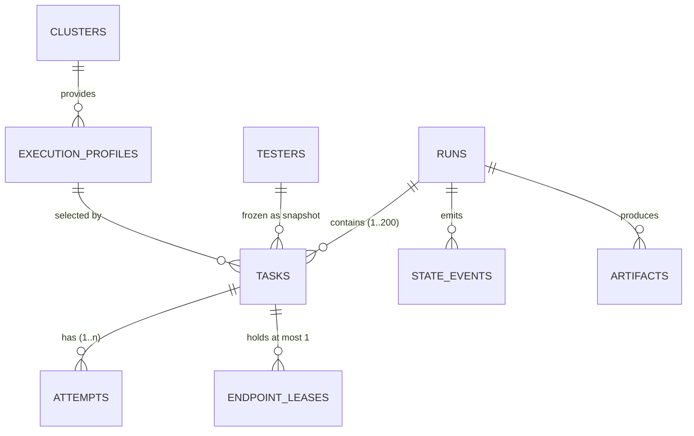
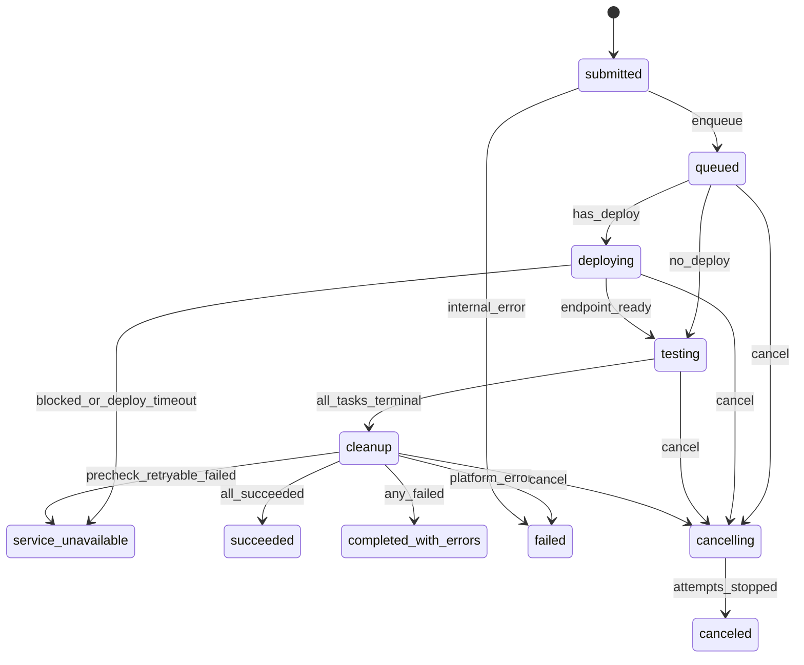
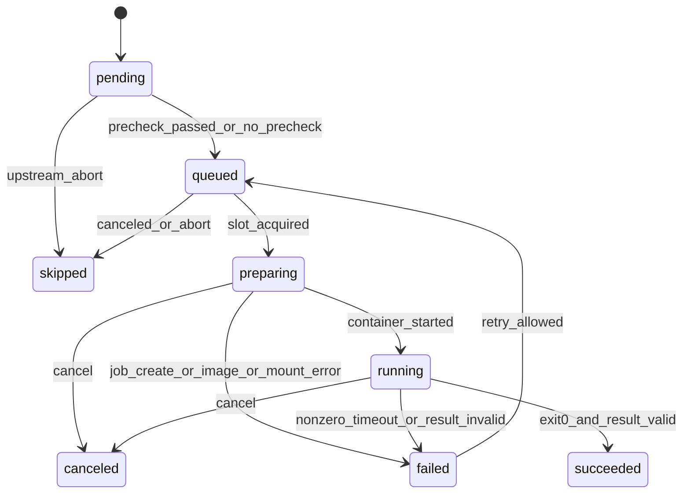
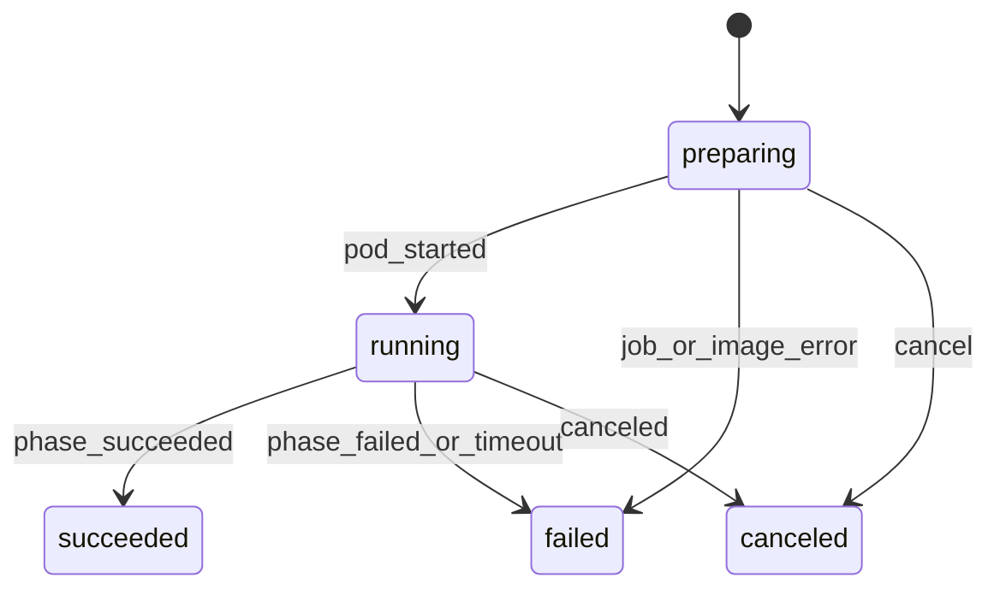
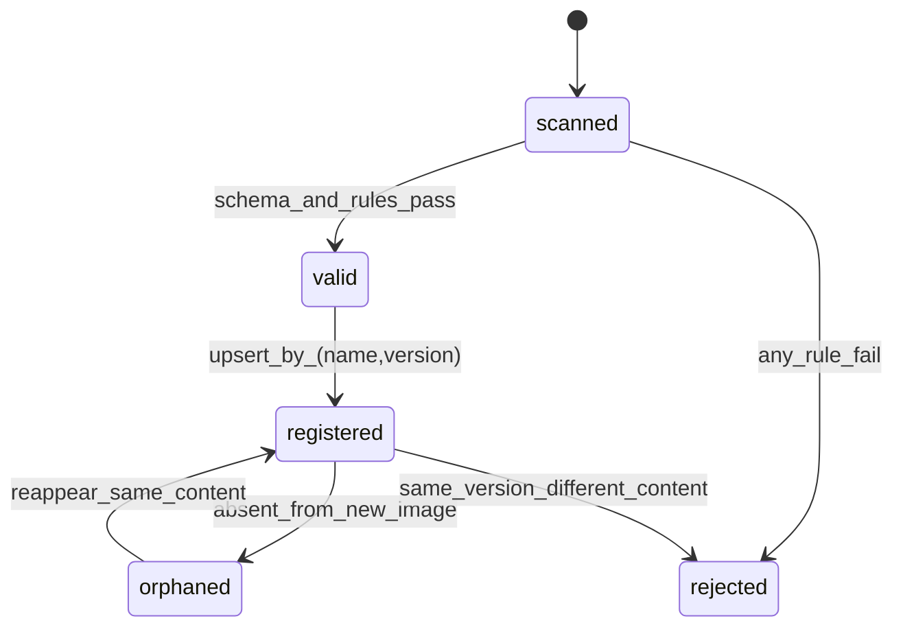

# 02 逻辑视图：领域模型、四个状态机与接口

> **覆盖：** 领域对象与聚合边界、Run / Task / Attempt(Execution) / Tester 四个状态机、迁移表、状态机接口（Go）、跨实体协调、不变量。
> **不覆盖：** 表结构细节（[03](03-data-view.md)）、运行时循环与时序（[04](04-process-view.md)）、HTTP 端点（[07](07-api.md)）。
> **基准：** ARCHITECTURE v0.5；状态 token 一律小写（文档与 UI 展示大写）。

---

## 1. 领域模型

### 1.1 聚合与边界

| 聚合根 | 内部实体 | 生命周期 | 一致性边界 |
|---|---|---|---|
| **Run** | Task（1..200） | 提交到 Run 终态 | Run 状态、Task 集合、Endpoint、Deploy 快照在**一个事务**内推进 |
| **Task** | Attempt（1..n） | 从创建到终态 | Task 状态与"当前 Attempt"必须同事务；Attempt 物理字段由执行层回写 |
| **TesterCatalog** | Tester（name+version） | 随平台镜像发布，不可变 | 启动时一次性校验入库；运行期只读 |
| **ExecutionProfile / Cluster** | — | admin 维护 | 被 Task 引用时做存在性校验；不随 Run 变更 |
| **SecretRef** | — | admin 维护 | 只存引用；不进入 Run 聚合 |
| **ArtifactIndex** | — | 随 Attempt 派生 | 由报告/索引任务写，可重建 |

### 1.2 实体关系



### 1.3 值对象（不可变）

| 值对象 | 字段 | 规则 |
|---|---|---|
| `TesterRef` | name、version、image_ref、content_sha | Task 创建时冻结；后续注册表变化不影响已存在的 Task（§5.7） |
| `Endpoint` | url、model_name、model_path、protocol、key、source | 来源只有 Genet 或 Manifest `service`；`key` = `scheme://host:port` |
| `ArgsSnapshot` | raw、argv、injected_argv | raw 为提交原文；argv 为词法切分；injected 为平台追加的公共参数 |
| `RetryPolicy` | max_attempts、backoff_seconds、retry_on[] | retry_on 只能取附录 D 中 `retryable: true` 的码 |
| `Timeout` | task_seconds、deploy_seconds | Task 由平台配置 + Manifest 覆盖；Deploy 由 Profile/平台配置（默认 72h） |
| `EnvBundle` | plain map、secret refs | 明文可回显；secret 只存引用 |
| `Failure` | code、message、detail、retryable | 结构与附录 D 一致；`detail` 放现场（k8s_reason、exit_code…） |

### 1.4 外部概念（不是本平台的实体）

| 概念 | 归属 | 平台只做什么 |
|---|---|---|
| Genet Deployment | Genet | 调用、轮询、读 Endpoint、记录 Pod 拓扑与日志；不解释拓扑、不自行判定就绪 |
| K8s Job / Pod | K8s | 渲染、创建、观测、删除；不把 Job 当状态源 |
| Tester 镜像与测试算法 | Tester 维护者 | 按 argv 调用 `/tester/run.sh`，不解析参数与指标 |

---

## 2. 状态机

> 所有状态机共用一套规则：**单写者、事务内 CAS、每次转移写一条事件、终态不可逆、外部 IO 不进事务**。

### 2.1 Run 状态机



| # | from | to | 命令 | 守卫 | 同事务副作用 |
|---|---|---|---|---|---|
| R1 | `submitted` | `queued` | `Enqueue` | 事务提交成功 | 写事件；NOTIFY 调度器 |
| R2 | `queued` | `deploying` | `BeginDeploy` | Manifest 有 `deploy` | 先冻结 `runs.deploy`（`release_name`/`values_digest`/`accepted_at`）再调 Genet（**事务外**）；始终 `noWait=true` |
| R3 | `queued` | `testing` | `BeginTesting` | 无 `deploy` 或 `service` 模式 | 计算/写入 `endpoint`；预检 Task 入队（见 2.2） |
| R4 | `deploying` | `testing` | `DeployReady` | Endpoint 非空 | 回填全部 Task 的 `endpoint_key`、`injected_argv`；清空 deploy 排队字段 |
| R5 | `deploying` | `service_unavailable` | `DeployBlocked` | `endpoint.status=blocked`、Genet 终态 `failed/superseded/uninstalling/uninstalled`、404 超 180s 宽限、或超 72h 窗口（D-47 折叠，不再有独立的 `DeployTimeout` 命令） | 全部 Task → `skipped(reason)`；`failure.code=DEPLOY_BLOCKED`（可重试）+ `detail.reason` 保留后端原文 |
| R6 | `testing` | `cleanup` | `BeginCleanup` | 全部 Task 终态 | 停止日志采集意图；触发卸载判定 |
| R7 | `cleanup` | 终态 | `Finish` | 按优先级判定（下表） | 落库终态 → 异步报告 |
| R8 | 任意非终态 | `cancelling` | `Cancel` | actor 有 operator 权限 | 记取消意图；返回后异步删 Job/uninstall |
| R9 | `cancelling` | `canceled` | `Canceled` | 无进行中 Attempt（或 2min 兜底） | 未终态 Task 收口 |
| R10 | 任意非终态 | `failed` | `Fail` | 平台侧不可恢复错误 | 未终态 Task 收口；事件带 trace |

**终态判定优先级（从上到下先命中者胜）：**

1. 用户取消完成 → `canceled`
2. 平台侧错误（Genet 调用失败、K8s 持续不可用、内部异常）→ `failed`
3. Deploy `blocked` / 排队超窗 → `service_unavailable`
4. Pre-Check 失败且错误可重试 → `service_unavailable`
5. 所有非 `skipped` 的 Task 均 `succeeded` → `succeeded`
6. 其余 → `completed_with_errors`

### 2.2 Task 状态机



| # | from | to | 命令 | 守卫 | 副作用 |
|---|---|---|---|---|---|
| T1 | `pending` | `queued` | `Queue` | Pre-Check 已 `succeeded`，或 `precheck: off`；`endpoint_key` 非空 | 写 `waiting_reason`；NOTIFY |
| T2 | `pending` | `skipped` | `Skip` | `upstream_abort` / `deploy_failed` / `canceled` | 记 `status_reason` |
| T3 | `queued` | `preparing` | `Prepare` | 已持有 Run 锁、端点租约 + 全局 permit | 创建 Attempt（`idx=current_attempt+1`）、插入 `endpoint_leases`；Job 创建在事务提交后执行（见 §3.5） |
| T4 | `queued` | `skipped` | `Skip` | 同上 | 无需释放租约 |
| T5 | `preparing` | `running` | `Start` | informer 观察到容器已启动 | Attempt→`running`、`started_at` |
| T6 | `preparing` | `failed` | `Fail` | Job 创建失败 / 镜像拉取失败 / 挂载缺失 | Attempt→`failed`；释放租约 |
| T7 | `preparing` | `canceled` | `Cancel` | 无 Cas 冲突 | 删 Job、释放租约 |
| T8 | `running` | `succeeded` | `Succeed` | exit=0 且 `result.json` 通过校验 | Attempt→`succeeded`；写 Task report 意图 |
| T9 | `running` | `failed` | `Fail` | 非零退出 / 超时 / 结果缺失或非法 | Attempt→`failed`；释放租约 |
| T10 | `running` | `canceled` | `Cancel` | — | Attempt→`canceled`；释放租约 |
| T11 | `failed` | `queued` | `Retry` | 错误码 ∈ `retry_on` 且 `idx < max_attempts` | `available_at = now + backoff`；不新建 Task |

> **Pre-Check 不是独立概念**：它就是一个 `role=pre_check` 的 Task（`seq=0`），遵守同一张表；其 `on_failure` 在 `tester.yaml` 里强制为 `abort_run`。

### 2.3 Attempt（Execution）状态机

Attempt 是物理执行，状态由执行层事实驱动，**不能由业务层臆造**。



| from | to | 触发来源 | 说明 |
|---|---|---|---|
| `preparing` | `running` | informer `Pod.status.phase=Running` | 只写 `started_at`；Task 由 T5 推进 |
| `preparing` | `failed` | Job 创建错误 / `ImagePullBackOff` / `FailedMount` | 错误码 `IMAGE_PULL_FAILED` / `MOUNT_UNAVAILABLE` / `EXECUTOR_UNAVAILABLE` |
| `running` | `succeeded` / `failed` | Job 终态 + Pod 退出码 + 结果校验 | `timeout` 映射为 `failed(TASK_TIMEOUT)` |
| 任意非终态 | `canceled` | 取消 / abort_run / 超时收口 | 与自然结束竞态：CAS 先落库者胜 |

**执行事实 → 状态映射**（附录 B）：

| Job/Pod 观测 | Attempt | Task | 错误码 |
|---|---|---|---|
| Job `Complete=True`，exit=0，结果合法 | `succeeded` | `succeeded` | — |
| exit≠0 | `failed` | `failed` | `TESTER_NONZERO_EXIT`；若 `result.json` 的 `error.code` 属附录 D，用该码（Pre-Check 借此区分可重试/不可重试） |
| `DeadlineExceeded` / watchdog 到点 | `failed` | `failed` | `TASK_TIMEOUT` |
| 镜像拉取失败 | `failed` | `failed` | `IMAGE_PULL_FAILED` |
| 挂载失败 | `failed` | `failed` | `MOUNT_UNAVAILABLE` |
| Pod `Unknown` / Job 404 | `preparing|running` 保持 | 保持 | 进 90s 复核，不直接判失败 |
| 平台取消 | `canceled` | `canceled` / `skipped` | `CANCELED` |

### 2.4 Tester 状态机（注册，不是运行时）

Tester **没有运行时状态**：它是一份不可变的镜像内元数据 + 一个镜像引用。状态机只描述"注册表里的一行"：



| 状态 | 语义 | 平台行为 |
|---|---|---|
| `scanned` | 启动扫描到目录条目 | 逐项校验（15 条，见 E-10） |
| `valid` / `rejected` | 校验结果 | 只要有 `rejected`，**平台拒绝启动**（K-3：镜像内构建、无运行时同步） |
| `registered` | 已入库，可被引用 | Task 提交时按 `name+version` 解析并冻结快照 |
| `orphaned` | 新镜像里消失 | 仅标记，不删除；历史 Task 仍能解析（`removed_at`） |
| 同版本不同内容 | — | **拒绝启动**（`TESTER_VERSION_PINNED`），必须升版本 |

`Tester` 对调度的影响只有一处：`tester.yaml.concurrency.endpoint_exclusive` 决定该 Tester 的 Task 是否独占 Endpoint。**平台提供并行能力，是否并行由 Tester 维护者声明**（K-12）。

### 2.5 Deploy 子状态（Genet）

| Deploy 状态 | Run 状态 | 平台动作 |
|---|---|---|
| `queued` | `deploying` | 记录 `PodGroup.phase` + 水位计数 + 原因原文 + 已等待时长；**没有位次**（D-46）；不按分钟级超时判失败 |
| `accepted` / `deploying` | `deploying` | 轮询**两根轴**：helm `status`（`pending-*`/`deployed`/终态）与 `callInfo.endpoint.status`（`pending`/`ready`/`blocked`）；发现 Pod 即开始日志采集 |
| `ready` | `testing`（R4） | 回填 Endpoint 与 Task 参数；**`endpoint.status=ready` 只代表地址可解析**，可用性仍由 Pre-Check 服务门判定（D-45） |
| `blocked` | `service_unavailable`（R5） | 终态，附后端原因；Genet 的 `failed/superseded/uninstalling/uninstalled` 都落这里 |
| 超 72h（可配） | `service_unavailable` | 排队/部署超时，不是平台调不通；`failure.code=DEPLOY_BLOCKED` + `detail.reason=timeout` |
| 取消 | `cancelling → canceled` | 先请求 Genet 取消排队/卸载；失败只记 `CLEANUP_FAILED` |

---

### 2.6 失败续跑（retry）与状态机的边界

`retry` **不新增状态、不改既有迁移**——这是它和"同 Run 内重跑"最大的区别：

| 问题 | 结论 | 依据 |
|---|---|---|
| 重试会不会改源 Run？ | **不会**。终态 Run 不可变（T11）：状态、`state_events`、报告全部冻结。 | §2.1、§5.1 |
| 那重试做了什么？ | **创建一个新 Run**：`runs.retry_of` 指向源 Run，manifest / `cleanup_policy` 原样，`resolved.precheck` **重新解析**（服务可能已变）。 | `03 §4.2` |
| 已成功的 Task 会重跑吗？ | **不会**。复用判据：源 Task `succeeded` **且** `result.json` 通过 `report.ValidateResult`。复用的 Task 直接落 `succeeded`、`attempt_no = 0`（**不产生 Attempt**），`tasks.reused_from_task_id` 指向源 Task。 | `03 §4.2` |
| 复用 Task 的产物在哪？ | 复制/硬链接到新 Run 自己的 `tasks/<task>/reused/`，路径前缀属于新 Run——这样 `/runs/{id}/files?path=` 与产物清单不需要为复用开特例。 | `03 §4.2` |
| 什么时候拒绝？ | 源 Run 非终态、源 Run `canceled`、同 `retry_of` 下已有非终态子 Run（`409 CONFLICT` + `detail.reason`）、没有可复用/可重跑项（`retryable=false` + `nothing_to_retry`）。 | `07 §8` |
| "终态"以哪份列表为准？ | **一份**：`domain` 导出的终态集合（含 `completed_with_errors`），SQL 与 Go 判定共用，不得各写一遍。 | 票 #33-3 |

`POST /tasks/{id}/retry` 是**另一条路径**：只给单个 Task 追加一次 Attempt（T11 `failed → queued` / T12 `skipped → queued`），不建新 Run、不涉及复用。允许的状态是 **`failed` 与 `skipped`**（`skipped` 多是上游失败连带跳过，重跑它有意义）；`succeeded` / 运行中 → 409。

## 3. 状态机接口设计（Go）

### 3.1 原则

1. **一个泛型内核 + 每实体一层类型化门面**：内核只认"转移请求"，门面提供 `Enqueue()`、`Succeed()` 这类语义方法。
2. **命令不是直接改字段**：所有状态变更都走 `Kernel.Apply(tx, Transition)`，由它做 CAS、分配事件 seq、写 `state_events`。
3. **守卫（guard）返回业务错误，副作用（effect）只写本事务**；外部 IO（K8s/Genet/NFS）一律在事务外，结果回来再开新事务。
4. **幂等**：目标状态等于当前状态 → `Noop`（不写事件）；当前状态不在 `From` 集合 → `ErrConflict`。
5. **事件是事实**：`state_events` 兼作 outbox；事务提交后 `NOTIFY`，SSE 与 jsonl writer 都消费它。

### 3.2 类型与转移请求

```go
package domain

type RunStatus string
type TaskStatus string
type AttemptStatus string

const (
    RunSubmitted  RunStatus = "submitted"
    RunQueued     RunStatus = "queued"
    // ... deploying / testing / cleanup / cancelling / 终态
    TaskPending   TaskStatus = "pending"
    TaskQueued    TaskStatus = "queued"
    // ... preparing / running / succeeded / failed / canceled / skipped
)

// Transition 是一次状态变更的完整描述；由调用方构造，Kernel 负责校验与落库。
type Transition struct {
    Entity  EntityType      // run | task | attempt
    ID      string          // run_id / task_id / attempt_id
    From    []Status        // 允许的前置状态集合（CAS 条件）
    To      Status
    Command string          // enqueue / deploy_ready / succeed / cancel ...
    Reason  string          // 写入 status_reason 或事件 reason
    Actor   string          // user:<id> | system:<component>
    Payload map[string]any  // 事件附加信息（不含凭据）
}
```

### 3.3 内核接口

```go
// Kernel 是唯一能改状态的地方；调用方必须已经在一个数据库事务里。
type Kernel interface {
    Apply(ctx context.Context, tx Tx, tr Transition) (Applied, error)
}

type Applied struct {
    From, To Status
    Seq      int64  // 该 Run 的事件序号
    Noop     bool   // 已是目标状态
}

var (
    ErrConflict     = errors.New("state conflict")       // 并发/非法前置
    ErrIllegalState = errors.New("illegal transition")   // 转移表不存在
    ErrPrecondition = errors.New("precondition failed")  // 守卫不通过
)
```

`Apply` 的事务内动作（顺序固定）：

1. 校验 `(entity, from→to)` 在转移表内，否则 `ErrIllegalState`；
2. `SELECT ... FOR UPDATE` 锁实体行；**调用方必须先锁 Run**（统一顺序：Run → Task → Attempt，批量按 id 升序；Task 转移的调用方负责，Kernel 不重复锁 Run）；
3. 若当前状态 == `To` → 返回 `Noop`；若不在 `From` → `ErrConflict`；
4. `UPDATE ... SET status=..., status_reason=... WHERE id=? AND status IN (from)`（CAS 双保险）；
5. `UPDATE runs SET last_event_seq = last_event_seq + 1 RETURNING last_event_seq` 分配 seq；
6. `INSERT INTO state_events(...)`；
7. 执行本转移的 `effects`（只允许 DB 写，见 3.5）；
8. 返回；提交后由上层 `NOTIFY`。

### 3.4 类型化门面

```go
type RunMachine interface {
    Enqueue(ctx context.Context, runID, actor string) error
    BeginDeploy(ctx context.Context, runID, deployID string) error
    DeployReady(ctx context.Context, runID string, ep Endpoint) error
    DeployBlocked(ctx context.Context, runID string, f Failure) error
    BeginTesting(ctx context.Context, runID string) error
    BeginCleanup(ctx context.Context, runID, reason string) error
    Finish(ctx context.Context, runID string, outcome RunOutcome) error
    Cancel(ctx context.Context, runID, actor string) error
    Fail(ctx context.Context, runID string, f Failure) error
}

type TaskMachine interface {
    Queue(ctx context.Context, taskID string) error
    Prepare(ctx context.Context, taskID string, attempt AttemptRef) error
    Start(ctx context.Context, taskID string) error
    Succeed(ctx context.Context, taskID string, r ResultSummary) error
    Fail(ctx context.Context, taskID string, f Failure, retryAllowed bool) error
    Cancel(ctx context.Context, taskID, actor string) error
    Skip(ctx context.Context, taskID, reason string) error
}

type AttemptMachine interface {
    Create(ctx context.Context, taskID string, idx int, jobID string) (AttemptRef, error)
    Start(ctx context.Context, attemptID string) error
    Finish(ctx context.Context, attemptID string, r AttemptResult) error   // 内部 CAS，先落库者胜
    Cancel(ctx context.Context, attemptID, reason string) error
}
```

门面只做三件事：参数校验 → 构造 `Transition`（含 `From` 集合与 `effects`）→ 调 `Kernel.Apply`。**不得**自己拼 SQL 改状态。

Tester 不是状态机门面，而是只读目录：

```go
type TesterCatalog interface {
    // 启动时调用一次；有 rejected / 同版本内容变化 → 返回错误，平台拒绝启动（K-3）
    SyncImageSnapshot(ctx context.Context, dir string) (SyncDiff, error)
    Resolve(ctx context.Context, name, version string) (TesterSpec, error)
    List(ctx context.Context, f TesterFilter) ([]TesterSpec, error)
}
```

### 3.5 Effects：转移的附带动作

`effects` 只能是**同事务 DB 写**，典型有：

| effect | 触发转移 | 内容 |
|---|---|---|
| `releaseLeases(taskID)` | Task 终态、preparing→failed/canceled | `DELETE endpoint_leases` |
| `queueTasksAfterPrecheck(runID)` | Task(precheck) `succeeded` | 批量 `pending → queued`（可复用同一 Kernel 循环） |
| `skipUnfinished(runID, reason)` | Run `cancelling` / Task `abort_run` | 批量 `skipped` |
| `markCancelRequested(taskID)` | 取消/超时 | 置位，供 executor 异步删 Job |
| `writeReportIntent(taskID)` | Task `succeeded` | 插 `state_events(report.pending)` 或入队标记 |
| `scheduleRetry(taskID, backoff)` | Task `failed → queued` | 更新 `available_at` |

外部动作（建 Job、删 Job、Genet 调用、写报告文件）由 orchestrator 在事务**之后**执行；失败以新命令回到状态机（如 `Fail`），不悬挂事务。

### 3.6 错误语义

| 错误 | 含义 | 调用方处理 |
|---|---|---|
| `ErrConflict` | 并发修改或前置状态已变 | 重读当前状态；幂等命令（如取消）视为成功；否则记录 `state_race_lost` 并放弃本次结论 |
| `ErrIllegalState` | 转移表不允许 | 编程错误，记录 ERROR + trace，不重试 |
| `ErrPrecondition` | 守卫不通过（如 Endpoint 空、缺 permit） | 拒绝本次推进，调度器下一轮重试 |
| `ErrNotFound` | 实体不存在 | 404 / 跳过 |
| `ErrTx`（DB） | 事务/连接失败 | 有界重试（指数退避，最多 3 次）；仍失败则告警并留给对账 |

### 3.7 事件发布与幂等

- `state_events` 是唯一事件源；`run.last_event_seq` 保证每 Run 单调。
- 事务提交后调用 `Notifier.Notify(runID, seq)`；SSE 只带 `run_id+seq`，客户端按 seq 去重。
- `events.jsonl` 与 SSE 都是 `state_events` 的派生；重启后按 seq 补齐（幂等）。
- **提交不做幂等**（D-37）：每次 `POST /runs` / `POST /tasks` 都创建新资源，没有 `Idempotency-Key`、没有提交指纹、不判重。状态命令用 `Noop` 语义；内部操作（同一 `run_id` 的 Genet 部署、同一 `job_id` 的 Job 创建）才需要"重复执行不产生副作用"。

### 3.8 并发与锁顺序

| 场景 | 锁 | 规则 |
|---|---|---|
| 单实体转移 | 先 `SELECT runs ... FOR UPDATE`，再 `SELECT tasks ... FOR UPDATE` | 统一顺序 Run → Task → Attempt；同 Run 的并发推进入口全部经 Run 行锁串行化，避免与 abort/取消交叉 |
| 批量转移（abort/skip） | Run 行锁 → Task 行锁（按 id 升序） | 持 Run 锁后批量 Update，天然与调度器互斥 |
| 端点互斥 | `pg_advisory_xact_lock(hash(endpoint_key))` | 在 Run 锁之后获取；事务结束自动释放 |
| 全局并发 | `pg_advisory_xact_lock('testplane:global-concurrency')` + count | 只包住"取 permit + 建 Attempt"；排在端点锁之后；锁名常量只允许一处定义（C-4.4） |
| 调度取活 | 普通 `SELECT` 候选（不加行锁）→ 逐候选锁 Run → CAS Task | 短事务，不跨外部 IO；CAS 兜住并发 |

---

## 4. 跨实体协调

| 触发 | 发起方 | 同事务内 | 事务外 |
|---|---|---|---|
| 提交 Run | API | 插 Run + Task + `submitted` 事件 | NOTIFY |
| Pre-Check 成功 | Task 门面 | Task→succeeded；批量 Task→queued；事件 | NOTIFY |
| Task 失败 + continue | Task 门面 | Task→failed（或 retry→queued）；不碰其他 Task | 写报告意图 |
| Task 失败 + abort_run | Task 门面 | 其余 Task→skipped；置 `cancel_requested`；事件 | 删 Job |
| 全部 Task 终态 | Orchestrator | Run `testing → cleanup` | 卸载 Genet、停采集 |
| Deploy ready | Orchestrator | Run→testing；回填 endpoint_key/injected_argv | 启动日志采集 |
| 取消 Run | API → Orchestrator | Run→cancelling；未开始 Task→skipped | 删 Job / Genet 取消 |
| Controller 重启 | Reconciler | 无状态转移（先读库） | 查 K8s/Genet，按事实补命令 |

> **没有提交幂等**（D-37）：每次提交都创建新 Run；平台不判断两次提交是否等价——硬件、驱动、HDK 版本等环境因素对平台透明，相同 Manifest 也可能是不同测试条件。重复提交的代价由提交者承担（可取消）。内部操作（Genet 部署、建 Job）仍须可重试安全，但那是实现细节，不是接口承诺。
>
> **镜像事实**：执行层从 Pod 的 `imageID` 解析出实际 digest，写入 `attempts.image_digest`；它不参与状态判定，只用于事后回答"同一个 tag 当时到底跑的是哪份代码"。

**禁止的跨实体写法**：Task 门面里直接改 `runs.status`；API 直接改 `attempts.status`；报告/日志模块改状态。

---

## 5. 不变量与一致性任务

| 不变量 | 保障 | 校验任务 |
|---|---|---|
| 一个 Task 至多一个活跃 Attempt | 部分唯一索引 `attempts_active_uq` | 每小时扫描 |
| `attempts.idx` 从 1 连续 | `current_attempt + 1` + 唯一约束 | 每夜 |
| 终态不可逆 | 转移表 + CAS | 每夜全表 |
| 事件 seq 连续唯一 | `runs.last_event_seq` + `UNIQUE(run_id,seq)` | 每小时 |
| Run 终态时所有 Task 终态 | `Finish` 前断言 | 每 10 分钟（悬挂 Run） |
| `queued` 的 Task 必有 `endpoint_key` | 调度守卫 | 调度前 |
| `skipped` 必有 `reason`；`failed` 必有 `error.code` | 报告生成前断言 | 每 Run 终态 |
| 历史 Attempt 不被覆盖 | 只追加、按 idx 分目录 | 每夜 |

一致性任务只**告警并修复可安全修复的项**（如补齐事件），不擅自改终态；需要人工判断的列清单交给 admin。

---

## 6. 状态机与外部边界的契约

| 边界 | 输入 | 输出 | 平台不做什么 |
|---|---|---|---|
| Tester | argv、env、`/workspace/output` | 退出码 + `result.json` | 不解析参数语义、不校验指标、不判达标 |
| Executor | Job Spec（附录 B） | Job/Pod 事实 + 日志流 | 不做业务状态判断 |
| Genet | deploy 参数 | Endpoint + 状态 + Pod 选择器 | 不解释拓扑、不自行判定就绪 |
| K8s/Volcano | Job/Pod/Queue | 调度事实 | 不写回调度器、不插队 |
| 下游 | Run/Task id | report / artifact / events | 不做 Gate 判定、不做 BI |

---

## 7. 扩展点

| 需求 | 做法 | 契约影响 |
|---|---|---|
| P1 跨 Run 续跑 | 已有 `runs.retry_of`、`tasks.reused_from_task_id`；新增 `RetryFromRun` 命令 | 不改状态机，只加一条"复用校验"守卫 |
| 新错误码 | 附录 D + 迁移；`error.code` 是自由字符串但只允许枚举值 | 无结构变更 |
| 新状态 | 追加转移表 + CHECK + 前端映射 | 属契约变更，走 §15 |
| Matrix 展开 | 提交前的纯函数（`args` → 多个 Task） | 不改状态机 |
| 指标入 MongoDB | 报告生成时写一份到 Mongo（P1） | 不改 Run/Task 模型 |
