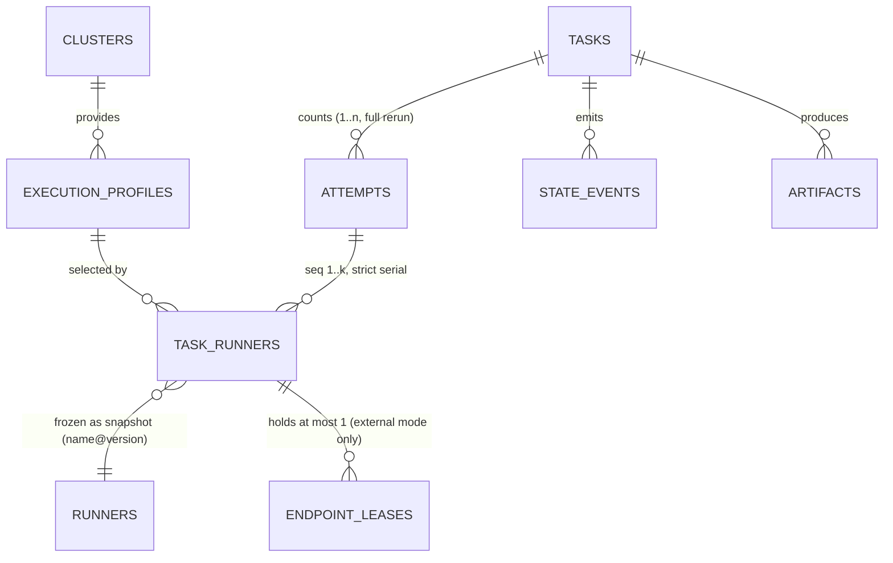
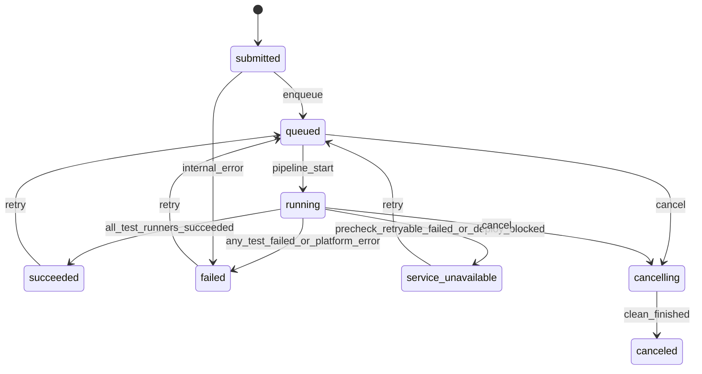
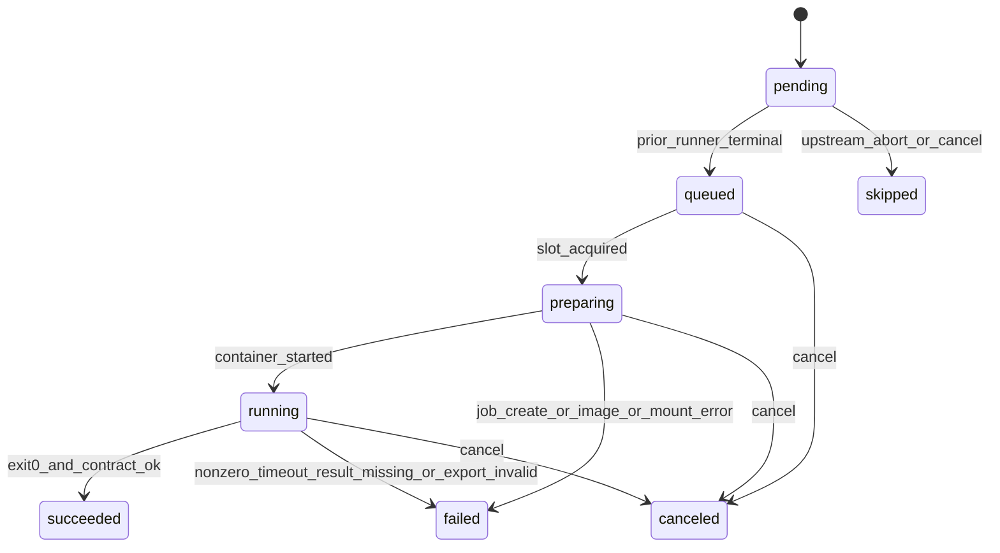
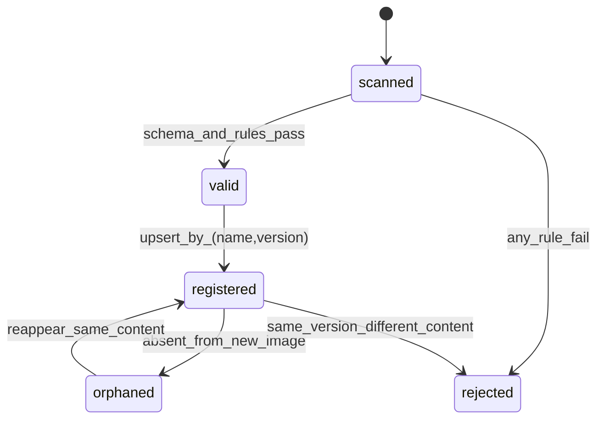

# 02 逻辑视图：领域模型、状态机与接口

> **覆盖：** 领域对象与聚合边界、Task / runner 两个状态机与 attempt 计数模型、Runner 注册状态机、部署子状态（deploy-state.json）、迁移表、状态机接口（Go）、跨实体协调、不变量。
> **不覆盖：** 表结构细节（[03](03-data-view.md)）、运行时循环与时序（[04](04-process-view.md)）、HTTP 端点（[07](07-api.md)）。
> **基准：** ARCHITECTURE v2.0；状态 token 一律小写（文档与 UI 展示大写）。
> **v2 结构说明：** v1 的"四个状态机"（Run / Task / Attempt / Tester）在 v2 重构为 **Task（平台层）+ runner（实例层）+ Runner（注册）** 三个状态机；attempt 不再是物理执行实体，降为 Task 级计数与归组（D-68），其物理事实全部并入 runner 执行记录。

---

## 1. 领域模型

### 1.1 聚合与边界

| 聚合根 | 内部实体 | 生命周期 | 一致性边界 |
|---|---|---|---|
| **Task** | runner（`task_runners`，用户 ≤200 + 注入的 service-deploy / pre_check / service-clean）、attempt 计数（1..n） | 提交到 Task 终态 | Task 状态、runner 管道、静态导出（外接 service）、部署状态归档在**一个事务**内推进 |
| **RunnerRegistry** | Runner（name+version） | 随平台镜像发布，白名单注册，不可变 | 启动时一次性校验入库；运行期只读；`role: deploy/clean` 仅内置，用户注册直接拒绝 |
| **ExecutionProfile / Cluster** | — | admin 维护 | 被 runner 引用时做存在性校验；不随 Task 变更 |
| **SecretRef** | — | admin 维护 | 只存引用；不进入 Task 聚合 |
| **ArtifactIndex** | — | 随 attempt / runner 目录派生 | 由报告/索引任务写，可重建 |

### 1.2 实体关系



### 1.3 值对象（不可变）

| 值对象 | 字段 | 规则 |
|---|---|---|
| `RunnerRef` | name、version、image_ref、image_digest（实际拉取，可得时） | runner 执行记录创建时冻结；后续注册表变化不影响已存在的执行记录（§5.7） |
| `Endpoint` | url、model_name、model_path、source | 来源只有 service-deploy 的 exports 或 Manifest `service`；**Runner 不可见**，只投影成 `AG_SERVED_*` 公共参数（§5.4.1、§9.1） |
| `InputSnapshot` | raw（输入原文）、input_format、落盘路径（`attempts/<n>/input/`） | 提交时校验后原样落盘，随 attempt 可审计可复现（§5.3、D-66） |
| `InjectSnapshot` | exports 合并清单（key、value、来源 seq） | 每次注入随 attempt 落库落盘，事后可完整还原（§5.12、D-71） |
| `Timeout` | runner_seconds、deploy_seconds | runner 超时由平台配置 + Manifest `runners[].timeout_seconds` 覆盖；部署窗口由平台配置（默认 72h）；Runner 不声明时限（§6.6、附录 C） |
| `EnvBundle` | plain map、secret refs | Task 级填一次注入全部 runner；明文可回显；secret 只存引用（§12.4） |
| `Failure` | code、message、detail、retryable | 结构与附录 D（v2）一致；`detail` 放现场（k8s_reason、exit_code…）；`retryable` 仅用于 §9.3 重放与告警分级 |

（v1 的 `RetryPolicy` 与 `ArgsSnapshot` 已取消：runner 级重试不存在（§7.8）；业务输入不再走 argv，输入通道见 `InputSnapshot`。）

### 1.4 外部概念（不是本平台的实体）

| 概念 | 归属 | 平台只做什么 |
|---|---|---|
| Genet Deployment | Genet | 由**内置 service-deploy / service-clean runner** 调用；平台不直连 Genet，只读取 runner 产出的 `deploy-state.json` 与 exports；不解释拓扑、不自行判定就绪（§9.1、D-70） |
| K8s Job / Pod | K8s | 渲染、创建、观测、删除；不把 Job 当状态源 |
| Runner 镜像与测试算法 | Runner 维护者 | 按 `runner.yaml.entry`（exec form）启动，argv 恒空；不拼装命令、不解析参数与指标 |

---

## 2. 状态机

> 所有状态机共用一套规则：**单写者、事务内 CAS、每次转移写一条事件、终态不可逆、外部 IO 不进事务**。

### 2.1 Task 状态机（平台层）



| # | from | to | 命令 | 守卫 | 同事务副作用 |
|---|---|---|---|---|---|
| R1 | `submitted` | `queued` | `Enqueue` | 事务提交成功 | 写事件；NOTIFY 调度器 |
| R2 | `queued` | `running` | `BeginPipeline` | 组合期校验已通过；首个 runner（service-deploy / pre_check / 首个 test）可入队 | **没有独立的 `deploying` / `cleanup` / `precheck` 平台阶段**（v2 取消，D-70）：部署就是管道第一个 runner 在跑，前端按 runner 时间线呈现链路（§7.4） |
| R3 | `running` | `succeeded` | `Finish` | 全部非 `skipped` 的测试类 runner `succeeded`，且 service-clean 已执行（finally） | 落库终态 → 异步报告；clean 失败只打 `cleanup_failed` 不改终态 |
| R4 | `running` | `failed` | `Finish` | 存在测试类 runner `failed`（`continue` 放行走完），或平台侧编排异常（service-deploy 调 Genet 失败 `DEPLOY_FAILED`、Executor 不可用、内部错误） | 未执行 runner 收口 `skipped`；事件带 trace |
| R5 | `running` | `service_unavailable` | `Finish` | pre_check 失败且错误可重试（窗口内一直未就绪），或 service-deploy 失败且 `deploy-state.json` 归类 Genet 受理但未就绪（`DEPLOY_BLOCKED`） | 未执行 runner 收口 `skipped`；pre_check 不可重试失败归 `failed`（D-35） |
| R6 | 任意非终态 | `cancelling` | `Cancel` | actor 有 operator 权限 | 记取消意图；未执行 runner `skipped(canceled)`；终止当前 runner |
| R7 | `cancelling` | `canceled` | `Canceled` | service-clean 已执行（含部署时）或无部署；或 2min 兜底 | clean 失败记 `cleanup_failed` 不改终态，进 §9.3 重放清单 |
| R8 | `submitted` | `failed` | `Fail` | 平台侧不可恢复错误 | runner 收口；事件带 trace |
| R9 | `succeeded` / `failed` / `service_unavailable` | `queued` | `Retry` | Task 已终态且**非 `canceled`**（取消不可重试）；`attempt_no` 未达上限（超限 409 `ATTEMPT_EXHAUSTED`） | `attempt_no + 1` 全量重跑，**含 fresh deploy**（§7.8：不得复用上次已部署服务）；写事件；NOTIFY 调度器 |

**终态判定优先级（从上到下先命中者胜，§7.5）：**

1. 用户取消完成 → `canceled`
2. 平台侧错误（service-deploy 调 Genet 失败、K8s 持续不可用、内部异常）→ `failed`
3. 部署 `blocked` / 超部署窗口（`DEPLOY_BLOCKED`）→ `service_unavailable`
4. pre_check 失败且错误可重试 → `service_unavailable`
5. 所有非 `skipped` 的测试类 runner 均 `succeeded` → `succeeded`
6. 其余（存在测试类 runner `failed` 且策略放行走完）→ `failed`（v1 的 `completed_with_errors` 并入此态，D-73）

### 2.2 runner 状态机（实例层）



| # | from | to | 命令 | 守卫 | 副作用 |
|---|---|---|---|---|---|
| T1 | `pending` | `queued` | `Queue` | **严格串行**：`seq-1` 已终态且未被 abort；外接模式下还需 Endpoint 槽位（`endpoint_exclusive`）或全局 permit | 写 `waiting_reason`；NOTIFY |
| T2 | `pending` | `skipped` | `Skip` | `upstream_abort` / `canceled` / 部署失败收口 | 记 `reason`（必填，D-06） |
| T3 | `queued` | `preparing` | `Prepare` | 全局 permit（+ 外接模式 Endpoint 租约）；Job 创建在事务提交后执行（见 §3.5） | 创建执行记录，定位键 `(task_id, attempt_no, seq)` |
| T4 | `queued` | `canceled` | `Cancel` | — | 无需释放租约 |
| T5 | `preparing` | `running` | `Start` | informer 观察到容器已启动 | 写 `started_at` |
| T6 | `preparing` | `failed` | `Fail` | Job 创建失败 / 镜像拉取失败 / 挂载缺失 | 释放租约（外接模式） |
| T7 | `preparing` | `canceled` | `Cancel` | 无 CAS 冲突 | 删 Job、释放租约 |
| T8 | `running` | `succeeded` | `Succeed` | exit=0 且契约满足（test / pre_check 三选一产物至少其一：`result.json` / `result.html` / `result.csv`，由 Runner 决定，不强求 `result.json`，D-74；`exports.env` 可解析） | 收割 exports 落档；写报告意图；放行 `seq+1` |
| T9 | `running` | `failed` | `Fail` | 非零退出 / 超时（`RUNNER_TIMEOUT`）/ 三选一产物全缺失（`RESULT_MISSING`）或 `result.json` 产出但不合法（`RESULT_INVALID`）/ 导出解析失败（`EXPORT_INVALID`） | 不收割 exports；释放租约 |
| T10 | `running` | `canceled` | `Cancel` | — | 释放租约 |

> **没有重试回路**：`FAILED` 是终态（v2 取消 v1 的 `failed → queued` 自动重试，§7.8、D-69）。抖动自愈（连接重试、等待就绪）在 entry 内部完成（§5.3、§5.11）。
>
> **pre_check / deploy / clean 不是独立概念**：它们就是对应 role 的 runner，遵守同一张表；`role: pre_check` 与内置 `deploy` / `clean` 的 `on_failure` 在 `runner.yaml` 里强制为 `abort_task`（§7.3）。service-deploy 与 service-clean 由平台按提交配置**自动配对注入**，用户不手动添加（§3、§10.1、D-70）。

### 2.3 attempt 模型（Task 级计数，无独立状态机）

attempt 是 Task 的第 N 次全量执行；runner 在每次 attempt 内按序执行**恰好一次**。

- `attempt_no` 从 1 递增，上限由平台配置（默认 3，超出 `ATTEMPT_EXHAUSTED`，§12.7）；runner 执行记录由 `(task_id, attempt_no, seq)` 唯一定位，`seq` 从 1 递增（含注入的 deploy / precheck / clean）。
- **attempt 不再是物理执行实体**（v2 取代 D-07 的 per-Attempt 状态机）：`preparing` / `running` 等物理事实全部记在 runner 执行记录上；attempt 只承载归组——输入落盘目录、exports 落档、`deploy-state.json` 副本、产物路径 `attempts/<n>/`（§7.2、§8.1、D-68）。
- 重试 = 整 Task 新 attempt **全量重跑含 fresh deploy**；历史 attempt 不覆盖，只追加（§7.8、D-69）。

**执行事实 → 状态映射**（附录 B）：

| Job/Pod 观测 | runner | 错误码 |
|---|---|---|
| Job `Complete=True`，exit=0，三选一产物至少其一，导出可解析 | `succeeded` | — |
| exit≠0 | `failed` | `RUNNER_NONZERO_EXIT`；若产出 `result.json` 且其 `error.code` 属附录 D，用该码（pre_check 借此区分可重试/不可重试；失败时产出带 `error` 的 `result.json` 是软要求，D-74） |
| `DeadlineExceeded` / watchdog 到点 | `failed` | `RUNNER_TIMEOUT` |
| 镜像拉取失败 | `failed` | `IMAGE_PULL_FAILED` |
| 挂载失败 | `failed` | `MOUNT_UNAVAILABLE` |
| exit=0 但 `exports.env` 解析失败 | `failed` | `EXPORT_INVALID`（下游不注入，§5.12） |
| exit=0 但三选一产物全缺失 | `failed` | `RESULT_MISSING`（D-74：`result.json` / `result.html` / `result.csv` 均无） |
| Pod `Unknown` / Job 404 | `preparing|running` 保持 | 进 90s 复核，不直接判失败 |
| 平台取消 | `canceled` / `skipped` | `CANCELED` |

### 2.4 Runner 状态机（注册，不是运行时）

Runner **没有运行时状态**：它是一份不可变的镜像内元数据（`runner.yaml`）+ 一个镜像引用。状态机只描述"注册表里的一行"：



| 状态 | 语义 | 平台行为 |
|---|---|---|
| `scanned` | 启动扫描到 `runners/*/` 根目录的 `runner.yaml` | 逐项校验：字段完整性、`entry` 非空且为 exec form 数组、`input_format` 合法、`parameters` / `exports` / `consumes` 结构合法、`on_failure` 枚举合法 |
| `valid` / `rejected` | 校验结果 | 只要有 `rejected`，**平台拒绝启动**（K-3：镜像内构建、无运行时上传） |
| `registered` | 已入库，可被引用 | Task 提交时按 `name+version` 解析并冻结快照 |
| `orphaned` | 新镜像里消失 | 仅标记，不删除；历史执行记录仍能解析（对外字段名 `retired`，同义，§5.6.1 / D-60） |
| 同版本不同内容 | — | **拒绝启动**（`RUNNER_VERSION_PINNED`），必须升版本 |
| 用户目录声明 `role: deploy` / `role: clean` | — | **注册直接拒绝**（仅内置，§5.1） |

`Runner` 对调度的影响只有一处：`runner.yaml.concurrency.endpoint_exclusive` 在**外接模式**下决定该 runner 执行期间是否独占 Endpoint（§6.7 v2 收窄；部署模式下服务是 Task 私有，声明冗余无害）。

### 2.5 部署子状态（deploy-state.json，service-deploy 产出）

平台状态机没有 `DEPLOYING` 阶段；下表是 service-deploy runner 周期改写、平台归档的 `deploy-state.json` 状态（§9.1、D-70）：

| deploy-state `phase` | Task 状态 | 平台动作 |
|---|---|---|
| `queued` | `running` | 展示水位 + 原因 + 已等待时长（**没有位次**，D-46）；不按分钟级超时判失败；平台归档副本 |
| `accepted` / `deploying` | `running` | 同上；`pod_count` / `label_selector` 出现后 collector 开始按 Pod 采日志（§9.2） |
| `ready` | `running` | service-deploy 退出 0，收割 exports 四件套；**`endpoint.status=ready` 只代表地址可解析**，可用性仍由 pre_check 判定（D-45） |
| `blocked` | `running`（即将终态） | service-deploy 以 `DEPLOY_BLOCKED` 退出；Genet 的 `failed/superseded/uninstalling/uninstalled` 都折叠到这里（D-47） |
| 超部署窗口（默认 72h，平台配置） | `running`（即将终态） | service-deploy 判失败（`detail.reason=timeout`）；Task 终态 `service_unavailable` |
| 取消 | `cancelling → canceled` | 终止 service-deploy runner；已创建资源由 service-clean finally 幂等拆除；失败只记 `CLEANUP_FAILED` |

> 平台不再直接轮询 Genet（v1 控制面的 `genet.poller` / `genet.uninstall` 循环取消）：轮询发生在 service-deploy runner 进程内，卸载动作移入 service-clean，平台只消费它们写出的状态与导出（§9.1、D-54、D-70）。

### 2.6 重试与状态机的边界

`retry` **不新增状态、不改既有迁移**——v2 的重试语义收敛为一条（§7.8、D-69）：

| 问题 | 结论 | 依据 |
|---|---|---|
| 重试会不会改历史 attempt？ | **不会**。attempt 只追加：新 attempt 全量重跑，历史 runner 记录、日志、产物、exports 落档全部冻结。 | §7.2、§7.8 |
| 那重试做了什么？ | `attempt_no + 1`：同一 Task 按原管道全量重跑，**含 fresh deploy**——不得复用上一次 attempt 的已部署服务（warm cache / 残留连接污染测量）。 | §7.8、D-69 |
| runner 失败能单独重跑吗？ | **不能**。runner 级没有平台重试（v1 `retry.max_attempts` / `retry_on` 取消）；抖动自愈归 entry。 | §7.8、§5.8 |
| 什么时候拒绝？ | `attempt_no` 达上限 → `409 ATTEMPT_EXHAUSTED`。 | 附录 D、§12.7 |
| 跨 Task 续跑？ | **P1、仅外接模式**（`retry_of` 关联 + 复用校验五要素：Runner 版本、镜像引用/digest、输入快照、Endpoint 标识等未变）；部署模式因 fresh-deploy 裁决不提供部分复用。 | §7.7、§13.2 |

`POST /tasks/{id}/retry` 是唯一的平台内重试入口：整 Task 新 attempt，不涉及部分复用。

## 3. 状态机接口设计（Go）

### 3.1 原则

1. **一个泛型内核 + 每实体一层类型化门面**：内核只认"转移请求"，门面提供 `Enqueue()`、`Succeed()` 这类语义方法。
2. **命令不是直接改字段**：所有状态变更都走 `Kernel.Apply(tx, Transition)`，由它做 CAS、分配事件 seq、写 `state_events`。
3. **守卫（guard）返回业务错误，副作用（effect）只写本事务**；外部 IO（K8s/NFS）一律在事务外，结果回来再开新事务。Genet 调用在**内置 runner 进程内**发生，天然在平台事务之外（§9.1）。
4. **幂等**：目标状态等于当前状态 → `Noop`（不写事件）；当前状态不在 `From` 集合 → `ErrConflict`。
5. **事件是事实**：`state_events` 兼作 outbox；事务提交后 `NOTIFY`，SSE 与 jsonl writer 都消费它。

### 3.2 类型与转移请求

```go
package domain

type TaskStatus string    // 平台层：task
type RunnerStatus string  // 实例层：task_runner

const (
    TaskSubmitted TaskStatus = "submitted"
    TaskQueued    TaskStatus = "queued"
    // ... running / cancelling / 终态 succeeded / failed / service_unavailable / canceled
    RunnerPending   RunnerStatus = "pending"
    RunnerQueued    RunnerStatus = "queued"
    // ... preparing / running / succeeded / failed / canceled / skipped
)

// RunnerKey 定位一次 runner 执行；v2 取代 v1 的 AttemptRef。
type RunnerKey struct {
    TaskID    string
    AttemptNo int
    Seq       int
}

// Transition 是一次状态变更的完整描述；由调用方构造，Kernel 负责校验与落库。
type Transition struct {
    Entity  EntityType      // task | task_runner
    ID      string          // task_id / task_runner key
    From    []Status        // 允许的前置状态集合（CAS 条件）
    To      Status
    Command string          // enqueue / pipeline_start / succeed / cancel ...
    Reason  string          // 写入 status_reason 或事件 reason
    Actor   string          // user:<id> | system:<component>
    Payload map[string]any  // 事件附加信息（不含凭据）
}
```

### 3.3 内核接口

```go
// Kernel 是唯一能改状态的地方；调用方必须已经在一个数据库事务里。
type Kernel interface {
    Apply(ctx context.Context, tx Tx, tr Transition) (Applied, error)
}

type Applied struct {
    From, To Status
    Seq      int64  // 该 Task 的事件序号
    Noop     bool   // 已是目标状态
}

var (
    ErrConflict     = errors.New("state conflict")       // 并发/非法前置
    ErrIllegalState = errors.New("illegal transition")   // 转移表不存在
    ErrPrecondition = errors.New("precondition failed")  // 守卫不通过
)
```

`Apply` 的事务内动作（顺序固定）：

1. 校验 `(entity, from→to)` 在转移表内，否则 `ErrIllegalState`；
2. `SELECT ... FOR UPDATE` 锁实体行；**调用方必须先锁 Task**（统一顺序：Task → runner 执行记录，批量按 seq 升序；runner 转移的调用方负责，Kernel 不重复锁 Task）；
3. 若当前状态 == `To` → 返回 `Noop`；若不在 `From` → `ErrConflict`；
4. `UPDATE ... SET status=..., status_reason=... WHERE id=? AND status IN (from)`（CAS 双保险）；
5. `UPDATE tasks SET last_event_seq = last_event_seq + 1 RETURNING last_event_seq` 分配 seq；
6. `INSERT INTO state_events(...)`；
7. 执行本转移的 `effects`（只允许 DB 写，见 3.5）；
8. 返回；提交后由上层 `NOTIFY`。

### 3.4 类型化门面

```go
type TaskMachine interface {
    Enqueue(ctx context.Context, taskID, actor string) error
    BeginPipeline(ctx context.Context, taskID, actor string) error          // queued → running：首个 runner 入队（无部署阶段）
    Finish(ctx context.Context, taskID string, outcome TaskOutcome) error   // running → 终态，按 §2.1 优先级判定
    Cancel(ctx context.Context, taskID, actor string) error
    Fail(ctx context.Context, taskID string, f Failure) error
}

type RunnerMachine interface {
    Queue(ctx context.Context, taskID string, key RunnerKey) error
    Prepare(ctx context.Context, taskID string, key RunnerKey) error
    Start(ctx context.Context, taskID string, key RunnerKey) error
    Succeed(ctx context.Context, taskID string, key RunnerKey, r ResultSummary) error
    Fail(ctx context.Context, taskID string, key RunnerKey, f Failure) error
    Cancel(ctx context.Context, taskID string, key RunnerKey, actor string) error
    Skip(ctx context.Context, taskID string, key RunnerKey, reason string) error
}
```

门面只做三件事：参数校验 → 构造 `Transition`（含 `From` 集合与 `effects`）→ 调 `Kernel.Apply`。**不得**自己拼 SQL 改状态。

Runner 定义不是状态机门面，而是只读目录：

```go
type RunnerCatalog interface {
    // 启动时调用一次；有 rejected / 同版本内容变化 → 返回错误，平台拒绝启动（K-3）
    SyncImageSnapshot(ctx context.Context, dir string) (SyncDiff, error)
    Resolve(ctx context.Context, name, version string) (RunnerSpec, error)
    List(ctx context.Context, f RunnerFilter) ([]RunnerSpec, error)
}
```

### 3.5 Effects：转移的附带动作

`effects` 只能是**同事务 DB 写**，典型有：

| effect | 触发转移 | 内容 |
|---|---|---|
| `releaseLeases(key)` | runner 终态、preparing→failed/canceled（外接模式） | `DELETE endpoint_leases` |
| `queueNextRunner(taskID)` | runner `succeeded` 或 `failed(continue)` | 严格串行放行 `seq+1`（取代 v1 的门控批量入池） |
| `skipUnfinished(taskID, reason)` | abort_task 传播 / 取消 | 批量 `skipped`（传播到 clean 为止） |
| `harvestExports(key)` | runner `succeeded` | 解析 `exports.env` → 落档 + 合并清单（解析失败改走 `Fail(EXPORT_INVALID)`，§5.12） |
| `scheduleCleanIfNeeded(taskID)` | 测试类 runner 全部终态 / abort 传播完成 / 取消 | service-clean 入队（finally，§7.6） |
| `markCancelRequested(key)` | 取消/超时 | 置位，供 executor 异步删 Job |
| `writeReportIntent(key)` | runner 终态 | 插 `state_events(report.pending)` 或入队标记 |

外部动作（建 Job、删 Job、写报告文件）由 orchestrator 在事务**之后**执行；失败以新命令回到状态机（如 `Fail`），不悬挂事务。（v1 的 `scheduleRetry` effect 已随 runner 级重试取消。）

### 3.6 错误语义

| 错误 | 含义 | 调用方处理 |
|---|---|---|
| `ErrConflict` | 并发修改或前置状态已变 | 重读当前状态；幂等命令（如取消）视为成功；否则记录 `state_race_lost` 并放弃本次结论 |
| `ErrIllegalState` | 转移表不允许 | 编程错误，记录 ERROR + trace，不重试 |
| `ErrPrecondition` | 守卫不通过（如缺 permit、`seq-1` 未终态） | 拒绝本次推进，调度器下一轮重试 |
| `ErrNotFound` | 实体不存在 | 404 / 跳过 |
| `ErrTx`（DB） | 事务/连接失败 | 有界重试（指数退避，最多 3 次）；仍失败则告警并留给对账 |

### 3.7 事件发布与幂等

- `state_events` 是唯一事件源；`tasks.last_event_seq` 保证每 Task 单调。
- 事务提交后调用 `Notifier.Notify(taskID, seq)`；SSE 只带 `task_id+seq`，客户端按 seq 去重。
- `events.jsonl` 与 SSE 都是 `state_events` 的派生；重启后按 seq 补齐（幂等）。
- **提交不做幂等**（D-37）：每次 `POST /tasks` / `POST /tasks/{id}/retry` 都按语义创建新资源或新 attempt，没有 `Idempotency-Key`、没有提交指纹、不判重。状态命令用 `Noop` 语义；内部操作（同一 `(task_id, attempt_no, seq)` 的 Job 创建）才需要"重复执行不产生副作用"。

### 3.8 并发与锁顺序

| 场景 | 锁 | 规则 |
|---|---|---|
| 单实体转移 | 先 `SELECT tasks ... FOR UPDATE`，再 `SELECT task_runners ... FOR UPDATE` | 统一顺序 Task → runner 执行记录（按 seq 升序）；同 Task 的并发推进入口全部经 Task 行锁串行化，避免与 abort/取消交叉 |
| 批量转移（abort/skip） | Task 行锁 → runner 行锁（按 seq 升序） | 持 Task 锁后批量 Update，天然与调度器互斥 |
| 端点互斥 | `pg_advisory_xact_lock(hash(endpoint_key))` | **仅外接模式**；在 Task 锁之后获取；事务结束自动释放 |
| 全局并发 | `pg_advisory_xact_lock('argus:global-concurrency')` + count | 只包住"取 permit + 建执行记录"；排在端点锁之后；锁名常量只允许一处定义（C-4.4） |
| 调度取活 | 普通 `SELECT` 候选（不加行锁）→ 逐候选锁 Task → CAS runner | 短事务，不跨外部 IO；CAS 兜住并发 |

---

## 4. 跨实体协调

| 触发 | 发起方 | 同事务内 | 事务外 |
|---|---|---|---|
| 提交 Task | API | 插 Task + runner 列表 + `submitted` 事件 | NOTIFY |
| runner 成功（串行推进） | runner 门面 | runner→succeeded；收割 exports 落档；放行 `seq+1`；事件 | NOTIFY |
| runner 失败 + continue | runner 门面 | runner→failed；放行 `seq+1`；不碰其他 runner | 写报告意图 |
| runner 失败 + abort_task | runner 门面 | 其余 runner→skipped（传播到 clean 为止）；置 `cancel_requested`；事件 | 删 Job |
| 测试类 runner 全部终态 | Orchestrator | service-clean 入队（finally） | — |
| service-clean 结束 | Orchestrator | Task→终态（§2.1 优先级判定） | 停日志采集 |
| 取消 Task | API → Orchestrator | Task→cancelling；未执行 runner→skipped | 删当前 runner Job → 执行 clean |
| Controller 重启 | Reconciler | 无状态转移（先读库） | 查 K8s 按事实补命令；clean 未被调度的 attempt 进 §9.3 重放清单 |

> **没有提交幂等**（D-37）：每次提交都创建新 Task；平台不判断两次提交是否等价——硬件、驱动、模型版本等环境因素对平台透明，相同 Manifest 也可能是不同测试条件。重复提交的代价由提交者承担（可取消）。内部操作（建 Job）仍须可重试安全，但那是实现细节，不是接口承诺。
>
> **镜像事实**：执行层从 Pod 的 `imageID` 解析出实际 digest，写入 runner 执行记录；它不参与状态判定，只用于事后回答"同一个 tag 当时到底跑的是哪份代码"。

**禁止的跨实体写法**：runner 门面里直接改 `tasks.status`；API 直接改 `task_runners` 状态；报告/日志模块改状态。

---

## 5. 不变量与一致性任务

| 不变量 | 保障 | 校验任务 |
|---|---|---|
| runner 执行记录 `(task_id, attempt_no, seq)` 唯一 | 唯一约束 | 每夜 |
| 同一 attempt 内 runner 严格串行：`seq` 放行以 `seq-1` 终态为前提 | 调度守卫 | 调度前 |
| `attempt_no ≤ 平台上限`（默认 3） | retry 入口守卫 | 每次 retry |
| 终态不可逆 | 转移表 + CAS | 每夜全表 |
| 事件 seq 连续唯一 | `tasks.last_event_seq` + `UNIQUE(task_id,seq)` | 每小时 |
| Task 终态时所有 runner 终态（含 service-clean） | `Finish` 前断言 | 每 10 分钟（悬挂 Task） |
| 外接模式下 runner 的公共参数必有来源（静态 service 或上游 exports） | 组合期校验 + 调度守卫 | 提交期 + 调度前 |
| `skipped` 必有 `reason`；`failed` 必有 `error.code` | 报告生成前断言 | 每 Task 终态 |
| 历史 attempt 不被覆盖 | 只追加、按 `attempt_no` 分目录 | 每夜 |

一致性任务只**告警并修复可安全修复的项**（如补齐事件），不擅自改终态；需要人工判断的列清单交给 admin。

---

## 6. 状态机与外部边界的契约

| 边界 | 输入 | 输出 | 平台不做什么 |
|---|---|---|---|
| Runner | 输入文件（`AG_PARAMS_FILE`）、env（元信息 + `AG_SERVED_*` 公共参数 + exports 注入 + secrets）、`/workspace/output` | 退出码 + 三选一产物（`result.json` / `result.html` / `result.csv` 至少其一，D-74）+ `exports.env` | 不解析参数语义、不校验指标、不判达标、不拼装命令（argv 恒空） |
| Executor | Job Spec 2.0（附录 B：`args` 恒空、mounts 含 input） | Job/Pod 事实 + 日志流 | 不做业务状态判断 |
| Genet | 部署描述 / `AG_DEPLOY_REF`（经内置 service-deploy / service-clean runner） | `deploy-state.json` + exports 四件套 | 平台不直连；不解释拓扑、不自行判定就绪 |
| K8s/Volcano | Job/Pod/Queue | 调度事实 | 不写回调度器、不插队 |
| 下游 | Task id | report / artifact / events | 不做 Gate 判定、不做 BI |

---

## 7. 扩展点

| 需求 | 做法 | 契约影响 |
|---|---|---|
| P1 跨 Task 续跑 | 仅外接模式；`tasks.retry_of` + 复用校验五要素（Runner 版本、镜像引用/digest、输入快照、Endpoint 标识等未变，§7.7） | 不改状态机，只加一条"复用校验"守卫 |
| 新错误码 | 附录 D + 迁移；`error.code` 是自由字符串但只允许枚举值 | 无结构变更 |
| 新状态 | 追加转移表 + CHECK + 前端映射 | 属契约变更，走 §15 |
| Matrix 展开 | 提交前的纯函数（输入矩阵 → 多个 runner 的 `input`） | 不改状态机 |
| 指标入 MongoDB | 报告生成时写一份到 Mongo（P1） | 不改 Task/runner 模型 |
