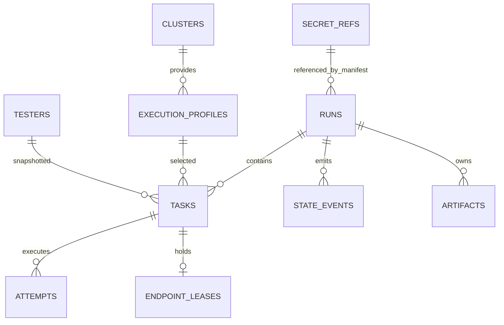

# 03 数据视图：表结构、约束与数据生命周期

> **覆盖：** PostgreSQL 表与列、约束、索引、JSON 列的形状、迁移、保留与容量、常用查询。
> **不覆盖：** 状态语义（[02](02-logical-view.md)）、API 形状（[07](07-api.md)）、文件产物布局（[06](06-physical-view.md) §3）。
> **唯一性：** 本文件是表结构的**唯一权威**；`impl/control-plane.md` C-2.3 是摘要，冲突以本文为准。
> **状态 token：** 一律小写（`pending`…），文档与 UI 展示大写。

---

## 1. 设计原则

| 原则 | 规则 |
|---|---|
| 状态落库 | 状态只在 `runs/tasks/attempts` 三张表；`state_events` 是事实流，不参与状态判定 |
| 单写者 | 只有 `Kernel.Apply`（02 §3.3）能改状态字段；其他模块只读 |
| 不可变 | `state_events` 只插入；`attempts` 终态后不再改（除补 `exit_code` 等物理事实） |
| 时间 | 全部 `timestamptz`（UTC）；展示层转换；不用本地时间排序 |
| JSONB 有边界 | 只用于**快照与不参与查询的扩展**（manifest、resolved、endpoint、deploy、retry_policy、error）；不把可查询字段塞进 JSONB |
| 不软删 | Run/Task 物理删除只发生在保留期清理（级联）；Tester 用 `orphaned` 标记 |
| 大小写 | 状态、角色、错误码等枚举值小写/大写固定，不在不同表里混用 |
| ID | 业务可读且可排序：`r-YYYYMMDD-XXXX`、`t-XXXXXX`、`<task>-a<n>`、`j-<8hex>` |

---

## 2. ER 图



---

## 3. 表设计

### 3.1 核心表列说明

> DDL 已给出约束；下表补"这一列给谁用、什么时候写、能不能变"，避免开发时把快照列当可更新列。

**`runs`**

| 列 | 类型 | 空 | 写时机 | 语义 / 规则 |
|---|---|---|---|---|
| `id` | text | 否 | 创建 | `r-YYYYMMDD-XXXX`；对外唯一标识 |
| `name` | text | 否 | 创建 | 展示用，不唯一（K-11）；不得用于定位 |
| `kind` | text | 否 | 创建 | `run` / `task`（独立 Task 的占位 Run） |
| `status` | text | 否 | 状态机 | 只经 `Kernel.Apply`；终态不可逆 |
| `manifest` | jsonb | 否 | 创建 | 提交原文快照；之后**只读** |
| `resolved` | jsonb | 否 | 创建 | 解析结果（precheck、argv、timeout）；之后只读 |
| `endpoint` | jsonb | 是 | Deploy ready / service 提交 | 投影来源；`key` 用于互斥 |
| `deploy` | jsonb | 是 | Deploy 阶段 | `state`/位次/`queued_at`；终态后只读 |
| `cleanup_policy` | text | 否 | 创建 | 只决定卸载，不决定保留期（G-13） |
| `submitted_by` | text | 否 | 创建 | 身份源 subject；审计用 |
| `submitted_at` | timestamptz | 否 | 创建 | 排序键（列表按它倒序） |
| `started_at` / `finished_at` | timestamptz | 是 | 状态机 | 只由 Run 状态推进填；不可手改 |
| `error` | jsonb | 是 | 终态/失败 | Failure 结构；终态后只读 |
| `retry_of` | text | 是 | P1 | 跨 Run 续跑来源 |
| `last_event_seq` | bigint | 否 | 每次事件 | 原子自增；唯一事件序号来源 |
| `revision` | bigint | 否 | 每次写 | 可选乐观锁（`If-Match`） |

**`tasks`**

| 列 | 类型 | 空 | 写时机 | 语义 / 规则 |
|---|---|---|---|---|
| `id` | text | 否 | 创建 | `t-XXXXXX`；Attempt id 以它开头 |
| `run_id` / `seq` | text / int | 否 | 创建 | `(run_id, seq)` 唯一；precheck = 0 |
| `name` | text | 否 | 创建 | Run 内唯一；报告/UI 展示用 |
| `tester_name` / `tester_version` / `image_ref` | text | 否 | 创建 | **冻结快照**；注册表变化不影响它（§5.7） |
| `profile` | text | 否 | 创建 | 引用 Execution Profile；之后只读 |
| `args_raw` / `args_argv` / `injected_argv` | text / jsonb | 否 | 创建或 deploy ready | 三份都留，保证可还原"当时传了什么" |
| `env` / `secret_env` | jsonb | 否 | 创建 | 明文 / 引用；Job 渲染时展开 |
| `on_failure` | text | 否 | 创建 | 取 Tester 与 Manifest 的更严者；之后只读 |
| `timeout_seconds` | int | 否 | 创建 | 平台默认 + Manifest 覆盖；执行期只读 |
| `retry_policy` | jsonb | 否 | 创建 | `retry_on` 只能取 `retryable: true` 的码 |
| `status` / `status_reason` | text | 否 / 是 | 状态机 | 只经 `Kernel.Apply`；`skipped` 必须有 reason |
| `waiting_reason` | text | 是 | 调度 | 仅展示；6 值枚举 |
| `endpoint_key` | text | 是（deploy 提交时） | 提交 / ready 回填 | `queued` 前必须非空 |
| `endpoint_exclusive` | boolean | 否 | 创建 | 来自 Tester 声明；决定是否独占 |
| `current_attempt` | int | 否 | 启动 Attempt | 最新 Attempt 序号；历史 Attempt 不覆盖 |
| `available_at` | timestamptz | 是 | 重试 | backoff 到期；空 = 立即可调度 |
| `cancel_requested` | boolean | 否 | 取消/超时 | 置位后由 executor 异步删 Job |
| `result_ref` | text | 是 | Task 终态 | 相对 Run 目录的结果引用 |
| `reused_from_task_id` | text | 是 | P1 | 跨 Run 续跑复用来源 |
| `error` | jsonb | 是 | 失败 | Failure；含 `retryable` 与 `detail` |

**`attempts`**

| 列 | 类型 | 空 | 写时机 | 语义 / 规则 |
|---|---|---|---|---|
| `id` | text | 否 | 启动 Attempt | `<task>-a<n>`；全局唯一 |
| `task_id` / `idx` | text / int | 否 | 同上 | `(task_id, idx)` 唯一；idx 从 1 连续 |
| `status` | text | 否 | 执行层事实 | 只由 `ResultSink` CAS 写；终态不覆盖 |
| `job_id` | text | 否 | 同上 | 内部幂等键（Job 去重）；唯一 |
| `job_namespace` | text | 是 | 同上 | 多 namespace 时必填 |
| `phase` / `exit_code` | text / int | 是 | 执行结束 | 附录 B 原值 / 退出码；只补不改状态 |
| `image_digest` | text | 是 | Pod Running / 终态 | K8s `imageID` 解析出的实际 digest；缺失记 unknown（03 §4.9、E-4.3.1） |
| `started_at` / `finished_at` | timestamptz | 是 | 执行层 | 超时判定与耗时统计来源 |
| `log_ref` / `artifact_ref` / `result_ref` | text | 是 | 执行结束 | 相对 `<run>/tasks/<task>/attempts/<n>/` |
| `error` | jsonb | 是 | 失败 | 与 Task 的 `error` 同构；Attempt 是原始事实 |
| `executor_ref` | jsonb | 是 | 启动 | `{cluster, namespace, job}`，用于查 K8s |

**为什么不把这些放进 JSONB**：`status`、`endpoint_key`、`available_at`、`run_id/seq`、`current_attempt` 参与查询或并发控制；`manifest/resolved/deploy` 是快照，不参与查询。

---

### 3.2 完整 DDL

> 约定：SQL 用 PostgreSQL 16；`CHECK` 约束是最后一道防线，业务校验仍在代码里；迁移文件按 `0001_init.up.sql` 起编号。

```sql
-- ============ 枚举注释（实现为 CHECK，不用 PG enum，便于灰度） ============
-- runs.status:    submitted|queued|deploying|testing|cleanup|cancelling|
--                 succeeded|completed_with_errors|service_unavailable|failed|canceled
-- tasks.status:   pending|queued|preparing|running|succeeded|failed|canceled|skipped
-- attempts.status:preparing|running|succeeded|failed|canceled
-- tasks.waiting_reason: precheck_gate|slot_waiting|global_limit|queue_full|insufficient_resources|gang_pending

CREATE TABLE runs (
  id               text PRIMARY KEY,
  name             text NOT NULL,
  kind             text NOT NULL DEFAULT 'run'
                   CHECK (kind IN ('run','task')),          -- 'task' = 独立 Task 合成的占位 Run
  status           text NOT NULL,
  manifest         jsonb NOT NULL,                          -- 提交原文（secrets 只有引用）
  resolved         jsonb NOT NULL,                          -- 冻结解析结果（见 §4.2）
  endpoint         jsonb,                                   -- 见 §4.3
  deploy           jsonb,                                   -- 见 §4.4
  cleanup_policy   text NOT NULL DEFAULT 'always'
                   CHECK (cleanup_policy IN ('always','on_failure','never')),
  submitted_by     text NOT NULL,
  submitted_at     timestamptz NOT NULL DEFAULT now(),
  started_at       timestamptz,
  finished_at      timestamptz,
  error            jsonb,                                   -- Failure（§4.7）
  retry_of         text REFERENCES runs(id),                -- P1 跨 Run 续跑
  last_event_seq   bigint NOT NULL DEFAULT 0,               -- 事件 seq 分配器
  revision         bigint NOT NULL DEFAULT 1,               -- 乐观锁（可选）
  CONSTRAINT runs_status_ck CHECK (status IN (
    'submitted','queued','deploying','testing','cleanup','cancelling',
    'succeeded','completed_with_errors','service_unavailable','failed','canceled')),
  CONSTRAINT runs_finished_ck CHECK (finished_at IS NULL OR finished_at >= submitted_at)
);
CREATE INDEX runs_status_time_idx ON runs (status, submitted_at DESC);
CREATE INDEX runs_time_id_idx     ON runs (submitted_at DESC, id DESC);
CREATE INDEX runs_kind_time_idx   ON runs (kind, submitted_at DESC);

CREATE TABLE tasks (
  id                  text PRIMARY KEY,
  run_id              text NOT NULL REFERENCES runs(id) ON DELETE CASCADE,
  seq                 int  NOT NULL CHECK (seq >= 0),       -- 0 = 平台注入的 Pre-Check
  name                text NOT NULL,
  tester_name         text NOT NULL,
  tester_version      text NOT NULL,
  image_ref           text NOT NULL,
  profile             text NOT NULL,
  args_raw            text NOT NULL,
  args_argv           jsonb NOT NULL,                       -- 词法切分结果
  injected_argv       jsonb NOT NULL DEFAULT '[]',
  env                 jsonb NOT NULL DEFAULT '{}',          -- 明文；可回显
  secret_env          jsonb NOT NULL DEFAULT '[]',          -- [{name, secret_ref}]
  on_failure          text NOT NULL CHECK (on_failure IN ('continue','abort_run')),
  timeout_seconds     int  NOT NULL CHECK (timeout_seconds > 0 AND timeout_seconds <= 86400),
  retry_policy        jsonb NOT NULL DEFAULT '{}',          -- §4.5
  status              text NOT NULL,
  status_reason       text,
  waiting_reason      text,
  endpoint_key        text,                                 -- deploy 模式 ready 后回填
  endpoint_exclusive  boolean NOT NULL,
  current_attempt     int NOT NULL DEFAULT 0 CHECK (current_attempt >= 0),
  available_at        timestamptz,
  cancel_requested    boolean NOT NULL DEFAULT false,
  result_ref          text,
  reused_from_task_id text,
  error               jsonb,
  created_at          timestamptz NOT NULL DEFAULT now(),
  updated_at          timestamptz NOT NULL DEFAULT now(),
  CONSTRAINT tasks_name_uq UNIQUE (run_id, name),
  CONSTRAINT tasks_seq_uq  UNIQUE (run_id, seq),
  CONSTRAINT tasks_status_ck CHECK (status IN (
    'pending','queued','preparing','running','succeeded','failed','canceled','skipped')),
  CONSTRAINT tasks_waiting_ck CHECK (waiting_reason IS NULL OR waiting_reason IN (
    'precheck_gate','slot_waiting','global_limit','queue_full','insufficient_resources','gang_pending')),
  CONSTRAINT tasks_queued_endpoint_ck CHECK (status <> 'queued' OR endpoint_key IS NOT NULL),
  CONSTRAINT tasks_skipped_reason_ck CHECK (status <> 'skipped' OR status_reason IN (
    'upstream_abort','canceled','deploy_failed','service_unavailable','platform_error'))
);
CREATE INDEX tasks_ready_idx ON tasks (status, available_at) WHERE status = 'queued';
CREATE INDEX tasks_run_idx   ON tasks (run_id, seq);
CREATE INDEX tasks_endpoint_idx ON tasks (endpoint_key) WHERE status IN ('preparing','running');

CREATE TABLE attempts (
  id             text PRIMARY KEY,                          -- <task>-a<n>
  task_id        text NOT NULL REFERENCES tasks(id) ON DELETE CASCADE,
  idx            int  NOT NULL CHECK (idx >= 1),
  status         text NOT NULL,
  job_id         text NOT NULL UNIQUE,                      -- 内部幂等键（Job 去重）
  job_namespace  text,
  phase          text,                                      -- 附录 B 原值
  image_digest   text,                                      -- 实际拉取到的 digest（K8s imageID）；同 tag 不同代码的唯一证据
  exit_code      int,
  started_at     timestamptz,
  finished_at    timestamptz,
  log_ref        text,
  artifact_ref   text,
  result_ref     text,
  error          jsonb,
  executor_ref   jsonb,                                     -- {cluster, namespace, job}
  CONSTRAINT attempts_status_ck CHECK (status IN ('preparing','running','succeeded','failed','canceled')),
  CONSTRAINT attempts_uq UNIQUE (task_id, idx)
);
CREATE UNIQUE INDEX attempts_active_uq ON attempts (task_id)
  WHERE status IN ('preparing','running');
CREATE INDEX attempts_status_idx ON attempts (status) WHERE status IN ('preparing','running');

-- append-only：状态事实流，派生 events.jsonl / SSE
CREATE TABLE state_events (
  id          bigserial PRIMARY KEY,
  run_id      text NOT NULL REFERENCES runs(id) ON DELETE CASCADE,
  task_id     text,
  attempt_id  text,
  seq         bigint NOT NULL,                              -- 每 Run 单调
  type        text NOT NULL,
  from_status text,
  to_status   text,
  reason      text,
  payload     jsonb NOT NULL DEFAULT '{}',
  actor       text,
  created_at  timestamptz NOT NULL DEFAULT now(),
  CONSTRAINT state_events_seq_uq UNIQUE (run_id, seq)
);
CREATE INDEX state_events_run_idx ON state_events (run_id, seq);

-- 端点互斥槽位（同一 endpoint_key 上：至多 1 个独占，或 N 个共享）
CREATE TABLE endpoint_leases (
  task_id      text PRIMARY KEY REFERENCES tasks(id) ON DELETE CASCADE,
  endpoint_key text NOT NULL,
  exclusive    boolean NOT NULL,
  acquired_at  timestamptz NOT NULL DEFAULT now()
);
CREATE UNIQUE INDEX endpoint_lease_excl_uq ON endpoint_leases (endpoint_key) WHERE exclusive;
CREATE INDEX endpoint_lease_key_idx ON endpoint_leases (endpoint_key);

CREATE TABLE testers (
  name          text NOT NULL,
  version       text NOT NULL,
  display_name  text NOT NULL,
  description   text NOT NULL,
  role          text NOT NULL CHECK (role IN ('test','pre_check')),
  on_failure    text NOT NULL CHECK (on_failure IN ('continue','abort_run')),
  entry         text NOT NULL,
  image         text NOT NULL,
  resources     jsonb NOT NULL,
  concurrency   jsonb NOT NULL,                             -- {endpoint_exclusive: bool}
  mounts        jsonb NOT NULL DEFAULT '[]',
  k8s           jsonb NOT NULL DEFAULT '{}',
  parameters    jsonb NOT NULL DEFAULT '{}',                -- 文档语义，不参与运行校验
  env_decl      jsonb NOT NULL DEFAULT '{}',
  placeholder   text,
  source_file   text NOT NULL,
  content_sha   text NOT NULL,
  orphaned      boolean NOT NULL DEFAULT false,
  removed_at    timestamptz,
  registered_at timestamptz NOT NULL DEFAULT now(),
  registered_by text NOT NULL,
  PRIMARY KEY (name, version)
);
CREATE INDEX testers_role_idx ON testers (role) WHERE NOT orphaned;

CREATE TABLE clusters (
  name              text PRIMARY KEY,
  api_server        text NOT NULL,
  kubeconfig_key    text NOT NULL,                          -- 挂载目录内的文件名，不存内容
  description       text,
  last_check_at     timestamptz,
  last_check_result text,
  created_at        timestamptz NOT NULL DEFAULT now()
);

CREATE TABLE execution_profiles (
  name                   text PRIMARY KEY,
  cluster                text NOT NULL REFERENCES clusters(name),
  namespace              text NOT NULL,
  mounts                 jsonb NOT NULL DEFAULT '[]',
  scheduler              text NOT NULL DEFAULT 'default'
                         CHECK (scheduler IN ('default','volcano')),
  queue                  text,
  image_pull_secrets     jsonb NOT NULL DEFAULT '[]',
  resource_defaults      jsonb NOT NULL DEFAULT '{}',
  deploy_timeout_seconds int NOT NULL DEFAULT 259200        -- 72h
                         CHECK (deploy_timeout_seconds BETWEEN 3600 AND 604800),
  network_policy         jsonb NOT NULL DEFAULT '{}',
  created_by             text NOT NULL,
  updated_at             timestamptz NOT NULL DEFAULT now()
);

CREATE TABLE secret_refs (
  name         text PRIMARY KEY,                            -- Manifest 里写的字符串
  namespace    text NOT NULL,
  secret_name  text NOT NULL,
  key          text NOT NULL,
  description  text,
  created_by   text NOT NULL,
  created_at   timestamptz NOT NULL DEFAULT now()
);

-- 产物索引（可重建）：路径相对 <storage-root>
CREATE TABLE artifacts (
  run_id     text NOT NULL,
  task_id    text,
  attempt_id text,
  path       text NOT NULL,
  size_bytes bigint NOT NULL CHECK (size_bytes >= 0),
  sha256     text,
  kind       text NOT NULL CHECK (kind IN ('result','raw','log','report','other')),
  mtime      timestamptz,
  indexed_at timestamptz NOT NULL DEFAULT now(),
  PRIMARY KEY (run_id, path)
);
CREATE INDEX artifacts_attempt_idx ON artifacts (attempt_id);

CREATE TABLE audit_log (
  id          bigserial PRIMARY KEY,
  actor       text NOT NULL,
  role        text NOT NULL,
  action      text NOT NULL,                                -- submit|cancel|retry|rotate|...
  object_type text NOT NULL,
  object_id   text,
  detail      jsonb NOT NULL DEFAULT '{}',
  at          timestamptz NOT NULL DEFAULT now()
);
CREATE INDEX audit_at_idx     ON audit_log (at DESC);
CREATE INDEX audit_object_idx ON audit_log (object_type, object_id);
```

---

## 4. JSON 列的形状

### 4.1 `runs.manifest`（提交原文）

```json
{
  "run": {
    "name": "qwen3-32b-daily",
    "deploy": { "provider": "genet", "parameters": { "model": "Qwen3-32B" } },
    "precheck": "auto",
    "env": { "LOG_LEVEL": "info" },
    "secrets": { "ENDPOINT_API_KEY": "endpoint/prod-qwen" },
    "tests": [
      { "name": "accuracy-a", "tester": "aisbench-acc", "version": "1.0.0",
        "execution": { "profile": "k8s-npu" }, "args": "--dataset=/data/a",
        "on_failure": "continue" }
    ],
    "cleanup": { "policy": "always" }
  }
}
```

**Manifest 的唯一形态是嵌套 `run:`**（D-40，与 `07-api.md §4.1` 一致）；`runs.manifest` 原样保存提交原文，平台不会"展开成平级"。

`secrets` 只存引用名；`args` 是字符串。结构以 `schemas/manifest.schema.json` 为机器可校验真相。

### 4.2 `runs.resolved`（冻结解析结果）

```json
{
  "kind": "run",
  "precheck": { "injected": true, "tester": "endpoint-probe", "version": "1.0.0", "seq": 0 },
  "tasks": [
    { "id": "t-0001", "seq": 1, "name": "accuracy-a", "profile": "k8s-npu",
      "timeout_seconds": 14400, "retry": { "max_attempts": 1, "backoff_seconds": 60,
      "retry_on": ["IMAGE_PULL_FAILED"] } }
  ],
  "args_snapshot_sha": "…",
  "schema_version": "1.0"
}
```

`precheck.injected` 是"这个 Run 到底有没有平台注入的 Pre-Check"的**唯一判据**（`precheck: "off"` 时为 `{"injected": false}`，只有这一个键）。判定某个 Task 是不是 Pre-Check 必须用它，**不能**用 `tasks.seq == 0`、也不能用 Tester 的 `role='pre_check'`：`precheck: "off"` 时首个测试 Task 的 seq 同样是 0，而 `endpoint-probe` 这类 Tester 既可是 Pre-Check 也可是普通测试。落地 SQL 形如：

```sql
SELECT t.id FROM tasks t JOIN runs r ON r.id = t.run_id
 WHERE t.run_id = $1 AND t.seq = 0
   AND COALESCE((r.resolved -> 'precheck' ->> 'injected')::boolean, false);
```

### 4.3 `runs.endpoint`

```json
{
  "url": "http://10.0.0.10:8000/v1",
  "model_name": "Qwen3-32B",
  "model_path": "/models/Qwen3-32B",
  "protocol": "http",
  "key": "http://10.0.0.10:8000",
  "source": "genet",
  "deploy_id": "d-123"
}
```

`key` 用于端点互斥（协议 + host + 端口，不含路径）；`source` ∈ `genet|service`。

### 4.4 `runs.deploy`

Genet **没有"部署单"**这个概念：一次部署 = 一次 Helm release，定位符只有 `namespace + release_name`，没有 `request_id` / `job_id`（`<G>/backend/internal/handlers/helm.go:2992-3000` 的 202 响应里只有 `name`）。所以平台主键只有 `deploy_id`，它同时是幂等键的来源；Genet 侧的一切查询与删除都靠 `namespace + release_name`。

```jsonc
{
  // ---- 定位与幂等 ----
  "deploy_id": "d-20261105-0001",           // 平台唯一主键（幂等键由 run_id+deploy_id 派生）
  "provider": "genet",
  "namespace": "user-alice",                // Genet API Key 绑定，调用方不能指定
  "release_name": "tp-3f9c1a2b7d40",        // 幂等键；namespace + release_name 才能定位 Genet 资源
  "package_type": "stack",                  // stack | pd → POST /api/open/helm/uc-packages/{type}/releases
  "chart": "charts/unified-cache-stack",    // 服务端配置固定，不可选
  "chart_version": "0.0.1",

  // ---- 冻结的输入（Genet 不做二次渲染，重放必须原样）----
  "values": "servingEngineSpec:\n  enableEngine: true\n  ...",  // 最终 values.yaml 文本（也可存等价 JSON）
  "values_digest": "sha256:…",
  "template_path": "ascend/values-qwq-32b-single.yaml",
  "image": "registry.dev.huawei.com/…:tag",
  "model_path": "/mnt/model/Qwen2.5-1.5B-Instruct",
  "model_name": "Qwen2.5-1.5B",             // 取自 callInfo.model，Pre-Check 公共参数要用
  "set": [{"name": "servingEngineSpec.containerPort", "value": "23345", "type": "set"}],
  "no_wait": true,                          // 恒 true，见下

  // ---- 两层状态都留证（Genet 有两根互不相干的轴）----
  "state": "deploying",                     // queued|accepted|deploying|ready|blocked（平台合成）
  "genet_release_status": "deployed",       // helm 原值：pending-install|deployed|failed|superseded|…
  "endpoint_status": "ready",               // callInfo.endpoint.status 原值：pending|ready|blocked

  // ---- 队列：只有水位，没有位次 ----
  "queue": {"phase": "Inqueue", "pending": 3, "inqueue": 2, "running": 12},

  // ---- Endpoint（ready 后回填；Task 的 endpoint_key 由它算）----
  "endpoint": {"url": "http://141.111.32.68:23345", "model_name": "Qwen2.5-1.5B",
               "model_path": "/mnt/model/Qwen2.5-1.5B-Instruct", "protocol": "http"},

  // ---- 时间线 ----
  "accepted_at": "2026-11-05T01:00:02Z",
  "queued_at": "2026-11-05T01:03:10Z",
  "ready_at": null,
  "last_polled_at": "2026-11-05T01:07:40Z",

  // ---- 失败 / 取消 / 卸载 ----
  "failure": {"code": "DEPLOY_BLOCKED", "message": "该实例调用入口不可用：…", "retryable": true,
              "detail": {"reason": "blocked"}},
  "cancel_requested_at": null,
  "uninstall": {"state": "pending", "verified_at": null, "force": false, "cleanup_errors": []}
}
```

| 字段 | 来源 / 约束 | 为什么必须落库 |
|---|---|---|
| `deploy_id` / `provider` | 平台生成；`provider` 恒 `genet` | 唯一的平台主键；幂等键 `run_id + deploy_id` 的输入 |
| `namespace` / `release_name` | Key 绑定；`release_name` 由 `sha256(run_id:deploy_id)[:12]` 派生，满足 `^[a-z][a-z0-9-]{0,52}$` | 重启后必须还能 `GET` / `DELETE` 同一个 release；Genet 无 request_id 可回溯 |
| `package_type` / `chart` / `chart_version` | 请求按包类型路由；chart 由 Genet 配置固定，回读后冻结 | 复现"部署了什么"必须能回答是 stack 还是 pd、哪个 chart |
| `values` / `values_digest` / `template_path` / `image` / `model_path` / `set` | 提交时冻结的最终入参（合并顺序：chart 默认 → 模板/values → image/modelPath → set → overlay，`<G>/backend/internal/handlers/helm.go:2143-2196`） | Genet 侧不接受二次渲染；审计与重放只能靠这份快照，`values_digest` 供比对 |
| `model_name` | 来自 `callInfo.model` | Pre-Check / Tester 公共参数 `--model_name` 的真实来源 |
| `no_wait` | 恒 `true` | `helm --wait` 的 `timeoutSec` 只是安装 deadline：排队超过它 release 会被判 `failed`（Pod 仍在排队，`<G>/jenkins/Helm-Start-Service-MB.Jenkinsfile:21-26`）→ 必须 `noWait=true`，就绪改由平台轮询判（C-5.3） |
| `state` | 平台按 C-5.3 映射表合成 | `queued` 没有 Genet 权威来源，是平台推断，必须留证便于解释"为什么卡住" |
| `genet_release_status` / `endpoint_status` | helm / callInfo 原值 | 两层轴不一致时（`deployed` 但 `endpoint.pending`）能解释，不必猜 |
| `queue{phase,pending,inqueue,running}` | `GET /api/open/queue/podgroups` 的 `phase` + `GET /api/open/queue` 的计数 | **没有位次**（Genet 只给计数，`<G>/backend/internal/models/volcano_views.go:13-39`）；UI 只能展示"已等待时长 + 水位"，故 `queue_position` 字段移除 |
| `endpoint{url,model_name,model_path,protocol}` | `callInfo.endpoint`，禁止自行推导 | `runs.endpoint` 与 Task `endpoint_key` 的唯一来源（§4.3） |
| `accepted_at` / `queued_at` / `ready_at` / `last_polled_at` | 平台在轮询中写 | 排队时长展示、`deploy_timeout_seconds` 判定、404 宽限期都以时间而非次数为准（C-5.3） |
| `failure{code,message,retryable}` | 部署终态 blocked 时写 | 只有两个码（附录 D）：`DEPLOY_FAILED`（不可重试，平台侧调 Genet 失败）→ Run `failed`；`DEPLOY_BLOCKED`（可重试，Genet `blocked` 或超 72h 窗口）→ Run `service_unavailable`；细分靠 `detail.reason ∈ {blocked,timeout,superseded,uninstalling,uninstalled}`（D-47） |
| `cancel_requested_at` | 用户取消时先落库 | Genet 的 DELETE 在 release 尚未出现时只回 404（`<G>/backend/internal/handlers/helm.go:2438`），取消意图必须先落库再由对账补偿 |
| `uninstall{state,verified_at,force,cleanup_errors[]}` | 清理阶段写 | "删了"以 `GET 404 + pods.items == []` 为准（`<G>/jenkins/Helm-Start-Service-MB.Jenkinsfile:3027-3061`），`cleanup_errors` 保留 Genet 返回的失败项；卸载失败**不改 Run 终态**，只记 `CLEANUP_FAILED` |

> `values` 超过 64 KiB 时仍写 JSON（Genet 请求体无已知大小限制，但反向代理可能有，调研 R11），`values_digest` 始终必填。
> §4.2 的 `runs.resolved.precheck.injected` 判据不受本节影响：`precheck.injected` 表示"平台是否注入了 Pre-Check"，与部署无关。

### 4.5 `tasks.retry_policy`

```json
{ "max_attempts": 1, "backoff_seconds": 60,
  "retry_on": ["IMAGE_PULL_FAILED", "TASK_TIMEOUT"] }
```

`retry_on` 只能取附录 D 中 `retryable: true` 的码；默认空对象 = 不重试。

### 4.6 `tasks.secret_env`

```json
[ { "name": "ENDPOINT_API_KEY", "secret_ref": "endpoint/prod-qwen" } ]
```

### 4.7 `error`（Failure，Run/Task/Attempt 同构）

```json
{ "code": "TASK_TIMEOUT", "message": "Task 超过 14400 秒被终止",
  "detail": { "timeout_seconds": 14400 }, "retryable": false }
```

### 4.8 `attempts.executor_ref`

```json
{ "cluster": "cluster-01", "namespace": "testplane", "job": "tp-t-0001-a1" }
```

### 4.9 提交不做幂等（D-37）

| 场景 | 行为 |
|---|---|
| 同一客户端超时后重发同一份 Manifest | **创建第二个 Run**（平台不做请求去重；提交者自行取消或忽略） |
| 两次独立提交，Manifest 完全一致 | **两个 Run，都执行** |
| 是否"同一次提交" | 平台不判断，也没有 `Idempotency-Key` / 提交指纹 |

**为什么不做**：LLM 测试的等价性不由 Manifest 决定。硬件型号、驱动、HDK 版本、集群负载、被测服务部署参数等环境因素对平台透明；相同的镜像 tag 背后可能已是新代码（tag 可变），相同的 Manifest 也可能是不同的测试条件。平台既无法判断两次提交是否等价，也不应替提交者做"合并/去重"的决定（§13.1）。

**代价与配套**：重复提交会产生两个独立 Run，占用资源、产生两份报告。这是**提交者的责任**（流水线不应盲目重试提交；超时后用查询确认是否已创建）。平台侧只保证：

- 两个 Run 各自有独立 ID、独立产物目录，互不覆盖；
- 取消/清理对每个 Run 独立生效；
- 记录每个 Attempt 实际拉取的镜像 digest（`attempts.image_digest`），供事后区分"同 tag 是否换了代码"。

**内部操作仍然要可重试安全**（不是接口幂等）：同一 `run_id` 的 Genet 部署、同一 `job_id` 的 Job 创建，重复执行不得产生第二个部署/Job。这是实现层用幂等键做的自我保护，不对调用方承诺"重复提交只跑一次"。

---

## 5. 索引与查询模式

| 查询 | SQL 要点 | 索引 |
|---|---|---|
| Run 列表（游标） | `WHERE (submitted_at, id) < ($ts, $id) ORDER BY submitted_at DESC, id DESC LIMIT 50` | `runs_time_id_idx` |
| Run 列表按状态 | 同上 + `status = $s` | `runs_status_time_idx` |
| Task 详情 | `WHERE run_id=$1 ORDER BY seq` | `tasks_run_idx` |
| 调度候选 | `status='queued' AND available_at<=now() AND run.status='testing' ORDER BY run.submitted_at, seq LIMIT 50`（**不加行锁**；逐候选先锁 Run，见 02 §3.8） | `tasks_ready_idx` |
| 取端点持有者 | `SELECT ... WHERE endpoint_key=$1` | `endpoint_lease_key_idx` |
| 活跃 Attempt（对账） | `status IN ('preparing','running')` | `attempts_status_idx` |
| 事件回放 | `WHERE run_id=$1 AND seq>$2 ORDER BY seq LIMIT 1000` | `state_events_run_idx` |
| 审计检索 | `WHERE at > $1 ORDER BY at DESC` | `audit_at_idx` |

**查询纪律：** 列表一律游标，不用 `OFFSET`；详情页禁止 N+1（Run 详情用一条 JOIN 取 Task 摘要）；`SELECT *` 不用。

---

## 6. 约束与不变量的分工

| 不变量 | DB 强制 | 代码强制 |
|---|---|---|
| 状态取值合法 | CHECK | 转移表 |
| 终态不可逆、转移合法 | — | Kernel |
| 至多一个活跃 Attempt | 部分唯一索引 | — |
| `queued` 必有 `endpoint_key` | CHECK | 调度守卫 |
| `skipped` 必有 reason | CHECK | — |
| 事件 seq 唯一 | UNIQUE | Kernel 分配 |
| 事件 seq 连续 | — | 一致性任务 |
| 每 Run 的 Task 数量 ≤ 200 | — | 提交校验 |
| Tester 版本不可覆盖 | PK（name,version）+ `content_sha` 比对 | 启动同步 |
| Attempt 与 Job 一一对应 | `job_id UNIQUE` | 执行层 |

---

## 7. 迁移策略

| 阶段 | 规则 |
|---|---|
| 版本管理 | `golang-migrate`，`NNNN_name.up.sql/.down.sql`；只前进，down 仅供本地 |
| 兼容 | expand（加表/加列/放宽 CHECK）与 contract（删列/收紧 CHECK）**分两个发布**；回滚镜像不需要回滚库 |
| 索引 | 大表索引用 `CREATE INDEX CONCURRENTLY`（迁移里单独文件、非事务） |
| 回填 | 大字段回填用后台任务（游标分批 1000 行），不进迁移事务 |
| 枚举 | 新增状态：先扩 CHECK → 发布代码 → 稳定后再考虑收缩 |
| 执行 | Helm pre-upgrade hook Job 执行 `testplaned migrate up`；多副本不得并发迁移 |
| 校验 | 启动时检查 `schema_migrations` 与二进制期望版本一致，不匹配拒绝启动 |

初始迁移建议：`0001_init`（全部表）、`0002_indexes`（并发索引）、后续按需。

---

## 8. 保留、容量与清理

| 数据 | 保留 | 清理方式 |
|---|---|---|
| `runs` / `tasks` / `attempts` | 与产物同期（默认 30 天，可配） | 按 Run 级联删除（`tasks → attempts` 级联；`state_events` 级联） |
| `state_events` | 同 Run | 随 Run 删除；`events.jsonl` 是永久副本（文件保留期同产物） |
| `artifacts` | 可重建 | Run 删除时按 `run_id` 清索引；文件由 retention sweeper 删目录 |
| `audit_log` | 365 天（合规） | 定时归档，不随 Run 删除 |
| `testers` | 永久 | 不删；`orphaned` 标记 |

容量估算（P0，日 100 Run、单 Run 5 Task）：

| 表 | 行数/年 | 估算 |
|---|---|---|
| runs | 3.6 万 | 每行 ~2KB（manifest/resolved），约 72MB |
| tasks | 18 万 | 每行 ~1.5KB，约 270MB |
| attempts | ~20 万 | 每行 ~0.5KB，约 100MB |
| state_events | ~250 万 | 每行 ~0.4KB，约 1GB |

> `state_events` 是最大表；超过 5000 万行时按 `run_id` 哈希分区或改归档表，属 P1。

---

## 9. 启动与种子数据

| 数据 | 来源 | 规则 |
|---|---|---|
| Testers | 镜像内 `/app/testers` | 启动扫描 + 校验；有错拒绝启动（K-3）；同版本内容变化拒绝启动 |
| Clusters / Profiles | Helm values 首次 seed + admin API 维护 | values 只做首次插入，之后以库为准 |
| Secret 引用 | admin API 登记 | 只存 `namespace/name/key`，不存值 |
| 平台配置 | 环境变量 / ConfigMap | 不落库；见 05 §4 |

---

## 10. 常用查询示例

```sql
-- 调度器取候选（单轮 50 条，短事务；不加行锁）
SELECT t.id, t.run_id, t.seq, t.endpoint_key, t.endpoint_exclusive
  FROM tasks t JOIN runs r ON r.id = t.run_id
 WHERE t.status = 'queued' AND r.status = 'testing'
   AND (t.available_at IS NULL OR t.available_at <= now())
 ORDER BY r.submitted_at, t.seq
 LIMIT 50;

-- 逐候选：先锁 Run（统一 Run → Task 顺序，防与取消/abort 死锁）
SELECT id FROM runs WHERE id = $run_id FOR UPDATE;

-- Run 详情 + Task 摘要（一条 JOIN，避免 N+1）
SELECT r.*, coalesce(jsonb_agg(jsonb_build_object(
         'id', t.id, 'name', t.name, 'status', t.status,
         'attempts', t.current_attempt, 'error', t.error)
       ORDER BY t.seq) FILTER (WHERE t.id IS NOT NULL), '[]') AS tasks
  FROM runs r LEFT JOIN tasks t ON t.run_id = r.id
 WHERE r.id = $1
 GROUP BY r.id;

-- 一致性：Run 终态但仍有非终态 Task（应为 0）
SELECT r.id FROM runs r JOIN tasks t ON t.run_id = r.id
 WHERE r.status IN ('succeeded','completed_with_errors','service_unavailable','failed','canceled')
   AND t.status NOT IN ('succeeded','failed','canceled','skipped')
 GROUP BY r.id;
```
