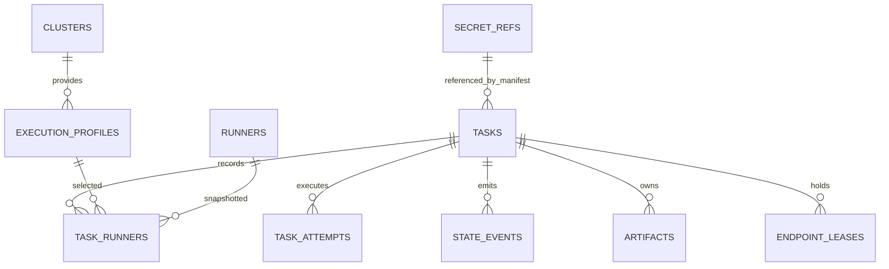

# 03 数据视图：表结构、约束与数据生命周期

> **覆盖：** PostgreSQL 表与列、约束、索引、JSON 列的形状、迁移、保留与容量、常用查询。
> **不覆盖：** 状态语义（[02](02-logical-view.md)）、API 形状（[07](07-api.md)）、文件产物布局（[06](06-physical-view.md) §3）。
> **唯一性：** 本文件是表结构的**唯一权威**；`impl/control-plane.md` C-2.3 是摘要，冲突以本文为准。
> **状态 token：** 一律小写（`pending`…），文档与 UI 展示大写（D-34 沿用）。
> **v2 术语（ARCHITECTURE §0.2 / D-66～D-68）：** Run→**Task**、Task（Run 内步骤）→**runner（实例）**、
> Tester→**Runner**、Attempt→**attempt（Task 级计数）**；runner 执行记录由 `(task_id, attempt_no, seq)` 定位。

---

## 1. 设计原则

| 原则 | 规则 |
|---|---|
| 状态落库 | 状态只在 `tasks` / `task_attempts` / `task_runners` 三张表；`state_events` 是事实流，不参与状态判定 |
| 单写者 | 只有 `Kernel.Apply`（02 §3.3）能改状态字段；其他模块只读 |
| 不可变 | `state_events` 只插入；`task_attempts` 终态后不再改；历史 attempt 的行与产物**不被重试覆盖**（§7.2） |
| 时间 | 全部 `timestamptz`（UTC）；展示层转换；不用本地时间排序 |
| JSONB 有边界 | 只用于**快照与不参与查询的扩展**（manifest、resolved、endpoint、deploy、error）；不把可查询字段塞进 JSONB |
| 不软删 | Task 物理删除只发生在保留期清理（级联）；Runner 用 `orphaned` 标记，永不删行（§5.6.1） |
| 大小写 | 状态、角色、错误码等枚举值小写/大写固定，不在不同表里混用 |
| ID | 业务可读且可排序：Task `t-YYYYMMDD-XXXX`；runner 执行记录无独立 ID，定位键 `(task_id, attempt_no, seq)`；Job `j-<8hex>` |

---

## 2. ER 图



---

## 3. 表设计

### 3.1 核心表列说明

> DDL 已给出约束；下表补"这一列给谁用、什么时候写、能不能变"，避免开发时把快照列当可更新列。

**`tasks`**（一次评测任务；v1 的 `runs` 表，D-66）

| 列 | 类型 | 空 | 写时机 | 语义 / 规则 |
|---|---|---|---|---|
| `id` | text | 否 | 创建 | `t-YYYYMMDD-XXXX`；对外唯一标识，不透明 |
| `name` | text | 否 | 创建 | 展示用，Task 内不重复；≤200 字符（D-58）；不得用于定位 |
| `status` | text | 否 | 状态机 | 只经 `Kernel.Apply`；8 值枚举（§3.2）；终态不可逆。**没有** `deploying` / `testing` / `cleanup` / `completed_with_errors`（v2 取消平台阶段，§7.4） |
| `manifest` | jsonb | 否 | 创建 | 提交原文快照（嵌套 `task:`，§4.1）；之后**只读** |
| `resolved` | jsonb | 否 | 创建 | 冻结解析结果（precheck、注入的 runner 序、输入快照摘要，§4.2）；之后只读 |
| `endpoint` | jsonb | 是 | deploy exports 收割 / service 提交 | 公共参数投影来源；`key` 用于外接模式互斥（§4.3） |
| `deploy` | jsonb | 是 | 创建冻结 + deploy runner 运行期刷新 | 部署描述快照 + `deploy-state.json` 副本合成（§4.4）；`queue.position` 恒 null（D-46）；终态后只读 |
| `env` / `secret_env` | jsonb | 否 | 创建 | **Task 级**明文 / 引用（§12.4）；渲染时展开到该 Task 全部 runner |
| `submitted_by` | text | 否 | 创建 | 身份源 subject；审计用 |
| `submitted_at` | timestamptz | 否 | 创建 | 排序键（列表按它倒序） |
| `started_at` / `finished_at` | timestamptz | 是 | 状态机 | 只由 Task 状态推进填；不可手改 |
| `error` | jsonb | 是 | 终态/失败 | Failure 结构（§4.7）；终态后只读 |
| `retry_of` | text | 是 | P1 | 跨 Task 续跑来源（仅外接模式，§7.7） |
| `current_attempt` | int | 否 | 启动 attempt | 最新 attempt 序号；0 = 尚未开始；历史 attempt 不覆盖 |
| `cancel_requested` | boolean | 否 | 取消/超时 | 置位后由 executor 异步删当前 runner 的 Job |
| `last_event_seq` | bigint | 否 | 每次事件 | 原子自增；唯一事件序号来源 |
| `revision` | bigint | 否 | 每次写 | 可选乐观锁（`If-Match`） |

> v1 `runs.cleanup_policy` / `runs.kind` **已取消**：有部署必有 clean（service-clean runner finally 语义，D-70），
> 产物保留期由平台配置统一决定（D-33）；v2 中一切评测都是 Task，不存在"独立 Task 合成的占位 Run"。

**`task_runners`**（runner 执行记录；v1 的 `tasks` 表，D-68。无独立主键，`(task_id, attempt_no, seq)` 唯一定位）

| 列 | 类型 | 空 | 写时机 | 语义 / 规则 |
|---|---|---|---|---|
| `task_id` / `attempt_no` / `seq` | text / int / int | 否 | 创建（attempt 启动时按 resolved 全量生成） | 主键三元组；`seq` 从 1 递增（含注入的 service-deploy / precheck / service-clean） |
| `name` | text | 否 | 创建 | Task 内唯一（用户 `runners[].name`；注入的为 `service-deploy` / `precheck` / `service-clean`；clean 重放追加的行为 `service-clean-replay`，§9.3）；报告/UI 展示用 |
| `runner_name` / `runner_version` | text | 否 | 创建 | **冻结快照**（`name@version`）；注册表变化不影响它（§5.7） |
| `role` | text | 否 | 创建 | `test` / `pre_check` / `deploy` / `clean`（deploy/clean 仅内置） |
| `image_ref` | text | 否 | 创建 | 冻结的镜像引用（原样来自 runner.yaml，平台不解析 tag/digest，§5.6） |
| `image_digest` | text | 是 | Pod Running / 终态 | K8s `imageID` 解析出的实际 digest；缺失记 unknown；"同 tag 是否换了代码"的唯一证据（§5.7、D-36） |
| `profile` | text | 否 | 创建 | 引用 Execution Profile；之后只读 |
| `input_ref` | text | 否 | 创建 | 输入落档引用（`attempts/<n>/input/<seq>/`，**每 runner 一个子目录**、互不可见，E-Q8/§6.8；只读挂载源）；输入原文随 attempt 落盘，可审计可复现（§5.3） |
| `on_failure` | text | 否 | 创建 | 取 Runner 声明与 Manifest 的**更严者**（§7.3）；之后只读 |
| `timeout_seconds` | int | 否 | 创建 | 平台默认 + Manifest `runners[].timeout_seconds` 覆盖；执行期只读（§6.6） |
| `status` | text | 否 | 状态机 | 8 值枚举（§3.2）；**没有重试回路**（FAILED 是终态，§7.8） |
| `status_reason` | text | 是 | 状态机 | 仅 `skipped` 必填（`upstream_abort` / `canceled`，D-06） |
| `waiting_reason` | text | 是 | 调度 | 仅展示；`queued` 必带，5 值枚举（§6.9、C-4.7：`slot_waiting` / `global_limit` / `queue_full` / `insufficient_resources` / `gang_pending`） |
| `endpoint_key` | text | 是 | exports 收割 / service 提交回填 | 外接模式互斥键；部署模式在 deploy exports 收割后回填（§4.3） |
| `endpoint_exclusive` | boolean | 否 | 创建 | 来自 Runner 声明；**仅外接模式有效**（§6.7） |
| `exit_code` | int | 是 | 执行结束 | 只补物理事实，不改状态 |
| `error_code` | text | 是 | 失败 | 附录 D 枚举（`RUNNER_TIMEOUT` / `RUNNER_NONZERO_EXIT` / `EXPORT_INVALID` / `RESULT_MISSING`（三选一产物全缺，D-74）…） |
| `error` | jsonb | 是 | 失败 | Failure 结构（§4.7）；含 `retryable` 与 `detail` |
| `exports_ref` | text | 是 | 收割成功 | 该 runner 收割落档引用（`attempts/<n>/exports/<seq>.exports.env`，§5.12）；失败/SKIPPED 不收割，保持 NULL |
| `result_ref` | text | 是 | 执行结束 | 相对 Task 目录的引用（`attempts/<n>/runners/<seq>/result.json`）；test/pre_check 角色**产出 `result.json` 时**指向之——产物三选一（`result.json`/`result.html`/`result.csv` 至少其一，D-74），仅产出 html/csv 时本列为 NULL（产物走 `artifacts` 索引）；其余角色 NULL；只写真实存在的产物（不造死链） |
| `log_ref` | text | 是 | 执行结束 | `attempts/<n>/runners/<seq>/logs/stdout.log` |
| `job_id` / `job_namespace` | text | 否 / 是 | 启动 | 内部幂等键（幂等键 = `(task_id, attempt_no, seq)` 的派生，附录 B）；`job_id` 唯一 |
| `phase` | text | 是 | 执行结束 | 附录 B Executor `phase` 原值；只补不改状态 |
| `executor_ref` | jsonb | 是 | 启动 | `{cluster, namespace, job}`，用于查 K8s（§4.8） |
| `started_at` / `finished_at` | timestamptz | 是 | 执行层 | 超时判定与耗时统计来源 |
| `created_at` / `updated_at` | timestamptz | 否 | 创建/每次写 | 行级时间戳 |

> v1 的 `args_raw` / `args_argv` / `injected_argv` / `retry_policy` / `available_at` / `reused_from_task_id` 已取消：
> 业务输入走输入文件（`input_ref`，argv 恒空，D-66）；runner 级重试取消（D-69）；
> `env` / `secret_env` 上移为 Task 级；跨 Task 复用是 P1（`tasks.retry_of` + 复用校验，§7.7）。

#### 4.4.1 Task 目录里的日志与拓扑（D-59 沿用，载体变更）

```
<storage-root>/<task_id>/
  attempts/<n>/input/<seq>/params.jsonl|yaml            # 每 runner 一个子目录、互不可见（E-Q8；只读挂载源 = input/<seq>/）
  attempts/<n>/runners/<seq>/logs/stdout.log            # runner 容器日志（含重启前 previous 段）
  attempts/<n>/runners/<deploy_seq>/logs/<pod>.log      # Deploy 每个 Pod 一份（多容器：<pod>.<container>.log）
  attempts/<n>/deploy-state.json                        # 部署状态副本（service-deploy 周期改写，平台归档）
```

- runner 容器重启：把 `previous=true` 的日志补写到同一文件，并写 `--- [container restarted #N at <RFC3339>, previous exit: <reason>] ---` 标记；
- Deploy 的 Pod 消失写 `--- [pod terminated at <RFC3339>] ---`；流中断写 `--- [log gap: <from> – <to>, <reason>] ---`（**宁可标缺口也不伪造连续**，`execution.md §7.2`）；单文件超 200MB 滚到 `<pod>.1.log`；
- Pod 拓扑快照（名称、角色、节点、重启次数）由 service-deploy runner **周期写入 `deploy-state.json` 的 `pods` 字段**（§9.1/§9.2，取代 v1 的 `deploy/pods.json`），平台归档；日志分段覆盖区间由平台 collector 登记进 `artifacts` 索引（`kind='log'`）；
- `/tasks/{id}/deploy/logs`、`/artifacts`、`/bundle` 三个读取口都**优先读盘**；盘上缺失才降级实时读 `pods/log`，并在响应里标注"实时窗口，Pod 回收后不可得"。

**`task_attempts`**（Task 级 attempt 聚合行；v1 的 `attempts` 表重新定义，D-68）

| 列 | 类型 | 空 | 写时机 | 语义 / 规则 |
|---|---|---|---|---|
| `task_id` / `attempt_no` | text / int | 否 | Task 进入 `running`（首次或重试） | 复合主键；`attempt_no` 从 1 递增；重试只追加不覆盖（§7.2） |
| `status` | text | 否 | 状态机 | attempt 聚合状态：`running` / `succeeded` / `failed` / `canceled`；终态不覆盖 |
| `trigger` | text | 否 | 创建 | `initial`（首次）/ `retry`（`POST /tasks/{id}/retry` 产生） |
| `input_ref` | text | 是 | 创建 | 该 attempt 的输入落档目录引用（`attempts/<n>/input/`，下按 `<seq>/` 分 runner 子目录，E-Q8）；runner 级细化在 `task_runners.input_ref` |
| `exports_ref` | text | 是 | 收割后 | **exports 汇总引用**：`attempts/<n>/exports/`（逐 runner `<seq>.exports.env` + 合并注入清单，§5.12）；事后可完整还原每次注入 |
| `deploy_state_ref` | text | 是 | deploy runner 运行期 | 该 attempt 的 `deploy-state.json` 副本引用（`attempts/<n>/deploy-state.json`，§9.1） |
| `error` | jsonb | 是 | 失败 | attempt 级 Failure（原始事实；runner 级细节在 `task_runners.error`） |
| `started_at` / `finished_at` | timestamptz | 是 | 状态机 | attempt 耗时统计来源 |

> v1 `attempts` 的 `job_id` / `phase` / `exit_code` / `image_digest` / `log_ref` / `artifact_ref` / `result_ref` / `executor_ref` 下沉到 `task_runners`（每 runner 一个 Job，附录 B）；attempt 行只做**归组与计数**。

**为什么不把这些放进 JSONB**：`status`、`endpoint_key`、`attempt_no/seq`、`current_attempt` 参与查询或并发控制；`manifest/resolved/deploy` 是快照，不参与查询。

---

### 3.2 完整 DDL

> 约定：SQL 用 PostgreSQL 16；`CHECK` 约束是最后一道防线，业务校验仍在代码里；迁移文件按 `0001_init.up.sql` 起编号。

```sql
-- ============ 枚举注释（实现为 CHECK，不用 PG enum，便于灰度） ============
-- tasks.status:         submitted|queued|running|succeeded|failed|service_unavailable|cancelling|canceled
--                       （v2 无 deploying/testing/cleanup/completed_with_errors，§7.4）
-- task_runners.status:  pending|queued|preparing|running|succeeded|failed|skipped|canceled
-- task_attempts.status: running|succeeded|failed|canceled
-- task_runners.waiting_reason: slot_waiting|global_limit|queue_full|insufficient_resources|gang_pending（§6.9 / C-4.7）
-- task_runners.status_reason(skipped): upstream_abort|canceled

CREATE TABLE tasks (
  id               text PRIMARY KEY,                        -- t-YYYYMMDD-XXXX
  name             text NOT NULL CHECK (char_length(name) <= 200),   -- D-58
  status           text NOT NULL,
  manifest         jsonb NOT NULL,                          -- 提交原文（嵌套 task:，secrets 只有引用）
  resolved         jsonb NOT NULL,                          -- 冻结解析结果（见 §4.2）
  endpoint         jsonb,                                   -- 见 §4.3
  deploy           jsonb,                                   -- 见 §4.4（含 deploy-state 副本合成；queue.position 恒 null，D-46）
  env              jsonb NOT NULL DEFAULT '{}',             -- Task 级明文；可回显（§12.4）
  secret_env       jsonb NOT NULL DEFAULT '[]',             -- [{name, secret_ref}]
  submitted_by     text NOT NULL,
  submitted_at     timestamptz NOT NULL DEFAULT now(),
  started_at       timestamptz,
  finished_at      timestamptz,
  error            jsonb,                                   -- Failure（§4.7）
  retry_of         text REFERENCES tasks(id),               -- P1 跨 Task 续跑（仅外接模式，§7.7）
  current_attempt  int NOT NULL DEFAULT 0 CHECK (current_attempt >= 0),
  cancel_requested boolean NOT NULL DEFAULT false,
  last_event_seq   bigint NOT NULL DEFAULT 0,               -- 事件 seq 分配器
  revision         bigint NOT NULL DEFAULT 1,               -- 乐观锁（可选）
  CONSTRAINT tasks_status_ck CHECK (status IN (
    'submitted','queued','running','succeeded','failed','service_unavailable','cancelling','canceled')),
  CONSTRAINT tasks_finished_ck CHECK (finished_at IS NULL OR finished_at >= submitted_at)
);
CREATE INDEX tasks_status_time_idx ON tasks (status, submitted_at DESC);
CREATE INDEX tasks_time_id_idx     ON tasks (submitted_at DESC, id DESC);

CREATE TABLE task_attempts (
  task_id          text NOT NULL REFERENCES tasks(id) ON DELETE CASCADE,
  attempt_no       int  NOT NULL CHECK (attempt_no >= 1),
  status           text NOT NULL,
  trigger          text NOT NULL DEFAULT 'initial'
                   CHECK (trigger IN ('initial','retry')),
  input_ref        text,                                    -- attempts/<n>/input/（下按 <seq>/ 分 runner 子目录，E-Q8）
  exports_ref      text,                                    -- attempts/<n>/exports/（含合并注入清单）
  deploy_state_ref text,                                    -- attempts/<n>/deploy-state.json 副本
  error            jsonb,
  started_at       timestamptz,
  finished_at      timestamptz,
  PRIMARY KEY (task_id, attempt_no),
  CONSTRAINT task_attempts_status_ck CHECK (status IN ('running','succeeded','failed','canceled')),
  CONSTRAINT task_attempts_trigger_ck CHECK (
    trigger <> 'retry' OR attempt_no > 1)                   -- attempt 1 恒为 initial
);
CREATE UNIQUE INDEX task_attempts_active_uq ON task_attempts (task_id)
  WHERE status = 'running';                                  -- 至多一个活跃 attempt
CREATE INDEX task_attempts_status_idx ON task_attempts (status) WHERE status = 'running';

CREATE TABLE task_runners (
  task_id            text NOT NULL REFERENCES tasks(id) ON DELETE CASCADE,
  attempt_no         int  NOT NULL CHECK (attempt_no >= 1),
  seq                int  NOT NULL CHECK (seq >= 1),         -- 含注入的 deploy/precheck/clean，从 1 递增
  name               text NOT NULL,
  runner_name        text NOT NULL,
  runner_version     text NOT NULL,
  role               text NOT NULL CHECK (role IN ('test','pre_check','deploy','clean')),
  image_ref          text NOT NULL,                          -- 冻结引用；平台不解析
  image_digest       text,                                   -- 实际 digest（K8s imageID 解析）
  profile            text NOT NULL,
  input_ref          text NOT NULL,                          -- attempts/<n>/input/<seq>/ 落档引用（每 runner 一个子目录，E-Q8）
  on_failure         text NOT NULL CHECK (on_failure IN ('continue','abort_task')),
  timeout_seconds    int  NOT NULL CHECK (timeout_seconds > 0 AND timeout_seconds <= 86400),  -- 通用上限 24h；部署窗口 72h 由 service-deploy 内部 AG_DEPLOY_TIMEOUT 自判，不占本列（§6.6）
  status             text NOT NULL,
  status_reason      text,
  waiting_reason     text,
  endpoint_key       text,
  endpoint_exclusive boolean NOT NULL,                       -- 仅外接模式有效（§6.7）
  exit_code          int,
  error_code         text,                                   -- 附录 D 枚举
  error              jsonb,
  exports_ref        text,                                   -- attempts/<n>/exports/<seq>.exports.env
  result_ref         text,                                   -- attempts/<n>/runners/<seq>/result.json（产物三选一之一，D-74；未产出 json 时为 NULL）
  log_ref            text,                                   -- attempts/<n>/runners/<seq>/logs/stdout.log
  job_id             text NOT NULL UNIQUE,                   -- 幂等键 (task_id, attempt_no, seq) 的派生（附录 B）
  job_namespace      text,
  phase              text,                                   -- 附录 B Executor phase 原值
  executor_ref       jsonb,                                  -- {cluster, namespace, job}
  started_at         timestamptz,
  finished_at        timestamptz,
  created_at         timestamptz NOT NULL DEFAULT now(),
  updated_at         timestamptz NOT NULL DEFAULT now(),
  PRIMARY KEY (task_id, attempt_no, seq),
  CONSTRAINT task_runners_name_uq UNIQUE (task_id, attempt_no, name),
  CONSTRAINT task_runners_status_ck CHECK (status IN (
    'pending','queued','preparing','running','succeeded','failed','skipped','canceled')),
  CONSTRAINT task_runners_skipped_reason_ck CHECK (status <> 'skipped' OR status_reason IN (
    'upstream_abort','canceled')),
  CONSTRAINT task_runners_waiting_ck CHECK (waiting_reason IS NULL OR waiting_reason IN (
    'slot_waiting','global_limit','queue_full','insufficient_resources','gang_pending')),
  CONSTRAINT task_runners_seq_uq_ck CHECK (seq > 0)
);
CREATE INDEX task_runners_sched_idx ON task_runners (status, seq)
  WHERE status IN ('pending','queued');
CREATE INDEX task_runners_endpoint_idx ON task_runners (endpoint_key)
  WHERE status IN ('preparing','running');

-- append-only：状态事实流，派生 events.jsonl / SSE
CREATE TABLE state_events (
  id          bigserial PRIMARY KEY,
  task_id     text NOT NULL REFERENCES tasks(id) ON DELETE CASCADE,
  attempt_no  int,
  runner_seq  int,
  seq         bigint NOT NULL,                              -- 每 Task 单调
  type        text NOT NULL,
  from_status text,
  to_status   text,
  reason      text,
  payload     jsonb NOT NULL DEFAULT '{}',
  actor       text,
  created_at  timestamptz NOT NULL DEFAULT now(),
  CONSTRAINT state_events_seq_uq UNIQUE (task_id, seq)
);
CREATE INDEX state_events_task_idx ON state_events (task_id, seq);

-- `type` 的取值（ARCHITECTURE §12.6 + §7.6）：
--   submitted | state_changed | runner_started | runner_finished | exports_harvested
--   | clean_finished | cleanup_failed | task_finished | report.written | resync_required
--
-- `cleanup_failed` 只在「Task 已终态但 service-clean 未通过判干净校验（GET 404 + pods 空，D-54）」时写一条，
-- payload = {release_name, clean_state, cleanup_errors[], verified_at}；
-- 它不改 Task 终态，是给"资源没删干净"留证据（07 §7 的事件表与之一致），并进 §9.3 重放清单。

-- 端点互斥槽位（同一 endpoint_key 上：至多 1 个独占，或 N 个共享；仅外接模式，§6.7）
CREATE TABLE endpoint_leases (
  task_id      text NOT NULL REFERENCES tasks(id) ON DELETE CASCADE,
  attempt_no   int  NOT NULL,
  runner_seq   int  NOT NULL,
  endpoint_key text NOT NULL,
  exclusive    boolean NOT NULL,
  acquired_at  timestamptz NOT NULL DEFAULT now(),
  PRIMARY KEY (task_id, attempt_no, runner_seq)
);
CREATE UNIQUE INDEX endpoint_lease_excl_uq ON endpoint_leases (endpoint_key) WHERE exclusive;
CREATE INDEX endpoint_lease_key_idx ON endpoint_leases (endpoint_key);

CREATE TABLE runners (                                       -- Runner 注册表（v1 testers 表，D-66）
  name          text NOT NULL,
  version       text NOT NULL,
  display_name  text NOT NULL,
  description   text NOT NULL,
  role          text NOT NULL CHECK (role IN ('test','pre_check','deploy','clean')),
                -- deploy/clean 仅内置：注册校验拒绝用户目录声明（§5.1），库层不做角色×来源约束
  on_failure    text NOT NULL CHECK (on_failure IN ('continue','abort_task')),
  entry         jsonb NOT NULL,                              -- exec form 数组（如 ["/runner/run.sh"]，§5.2）
  input_format  text NOT NULL DEFAULT 'jsonl'
                CHECK (input_format IN ('jsonl','yaml','text')),   -- §5.4（D-67）
  image         text NOT NULL,
  resources     jsonb NOT NULL,
  concurrency   jsonb NOT NULL,                             -- {endpoint_exclusive: bool}，仅外接模式有效
  mounts        jsonb NOT NULL DEFAULT '[]',                -- [{name, mount_path, read_only, source}]
  k8s           jsonb NOT NULL DEFAULT '{}',
  parameters    jsonb NOT NULL DEFAULT '[]',                -- jsonl 结构校验 schema（类型+required，§5.4）；yaml/text 时必须 []
  exports       jsonb NOT NULL DEFAULT '[]',                -- 本 Runner 产出的下游 key（§5.12）
  consumes      jsonb NOT NULL DEFAULT '[]',                -- 需要的上游 key；组合期校验闭合
  env_decl      jsonb NOT NULL DEFAULT '{}',
  placeholder   text,                                       -- 与 input_format 同格式的合法片段（§5.4）
  source_file   text NOT NULL,
  content_sha   text NOT NULL,
  orphaned      boolean NOT NULL DEFAULT false,
  removed_at    timestamptz,
  registered_at timestamptz NOT NULL DEFAULT now(),
  registered_by text NOT NULL,
  PRIMARY KEY (name, version)
);
CREATE INDEX runners_role_idx ON runners (role) WHERE NOT orphaned;

CREATE TABLE clusters (
  name              text PRIMARY KEY,
  api_server        text NOT NULL,
  kubeconfig_key    text NOT NULL,                          -- 挂载目录内的文件名，不存内容
  description       text,
  last_check_at     timestamptz,
  last_check_result text,
  created_at        timestamptz NOT NULL DEFAULT now()
);

CREATE TABLE execution_profiles (
  name                   text PRIMARY KEY,
  cluster                text NOT NULL REFERENCES clusters(name),
  namespace              text NOT NULL,
  mounts                 jsonb NOT NULL DEFAULT '[]',
  scheduler              text NOT NULL DEFAULT 'default'
                         CHECK (scheduler IN ('default','volcano')),
  queue                  text,
  image_pull_secrets     jsonb NOT NULL DEFAULT '[]',
  resource_defaults      jsonb NOT NULL DEFAULT '{}',
  deploy_timeout_seconds int NOT NULL DEFAULT 259200        -- 72h：service-deploy 的部署总窗口（§12.7）
                         CHECK (deploy_timeout_seconds BETWEEN 3600 AND 604800),
  network_policy         jsonb NOT NULL DEFAULT '{}',
  created_by             text NOT NULL,
  updated_at             timestamptz NOT NULL DEFAULT now()
);

**`shared_mounts` 的数据源优先级（D-65）**：本表是**运行时真源**（executor 渲染所有 runner Job 时读
`enabled = true` 的行）；`AG_SHARED_MOUNTS` 只在**表为空时**作为首次启动的种子导入一次，之后不再覆盖。
历史 Task 不受删除影响：执行记录已冻结自己的 `mounts` 快照，渲染发生在提交之后的新 attempt。

CREATE TABLE shared_mounts (                                 -- D-65：运行时可管理的平台级统一共享挂载
  name        text PRIMARY KEY,                           -- volume 名（渲染前会 sanitize/去重）
  mount_path  text NOT NULL,                              -- 容器内绝对路径（如 /models）
  read_only   boolean NOT NULL DEFAULT true,              -- 默认只读：模型权重是只读输入
  claim_name  text NOT NULL,                              -- 集群里已存在的 PVC 名（平台不创建 PV/PVC）
  enabled     boolean NOT NULL DEFAULT true,              -- false = 保留记录但不注入
  created_at  timestamptz NOT NULL DEFAULT now(),
  updated_at  timestamptz NOT NULL DEFAULT now(),
  created_by  text NOT NULL DEFAULT 'system:seed',        -- 首次启动的 env 种子 / 管理面操作人
  updated_by  text NOT NULL DEFAULT 'system:seed',
  CONSTRAINT shared_mounts_path_uq UNIQUE (mount_path),   -- 同一路径只允许一条（挂两次是配置错误）
  CONSTRAINT shared_mounts_claim_ck CHECK (btrim(claim_name) <> ''),
  CONSTRAINT shared_mounts_path_ck  CHECK (mount_path LIKE '/%')
);
CREATE INDEX shared_mounts_enabled_idx ON shared_mounts (enabled) WHERE enabled;  -- 渲染只读启用行

CREATE TABLE secret_refs (
  name         text PRIMARY KEY,                            -- Manifest 里写的字符串
  namespace    text NOT NULL,
  secret_name  text NOT NULL,
  key          text NOT NULL,
  description  text,
  created_by   text NOT NULL,
  created_at   timestamptz NOT NULL DEFAULT now()
);

-- 产物索引（可重建）：路径相对 <storage-root>/<task_id>/
CREATE TABLE artifacts (
  task_id    text NOT NULL,
  attempt_no int,
  runner_seq int,
  path       text NOT NULL,                                 -- 如 attempts/1/runners/3/result.json
  size_bytes bigint NOT NULL CHECK (size_bytes >= 0),
  sha256     text,
  kind       text NOT NULL CHECK (kind IN ('result','raw','log','report','export','other')),
  mtime      timestamptz,
  indexed_at timestamptz NOT NULL DEFAULT now(),
  PRIMARY KEY (task_id, path)
);
CREATE INDEX artifacts_attempt_idx ON artifacts (task_id, attempt_no);

CREATE TABLE audit_log (
  id          bigserial PRIMARY KEY,
  actor       text NOT NULL,
  role        text NOT NULL,
  action      text NOT NULL,                                -- 见下方 §4.6.1 的动作枚举（含 register/update/delete_profile/delete_cluster/secret_rotated/cleanup_artifacts）
  object_type text NOT NULL,
  object_id   text,
  detail      jsonb NOT NULL DEFAULT '{}',
  at          timestamptz NOT NULL DEFAULT now()
);
CREATE INDEX audit_at_idx     ON audit_log (at DESC);
CREATE INDEX audit_object_idx ON audit_log (object_type, object_id);
```

### 4.6.1 审计动作枚举（`audit_log.action`）

写操作必须落审计；**失败的尝试也记**（`detail.result = "rejected"`，含 `code` 与对象标识），只有"畸形 JSON / 超大 body"这类**无法归属对象**的请求不记。

| action | 触发 | object_type |
|---|---|---|
| `submit` / `cancel` / `retry` | 提交 / 取消 / 重试（与状态推进**同事务**；失败也记 `rejected`；`retry` = 整 Task 新 attempt，D-69） | `task` |
| `register` | 新建 Profile / Cluster / Secret 引用 | `execution_profile` / `cluster` / `secret_ref` |
| `update` | 更新 Profile / Cluster | `execution_profile` / `cluster` |
| `delete_profile` / `delete_cluster` | 删除 Profile / Cluster | 同名 object_type |
| `secret_rotated` | 轮换校验（D-55 窄例外：只对登记项做存在性检查，不读值） | `secret_ref` |
| `cleanup_artifacts` | 人工清理某 Task 的产物 | `task` |
| `clean_replay` | 重放内置 service-clean（`POST /tasks/{id}/clean`，泄漏兜底 §9.3 / D-72；失败也记 `rejected`） | `task` |
| `rbac_rejected` | 403：角色不足（中间件拒绝，进不到 handler） | `http_request` |
| `csrf_rejected` | 403：Cookie 写操作缺/错 `X-CSRF-Token` | `http_request` |
| `auth_rejected` | 401：无/坏凭据（`actor=anonymous`） | `http_request` |

> **`cleanup_artifacts` 的两条记录**：正常写 1 条 `result=ok`（`detail.directory` 为计划删除的目录）；若磁盘目录删除失败，**再补 1 条 `result=rejected`**（带 `detail.directory` 与 `detail.error`）——同一 Task 的清理可能产生 2 条审计。
>
> **接入层拒绝的审计是异步有界的**：容量 1024 的队列 + 单消费者（满了丢弃并计数，**不阻塞响应**）；`401`（`auth_rejected`）按 `(来源 IP, 1min)` 聚合成一条，`object_id = 来源 IP`、`detail.suppressed_count` 记被压掉的条数、`detail.window_seconds=60`、`code = UNAUTHENTICATED`；`403`（`rbac_rejected`）与 `csrf_rejected` 仍逐条、`object_id = 请求路径`。进程级计数：`argus_audit_rejected_{written,dropped,failed,suppressed}_total`（`/metrics`）。> **审计口径（PR #33 评审第 6 条）**：所有写操作（`submit`/`cancel`/`retry` + admin 写 + `rotate` + 清理产物）与 `audit_log` 在**同一事务**提交——审计写失败 → 整体回滚 + 5xx，不允许"数据改了、审计没写"。拒绝类（403/401/CSRF）进不到 handler，在事务外用 `context.WithoutCancel` + 2s 超时补记，`detail.result=rejected` 且带 `code`/`reason`；`http_request` 的 `object_id` 记请求路径。畸形 JSON / 超大 body 不记（无法归属对象）。
>
> `actor` / `role` 由服务端按当前身份记录，**不接受客户端传**；`detail` 里禁止出现任何 Secret 值（`06 §4.4` + D-55）。
>
>

---

## 4. JSON 列的形状

### 4.1 `tasks.manifest`（提交原文）

```json
{
  "task": {
    "name": "qwen3-32b-daily",
    "deploy": { "provider": "genet", "spec": "model: Qwen3-32B\nreplicas: 1\n" },
    "precheck": "auto",
    "env": { "LOG_LEVEL": "info" },
    "secrets": { "ENDPOINT_API_KEY": "endpoint/prod-qwen" },
    "runners": [
      { "name": "accuracy-dataset-a", "runner": "aisbench-acc", "version": "1.0.0",
        "execution": { "profile": "k8s-npu" }, "on_failure": "continue",
        "input": "{\"dataset\":\"/data/dataset-a\",\"limit\":100}\n" }
    ]
  }
}
```

**Manifest 的唯一形态是嵌套 `task:`**（D-40 v2 表述，与 `07-api.md §4.1` 一致）；`tasks.manifest` 原样保存提交原文，平台不会"展开成平级"。

`deploy` 与 `service` 互斥（都填或都不填拒绝提交，`VALIDATION_ERROR`）；`runners[]` 字段只有
`name` / `runner` / `version` / `execution.profile` / `input`（输入原文，jsonl|yaml|text 按 Runner 的 `input_format`）/
`on_failure`（`continue|abort_task`）/ `timeout_seconds`——**没有** `args`、没有 `retry`、没有 `cleanup.policy`
（D-66/D-69/D-70）。`secrets` 只存引用名；`input` 是字符串（该 runner 输入框的原文，多行 jsonl 也在这一个字段里）。
结构以本文 §4.1 与 `07-api.md §4` 为准（本仓没有独立 `schemas/` 目录，机器契约只有 `server/api/openapi.yaml`）。

### 4.2 `tasks.resolved`（冻结解析结果）

```json
{
  "precheck": { "injected": true, "runner": "endpoint-probe", "version": "1.0.0" },
  "runners": [
    { "seq": 1, "name": "service-deploy", "runner": "service-deploy", "role": "deploy", "injected": true },
    { "seq": 2, "name": "precheck", "runner": "endpoint-probe", "role": "pre_check", "injected": true },
    { "seq": 3, "name": "accuracy-dataset-a", "runner": "aisbench-acc", "version": "1.0.0",
      "profile": "k8s-npu", "timeout_seconds": 14400, "on_failure": "continue",
      "input_file": "params.jsonl" }
  ],
  "input_snapshot_sha": "…",
  "schema_version": "2.0"
}
```

`runners[]` 各行除上例字段外，实现额外携带 `entry` / `resources` / `mounts` / `input_format`，供 Job 渲染直接从冻结快照读取（executor 渲染不回查注册表——注册表之后的变化不影响已提交 Task；openapi 的 `ManifestSnapshot.resolved` 为 `additionalProperties`，允许这些字段）。

`precheck.injected` 是"这个 Task 到底有没有平台注入的 pre_check runner"的**唯一判据**（`precheck: "off"` 时为
`{"injected": false}`，只有这一个键）。判定某个 runner 是不是 pre_check 必须用它，**不能**用 `role='pre_check'`：
用户可以显式提交 pre_check 角色 runner（§10.1），`endpoint-probe` 这类 Runner 也可是 pre_check 也可是普通测试。
`runners[].seq` 是**最终执行序**（含注入的 service-deploy / precheck / service-clean），注入的行带 `injected: true`。

### 4.3 `tasks.endpoint`

```json
{
  "url": "http://10.0.0.10:8000/v1",
  "model_name": "Qwen3-32B",
  "model_path": "/models/Qwen3-32B",
  "protocol": "http",
  "key": "http://10.0.0.10:8000",
  "source": "genet",
  "deploy_ref": "arg-3f9c1a2b7d40"
}
```

`key` 用于端点互斥（协议 + host + 端口，不含路径；**仅外接模式**，§6.7）；`source` ∈ `genet|service`。
部署模式下本行由 service-deploy 的 **exports 收割**回填（`AG_SERVED_URL` 等四件套，§5.12）；
外接模式在提交时从 `service` 块静态写入（视为"序号 0 的导出"）。

### 4.4 `tasks.deploy`

v2 里平台**不再直连 Genet**（D-70）：部署动作由内置 service-deploy runner 执行，它周期改写
`deploy-state.json`（`genet_status` / `phase ∈ queued|accepted|deploying|ready|blocked` / `reason` /
`waited_seconds` / `pod_count` / `label_selector` / `pods[]` / `exports`），平台按 attempt 归档副本。
`tasks.deploy` 因此是两部分的合成：**提交时冻结的部署描述**（service-deploy 的输入）+ **最新归档的部署状态副本摘要**。

```jsonc
{
  // ---- 提交冻结（service-deploy 的输入，平台不解析语义）----
  "provider": "genet",
  "spec": "model: Qwen3-32B\nreplicas: 1\nresources: { gpu: 8 }\n",   // 原文落档 attempts/<n>/input/<deploy_seq>/
  "spec_digest": "sha256:…",
  "package_type": "stack",                  // stack | pd → POST /api/open/helm/uc-packages/{type}/releases

  // ---- 定位（平台派生，D-44）----
  "namespace": "argus",                     // Genet API Key 绑定，调用方不能指定
  "release_name": "arg-3f9c1a2b7d40",       // "arg-" + sha256(task_id:attempt_no)[:12]，noWait=true

  // ---- deploy-state.json 副本合成（平台归档，非平台轮询）----
  "deploy_state_ref": "attempts/1/deploy-state.json",
  "phase": "ready",                         // queued|accepted|deploying|ready|blocked（deploy-state.phase 原值）
  "genet_status": "deployed",               // helm 原值：pending-install|deployed|failed|superseded|…
  "reason": null,
  "waited_seconds": 4188,                   // 部署排队/执行已等待时长（UI 展示用）
  "pod_count": 1,
  "label_selector": "argus.io/task=t-20261110-0001",

  // ---- 队列：只有水位，没有位次 ----
  "queue": {"phase": "Inqueue", "pending": 3, "inqueue": 2, "running": 12, "position": null},

  // ---- Endpoint（deploy exports 收割后回填；§4.3）----
  "endpoint": {"url": "http://141.111.32.68:23345", "model_name": "Qwen3-32B",
               "model_path": "/models/Qwen3-32B", "protocol": "http"},

  // ---- 时间线（取自 deploy-state.json）----
  "queued_at": "2026-11-10T01:03:10Z",
  "ready_at": null,

  // ---- 失败 / 取消 ----
  "failure": {"code": "DEPLOY_BLOCKED", "message": "该实例调用入口不可用：…", "retryable": true,
              "detail": {"reason": "blocked"}},
  "cancel_requested_at": null
}
```

| 字段 | 来源 / 约束 | 为什么必须落库 |
|---|---|---|
| `provider` / `spec` / `spec_digest` / `package_type` | 提交冻结（`deploy.spec` 是 Genet 部署描述原文，平台不解析） | 复现"部署了什么"与泄漏重放（§9.3）必须能拿到原样输入；`spec_digest` 供比对 |
| `namespace` / `release_name` | 平台派生；`release_name = "arg-" + sha256(task_id:attempt_no)[:12]`，满足 `^[a-z][a-z0-9-]{0,52}$`，必须 `noWait=true`（D-44） | 重试产生新 attempt → 新 release 名，历史 attempt 的部署不被复用（fresh deploy，§7.8）；Genet 侧一切查询/删除靠 `namespace + release_name` |
| `deploy_state_ref` / `phase` / `genet_status` / `reason` / `waited_seconds` / `pod_count` / `label_selector` | service-deploy runner 周期写入 `deploy-state.json`，平台归档后摘要进本行（D-70；D-31/D-46/D-47 语义保留、载体变更） | 部署排队可见性（D-46：水位有、位次无）与 `blocked` 折叠（D-47）的落库面；重启后仍能回答"为什么还在排队" |
| `queue{phase,pending,inqueue,running,position}` | `deploy-state.json` 原值 | **`position` 一律 null**（D-46：键保留仅为兼容前端与 openapi，不是漏算）；UI 只展示"已等待时长 + 水位" |
| `endpoint{…}` | deploy exports 收割回填（§4.3） | `tasks.endpoint` 与 runner `endpoint_key` 的唯一来源 |
| `queued_at` / `ready_at` | 取自 `deploy-state.json` 时间线 | 排队时长展示、部署总窗口判定（默认 72h，超窗判该 runner 失败 `DEPLOY_BLOCKED(detail.reason=timeout)`，§7.4） |
| `failure{code,message,retryable}` | deploy runner 失败时写 | 只有两个码（附录 D）：`DEPLOY_FAILED`（不可重试，Genet 调用失败）→ Task `failed`；`DEPLOY_BLOCKED`（可重试，`blocked` 或超窗）→ Task `service_unavailable`；细分靠 `detail.reason ∈ {blocked,timeout,superseded,uninstalling,uninstalled}`（D-47） |
| `cancel_requested_at` | 用户取消时先落库 | 取消意图先落库再由 service-clean / 对账收口（Genet DELETE 在 release 尚未出现时只回 404，D-50） |

> 卸载收口（v1 `deploy.uninstall`）由 service-clean runner 承载：clean 失败**不改 Task 终态**，只记
> `cleanup_failed` 事件 + `CLEANUP_FAILED`，并进 §9.3 重放清单；`deploy-state.json` 副本与 exports 落档是重放的输入。

> §4.2 的 `tasks.resolved.precheck.injected` 判据不受本节影响：`precheck.injected` 表示"平台是否注入了 pre_check runner"，与部署无关。

### 4.5 attempt 与重试（v2，取代 `retry_policy`）

```json
{ "current_attempt": 2, "attempt_max": 3 }
```

- **runner 级没有重试**（D-69）：v1 的 `retry.max_attempts` / `backoff_seconds` / `retry_on` 字段**全部取消**，
  `tasks` / `task_runners` 里不再有 `retry_policy` 列；抖动自愈由 entry 内部完成（§5.3）。
- **重试 = 整 Task 新 attempt，全量重跑含 fresh deploy**：入口 `POST /tasks/{id}/retry`；新 attempt 的
  `task_attempts.trigger='retry'`、`attempt_no = current_attempt + 1`；历史 attempt 的行与产物不覆盖。
- `attempt_no` 上限由平台配置（默认 3，§12.7）；达到上限的重试请求返回 409 `ATTEMPT_EXHAUSTED`。
- 不得复用上一次 attempt 的已部署服务：release 名按 `(task_id, attempt_no)` 派生，天然 fresh（§4.4）。

### 4.6 `tasks.secret_env` / `tasks.env`

```json
[ { "name": "ENDPOINT_API_KEY", "secret_ref": "endpoint/prod-qwen" } ]
```

环境变量是 **Task 级**的：提交时填一次，平台展开到该 Task 全部 runner 的 Job Spec（`env` / `secret_env`，
附录 B）。明文变量不强制 Secret 化（D-25 沿用）。

### 4.7 `error`（Failure，Task/attempt/runner 同构）

```json
{ "code": "RUNNER_TIMEOUT", "message": "runner 执行超过 14400 秒被终止",
  "detail": { "task_id": "t-20261110-0001", "attempt_no": 1, "seq": 3, "timeout_seconds": 14400 },
  "retryable": false }
```

`code` 只取附录 D v2 枚举（`TESTER_*`→`RUNNER_*`、`TASK_TIMEOUT`→`RUNNER_TIMEOUT`、`RUN_TOO_LARGE`→`TASK_TOO_LARGE`，
新增 `EXPORT_INVALID` / `ATTEMPT_EXHAUSTED` / `DEPLOY_FAILED` / `DEPLOY_BLOCKED`）。

### 4.8 `task_runners.executor_ref`

```json
{ "cluster": "cluster-01", "namespace": "argus", "job": "argus-t-0001-1-3" }
```

每个 runner 一个 K8s Job（幂等键 `(task_id, attempt_no, seq)`，附录 B）；Job 名派生自该三元组。

### 4.9 提交不做幂等（D-37）

| 场景 | 行为 |
|---|---|
| 同一客户端超时后重发同一份 Manifest | **创建第二个 Task**（平台不做请求去重；提交者自行取消或忽略） |
| 两次独立提交，Manifest 完全一致 | **两个 Task，都执行** |
| 是否"同一次提交" | 平台不判断，也没有 `Idempotency-Key` / 提交指纹 |

**为什么不做**：LLM 测试的等价性不由 Manifest 决定。硬件型号、驱动、HDK 版本、集群负载、被测服务部署参数等环境因素对平台透明；相同的镜像 tag 背后可能已是新代码（tag 可变），相同的 Manifest 也可能是不同的测试条件。平台既无法判断两次提交是否等价，也不应替提交者做"合并/去重"的决定（§13.1）。

**代价与配套**：重复提交会产生两个独立 Task，占用资源、产生两份报告。这是**提交者的责任**（流水线不应盲目重试提交；超时后用查询确认是否已创建）。平台侧只保证：

- 两个 Task 各自有独立 ID、独立产物目录，互不覆盖；
- 取消/清理对每个 Task 独立生效；
- 记录每个 runner 实际拉取的镜像 digest（`task_runners.image_digest`），供事后区分"同 tag 是否换了代码"。

**内部操作仍然要可重试安全**（不是接口幂等）：同一 `(task_id, attempt_no, seq)` 的 Genet 部署（release 名派生）、同一 `job_id` 的 Job 创建，重复执行不得产生第二个部署/Job。这是实现层用幂等键做的自我保护，不对调用方承诺"重复提交只跑一次"。

### 4.10 exports 落档（`task_attempts.exports_ref` 指向的形状）

```json
{
  "attempt_no": 1,
  "harvested": [
    { "seq": 1, "name": "service-deploy",
      "keys": { "AG_SERVED_URL": "http://141.111.32.68:23345", "AG_SERVED_MODEL_NAME": "Qwen3-32B",
                "AG_MODEL_PATH": "/models/Qwen3-32B", "AG_DEPLOY_REF": "arg-3f9c1a2b7d40" },
      "ref": "attempts/1/exports/1.exports.env" }
  ],
  "static": { "source": "service", "keys": { "AG_SERVED_URL": "http://10.0.0.10:8000/v1" } },
  "injection_order": ["static", "seq:1"]
}
```

收割按**管道线性顺序**合并注入后续 runner（§5.12）；静态值（外接模式 `service`、secrets）视为"序号 0 的导出"。
失败（退出码 ≠ 0）或 SKIPPED 的 runner 不收割；解析失败的行整体拒绝收割并判 `EXPORT_INVALID`。
凭据**不得**进入 exports（§12.4）。

---

## 5. 索引与查询模式

| 查询 | SQL 要点 | 索引 |
|---|---|---|
| Task 列表（游标） | `WHERE (submitted_at, id) < ($ts, $id) ORDER BY submitted_at DESC, id DESC LIMIT 50` | `tasks_time_id_idx` |
| Task 列表按状态 | 同上 + `status = $s` | `tasks_status_time_idx` |
| Task 详情 | 主行 + `task_runners WHERE task_id=$1 AND attempt_no=$2 ORDER BY seq`（一条 JOIN，禁止 N+1） | 主键 |
| 调度候选 | `status='queued' ORDER BY (task_id, seq)`（**串行管道：只取各 attempt 内最小非终态 seq**；不加行锁，逐候选先锁 Task，见 02 §3.8） | `task_runners_sched_idx` |
| 取端点持有者 | `SELECT ... WHERE endpoint_key=$1` | `endpoint_lease_key_idx` |
| 活跃 attempt（对账） | `task_attempts WHERE status='running'` + 该 attempt 的 `task_runners WHERE status IN ('preparing','running')` | `task_attempts_status_idx` / 主键 |
| 事件回放 | `WHERE task_id=$1 AND seq>$2 ORDER BY seq LIMIT 1000` | `state_events_task_idx` |
| 审计检索 | `WHERE at > $1 ORDER BY at DESC` | `audit_at_idx` |

**查询纪律：** 列表一律游标，不用 `OFFSET`；详情页禁止 N+1（Task 详情用一条 JOIN 取 runner 摘要）；`SELECT *` 不用。

---

## 6. 约束与不变量的分工

| 不变量 | DB 强制 | 代码强制 |
|---|---|---|
| 状态取值合法 | CHECK | 转移表 |
| 终态不可逆、转移合法 | — | Kernel |
| 至多一个活跃 attempt | 部分唯一索引 | — |
| `skipped` 必有 reason | CHECK | — |
| `queued` 必带 `waiting_reason` | — | 调度守卫（§6.9，D-28） |
| 事件 seq 唯一 | UNIQUE | Kernel 分配 |
| 事件 seq 连续 | — | 一致性任务 |
| 每 Task runner 数 ≤ 200 | — | 提交校验（`TASK_TOO_LARGE`，§12.7） |
| attempt 数 ≤ 上限（默认 3） | — | `POST /tasks/{id}/retry` 校验（409 `ATTEMPT_EXHAUSTED`） |
| exports key 无重复、`consumes` 闭合 | — | 提交校验（§5.12、§10.1） |
| Runner 版本不可覆盖 | PK（name,version）+ `content_sha` 比对 | 启动同步（`RUNNER_VERSION_PINNED`） |
| runner 执行与 Job 一一对应 | `job_id UNIQUE` | 执行层 |
| deploy/clean 角色仅内置 | — | 注册校验（用户目录声明 `role: deploy|clean` 一律拒绝，§5.1） |

---

## 7. 迁移策略

| 阶段 | 规则 |
|---|---|
| 版本管理 | `golang-migrate`，`NNNN_name.up.sql/.down.sql`；只前进，down 仅供本地 |
| 兼容 | expand（加表/加列/放宽 CHECK）与 contract（删列/收紧 CHECK）**分两个发布**；回滚镜像不需要回滚库 |
| 索引 | 大表索引用 `CREATE INDEX CONCURRENTLY`（迁移里单独文件、非事务） |
| 回填 | 大字段回填用后台任务（游标分批 1000 行），不进迁移事务 |
| 枚举 | 新增状态：先扩 CHECK → 发布代码 → 稳定后再考虑收缩 |
| 执行 | Helm pre-upgrade hook Job 执行 `argusd migrate up`；多副本不得并发迁移 |
| 校验 | 启动时检查 `schema_migrations` 与二进制期望版本一致，不匹配拒绝启动 |

初始迁移建议：`0001_init`（全部表）、`0002_indexes`（并发索引）、后续按需。v1→v2 的表更名
（`runs`→`tasks`、`tasks`→`task_runners`、`attempts`→`task_attempts`、`testers`→`runners`）按
expand/contract 两段式：先建新表双写，历史数据迁移脚本批量改写，稳定后删旧表。

---

## 8. 保留、容量与清理

| 数据 | 保留 | 清理方式 |
|---|---|---|
| `tasks` / `task_attempts` / `task_runners` | 与产物同期（默认 30 天，可配，D-33） | 按 Task 级联删除（`task_attempts` / `task_runners` / `state_events` 级联） |
| `state_events` | 同 Task | 随 Task 删除；`events.jsonl` 是永久副本（文件保留期同产物） |
| `artifacts` | 可重建 | Task 删除时按 `task_id` 清索引；文件由 retention sweeper 删目录 |
| `audit_log` | 365 天（合规） | 定时归档，不随 Task 删除 |
| `runners` | 永久 | 不删；`orphaned` 标记（`registry.Store.MarkRunnerOrphaned` 落库，重启不丢，§5.6.1） |

容量估算（P0，日 100 Task、单 Task 5 runner、attempt 均值 1.2）：

| 表 | 行数/年 | 估算 |
|---|---|---|
| tasks | 3.6 万 | 每行 ~2KB（manifest/resolved/deploy），约 72MB |
| task_attempts | ~4.4 万 | 每行 ~0.3KB，约 13MB |
| task_runners | ~22 万 | 每行 ~1KB，约 220MB |
| state_events | ~250 万 | 每行 ~0.4KB，约 1GB |

> `state_events` 是最大表；超过 5000 万行时按 `task_id` 哈希分区或改归档表，属 P1。

---

## 9. 启动与种子数据

| 数据 | 来源 | 规则 |
|---|---|---|
| Runners | 镜像内 `/app/runners` | 启动扫描 + 校验（只认根目录 `runner.yaml`，§5.5）；有错拒绝启动（K-3）；同版本内容变化拒绝启动（`RUNNER_VERSION_PINNED`）；目录消失的版本标 `orphaned`（`registry.Store.MarkRunnerOrphaned`） |
| 内置 service-deploy / service-clean / endpoint-probe | 随平台发版 | 不接受运行时上传（§12.1） |
| Clusters / Profiles | Helm values 首次 seed + admin API 维护 | values 只做首次插入，之后以库为准（开发/验收环境种子：`cluster-01` + `k8s-npu`，D-42） |
| Secret 引用 | admin API 登记 | 只存 `namespace/name/key`，不存值 |
| 平台配置 | 环境变量 / ConfigMap（`AG_*`） | 不落库；见 05 §4 |

---

## 10. 常用查询示例

```sql
-- 调度器取候选（串行管道：每个活跃 attempt 取 seq 最小的非终态 runner；短事务；不加行锁）
SELECT tr.task_id, tr.attempt_no, tr.seq, tr.endpoint_key, tr.endpoint_exclusive
  FROM task_runners tr
 WHERE tr.status = 'queued'
   AND tr.seq = (SELECT min(p.seq) FROM task_runners p
                  WHERE p.task_id = tr.task_id AND p.attempt_no = tr.attempt_no
                    AND p.status IN ('pending','queued'))
 ORDER BY (SELECT t.submitted_at FROM tasks t WHERE t.id = tr.task_id), tr.seq
 LIMIT 50;

-- 逐候选：先锁 Task（统一 Task → runner 顺序，防与取消/abort 死锁）
SELECT id FROM tasks WHERE id = $task_id FOR UPDATE;

-- Task 详情 + 最新 attempt 的 runner 摘要（一条 JOIN，避免 N+1）
SELECT t.*, coalesce(jsonb_agg(jsonb_build_object(
         'seq', r.seq, 'name', r.name, 'role', r.role, 'status', r.status,
         'exit_code', r.exit_code, 'error_code', r.error_code)
       ORDER BY r.seq) FILTER (WHERE r.seq IS NOT NULL), '[]') AS runners
  FROM tasks t LEFT JOIN task_runners r
    ON r.task_id = t.id AND r.attempt_no = t.current_attempt
 WHERE t.id = $1
 GROUP BY t.id;

-- 一致性：Task 终态但仍有非终态 runner（应为 0）
SELECT t.id FROM tasks t JOIN task_runners r ON r.task_id = t.id
 WHERE t.status IN ('succeeded','failed','service_unavailable','canceled')
   AND r.status NOT IN ('succeeded','failed','skipped','canceled')
 GROUP BY t.id;
```
