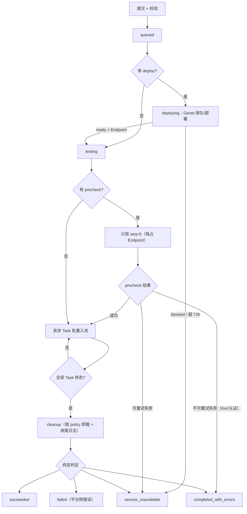
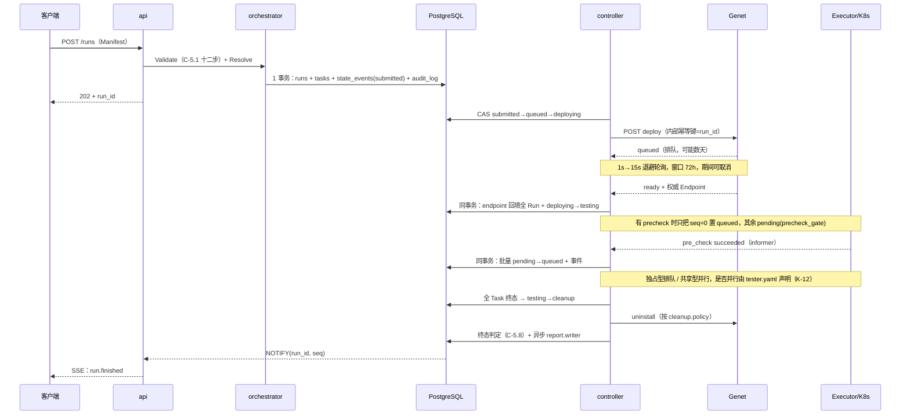
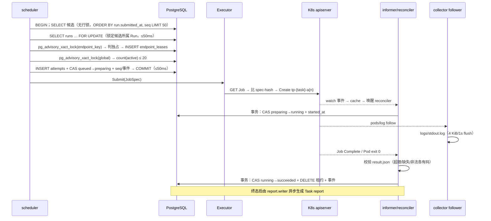
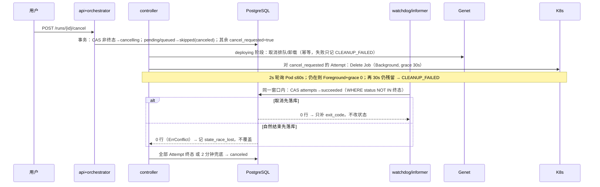

# 04 进程视图（Process View）

> **范围：** TestPlane 控制面的**运行时形态**——有哪些并发单元、各自按什么周期跑、一次 Run / Task 的交互时序、关键路径靠什么锁保证正确、故障时在跑的东西会怎样、事件如何推到客户端、时间花在哪里、哪些循环必须单活。
> **不在范围：** 状态与转移表（见 [02 逻辑视图](02-logical-view.md) §2–§3，及 [`../ARCHITECTURE.md`](../ARCHITECTURE.md) §7）；表、列、索引（[03 数据视图](03-data-view.md)）；Job 渲染、挂载、日志分段细节（[`../impl/execution.md`](../impl/execution.md) §2–§3、§7）；副本数、探针、节点与容量（[06 物理视图](06-physical-view.md)）。
> **基线：** ARCHITECTURE v0.5、IMPLEMENTATION（K-1…K-12 已拍板）、C-3/C-4/C-5/C-6/C-9、E-4/E-5/E-7。**本文不新增设计裁决**：文中数字未标来源的都是 C-11 / E 分册的实现默认值，可配。
> **读法：** §1 谁在跑；§2 按什么顺序跑；§3–§5 并发下靠什么保证正确；§6 慢在哪；§7 部署时受什么约束。

---

## 1. 进程与角色

### 1.1 三个角色，一个二进制

`testplaned --role=api|controller|collector|all`（I-4.1）。同一镜像，角色只改启动参数与副本数。

| 角色 | 干什么 | 明确不干 | 状态 | 扩缩 |
|---|---|---|---|---|
| `api` | REST、SSE fanout、鉴权、校验、读投影 | 不建 Job、不调 Genet、不推进状态 | 无状态 | 多副本，滚动 |
| `controller` | 调度、编排推进、对账、超时、报告、`events.jsonl`、GC、保留期 | 不服务用户请求；不写产物内容 | 内存只有 cache（可丢） | **单活**（Lease） |
| `collector` | Tester / Deploy Pod 日志跟随、`pods.json`、配额 walk | 不改 Task 状态、不判日志体积为失败 | 内存只有游标 | 多副本 + 分片 |
| `all` | 三者同进程（P0 默认，K-7） | — | — | 1 副本 |

**一条硬约束支撑下面所有判断：只有 `controller` 推进状态**（C-1 规则 2、C-2.5）。`api` 与 `collector` 只表达事实或只读，所以它们可多副本；反过来说，任何"顺手在 api 里改个状态"的实现都会破坏本视图。

### 1.2 循环清单

| 循环 | 触发 | 周期 | 事务边界 | 失败重试 | 幂等键 |
|---|---|---|---|---|---|
| `api.http.serve` | 连接到达 | 常驻（`:8080`） | 每请求 1 个只读事务；写请求由 orchestrator 开 1 个短事务；SSE 长连接**不占事务** | 不内部重试，错误体带 `retryable` 交客户端 | 无（提交不做幂等，D-37） |
| `api.sse.fanout` | `LISTEN` 通知 / 新订阅 | 事件驱动，无周期 | 无（只读 `state_events`） | 查库失败：记日志、保持连接，下一条事件重查 | `(run_id, seq)` 去重 |
| `api.sse.heartbeat` | ticker | 15s `: ping`；空闲 60s 断开 | 无 | 客户端按 `Last-Event-ID` 重连 | `Last-Event-ID = seq` |
| `api.schedview.poll` | ticker | 15s（单查超时 5s） | 无（K8s/Volcano 只读，不写库） | 不可达 → `scheduler_unavailable`，保留上次快照并标 stale | 只读，无 |
| `controller.leader` | ticker | TTL 15s / 续约 5s | 无（K8s `Lease` 对象） | 续约失败立即停全部业务循环、转待命 | `testplane-controller-leader` |
| `controller.scheduler.tick` | `NOTIFY` + 兜底 ticker | ≤ 1s | **每候选 1 个事务**：取槽位 + 插 attempt + CAS `queued→preparing` + 事件 | 冲突（`ErrConflict` / 23505 / 40P01）→ 回 `queued`，下轮重来 | `job_id = j-<sha256(task_id/attempt)[:8]>` |
| `controller.informer.jobs` | list/watch（每集群 1 factory） | `resyncPeriod 5m`（只对齐，不触发业务） | 无：handler 只更新内存 cache + 有界 channel(1024) | Reflector 自动重连；410 Gone 重 list；`HasSynced` 前不判定 | label `testplane.io/job-id` |
| `controller.informer.pods` | 同上，二级过滤 `job-id` | 同上 | 同上 | channel 满 → 丢弃并置脏，由 30s 对账补 | 同上 |
| `controller.reconciler` | ticker + channel 唤醒 | 30s（`TESTPLANE_RECONCILE_INTERVAL`） | 每条结论 1 个事务（CAS + 事件）；读 K8s 在事务外 | 单轮 ≤500 条、单次 5s；失败不阻塞下一轮 | `(attempt_id, job_id)`；结论只认一次 |
| `controller.watchdog.timeout` | ticker | 10s | 两段：先落库 `failed/TASK_TIMEOUT`，再删 Job（不同事务，顺序不可换） | Job 删失败 → `CLEANUP_FAILED` + 1m/5m/15m 退避 ≤5 次 | `attempt_id` + CAS `NOT IN (终态)` |
| `controller.genet.poller` | 部署受理后启动 | 前 30s 每 1s，其后 5s 起指数退避、上限 15s；总窗口 72h | 状态落库 1 事务；Genet 调用在事务外（单请求 10s 超时） | 连续 5 次失败且累计 ≥60s 才收口 `failed`（防网络抖动误判） | 内部幂等键 = `run_id`；`deploy_id` 落库 |
| `controller.genet.uninstall` | Run 进 `CLEANUP` 且策略要求 | 一次性，超时 5 分钟 | 结果写 `state_events`，**不改终态** | 幂等（404 视为成功）；失败 `CLEANUP_FAILED` + 告警 | `run_id` |
| `controller.report.writer` | `run.finished` 后异步 / 报告缺失对账 | 串行 1 worker，队列深度 ≤1000 | 只读库、只写 NFS，不开写事务 | 1m/5m/15m 退避 ≤5 次；未生成时对外 404 + `Retry-After` | 覆盖写（内容由库派生，重写即幂等） |
| `controller.events.jsonl` | `NOTIFY` + 1s 轮询兜底 | ≤1s（或攒 64 行） | 无（只读 `state_events`，只追加文件） | 重启后读文件尾 `seq` 与库比对，缺则补 | `(run_id, seq)`：已存在的 seq 跳过 |
| `controller.gc.orphan` | ticker | 10m | 无（删 K8s 对象 + `ResultSink` 回写状态） | 下轮重来；`hold-until` 未过期则跳过 | label `managed=true` + `job-id` |
| `controller.retention.sweeper` | ticker（每日 03:00 Asia/Shanghai） | 24h | 每 Run 1 事务（删索引 + 审计），文件删除在事务之后 | 失败下一轮继续；先 `dry_run` 算体积再删 | `run_id`；`cleanup.policy` 不参与（G-13） |
| `controller.consistency.check` | ticker | 每小时（不变量扫描）+ 每夜（全量） | 只读 + 只告警；**不自动改终态**（02 §5） | 失败下一轮；悬挂 Run 清单交 admin | `(run_id, check_name)` |
| `collector.leader` | ticker | TTL 15s / 续约 5s | 无（Lease） | 丢租约 → 停写 `pods.json`，重新竞选 | `testplane-collector-leader` |
| `collector.discover` | ticker | 30s（按 Genet `PodSelector` LIST） | 无 | 失败沿用上次清单；Pod 消失写 `terminated` 标记 | `pod_name` |
| `collector.follower` | Attempt 进 `running` / Deploy Pod 出现 | 流式 `follow=true`，EOF 关闭 | 无（只写 NFS `logs/`） | 断线 `sinceTime=lastTS` 重连 + `log resumed` 标记；丢租约即停写 | Lease `tp-log-<jobhash>`；游标 = 服务端时间戳 + 200 行去重窗 |
| `collector.quota.walker` | ticker | 60s/Attempt（单次 <50ms 量级） | 无（只读文件系统） | walk 失败 → `quota_check_skipped`，不判失败 | `attempt_id` + 目录路径 |
| `collector.podsjson` | ticker | 30s（temp + rename 原子写） | 无 | 写失败下轮重写，旧文件保留 | `run_id` 覆盖写 |

**"事务边界"这一列是硬约束**：事务内禁止 K8s / Genet / NFS IO（C-2.5）。凡是表里写"事务外"的调用，都必须先拿结果、再把结果变成状态。

### 1.3 角色 × 循环

| 循环 | api | controller | collector |
|---|---|---|---|
| `http.serve` / `sse.fanout` / `sse.heartbeat` / `schedview.poll` | ● | ○ | ○ |
| `leader` / `scheduler.tick` / `reconciler` / `watchdog` / `genet.poller` / `genet.uninstall` | ○ | ● | ○ |
| `informer.jobs` / `informer.pods` | ○ | ● | ○（只读 Pod 用 `logs`/`LIST`，不建 informer） |
| `report.writer` / `events.jsonl` / `gc.orphan` / `retention.sweeper` / `consistency.check` | ○ | ● | ○ |
| `collector.leader` / `discover` / `follower` / `quota.walker` / `podsjson` | ○ | ○ | ● |

`--role=all` 时全部 ● 在同一进程；循环按角色开关挂载，**不因合并而共享事务**。

### 1.4 并发预算

| 角色 | 常驻 goroutine 量级 | 上限与说明 |
|---|---|---|
| `api` | 1 listener + 2/SSE 连接（读+写）+ 1/fanout 频道 | 1000 并发 SSE ≈ 2×10³ goroutine；每连接缓冲 256 事件、超 64 KiB 慢连接的帧丢弃并置脏 |
| `controller` | 约 10 个常驻循环 + 每候选短事务 + 每集群 1 factory（2 informer × 2 goroutine） | 调度 tick 内 ≤20 个事务；对账单轮 ≤500；cache 与活跃 Job 数成正比 |
| `collector` | 1 leader + 每被跟随对象 3 goroutine（read / pump / flush）+ 定时器组 | 每副本 ≤200 follower；单文件 4 KiB `bufio` + 1s flush |
| `all` | 三者相加，P0 单 Pod 峰值 ≈ 3×10³ | 4 vCPU / 2 GiB 起；SSE 连接数是第一变量，不是 Task 数 |

---

## 2. 一次 Run 的时序

### 2.0 业务流总图



### 2.1 提交 → 排队 → Pre-Check → 并行 Task → CLEANUP → 报告



四处需要点明：

1. **提交只有 1 个事务**；`202` 之后的一切都在 controller 里推进，api 不参与。
2. **排队不是本进程的等待**：`genet.poller` 每轮只花毫秒级，72h 窗口靠 `deploy.queued_at` + 事件推给前端，不占连接、不占 goroutine。
3. **`precheck_gate` 是唯一的序化点**（C-4.5）；其他 Task 之间没有"seq 顺序"，只有端点槽位与全局 permit 决定的先后。
4. **CLEANUP 是独立阶段**：先停 collector 对 Deploy 的跟随，再卸载，最后落终态；卸载失败只记事件。

### 2.2 单个 Task 的执行细节



要点：**Job 创建在事务外**（C-2.5），失败走 `preparing→failed`（`IMAGE_PULL_FAILED` / `MOUNT_UNAVAILABLE` / `EXECUTOR_UNAVAILABLE`），命中 `retry_on` 才回 `queued`（`available_at=now+backoff`）。**租约释放与终态同事务**（C-4.3），否则崩溃会泄漏槽位。

### 2.3 取消与自然结束的竞态（含 Deploy 排队期取消）



三条不变量：**先落库者胜**（CAS + `state_race_lost`，E-5.3）；**取消不悬挂**（2 分钟兜底，`CANCELLING` 不是归宿）；**删 Job 失败不回滚状态**（只记 `CLEANUP_FAILED` + 告警，C-6.4）。

---

## 3. 关键路径的并发控制

### 3.1 锁与互斥清单

| # | 机制 | 位置 | 持有范围 | 顺序 | 失败 / 冲突处理 |
|---|---|---|---|---|---|
| 1 | `SELECT runs … FOR UPDATE`（逐候选） | `scheduler.claim`（C-4.2 的候选集） | Run 行锁覆盖该候选整段 dispatch（≤50ms），不跨轮 | 第 1 | 同 Run 的其他推进等待或超时跳过；`lock_timeout=2s` → 本轮放回 |
| 2 | `pg_advisory_xact_lock(hashtext(endpoint_key))` | `scheduler.acquireEndpointLease`（C-4.3） | 覆盖"查持有者 → INSERT 租约"整段；xact 结束即释放 | 第 2 | `lock_timeout=2s` → 放弃该候选，写 `waiting_reason=slot_waiting`；只降并发，不影响正确性 |
| 3 | `pg_advisory_xact_lock('testplane:global-concurrency')` | `scheduler.acquireGlobalPermit`（C-4.4） | 覆盖"count 活跃 + 插 attempt"；全局单点串行 | 第 3 | 2s 超时 → `global_limit`；20 并发下每次毫秒级，实测非瓶颈 |
| 4 | CAS `UPDATE … WHERE status IN ($from)`（`Kernel.Apply` 第 4 步） | `Kernel.Apply` / `AttemptMachine.Finish` | 单行行锁，至提交；不跨语句 | 第 4（必须在 advisory 之后） | 返回 0 行 → `ErrConflict` → 重读，先落库者胜；终态不进 `from` 集合 |
| 5 | `runs.last_event_seq` 原子自增（`Kernel.Apply` 第 5 步） | `store.nextSeq` | 单行 `UPDATE … RETURNING`，与状态写同事务 | 紧跟 CAS | 40P01 死锁 → 整事务退避 20ms 重试 1 次，仍失败记 `INTERNAL_ERROR` |
| 6 | 部分唯一索引 `attempts_active_uq` | 启动 Attempt | 索引即约束：一 Task 至多 1 个 `preparing/running` | 事务内 | 23505 → 判定竞态，回 `queued`，不重试本事务 |
| 7 | 部分唯一索引 `endpoint_lease_excl_uq` | 插独占租约 | 一 Endpoint 至多 1 个独占持有者 | 事务内 | 23505 → 回退（advisory 已串行，正常不触发） |
| 8 | informer cache + 30s 对账 | `executor.Status` / `reconciler` | 内存，无锁；`resync 5m` 只对齐 | — | 未 `HasSynced` 不判定；cache 缺项 → `GET`；`unknown` 按 0/5/20/60s 四步复核，≤90s |
| 9 | K8s `Lease` 选主 | `controller.leader` | TTL 15s / 续约 5s；非 leader 不启业务循环 | — | 抢不到 → 待命但不退出；进程存活、`/readyz` 仍成功（见 §7） |
| 10 | collector 双层 Lease | `collector.leader` + `tp-log-<jobhash>` | 外层：分配、`pods.json`、回收死 follower；内层：单文件的唯一写权 | 先外后内 | 内层丢失立即停写；新持有者从 checkpoint 续采并写 `log gap`（E-7.3） |

> advisory 的键名以 C-4.4 字面为准；[02 §3.8](02-logical-view.md) 里的 `testplane:global` 是同一把锁的简写，实现只能有一处常量。状态写入只经 `Kernel.Apply`（02 §3.3）；表里的 `scheduler.*` 是实现层函数名，不是契约。

### 3.2 加锁顺序与死锁规避

- **固定顺序**：实体的行锁统一为 **Run → Task → Attempt**（批量按 id 升序）；调度事务先锁候选所属的 Run，再取 endpoint advisory（#2）→ 全局 advisory（#3）→ CAS Task（#4）→ 写 `endpoint_leases` / `attempts` → 写 `state_events`。任何代码不得倒序，也不得在持有 advisory 后再去锁另一个 Run。
- **一个事务只处理一个候选**：tick 内最多 20 个事务，禁止批量持有多个 `tasks` 行锁——多候选批处理是死锁的唯一现实来源。
- **只用事务级 advisory**（`_xact_`），禁止会话级：连接池复用会让会话锁泄漏到别的请求上。
- **超时护栏**：`lock_timeout=2s`、`statement_timeout=3s`、调度事务 `SET LOCAL statement_timeout=40ms`、`idle_in_transaction_session_timeout=5s`。
- **争用可观测**：`scheduler_tx_slow_total`（>40ms）、`lock_wait_seconds`、`state_race_lost_total`、`reconcile_exhausted_total`。没有指标的自旋锁等于没有锁。

### 3.3 内部操作的幂等键

> **对外提交没有幂等**（D-37）：`POST /runs` / `POST /tasks` 每次都新建，重复提交 = 多个 Run。下表只是实现层的"重复执行不产生副作用"，不构成对调用方的承诺。

| 对象 | 键 | 冲突语义 |
|---|---|---|
| Job | `job_id = j-<sha256(task_id/attempt)[:8]>`，K8s 名 `tp-<task>-a<n>` | `GET` 先查，`spec-hash` 相同即复用，不同 409（E-2.3） |
| Deploy | `run_id` | 一 Run 一次部署；对方不支持幂等头则"先 GET 再 POST"+ 落 `deploy_id` |
| 事件 | `(run_id, seq)` | 唯一约束；jsonl 与 SSE 都按它去重 |
| 日志文件 | `tp-log-<jobhash>` Lease | 单写者；续采靠时间戳游标 |
| 报告 | 覆盖写 | 内容由库派生，重算即重写 |

---

## 4. 故障恢复

| 故障 | 进行中的 Run / Task / Attempt | 恢复动作 | 用户可见 |
|---|---|---|---|
| **controller 崩溃** | 状态全部停留在库中最后一次提交；`RUNNING` 的 Job 继续跑、Pod 不删；`attempts` 不再更新 | Lease 15s 过期后新 leader 接管；`HasSynced` 后 30s 内对账拉平；Job 缺失需连续 3 次（≈1min）确认才判 `EXECUTOR_UNAVAILABLE` | Run 状态"冻结"但合法；SSE 心跳仍在、无新事件；详情页标"待确认"（`executor_observation_unknown`）；不显示失败 |
| **api 副本摘流** | 不影响任何 Run；该副本上的 SSE 连接断开 | `Last-Event-ID` 重连到其他副本并从库回放（24h / 1000 条内）；无粘滞会话 | 流式刷新中断 1–2s 后自动续上；不丢事件，超窗则整页重建 |
| **DB 不可用** | controller **暂停推进**，不误判；Job 继续跑；已提交事务不丢 | `/readyz` 失败摘流；连接池退避重连；恢复后 30s 对账对齐；已跑的 `RUNNING` 不假定失败 | 写操作 503 + `Retry-After`；读接口降级失败；状态停在最后一次落库值，不出现"假终态" |
| **K8s API 不可达** | Task 停在 `PREPARING`（建 Job 失败）或 `QUEUED`；已在跑的 Pod 不受影响 | 建 Job 失败 → `EXECUTOR_UNAVAILABLE`（可重试）按 `retry_on` 回 `queued`；`unknown` 走四步复核，不直接判失败 | `QUEUED/PREPARING` + `waiting_reason` 不变；错误码 503、`retryable: true`；不显示 Task 失败 |
| **Genet 不可达** | `DEPLOYING` 的 Run 停在原地；尚无 Task/Attempt | 轮询单次 10s 超时；连续 5 次且累计 ≥60s → `failed`（平台侧）；72h 未 ready → `service_unavailable`；**排队期间不可达不算 blocked** | 终态区分清楚：`failed` 找平台，`service_unavailable` 找部署方（§7.5） |
| **NFS 抖动** | `PrepareAttempt` 失败则不建 Job；运行中则日志断流、产物可能写不进 | 预创建失败 → `EXECUTOR_UNAVAILABLE`（可重试），**不**混成 `MOUNT_UNAVAILABLE`；`result.json` 读取区分"不存在"与 I/O 错误（后者 1s/2s/4s 重试 3 次才收口）；日志写 gap 标记 | 重试中的 Task 保持 `QUEUED`；日志出现 `--- [log gap: …] ---`；不把 NFS 抖动记成测试失败 |
| **collector 崩溃** | Task 状态完全不受影响；该 Run 日志出现断档 | 新副本抢 `tp-log` 租约，从 checkpoint 续采并写 gap；`pods.json` 由外层 leader 30s 内重写 | 日志文件出现缺口标记（可正则识别）；UI 显示"采集中断"而非"服务无输出" |
| **Tester Pod 重启 / 驱逐** | `restartPolicy: Never` + `backoffLimit: 0` → 该 Attempt 直接失败，不重启续跑 | `OOMKilled` / `Evicted` → `failed` + `INTERNAL_ERROR`（`detail.k8s_reason` 保原文）；可按 `retry_on` 重试成新 Attempt；`Unschedulable` 不判失败，超时后按 `TASK_TIMEOUT` 收口 | 该 Task `FAILED` 带 K8s 原因；其余 Task 按 `continue/abort_run` 继续或收尾；历史 Attempt 不被覆盖 |
| **Deploy Pod 重启** | Run 不受影响（Pod 不是 Attempt）；服务可能短暂不可用 | 日志续写同一文件并插 `container restarted #N`；后续 Task 若撞上未就绪 → `ENDPOINT_UNREACHABLE`/`PRECHECK_FAILED`（可重试） | 日志可见重启标记；详情页展示重启次数与状态，不假设"只有一个实例"（§9.1） |

**共性规则**：故障不产生"猜出来的状态"。要么保持上一个已提交状态，要么落一个带错误码的终态；**绝不**因为观测不到就判失败（§12.5 第 2 条、附录 B `unknown` 语义）。

---

## 5. 事件与推送路径

### 5.1 写路径（DB 是唯一权威）

```text
状态事务 COMMIT
   └─ NOTIFY testplane_run_<id>, payload={run_id, seq}   （提交后发，≤100B）
        ├─ api 每个副本 LISTEN（无粘滞）→ 按 (run_id, seq) 查 state_events → 分发给本副本订阅者
        │      └─ SSE 帧：id: <seq> / event: <type> / data: <JSON>
        └─ controller.events.jsonl 单 writer → 追加 <storage-root>/<run>/events.jsonl
```

- **`NOTIFY` 放在事务提交后**（C-3.3）：推已回滚的事件比晚 2ms 严重得多。payload 只带 `run_id + seq`，绕开 PG 8 KiB 限制，正文一律回查。
- **`events.jsonl` 单 writer**：只有 controller leader 内的一个 goroutine 写；输入是 NOTIFY 与 1s 轮询的并集，按 `seq` 排序去重；每 1s 或 64 行 flush。重启后读文件尾 `seq` 与库比对补齐（G-8：文件是派生，可整文件重建）。
- **文件与库不一回事**：库是权威，文件落后一个 flush 周期是允许的；反过来"文件有、库里没有"是缺陷。

### 5.2 断线回放与 `resync_required`

| 场景 | 行为 |
|---|---|
| 断线 ≤24h 且缺失 ≤1000 条 | 从 `Last-Event-ID` 之后回放，客户端按 `seq` 去重；不重排 |
| 超出窗口（>24h）或超条数 | **先发 `resync_required`**，客户端整页重建（拉 `/runs/{id}` + `/events/history`），**不静默截断** |
| 慢客户端（缓冲满 256 或 64 KiB） | 丢弃该连接并置脏，客户端重连走回放；不阻塞其他订阅者 |
| 空闲 | 15s `: ping`；60s 无数据断开重连 |
| 事件类型 | 只用 C-9.1 的枚举；`payload` 不含凭据，**日志内容不走 SSE**（日志走 `…/logs?follow=1`） |

多副本下每个 api 都能服务任一订阅者，代价是 N 次回查；P0 的 N（api 副本）≤3，按 `queue_depth` 与 SSE 连接数决定是否加副本。

---

## 6. 时延预算

### 6.1 状态查询 P95 < 300ms（§12.7）

| 段 | 预算 | 手段 |
|---|---|---|
| TLS / HTTP 复用 | 0（长连接）/ 8ms（冷） | keep-alive；不做每请求握手 |
| 认证 + RBAC | 5ms | JWKS 内存缓存 10min，无远程校验 |
| 路由 + 请求解析 | 2ms | chi，无反射绑定 |
| 连接池获取 | 3ms | `max_conns=20`（4×vCPU，上限 40）；只读事务立即结束 |
| 查询 | 20ms | 详情 1 条 JOIN（`tasks(run_id, seq)`）；列表游标扫 ≤50 行（`runs(status, submitted_at DESC)`），**不用 OFFSET** |
| 序列化 | 10ms | 预分配 buffer；attempt 摘要一次带出，杜绝 N+1 |
| 内网传输 + 首字节 | 20ms | 同集群 |
| **合计（P95 预算）** | **≈60ms** | 对 300ms 留 5× 余量给 PG 抖动与 GC；慢查询 >50ms 记 `pg_slow_query_total` |

单 Run ≤200 Task（`RUN_TOO_LARGE` 拦截）是这条预算的前提；再加 Task 数会先打爆序列化，不是查询。

### 6.2 调度一次事务 < 50ms

| 段 | 预算 |
|---|---|
| `BEGIN` | 1ms |
| 候选查询（`tasks_ready_idx`, `LIMIT 50`，不加行锁） | 3ms |
| endpoint advisory 等待 | ≤10ms（常态 <0.5ms，持锁方只做 3 条语句） |
| 租约判定 + `INSERT` | 1ms |
| 全局计数（活跃行 ≤20） | 2ms |
| `INSERT attempts` + CAS task + `seq` + 事件 | 3ms |
| `COMMIT`（本地盘 WAL fsync） | 3–6ms |
| **合计** | **20–25ms 典型，50ms 硬线** |

超 40ms 记 `scheduler_tx_slow_total`；每 tick 20 个事务仍能塞进 1s。NFS 不参与任何事务——这是这条预算成立的根本原因。

### 6.3 SSE 事件端到端 < 1s

| 段 | 预算 |
|---|---|
| 状态事务 COMMIT（含 fsync） | 3ms |
| `NOTIFY` 投递到 api（同机 PG） | 1–3ms |
| api 回查 `state_events`（唯一索引） | 5ms |
| fanout 到订阅者 channel | <1ms |
| 写 TCP + 客户端首字节（同集群） | 20ms |
| 客户端批量失效 + 渲染 | 50ms |
| **合计** | **P50 ≈80ms，P95 <1s** |

**不承诺跨集群**：controller / api / PG 同集群部署时上述成立；Genet 与被测服务在别的网络里，只影响 Run 推进速度，不影响事件路径。若把 api 与 PG 分置两集群，按"秒级 + 回放兜底"理解，不套用 1s 预算。

---

## 7. 进程视图 → 物理视图（[06](06-physical-view.md)）的约束

| 循环 / 组件 | 部署要求 | 理由 |
|---|---|---|
| controller 全部业务循环（scheduler / reconciler / watchdog / genet poller / report.writer / events.jsonl / gc / retention） | **必须单活**：`replicas: 1` + `strategy: Recreate`，或 2 副本靠 Lease 待命 | 双写会重复推进状态；单活靠 Lease，不靠"只有一个 Pod"这个事实 |
| `api.http.serve` / `api.sse.fanout` | **多副本 ≥2**，`maxSurge 1 / maxUnavailable 0`；不要求会话粘滞 | 无内存状态；SSE 靠 `Last-Event-ID` 回放跨副本续订 |
| `collector.leader` | **单活**（全局 Lease），只做分配、`pods.json`、回收死 follower | 避免多副本重复写元数据 |
| `collector.follower` | **多副本分片**：分片键 `hash(job_id) % N`，每副本 ≤200 follower | 文件写权已由 `tp-log` 租约保证；分片只为摊吞吐 |
| `controller.informer.*` | 每副本各自一套（每集群 1 factory，2 类资源），**不选主** | 只读缓存；单活会让 failover 后重新 list 变慢 |
| `api.schedview.poll` | 每 api 副本各自 15s 缓存 | 只读、可短暂 stale，不共享 |
| 探针 | api `/readyz` = DB ping + NFS 可写 + 迁移版本匹配（**不含 K8s**）；controller `/readyz` **不因"非 leader"失败**，leader 状态走 `controller_is_leader` 指标 | K8s 抖动不该摘掉能读历史报告的 api；待命副本被摘流会导致真 leader 挂掉时无人接班 |
| 升级顺序 | controller（Recreate，在跑 Job 不删，由对账接管）→ collector（≤30s 租约接管并写 gap）→ api（滚动） | 每步都有可解释的短暂降级，不需要"同时重启" |
| 存储前提 | RWX PVC 必须全节点可见；`subPath` 只到 `attempts/<n>` | 产物直落最终路径（§6.8），单写者只依赖 `O_APPEND` + Lease |

**分片容量线**：队列深度 >200 个 `queued` Task，或调度事务 P95 >50ms 时，才考虑按 `run_id` 分片 controller（`tasks` 已按 `run_id` 聚集，DB 层预留）。P0 的量级（每日百级 Run、20 并发 Task）单活足够，不提前拆。
