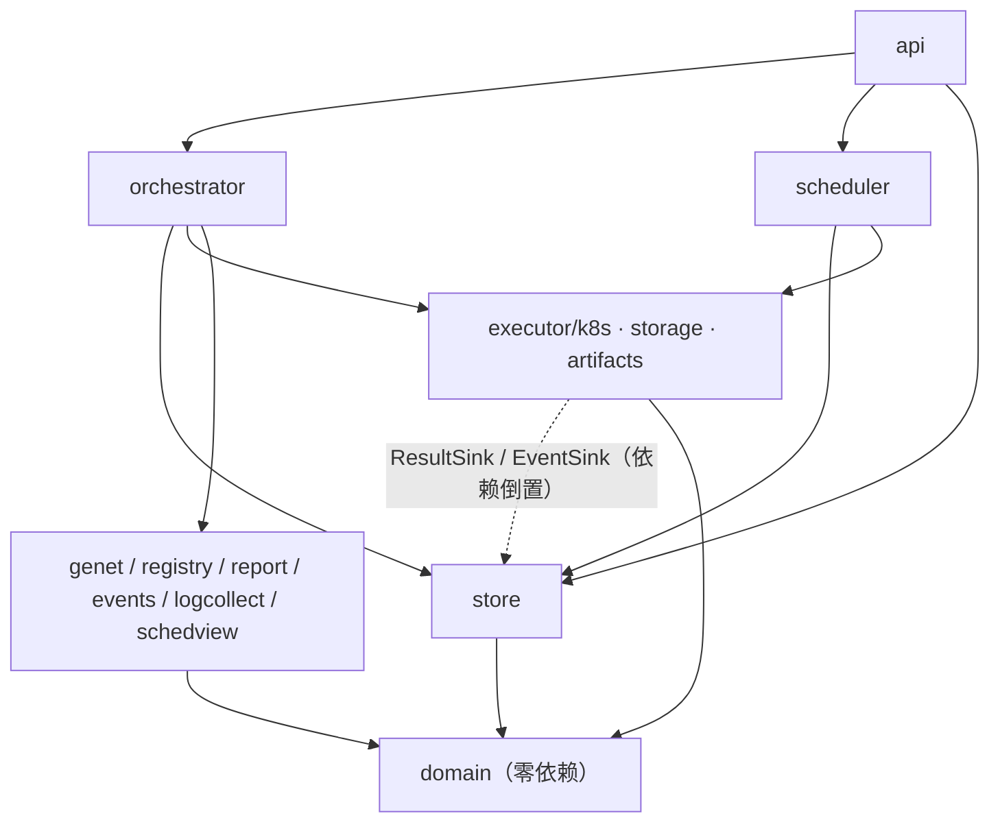

# 05 开发视图（Development View）

> **视角与效力：** 代码怎么组织、怎么构建、怎么被约束——回答"改动该落在哪个包、能不能 import 它、提交前必须过哪些门"。本文是组织视图，**不新增设计裁决**；与 [`ARCHITECTURE.md`](../ARCHITECTURE.md)（v0.5）冲突时以它为准，选型与默认值以 [`IMPLEMENTATION.md`](../IMPLEMENTATION.md)（K-1…K-12）及三份分册为准。
> **引用约定：** `§x.y` = ARCHITECTURE；`I-x` = IMPLEMENTATION；`C-x` / `E-x` / `W-x` = `impl/control-plane.md` / `execution.md` / `web-and-delivery.md` 的章节。路径均以仓库根为基准。

---

## 1 前置事实（已拍板，不再讨论）

| 项 | 结论 | 出处 |
|---|---|---|
| 控制面语言 | **Go 1.23+**（`server/go.mod` 声明 `go 1.23`；CI 编译镜像 `golang:1.24-alpine`） | I-3.1、K-1、W-8 |
| 交付形态 | 单二进制 `cmd/testplaned`（`--role=api\|controller\|collector\|all`）；**Go 模块根 = `server/`**（仓库唯一 `go.mod`） | I-4.1、W-7 |
| 前端 | React 19 + TS + Vite 7 + Tailwind v4 + shadcn/ui，产物 `go:embed` 到 `server/internal/webui/dist` | K-2、W-1 |
| 状态存储 | **PostgreSQL 外部实例**；`pgx/v5` + `sqlc` + `golang-migrate` | K-9、I-3.1 |
| 产物存储 | NFS **RWX** 挂 `/storage-root`，容器 `subPath` 直挂最终路径 | §6.8、D-16 |
| Tester 来源 | 镜像内 `/app/testers`，启动扫描一次，**无运行时同步** | K-3、E-10 |
| 日志 | **明文，不脱敏**（平台不读 Secret 做替换） | K-5、D-30 |
| Deploy 窗口 / P0 副本 | 部署窗口默认 **72h**（Profile 可覆盖）；P0 **单副本** | K-6、D-31、K-7 |

## 2 代码结构

### 2.1 仓库顶层
```text
TestPlane/
├── server/     # Go 模块（唯一）；只有这里能 import Go 包，web/ 不参与 go build
├── web/        # React SPA，独立 pnpm 工程；只从 openapi.yaml 生成类型，不手写
├── testers/    # Tester 白名单：只认 tester.yaml + run.sh，build/ 是 CI 上下文
├── deploy/     # helm chart、values、versions.lock；chart 不内置数据库
├── design/     # 设计文档与原型（不进镜像，见 .dockerignore）
└── .github/    # CI 流水线与 PR 模板
```

### 2.2 `server/` 目录树
```text
server/
├── go.mod  go.sum
├── api/openapi.yaml          # 契约唯一源（OpenAPI 3.1）
├── cmd/testplaned/main.go    # 唯一入口：解析 --role 后装配
├── internal/
│   ├── api/                  # 路由、中间件、handler、SSE、错误映射（薄）
│   ├── domain/               # 状态枚举、转移表、校验规则（零 IO、零第三方依赖）
│   ├── store/                # 唯一 SQL 入口：事务、CAS、事件、锁（queries/ 手写，dbgen/ 生成）
│   ├── orchestrator/         # 提交校验、precheck 注入、Run 推进、abort、cleanup、终态判定
│   ├── scheduler/            # 候选选取、端点槽位、全局 permit、超时 watchdog
│   ├── executor/{k8s,storage,artifacts}  # Job 渲染与对账 / 目录预创建 / result.json 校验
│   ├── logcollect/           # Pod 日志跟随、分段、重启/gap 标记、单写者 Lease
│   ├── genet/                # Genet client（dto.go 收敛字段）+ fake/
│   ├── registry/             # testers/ 扫描、Schema 校验、版本不可覆盖
│   ├── report/               # Task/Run report、report.md 模板、ValidateResult
│   ├── events/               # state_events → events.jsonl / SSE 广播
│   ├── auth/                 # OIDC、会话、RBAC、服务令牌
│   ├── copy/                 # 用户可见中文文案（状态/错误码），字体子集采集源
│   ├── webui/                # embed.go：//go:embed all:dist
│   ├── config/               # 配置结构、env→字段映射、启动校验
│   ├── metrics/              # Prometheus collector
│   └── schedview/            # Volcano / Node 只读视图（waiting_reason 输入）
├── migrations/               # golang-migrate，只加不删
└── schemas/                  # tester / result / manifest 三份 JSON Schema
```

`cmd/tpctl/` 属 P1，P0 **不建目录**（I-13）；`schedview` 来自 I-5，与 `api` 同层只读，不参与状态推进。

## 3 分层与依赖规则

箭头即**允许的 import 方向**，反向一律禁止：


（`api` 还允许 import `webui`/`auth`/`copy`/`metrics`，为免连线拥挤未画。）

### 3.1 允许 / 禁止 import 清单

| 包 | 允许 import | 禁止 import | 理由 |
|---|---|---|---|
| `domain` | 仅标准库（`time`/`errors`/`slices`） | 任何 `internal/*`、`pgx`、`client-go` | 纯规则，必须零 IO 且可被所有人引用 |
| `config` | 标准库、`domain` | `store`/`api`/`executor` | 启动期只做校验，不做业务 |
| `store` | `domain`、`pgx`、`dbgen` | `api`/`orchestrator`/`scheduler`/`executor` | 被依赖方不得反向依赖调用方 |
| `orchestrator` | `domain`、`store`、`executor/*`、`genet`、`registry`、`report`、`events` | `api` | 编排是主体，不感知 HTTP |
| `scheduler` | `domain`、`store`、`executor/k8s`、`schedview` | `api`、`report` | 只产出"谁该跑"，不产出报告 |
| `executor/*` | `domain`、`client-go`、标准库；`store` **仅限窄接口** | `api`、`orchestrator`、`store.Transition*` | 执行层不写 `tasks`/`runs` 状态（I-5） |
| `logcollect` | `domain`、`client-go`、`store` 窄接口 | `api`、`scheduler` | 只写文件与物理事实 |
| `genet`/`registry`/`report`/`events` | `domain`、store 窄接口 | `api`、orchestrator 内部实现 | adapter 只回写事实，不推进状态（C-1③） |
| `schedview` | `domain`、`dynamic`/`typed` client | `store`、`api`、`executor` | 只读快照，禁止写回调度器（§6.9） |
| `api` | 全部下层 + `auth`/`webui`/`copy`/`metrics` | **直接调 `executor`**、直接写 SQL | API 只做鉴权、校验、读写投影（C-8） |
| `auth` | `config`、`domain`、OIDC 库、store 窄接口 | `orchestrator` | 只回答"你是谁、能不能" |
| `webui` / `metrics` | 标准库 + `embed` / Prometheus 库 | 任何 `internal/*` / `store` | 只暴露 `fs.FS`；指标不得成为业务依赖 |

### 3.2 三条硬规则

1. **只有 `store` 执行 SQL**；其他包用方法表达意图（C-1）。
2. **只有 `store.Transition*` 改状态**，与业务写同事务、同事务写事件（§7.1、§12.5）。
3. **adapter 不写 `runs`/`tasks` 状态**，只回写 `attempts` 的物理事实与文件（E-1）；状态推进在 `orchestrator` 事务内。

**归属口诀：** 测试怎么做 → Tester；在哪跑、怎么起停 → `executor`；谁在什么情况下变成什么 → `orchestrator` + `store`；能看到什么 → `api` + `web`。

## 4 包职责与关键接口

| 包 | 一句话职责 | 关键接口 / 出口 |
|---|---|---|
| `domain` | 8 态转移表、错误码枚举、argv 词法规则 | 纯类型 + 纯函数 |
| `store` | 事务、CAS、事件 seq、租约、游标分页 | `StateStore` |
| `orchestrator` | 提交校验、precheck 注入、abort、cleanup、终态判定 | `Service`（被 `api` 调） |
| `scheduler` | 候选、端点槽位、全局 permit、watchdog | `Loop`（Notify + 1s 兜底） |
| `executor/k8s` | 渲染、informer、对账、取消与清理 | `Executor` |
| `executor/storage` · `artifacts` | `PrepareAttempt`（mkdir/chown/可写探测）；`result.json` 校验 | `Preparer` · `Validator` |
| `logcollect` | 跟随、分段、gap、单写者 | `Follower`（内部） |
| `genet` | 部署 / 状态 / 卸载 | `Genet` |
| `registry` | 扫描、校验、diff | `RegistryStore`（实现在 `store`） |
| `report` / `events` | 报告生成与 `ValidateResult` / jsonl 追加 + SSE fan-out | `Writer` / `Broadcaster` |
| `api` | REST、SSE、鉴权、错误映射；日志读取 | HTTP handler、`LogStore` |
| `copy` / `metrics` / `config` | 中文文案 / Prometheus / 配置校验 | `map`+`func` / `Collector` / `Config` |

```go
// 执行层：只声明"我要执行"，不声明"我要改状态"（E-1）
type Executor interface {
	Submit(ctx context.Context, spec JobSpec) (JobRef, error)      // 同 job_id 幂等（内部）
	Cancel(ctx context.Context, ref JobRef, mode CancelMode) error // 删 Job 并推动 Pod 消失
	Status(ctx context.Context, ref JobRef) (JobStatus, error)     // 命中 cache 不打 apiserver
	Reconcile(ctx context.Context, refs []JobRef) ([]JobStatus, error)
}
// 依赖倒置：执行层只声明需要的出口，实现方在 control-plane（C-13）
type EventSink interface{ Emit(ctx context.Context, ev Event) error }
type ResultSink interface {
	FinishAttempt(ctx context.Context, k AttemptKey, r AttemptResult) error
	FinishAttemptAsCanceled(ctx context.Context, k AttemptKey, r CancelResult) error
}
type Genet interface { // 内部幂等键 = run_id
	Deploy(ctx context.Context, req DeployRequest) (DeployReceipt, error)
	Status(ctx context.Context, deployID string) (DeployStatus, error)
	Uninstall(ctx context.Context, deployID string) error
}
// registry 只算 diff；落库走这里，同版本不同 hash → TESTER_VERSION_PINNED（E-10）
type RegistryStore interface {
	Diff(ctx context.Context, seen []TesterRecord) (SyncDiff, error)
	UpsertVersion(ctx context.Context, r TesterRecord) error
}
// 状态唯一写入口：内部调用 Kernel.Apply（02 §3.3），CAS 即并发控制，from 集合不含终态（C-3.3）
type StateStore interface {
	TransitionTask(ctx context.Context, id string, from []TaskStatus, to TaskStatus, reason string, ev Event) (*Task, error)
	TransitionRun(ctx context.Context, id string, from []RunStatus, to RunStatus, reason string, ev Event) (*Run, error)
}
// SSE：本副本 fan-out，跨副本靠 LISTEN/NOTIFY，载荷只有 run_id+seq（C-9.2）
type Broadcaster interface {
	Subscribe(ctx context.Context, runID string, lastSeq int64) (<-chan Envelope, func(), error)
	Publish(runID string, seq int64)
}
// 日志：按字节 offset 尾读，不整文件入内存（C-7.5）
type LogStore interface {
	Tail(ctx context.Context, ref FileRef, n int) ([]byte, int64, error)
	ReadAt(ctx context.Context, ref FileRef, off int64, limit int) ([]byte, error)
}
```

## 5 构建与生成

### 5.1 Make 目标

| 目标 | 做什么 | 备注 |
|---|---|---|
| `make dev` | 起本地 PG → `make migrate` → `go run ./cmd/testplaned --role=all --auth=dev` | 单命令起全栈，10 分钟内跑通一次 Run（W-14） |
| `make web` | `pnpm --dir web build` → 复制 `web/dist` 到 `server/internal/webui/dist` | `go:embed` 不能跨模块目录，必须复制 |
| `make build` | `make web` + `CGO_ENABLED=0 go build -trimpath ./cmd/testplaned` | 静态二进制，distroless 运行 |
| `make gen` | `oapi-codegen` + `openapi-typescript` + `sqlc generate` | 生成物**全部入库**，diff 为空才算过 |
| `make schemas` | 校验 `schemas/*.schema.json`（2020-12）+ 抽取字段表供人工校对 | 与 C-8.3、E-10 同源 |
| `make test` | `go test -race ./...` + `pnpm --dir web vitest run` | 含 testcontainers 集成 |
| `make lint` | `golangci-lint`、`eslint --max-warnings=0`、`spectral lint`、`helm lint` | 全部阻断 |
| `make migrate` | `migrate -path server/migrations -database "$DSN" up` | **只前向**，无 `down` 目标 |
| `make e2e` | kind 起集群 + `helm install` + 桩 Genet/OpenAI | 夜间与发版前 |

### 5.2 生成物与"重生成 diff 为空"门禁

| 生成物 | 唯一源 | 工具 | 入库 | 门禁 |
|---|---|---|---|---|
| `server/internal/api/oapi.gen.go` | `server/api/openapi.yaml` | `oapi-codegen` | 是 | `make gen && git diff --exit-code` |
| `web/src/lib/api/types.d.ts` | 同上 | `openapi-typescript` | 是 | 同一道 diff（一端漂移即失败） |
| `server/internal/store/dbgen/*.go` | `queries/*.sql` + `migrations/` | `sqlc generate` | 是 | 同上，另跑 `sqlc vet` |
| `server/internal/webui/dist/` | `web/` | `pnpm build` + `cp` | **否**（`.gitignore`） | 必须存在，否则 `//go:embed all:dist` 编译失败 |

生成物**不进 code review 讨论**（I-3.4），但必须入库；"改了 spec 没重生成"由 CI 直接拦下。`dbgen/` 禁止手改；SQL 只写在 `queries/*.sql`，事务与锁写在 `store/*.go`；`SKIP LOCKED` 只用于对账等扫描类读取，**不用于候选领取，也不用于状态转移**（候选领取先锁 Run，见 02 §3.8）。schemas 由 `make schemas` 做 2020-12 校验并抽取字段表供人工校对（C-8.3、E-10）。

### 5.3 前端构建与 embed
```bash
pnpm --dir web install --frozen-lockfile
pnpm --dir web build                              # → web/dist
rm -rf server/internal/webui/dist && cp -r web/dist server/internal/webui/dist   # 唯一允许的跨模块复制
cd server && go build -trimpath -o ../bin/testplaned ./cmd/testplaned
```
`server/internal/webui/embed.go` 用 `//go:embed all:dist` + `fs.Sub`，只暴露 `fs.FS`；缓存头、SPA fallback、CSP、dev 代理见 W-7（`/api/`、`/metrics`、`/healthz`、`/readyz` 不 fallback）。

## 6 代码规范

### 6.1 错误：包装、哨兵、错误码

| 层 | 做法 |
|---|---|
| `domain` | 只定义哨兵与分类（`ErrConflict` / `ErrNotFound` / `ErrInvalid`），不 import 框架 |
| `store` | `fmt.Errorf("store: transition task %s: %w", id, ErrConflict)`，**保留 `%w` 链** |
| adapter | 外部错误先归类再返回；**原始原因永不丢**（`detail.k8s_reason`、`detail.genet_state`） |
| `api` | 唯一映射点 `CodeOf(err) → (code, httpStatus, retryable)`；`code` 只用附录 D 枚举；未归类 → `INTERNAL_ERROR` + `trace_id`，**绝不**回传 pgx / client-go 原文 |
| 日志 | 只在"会被丢弃"的边界记一次，错误不重复打三层 |

### 6.2 context 与超时

| 场景 | 默认 | 取消来源 |
|---|---|---|
| REST 普通请求 | 30s | 客户端断开 / 网关 |
| SSE `/events`、日志 follow | 长连接（15s 心跳） | 客户端断开、`run.finished`、切 Tab |
| DB 单语句 / 单事务；K8s 单次 / LIST | 5s / 10s；5s / 30s | 请求 ctx |
| Genet 单请求 | 10s | 轮询 ctx（总窗口 72h） |
| NFS 目录准备 | 10s | 调度 ctx |

请求路径**禁止** `context.Background()`；每个 goroutine 派生并 `defer cancel()`；用 `errgroup.WithContext` 保证首错取消；超时用 `WithTimeout`，不用 `time.After` 兜底。

### 6.3 事务边界

| 操作 | 一个事务内包含（C-2.5） |
|---|---|
| 提交 Run | 插入 run → 插入全部 task → `submitted` 事件 → audit |
| 状态推进 | CAS 更新 → 分配 seq（`runs.last_event_seq` 行级自增）→ 插入事件 |
| 启动 / 结束 Attempt | 取槽位 → 检查全局 permit → 插入 attempt → task→`preparing` → 事件；结束时 CAS attempt → 终态判定 → 事件 →（重试回 `queued`） |
| abort_run | 批量 `skipped` + `cancel_requested` → 事件 |

硬规则：**事务内禁止外部 IO**（K8s / Genet / NFS）；外部调用先做、拿结果再进事务；失败就把结果变成状态，不悬挂事务；`NOTIFY` 只在提交后发（C-3.3）。

### 6.4 日志字段

| 字段 | 说明 |
|---|---|
| `ts` `level` `msg` `duration_ms` | slog JSON 固定项；`duration_ms` 只在操作结束时 |
| `request_id` `user` `role` | HTTP 边界 |
| `run_id` `task_id` `attempt_id` `job_id` `cluster` `namespace` | 有则必带（§12.6） |
| `err.code` `err.retryable` | 用附录 D 码，不用 Go 类型名 |

平台自身日志不打印 Secret 值与 `Authorization` 头；Tester/Deploy 日志**明文落盘、不脱敏**（K-5），collector 不读 Secret，因此也无法替换。

### 6.5 命名、时间、ID、并发

| 维度 | 规则 |
|---|---|
| 包 / 文件 / 接口 | 包小写无下划线（`executor/k8s`）；文件小写下划线；单方法接口用 `-er`，**由消费方定义**（`ResultSink` 在 `executor` 侧） |
| 状态 token | 库 / API / 报告统一**小写**（`pending`…），前端展示大写徽标（D-34） |
| 错误码 | `SCREAMING_SNAKE_CASE`，只出现在 `domain` 常量与附录 D |
| 时间 | 存储 `timestamptz`（UTC），展示 `Asia/Shanghai`，HTTP 用 RFC3339，Tester 注入 `TZ=Asia/Shanghai`；业务代码不直接 `time.Now()`，走注入的 `Clock`，日志时间戳取 apiserver / DB |
| ID 与生成 | `r-YYYYMMDD-XXXX` / `t-XXXXXX` / `<task>-a<n>` / `j-<sha256(task/attempt)[:8]>`；crypto 随机 + base32（去易混字符），主键冲突重试 3 次；**禁止**用名称或自增序列做对外标识（K-11） |
| 并发 | `errgroup` + 有界 `chan`（informer 通知 1024，满则置脏）；全局 permit 用 DB advisory lock（C-4.4）；单写者靠 Lease |
| 禁止 | 无限 goroutine、`time.Sleep` 轮询、跨事务持锁、`init()` 里做 IO |

### 6.6 测试写法

| 约定 | 做法 |
|---|---|
| 表驱动 + golden | `tests := []struct{...}` + `t.Run`，每例 `t.Parallel()`；`testdata/*.golden` + `-update`，CI 不带 flag，diff 即失败 |
| 时间 | 注入 fake clock；不用 `time.Sleep`，用 `require.Eventually` 带上限 |
| 假件与集成 | `genet/fake`（脚本化状态机）、`fakeExecutor`、`httptest.Server`；testcontainers 复用同一 PG，每例独立 schema 或事务回滚 |
| 断言与命名 | 断言**错误码**与 HTTP 状态，不断言 message 全文；每个附录 D 码至少一例（C-8.6）；`TestTransitionTask_RejectsTerminalFrom` 式命名写清不变量 |

## 7 测试与 CI 门禁

### 7.1 分层

| 层 | 工具 | 覆盖 | 频率 | 阻断 |
|---|---|---|---|---|
| 单测 | `go test -race` | 转移表、argv 切分、公共参数冲突、subPath 安全、退出码归类 | 每次 push | 是 |
| 集成 | testcontainers + PG 16 | 迁移、事务内状态写、槽位互斥、游标分页、事件 seq 单调 | 每次 push | 是 |
| envtest | 真实 apiserver+etcd | Job 渲染字段、`unknown` 不判失败、取消删 Job、Lease 选主 | 每次 push | 是 |
| kind e2e | kind + 桩 Genet/OpenAI + 集群内 NFS | 提交→Deploy→PreCheck→Task→报告→清理；四终态；排队中取消 | PR 标签 / 夜间 | 发版前 |
| 契约 | golden + `-update` | 附录 A/B/C/D 四份契约、OpenAPI 重生成 diff 为空 | 每次 push | 是 |
| 契约（双向差集） | `tools/contract`（`make contract`） | **设计端点 vs `server/api/openapi.yaml` 双向差集**（设计有实现无 / 实现有设计无都要报）+ live 探针对已实现端点做一次真实调用（`TESTPLANE_LIVE_URL` 设置时）；门禁口径见 PR #13 评审后的 #16 变更 | 每次 push | 是 |
| 前端 | Vitest + MSW；Playwright | Query 失效粒度、SSE 去重/回放、错误码→呈现、提交两形态 | 每次 push | e2e 夜间 |
| 压测 / 故障注入 | k6 / chaos 脚本 | P95 < 300ms、1k SSE 长连接；删 Job、`kill -9` 控制面、NFS 抖动 30s | 发版前 / 里程碑 | 发版前 |

口径见 W-13：删 Job 绝不"凭空 SUCCEEDED"；杀控制面后 `RUNNING` 必须对账恢复；NFS 抖动只产生 gap 标记。

**数据库隔离（硬规则，2026-11-05 实测踩坑后补）**：集成测试必须连**独立库**（`testplane_test`），禁止把 `TESTPLANE_TEST_DATABASE_URL` 指向开发/验收库 `testplane`。测试会在库里跑 DDL 与清表，指向开发库会把正在跑的 Run 数据清空——实测表现是 `POST /runs` 突然 500 `relation "runs" does not exist`、`runs` 行数骤降、SSE 断流。测试 helper 负责建库再切库，`make test` 默认连 `testplane_test`。

### 7.2 覆盖率

| 范围 | 目标 | 说明 |
|---|---|---|
| `internal/domain` | ≥ 85% | 纯函数，最便宜，必须高 |
| `internal/orchestrator` · `executor/k8s` | ≥ 70% | 重点是 abort/终态判定分支与渲染映射表 |
| 其余 `internal/*` | ≥ 50% | adapter 以契约测试为主；生成物不计 |
| 总体 | ≥ 60% | 低于则 CI 失败（与 W-8 同源） |

### 7.3 PR 检查清单

- [ ] 描述写明对应 §14.1 的验收项编号
- [ ] 是否触及 §12 缺口项（G-1…G-15）；是则同步更新 IMPLEMENTATION
- [ ] 改 `server/api/openapi.yaml` 则 `make gen` 且 diff 为空
- [ ] 迁移只前向、未改历史文件；新增错误码先改附录 D 再加常量与映射
- [ ] 新增状态转移只加在 `domain` 转移表 + `store.Transition*`，无直写 SQL
- [ ] 无越层 import（§3.1，CI 用 `go list` + 白名单校验）；无外部 IO 进事务
- [ ] 用户可见文案改动已更新 `internal/copy` 并重建字体子集（W-5）
- [ ] 新增包/导出接口有 doc comment；新增分支有测试
- [ ] 触及 `web/` 附截图，且未引入第二套图标/样式体系

## 8 版本与兼容

| 维度 | 规则 |
|---|---|
| API 版本 | 前缀 `/api/v1`；破坏性变更开 `/api/v2` 并存**至少一个发布周期**；`GET /meta` 返回 `api_version` 供协商（I-13）。新增可选字段/枚举值 = 兼容；删字段、改语义、收紧校验 = 破坏 |
| 契约版本 | `result.json.schema_version="1.0"`、`Job Spec.spec_version="1.0"`；破坏性变更升版本并给一个版本兼容期（§15②） |
| `tester.yaml` | 以 `schemas/tester.schema.json` 为准；禁止字段（`requires`/`timeout_seconds`/`outputs`）出现即拒（E-10） |
| 数据库迁移 | **expand / contract 分两版**：N 加列加表（可空或带默认，旧镜像可跑）→ N+1 代码切新列 → N+2 才删旧列；只 `up`，无 `down`；启动比对 `schema_migrations`，不匹配拒绝启动（C-2.6） |
| 镜像 tag | `vMAJOR.MINOR.PATCH` + `:git-<short-sha>`；**不打 `:latest`**；release 用 digest，记入 `deploy/versions.lock`（W-8） |
| Tester 镜像 | tag 取该目录 `tester.yaml.version`；同 `name+version` 不同内容拒绝（`TESTER_VERSION_PINNED`）；平台不解析 tag/digest（§5.6） |
| 回滚 | 镜像可回退、**库不回退**（前向兼容两版本）；含 contract 的版本单独发布，回滚需先恢复备份（W-14） |

> 部署侧的拓扑、容量与故障域见 [06 部署视图](06-physical-view.md)；状态机、API 形状与执行细节分别见 C-1…C-13、E-1…E-11。
