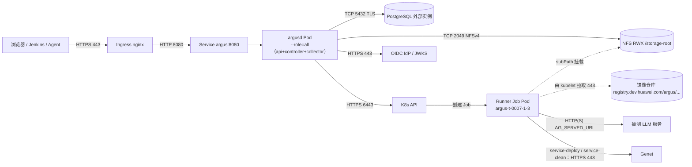

# 06 部署视图（Physical View）

> **视角：** 这些东西实际跑在哪、怎么连、占多少资源、坏了怎么办。
> **效力：** 本文是部署视图，**不新增设计裁决**；端口、规格、阈值均为可调整的默认值，改动需同步 `IMPLEMENTATION.md` 与三份分册。与 [`ARCHITECTURE.md`](../ARCHITECTURE.md)（v2.0）冲突时以它为准。
> **引用约定：** `§x.y` = ARCHITECTURE；`K-x` = IMPLEMENTATION §11 已拍板决策；`C-x` / `E-x` / `W-x` = `impl/control-plane.md` / `execution.md` / `web-and-delivery.md`。Helm values 与 RBAC 细节见 W-9，此处只给拓扑约束与关键字段；平台资产命名（`argusd`、`AG_*`、`argus-storage`、`argus.io/*`）见 ARCHITECTURE §0.2。

---

## 1 部署拓扑

P0 是**一个镜像、三种角色、一个 namespace**：`argusd` 以 `--role=all` 起 1 副本，同时承担 api / controller / collector；拆分只是改启动参数与副本数（I-4.1、K-7）。Runner 跑在 Execution Profile 指定集群与 namespace 的 Job 里，与控制面共用同一份 NFS；P0 只登记一个集群，多集群只是多份 kubeconfig（K-4）。



| 链路 | 端口 / 协议 | 说明 |
|---|---|---|
| 用户 → Ingress | 443 / TLS | 唯一入口；内网 CA 签发 |
| Ingress → Service → Pod | 8080 / HTTP | 静态资源、`/api/v1`、SSE、`/metrics` **同端口**，没有第二个监听 |
| 控制面 → PostgreSQL | 5432 / TCP + TLS（`sslmode=require`） | 状态、事件、租约、注册表；外部实例（K-9） |
| 控制面 → NFS | 2049 / TCP（NFSv4） | 报告、日志、目录预创建 |
| 控制面 → K8s API | 6443 / HTTPS（in-cluster 走 Service） | Job/Pod/Lease + Volcano 只读 |
| 控制面 → Genet | **无**（v2） | 与 Genet 的全部交互由内置 service-deploy / service-clean runner 执行，平台不直连（§9.1、D-70） |
| service-deploy / service-clean Pod → Genet | 443 / HTTPS | 部署受理、状态轮询、OpenAPI DELETE 卸载（D-53、D-54） |
| 控制面 → OIDC IdP | 443 / HTTPS | discovery + JWKS（缓存 10min） |
| kubelet → 镜像仓库 | 443 / HTTPS | 拉 Runner 镜像；**不是 Pod 的出站流量** |
| Runner Pod → 被测服务 | 由 `AG_SERVED_URL` 决定（常见 `http://host:8000/v1`） | 平台不限制地址（§9.1） |
| Runner Pod → NFS | **无** | NFS 由 kubelet 挂载，Pod 内不发起 NFS 流量 |
| 部署窗口（默认 72h） | 不占 HTTP 连接 | Genet 轮询在 service-deploy runner 进程内，`deploy-state.json` 落档，SSE 只推事件（K-6、§9.1）；因此 Ingress 超时按 SSE 调，不按部署调 |

## 2 K8s 对象清单

| 对象 | 名称 | 关键字段 | 说明 |
|---|---|---|---|
| Namespace + PSA | `argus` | `pod-security.kubernetes.io/enforce: restricted`（另加 `audit`/`warn` 同档） | 控制面、Runner Job、PVC、Lease 同处一室；`Role` 的作用域就是它 |
| Deployment | `argusd` | `replicas: 1`、`args: ["--role=all"]`、`RollingUpdate{maxUnavailable:0,maxSurge:1}`、`requests 500m/512Mi`、`limits 2/2Gi` | 升级先起新 Pod 再停旧；P1 拆三份只改 `--role` 与副本数 |
| Service | `argus` | `ClusterIP`、`8080 → http` | 三个角色共用一个端口 |
| Ingress | `argus` | `proxy-buffering: "off"`、`proxy-read-timeout: "3600"`、`proxy-send-timeout: "3600"`、`proxy-body-size: 8m`、`proxy-http-version: 1.1` | **SSE 必须关缓冲**，否则事件被攒住；72h 部署窗口与超时无关（见 §1 末行） |
| ConfigMap | `argus-config` | 非敏感 env（并发、超时、保留期、SSE、日志分段）、`checksum/config` 注解 | 变更触发滚动；敏感项一律不进 ConfigMap |
| Secret | `argus-db` / `-oidc` / `-genet` / `-clusters` / `-session` | `existingSecret` 引用 | chart **不生成明文**；kubeconfig 以文件挂到 `/etc/argus/clusters`（K-4）；Genet Open API Key 以 Task 级 secret 注入 service-deploy / service-clean（§12.4） |
| ServiceAccount | `argus` | `automountServiceAccountToken: true` | 只有控制面需要；Runner Pod 一律 `false`——runner 不绑 ServiceAccount（§12.2、D-72） |
| Role / RoleBinding | `argus` | `jobs`、`pods`、`pods/log`、`persistentvolumeclaims`、`events`、`leases`（动词见 W-9） | namespace 级；**不授予 `secrets`**、不授予 `pods/exec`（见 §4.4） |
| ClusterRole（只读） | `argus-view` | `nodes` | 看板节点状态；`insufficient_resources` 判定的数据源 |
| ClusterRole（只读） | `argus-volcano-view` | Volcano `queues` / `podgroups`：`get,list`（**不 watch**；Volcano `jobs` 暂不读） | 队列展示与 `waiting_reason` 的集群侧数据源。**两者都是 cluster-scoped**，namespace 级 `Role` 绑不到（见 §2.1） |
| PVC | `argus-storage` | `ReadWriteMany`、`storageClassName: nfs-csi`、容量按保留期规划（示例 `20Ti`，以 03 §8 估算校准） | 只挂控制面到 `/storage-root`；Runner 用同 PVC 的 subPath（D-41：v1 `testplane-storage` → v2 `argus-storage`） |
| NetworkPolicy | `argus-default-deny` + 放行条目 | ingress/egress 双向默认拒绝 | 见 §4；每 Job 另生成一条同名策略（E-2.1） |
| PDB | `argusd` | `minAvailable: 1` | 单副本下会阻塞 drain，见 §7.1 |
| Lease | `argus-controller` / `argus-collector-leader` / `argus-log-<hash>` | TTL 15s / 续约 5s；日志 Lease 30s / 10s | 选主与"同文件单写者"（E-7.3） |
| Job（运行时） | `argus-<task_id>-<attempt>-<seq>` | `backoffLimit: 0`、`restartPolicy: Never`、`activeDeadlineSeconds = timeout+60`、`automountServiceAccountToken: false`、labels `argus.io/task|attempt|runner-seq` | 平台渲染，**不在 chart 里**（E-2.2、附录 B 2.0） |
| Job（hook） | `argusd-migrate` | `pre-install,pre-upgrade`、`hook-delete-policy: before-hook-creation` | 迁移唯一入口，见 §6.2 |

### 2.1 排队与可观测数据源

`GET /api/v1/queue-status` 一个端点装**两套数据源**，这是本节存在的理由。
（本节的调研依据：Jenkins 侧 `Helm-Start-Service-MB.Jenkinsfile` 的队列面板读 Genet
`/api/open/queue`；`E2E-Test.jenkinsfile` 本身不读 Volcano。Argus 不复用那条路径。）

**（1）两类排队必须分开呈现，永远不相加。**

| | 平台槽位 | Volcano 队列 |
|---|---|---|
| 有哪些 | `slot_waiting`（仅外接模式）/ `global_limit` | `queue_full` / `gang_pending` / `insufficient_resources` |
| 数据源 | 自己的 DB（`endpoint_leases`、runner 执行记录） | K8s CRD `scheduling.volcano.sh/v1beta1` |
| 时间尺度 | 秒~分钟 | 小时~天 |
| 单位 | 并发 permit 计数（默认 20） | 资源配额（卡 / CPU / 内存） |
| 归责 / 动作 | 平台内（等独占 runner 结束、调 `AG_CONCURRENCY_MAX`） | 集群侧（找管理员扩卡 / 开队列 / 调 `minMember`） |
| 可用性 | 永远可读 | 可能 `scheduler_unavailable` |
| 第三类（部署排队） | 由 service-deploy 的 `deploy-state.json` 承载（水位 + 已等待时长，无位次，D-46），在 Task 详情呈现，**不进本端点** | — |

合成一张卡或一个"总排队 N"是**错的**：它会让"队列 Open 但本 runner 实际卡在端点独占"这种情况
把用户支去扩队列。UI 上两张卡并列、标题带归属（`平台槽位（Argus）` / `Volcano 队列（只读快照，15s）`），
`waiting` 明细逐条带 `waiting_reason`，tag 分两组颜色。

**（2）采样路径：直连 CRD，不经过 Genet。**

```text
controller --(k8s API, scheduling.volcano.sh/v1beta1)--> queues(list) + podgroups(list)
           --> GET /api/v1/queue-status --> UI（30s 轮询该端点）
```

不绕 Genet 的理由：它的 `/api/open/queue` 是给**它自己的 UI** 用的（按 API Key 绑定的池返回单个队列，
带它自己的会话与配额口径），语义是"我这个 key 的池"，不是"这个集群的队列全景"；复用它等于继承
一套与 Argus 无关的鉴权和配额语义。实现用 `dynamic.Interface` + unstructured（只读），
**不引** `volcano.sh/apis` typed client，避免被 Volcano 版本绑死。

**（3）采样约束。**

| 项 | 值 | 理由 |
|---|---|---|
| 缓存 TTL | 15s | E-11 已定；`/queue-status` 本身被 UI 30s 轮询，15s 是新鲜度上限 |
| 单飞（single-flight） | 并发请求最多一个在打 API | 看板一开多客户端同时打，不单飞会出现 N 倍 `List podgroups` |
| 单次超时 | 5s（火山块失败即降级，不等） | 不得拖慢 `slots`/`waiting` 的返回 |
| 失败退避 | 连续失败后降到 60s 重试 | 集群不可达时不要每 15s 打一次 |
| 分页 | 不需要 | queues 量级 < 50、podgroups 通常 < 数百，一次 list 足够 |

**（4）不可达 ≠ 0 排队（降级四态，只影响 `volcano` 块）。**

| `detail` | 触发 |
|---|---|
| `crd_missing` | 该集群没装 Volcano（discovery 返回 404；结果可缓存 5 分钟） |
| `rbac_forbidden` | List 返回 `IsForbidden`（**不要**把原始 RBAC 报错全文吐给前端，避免泄露 SA/角色名） |
| `scheduler_unavailable` | 超时 / 连接失败（保留上次快照并标 stale） |
| `disabled` | CRD 在、但平台侧未启用队列调度 |

任何"不可达 → 显示 0 排队 / 显示空闲"的默认值都是误导。`queue_full` 在 **MVP 只由
`queue.state = Closed`（且队列内有 Pending）触发**——`deserved` 只存在于 vc-scheduler 的
`/metrics` 里，CRD 没有，MVP 不接 Prometheus（P1 再评估）。

**（5）多集群（P1）。** 一期只登记一个集群。多集群时 `queues[].name` 用 `"<cluster>/<queue>"`
前缀（零契约变更）。

**RBAC：Volcano 是集群级资源，必须单独的 ClusterRole。**

```yaml
# ClusterRole: argus-volcano-view —— 只读，供 queue-status 采样
# 注意：queues 与 podgroups 都是 cluster-scoped，namespace 级 Role 绑不到。
apiVersion: rbac.authorization.k8s.io/v1
kind: ClusterRole
metadata:
  name: argus-volcano-view
rules:
  - apiGroups: ["scheduling.volcano.sh"]
    resources: ["queues", "podgroups"]
    verbs: ["get", "list"]      # 不要 watch：我们是轮询 + 15s TTL，不用 informer
```

要点：

1. **不给 `watch`**：轮询实现不需要，给了等于允许无限长连接，只扩大权限面。
2. **不给 `queues/status` / `podgroups/status` 的写权限**：读 `status` 随主资源 `get/list` 一起返回，
   不需要额外 subresource 规则。Genet 给写是因为它要 `ensure`/reconcile，Argus 只读（§4.4）。
3. **不授 `pods/exec`、不授 `secrets`**，沿用 §4.4 的最小权限原则。
4. **Volcano 未安装时这个 ClusterRole 漂亮地不生效**：`kubectl apply` 不会报错——ClusterRole
   只声明 `apiGroups`/`resources`，**不做 discovery**，所以集群里没有那些 CRD 也能建。真正无权限时
   是 List 阶段返回 `IsForbidden` → 走 `rbac_forbidden` 降级，而不是启动失败。

### 2.2 命名空间划分与 Genet 侧资产（D-52/D-53）

接入 Genet 之后，一套环境里有**五个** namespace，职责不同、不能混用。混用会在两个地方炸：Genet 的
Helm release 存量和它自己的 OpenAPI 控制态冲突（启动 FATAL），以及"被部署的服务"与"跑测试的 Job"
落在同一 ns 时清理边界不清。

| namespace | 归属 | 里面放什么 | 谁创建 |
|---|---|---|---|
| `argus` | Argus 平台 | 控制面 Deployment、Runner Job、产物 PVC | 平台清单/kustomize |
| `argus-mock` | 本地联调 | 假 Genet 装的 mock 服务、跨 ns 网络策略 | 平台清单（仅 dev/kind） |
| `argus-svc` | 真 Genet 部署 | **被 Genet 拉起的服务**（Helm release 的实际落地 ns） | **Genet**（API Key 绑定，必须事先不存在） |
| `genet` | Genet 自身 | `genet-backend` 等 Genet 控制面组件 | Genet 的 Helm chart |
| `genet-open-api` | Genet OpenAPI 控制态 | `genet-openapi-keys` Secret 与 key 记录 | Genet（`openAPI.namespace`） |

四条硬约束：

1. **API Key 与 namespace 1:1**，且该 namespace **必须事先不存在**——Genet 创建它时会打身份标签，已存在会 409；
2. 真 Genet 的 release **只能由 Genet 自己卸载**：直接 `helm uninstall` 会被 admission webhook 拒绝
   （`Helm release storage is managed exclusively by the Genet backend`），因此**只能**走
   `DELETE /api/open/helm/releases/{name}`（D-54）——v2 起这个动作由内置 service-clean runner 执行（D-70）；
3. 独占池（D-52）：Argus 的 key 落在独占池里，其 namespace 内的服务不受 Genet 每日 23:00 回收影响；
4. 跨 namespace **不能共享 PVC**（PVC 是 namespaced）：Runner 在 `argus`、被测服务在 `argus-svc`，
   两者只能通过 Service DNS（`<svc>.<ns>.svc.cluster.local`）通信，这也是"外接模式/部署模式"都只依赖 `AG_SERVED_URL` 的原因。


## 3 存储布局

### 3.1 目录树

```text
/storage-root/                              # PVC argus-storage（RWX）
└── t-20261110-0007/                        # task_id
    ├── report.json  report.md  metadata.json
    ├── events.jsonl                        # 派生文件：库为准，可按 seq 重建
    └── attempts/
        ├── 1/                              # attempt 分层：重试产生 attempts/2/…，互不覆盖（§7.2）
        │   ├── input/
        │   │   └── params.jsonl            # 提交输入的落盘原文（只读挂载源，§6.8）
        │   ├── exports/                    # 平台收割落档：<seq>.exports.env + 注入清单（§5.12）
        │   ├── deploy-state.json           # service-deploy 产出的最新部署状态副本（平台同步归档）
        │   └── runners/
        │       ├── 1/                      # service-deploy（seq=1）
        │       │   ├── deploy-state.json   # runner 产出原件（其余 runner 无此文件）
        │       │   └── logs/<pod>.log      # 部署 Pod 日志：一 Pod 一文件，测试期间持续追加（§8.6）
        │       ├── 2/                      # endpoint-probe（seq=2）
        │       │   ├── result.json         # 三选一产物示例（result.json / result.html / result.csv 至少其一，D-74）；全缺失即 RESULT_MISSING
        │       │   ├── exports.env         # Runner 产出的导出（平台收割源）
        │       │   ├── logs/stdout.log     # collector 独占该文件名
        │       │   └── raw/                # Runner 自由区，平台不解析
        │       └── 3/ …
        └── 2/                              # 重试产生的新 attempt（全量重跑含 fresh deploy）
```

### 3.2 属主与权限

| 路径 | 属主 | 权限 | 谁创建 |
|---|---|---|---|
| `/storage-root` | `10001:10001` | `0770` | 存储侧预置 / chart 初始化 Job |
| `<task_id>/` | `10001:10001` | `02770`（setgid，子目录继承组） | controller（提交后、首个 runner 前） |
| `attempts/<n>/input/` | `10001:10001` | `0770` | controller（提交后预写输入文件） |
| `attempts/<n>/runners/<seq>/{,logs,raw}` | `10001:10001` | `0770` | `executor/storage` 预创建（E-3.2） |

`root_squash` 使 `chown` 可能无效：**chown 失败只记 warning**，靠 `fsGroup: 10001` + setgid 兜底；Runner 仍必须容忍目录缺失并自行 `mkdir -p`（§6.8③，两边都要成立）。

### 3.3 挂载

| 容器 | 挂载点 | 来源 | 读写 | subPath |
|---|---|---|---|---|
| 控制面 | `/storage-root` | PVC 根 | rw | 无 |
| Runner（Job） | `/workspace/input` | 同一 PVC | **ro** | `<task_id>/attempts/<n>/input`，必须相对路径，禁 `..`、绝对路径（附录 B：mounts 含 input） |
| Runner（Job） | `/workspace/output` | 同一 PVC | rw | `<task_id>/attempts/<n>/runners/<seq>`，就是最终落盘位置（§6.8、D-68） |
| Runner（Job） | `/data`、`/models` … | Profile 提供的 PVC | ro | Profile 侧 `sub_path` 前缀，不得指向其它 Task |
| Runner（Job） | `/tmp` | emptyDir `256Mi` | rw | 无（配合只读根文件系统） |
| Runner（Job） | `/workspace` 其余部分 | **不挂** | ro | 除 input / output / Profile 挂载点外均为只读 |

**不得**把 `<storage-root>` 整体挂进 Runner 容器——否则可读写其他 Task 的产物（§6.8②）。

### 3.4 日志分段、配额与保留

| 项 | 默认 | 行为 |
|---|---|---|
| 日志分段 | 200 MiB / 文件 | 滚到 `<pod>.N.log`，Pod 清单快照记每段区间；日志满**不改变** runner 结果 |
| 单 attempt 产物 | 10 GiB | 超限 → 删 Job → `ARTIFACT_QUOTA_EXCEEDED`（不可重试） |
| Task 报告 | ≤ 20 MiB | 超限写摘要 + `report.full.json` |
| 部署 Pod 日志 | 2 GiB / attempt（软上限） | 超出后每段只记 head 并标 `truncated`；落盘位置 `runners/<deploy_seq>/logs/`（v1 的 `deploy/logs/` 已移入 runner 产物目录，D-26/D-71） |
| 保留期 | 30 天（`AG_RETENTION_DAYS`） | `retention-sweeper` cron `0 3 * * *`，只删终态且超期的整个 `<task_id>/` |
| 清理粒度 | 整个 Task 目录 | 不删单文件（破坏分段语义）；单次 ≤ 200 Task；先写 `retention_purged` 事件 |
| 解耦 | `cleanup.policy` **已取消**（v2） | 有部署必有 clean（finally）；产物保留期由平台配置统一决定（D-33 v2） |
| 失败现场 | 不删 | runner 失败保留目录，供下载与复盘（§6.8⑤） |

## 4 网络与安全边界

### 4.1 入站（默认拒绝）

| 来源 | 目标 | 端口 | 用途 | 策略 |
|---|---|---|---|---|
| 内网用户 / Jenkins / Agent | Ingress | 443 | UI、REST、SSE | 允许（内网 LB 之后） |
| ingress-controller | `argusd` Pod | 8080 | 反代 | NetworkPolicy 按 namespaceSelector 放行 |
| Prometheus | `argusd` Pod | 8080 `/metrics` | 抓取 | 放行 |
| 任意其它 | 控制面 / PostgreSQL / NFS | — | — | 默认拒绝 |

### 4.2 出站（默认拒绝，逐条放行）

| 源 | 目标 | 端口 | 用途 | 失败影响 |
|---|---|---|---|---|
| 控制面 | kube-dns | 53 / UDP+TCP | 解析 | 全链路失败 |
| 控制面 | PostgreSQL | 5432 | 状态读写 | `/readyz` 失败，controller 暂停推进 |
| 控制面 | K8s API | 6443 | Job/Pod/Lease/Volcano 只读 | runner 卡 `PREPARING` → `EXECUTOR_UNAVAILABLE` |
| 控制面 | OIDC IdP | 443 | 登录、JWKS | 新登录不可用；已有会话有效至 TTL |
| 控制面 | NFS server | 2049 | 产物、报告、目录预创建 | 预创建失败 → 保持 `queued` + 可重试 `EXECUTOR_UNAVAILABLE` |
| Runner Pod | 被测服务 | 由 `AG_SERVED_URL` 决定 | 测试流量 | runner 失败（`ENDPOINT_UNREACHABLE` 等） |
| Runner Pod | kube-dns | 53 | 域名解析 | 解析失败 |
| service-deploy / service-clean Pod | Genet | 443 | 部署 / 状态 / 卸载（Genet OpenAPI，凭据走 Task 级 secret） | `DEPLOY_FAILED`（Task `failed` 平台侧）或 `DEPLOY_BLOCKED` |
| Runner Pod | 互联网 | 任意 | — | **默认拒绝**（§12.2） |

### 4.3 Runner Pod 的出站策略

| 项 | 规则 |
|---|---|
| 渲染 | 每个 Job 渲染一条同名 NetworkPolicy，label 与 Job 一致，随 Job 删除（E-2.1） |
| 缺省允许 | `egress_allow` = 目标服务网段（默认 `10.0.0.0/8`）+ kube-dns；service-deploy / service-clean 另含 Genet API（附录 B） |
| 明确不放行 | 互联网、其他 namespace、K8s API（`automountServiceAccountToken: false`，即使放行也调不动；runner 不绑 ServiceAccount，§12.2） |
| 需外网时 | 由维护者在 Execution Profile 显式加网段并评审；平台不默认放开 |
| 依据 | `AG_SERVED_URL` 不限制地址，**可达性由策略决定**（§12.2）；平台不做地址白名单 |

### 4.4 平台不授予的权限
> **窄例外（D-55）**：`POST /admin/secrets/{name}/rotate` 需要对**已登记的那一条** Secret 做 `get`
> （只判存在 + key 非空）。RBAC **必须用 `resourceNames` 限定**到该条 `secret_refs`（由
> `deploy/k8s/gen-secret-rotate-role.ps1` 按登记项生成 Role/RoleBinding：Role 在目标 Secret 所在
> namespace、只授 `get`），不得授予通配 `secrets get/list/watch`；值不进日志 / 不落库 / 不回显，
> 校验结果只记 `verified` + `checked_at`；无权限或不可达返回 `503 EXECUTOR_UNAVAILABLE`（可重试，
> `detail.reason=forbidden|k8s_unavailable`），**不得降级成成功**。


| 不授予 | 原因 | 依据 |
|---|---|---|
| `secrets get/list/watch`（**除 D-55 的窄例外**：`resourceNames` 限定的 `get`，仅限已登记项，见上方注记） | 日志明文不脱敏，平台无需读明文；凭据由 kubelet 在创建 Pod 时注入 | K-5、W-9、D-55 |
| `pods/exec`、`pods/attach`、`pods/portforward` | 平台不代执行命令，Runner 只走 Job | §5.10、§6.4 |
| 创建/修改 Deployment / Service / Ingress | 部署归 Genet（经内置 service-deploy），平台只建 Job | §9.1 |
| 对 Genet 资源设置 ownerReferences | Job 回收的级联删除会杀掉活着的被测服务；进程生命周期 ≠ 资源生命周期 | §9.3、D-72 |
| `nodes` 写、`nodes/drain`、`nodes/evict` | 只读可见性，不替运维做节点决策 | §6.9 |
| Volcano 写（权重/抢占/删 PodGroup） | 平台没有调度决策权 | §6.9 |
| `hostPath` / `privileged` / `hostNetwork` / `hostPID` | PSA `restricted` + `runner.yaml.k8s` 白名单字段 | §12.2、附录 C |
| Secret 写（创建/轮换值） | 轮换由 admin 在 Secret Store 侧完成，平台只重读引用 | C-10 |
| CRD 写入 / 以 CRD 作权威状态 | PG 是唯一权威，CRD 只读 | I-3.3 |
| 集群创建 / 扩缩容 / 换调度器 | 非平台职责 | §6.3、§6.9 |

## 5 容量与规格

### 5.1 控制面

| 项 | P0 值 | 说明 |
|---|---|---|
| replicas | 1（`--role=all`） | K-7；P1 拆三个 Deployment |
| requests / limits | 500m / 512Mi；2 CPU / 2Gi | IO 型负载，20 并发 runner 下 2 CPU 有余量 |
| `/tmp` | emptyDir 256Mi | 配合只读根（pip/jq 缓存需要 `HOME=/tmp`） |
| 文件句柄 | 每 follower 1 条 log stream，20 并发 ≤ 40 | 默认 ulimit 足够 |
| informer cache | 5k 对象 < 100MiB | 接近 500MiB 先拆角色再考虑分片 |
| 探针 | startup 30×2s；readiness 含 DB + 迁移版本；liveness **不含 DB** | DB 抖动不该重启进程（W-9） |
| 临时上限 | 单次 SSE 回放 1000 条 / 24h 窗口 | 超出先发 `resync_required`（C-9.2） |

### 5.2 PostgreSQL

| 项 | 估算 |
|---|---|
| 单 Task 行数 | 1 task + runner 执行记录（用户 ≤200 + 注入 ≤3，× attempt 数）+ ≈1200 events |
| 单 Task 体积 | ≈ 3 MiB（行 + `manifest`/`resolved` jsonb + 索引），膨胀系数按 2× |
| 日 100 Task | ≈ 600 MiB/日（已含 2× 膨胀）→ ≈ 220 GiB/年 |
| 连接 | 每进程 `max_conns` 20：P0 = 20；P1 三角色 ≈ 80 → 要求 PG `max_connections ≥ 200` |
| 长事务 | 禁止（外部 IO 不进事务），单事务 10s 上限 |
| 备份 | DBA 全量 + WAL 归档；平台不引入备份组件（W-11） |

### 5.3 NFS 带宽（并发 20）

| 项 | 假设 | 平均 | 峰值 |
|---|---|---|---|
| 日志写入 | 单 runner 0.2–1 MB/s × 20 | ≈ 20 MB/s | ≈ 100 MB/s（同时刷进度） |
| 产物写入 | 单 attempt 0.1–2 GiB，集中在收尾 | ≈ 5 MB/s | ≈ 250 MB/s（按 5 个并发收尾、各 50 MB/s） |
| 报告 / 事件 | 一次性写 | < 1 MB/s | ≈ 5 MB/s（报告收尾） |
| **合计** | — | **≈ 25 MB/s ≈ 200 Mbps** | **≈ 350 MB/s ≈ 2.8 Gbps** |
| 结论 | — | 1 GbE 不够（平均已占 25%） | 建议 10 GbE；只有 1 GbE 时把并发降到 8 并把 `raw/` 外置 |

### 5.4 单 Task 上限与 PV 容量

| 项 | 值 |
|---|---|
| runner 数 | ≤200（超出 `TASK_TOO_LARGE`；注入的 deploy/precheck/clean 不计入用户列表） |
| attempt 数 | 默认 ≤3（`ATTEMPT_EXHAUSTED`，§12.7）；重试全量重跑 |
| attempt 产物 | 10 GiB / 次（`ARTIFACT_QUOTA_EXCEEDED`） |
| 理论极值 | 200 × attempt 数 × 10 GiB（重试是全量重跑，按 attempt 放大） |
| 规划口径 | 按 **2 GiB/Task 均值**估算，不按极值买盘 |
| 容量公式 | PV ≈ 日 Task 数 × 平均产物 × 保留天数 × 1.3 |
| 示例 | 20 Task/日 → ≈ 1.6 TiB（起 2 TiB）；100 Task/日 → ≈ 8 TiB |

### 5.5 扩容路径

| 维度 | P0 | 扩容动作 | 触发信号 |
|---|---|---|---|
| api | 1 副本 | 加到 2–4，HPA CPU 60% | `http_request_duration_seconds` P95 > 300ms 或 SSE 连接数上升 |
| controller | 单活 | 加副本（Lease 选主），仍单写 | `queue_depth{reason="slot_waiting"}` 持续高、调度事务排队 |
| collector | 单活 | 2–3 副本 + 每 Job Lease 分片 | `collector_gaps_total` 上升或日志吞吐 > 100 MB/s |
| 分片 | 无 | 按 `task_id` 哈希分 controller（预留 `tasks.shard`） | M6 压测确认单 controller 撑不住 20 并发 |
| PG | 单实例 | 先调池与索引，再只读副本 | 连接打满、慢查询 |
| NFS | 单挂载点 | 10 GbE → 多挂载点 → 冷数据归档 | 带宽或 inode 压力 |

## 6 环境与发布

### 6.1 环境差异

| 环境 | 依赖差异 | 准入条件 | 回滚 |
|---|---|---|---|
| dev | kind 或单节点 k3s、**mock Genet**、容器 PG、`AUTH_MODE=dev`、`local-path` 模拟 RWX | `make dev` 10 分钟跑通一次 Task | — |
| test | 真 Genet sandbox、1 个 K8s 集群、小规格 NPU、桩 OpenAI | 18 项 P0 验收全绿 + 契约 golden 通过 | `helm rollback` |
| staging | 生产同构 NPU 集群、真实 Runner 镜像、真实 OIDC、只读账号 + 1 个可写 namespace | 单副本灰度 1 周，`cleanup_failures_total` / `precheck_failures_total` 无非预期增长 | `helm rollback` + 镜像 digest 回退 |
| prod | 多副本、RWX NFS、OIDC 真实身份、多集群 kubeconfig | staging 连续 5 个工作日无 P1 缺陷；expand 迁移已合入；备份演练通过 | 先回镜像，再按需 contract |

红线：`AG_AUTH_MODE=dev` 出现在 staging/prod values 即**启动失败**；`image.tag` 与 `image.digest` 二选一，release 环境强制 digest；**不打 `:latest`**（W-14）。

### 6.2 迁移 hook

| 项 | 做法 |
|---|---|
| 载体 | Helm `pre-install,pre-upgrade` **Job**，镜像同 `argusd`，`command: ["/argusd","migrate","up"]` |
| 为什么不用 initContainer | 多副本会并发迁移（W-11） |
| 失败 | 阻断本次升级，release 停在旧版本；手工修复后重跑 |
| 规范 | 只前向；expand（版本 N）与 contract（版本 N+2）分开发布，保证"回滚镜像不需要回滚库" |
| 启动校验 | 控制面比对 `schema_migrations` 版本，不匹配拒绝启动；api 的 `/readyz` 含该项 |

### 6.3 回滚顺序

1. **先回镜像**（digest 回退到上一版），不动库——expand 已保证旧镜像能读新库。
2. 看 `/readyz` 恢复，再跑一次 smoke Task（外接模式，不碰 Genet、不占部署窗口）。
3. 若本次发布含 **contract**（删列/删表）：不能直接回滚，按 §6.4 恢复库或前滚修复——这也是 contract 必须单独发版的原因。
4. 回滚动作由 admin 执行并记录（`audit_log` 手工条目），无人值守流程不做自动回滚。

### 6.4 备份与恢复演练

| 项 | 频率 | 判据 | 备注 |
|---|---|---|---|
| PG 全量 + WAL 恢复到新实例 | 每季度（staging） | 历史 Task 可查、事件 `seq` 连续；目标 RPO ≤ 15min、RTO ≤ 2h（待与 DBA 对齐） | 平台不建备份组件 |
| 单 Task 目录从 NFS 快照恢复 | 每季度 | 三选一产物（`result.json` / `result.html` / `result.csv`，D-74）与 `report.json` 可下载，DB 仍指向同一 `task_id` | 只验产物完整性，不验指标 |
| 库丢、产物在 | 每半年 | 产物仍可下载（§12.5 状态与产物分离），Task 列表为空 | 接受：不反向重建状态 |
| 不演练 | — | Job 重放、结果复现 | §5.7 明确不承诺可复现 |

## 7 高可用与故障域

### 7.1 P0 单副本的 SPOF 清单

| 单点 | 失效影响 | P0 缓解 | 恢复 |
|---|---|---|---|
| 控制面 Pod（唯一副本） | REST/SSE 全停，状态推进停止；**K8s 上的 Job 继续跑** | `maxUnavailable:0` 滚动、`/readyz` 摘流、重启即重建 | 重启后按 DB 对账（C-3.5），`RUNNING` 不误判失败 |
| controller 单活 | 无推进（调度、超时、对账全停） | Lease `argus-controller`，TTL 15s / 续 5s | 新 leader 先 `Reconcile` 再调度 |
| collector 单活 | 日志断档 | 允许 gap 标记，**不伪造连续** | 从 checkpoint 续采并写 gap |
| Ingress 单实例 | 全站不可达 | 由平台外 LB / 多副本 ingress 保证（不在本 chart） | — |
| PostgreSQL 单实例 | 状态读写失败 | 外部实例，HA 由 DBA 负责；平台只摘流不自愈 | 恢复后 controller 继续推进，Job 不受影响 |
| NFS 单挂载点 | 产物写不进、报告写不出 | 预创建可写探测 → 保持 `queued` + 可重试 `EXECUTOR_UNAVAILABLE` | 恢复后重试；产物不丢（直落最终路径） |
| 单节点故障 | Pod 漂移、在跑 Job 中断 | P1 加反亲和；PDB | 重调度后对账收口 |
| 时钟漂移 | 日志区间与 `duration_ms` 偏差 | 时间戳取 apiserver / DB，不用节点本地时钟 | — |

**PDB 的坑：** 单副本 + `minAvailable: 1` 会让节点 drain 永久阻塞。运维手册：先 `kubectl scale --replicas=2`（新 Pod 会抢 Lease），或临时删除 PDB 再 drain——两者都要留记录。

### 7.2 P1 多副本演进

| 演进 | 做法 | 前置条件 | 收益 |
|---|---|---|---|
| api 多副本 | 2–4 副本，Service 只选 api | 无状态已满足；SSE 跨副本靠 `LISTEN/NOTIFY`（C-9.3） | 滚动不中断、SSE 扩容 |
| controller 1 活 N 备 | 同镜像 `--role=controller`，Lease 选主 | 状态推进仍是单写者 | 切换从"重启 Pod"变成"选主"（秒级） |
| collector 分片 | 全局 leader 分配 + 每 Job Lease | 同文件单写者语义不变 | 日志吞吐线性扩展 |
| 按 Task 分片 controller | `task_id` 哈希 → 分片 Lease | 需要 `tasks.shard` 列（P1 预留） | 突破单写吞吐上限 |
| 存储分层 | 热数据留 NFS，冷数据归档对象存储 | 保留期清理先跑稳 | 控制 PV 增长 |

> 逻辑分层与代码边界见 [05 开发视图](05-development-view.md)；状态机、执行层与交付细节分别见 C-1…C-13、E-1…E-11、W-8…W-14。
