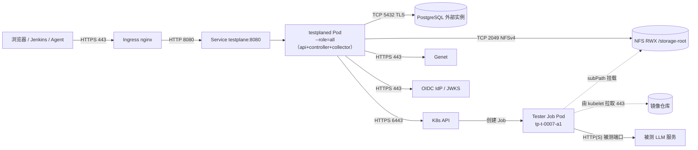

# 06 部署视图（Physical View）

> **视角：** 这些东西实际跑在哪、怎么连、占多少资源、坏了怎么办。
> **效力：** 本文是部署视图，**不新增设计裁决**；端口、规格、阈值均为可调整的默认值，改动需同步 `IMPLEMENTATION.md` 与三份分册。与 [`ARCHITECTURE.md`](../ARCHITECTURE.md)（v0.5）冲突时以它为准。
> **引用约定：** `§x.y` = ARCHITECTURE；`K-x` = IMPLEMENTATION §11 已拍板决策；`C-x` / `E-x` / `W-x` = `impl/control-plane.md` / `execution.md` / `web-and-delivery.md`。Helm values 与 RBAC 细节见 W-9，此处只给拓扑约束与关键字段。

---

## 1 部署拓扑

P0 是**一个镜像、三种角色、一个 namespace**：`testplaned` 以 `--role=all` 起 1 副本，同时承担 api / controller / collector；拆分只是改启动参数与副本数（I-4.1、K-7）。Tester 跑在 Execution Profile 指定集群与 namespace 的 Job 里，与控制面共用同一份 NFS；P0 只登记一个集群，多集群只是多份 kubeconfig（K-4）。



| 链路 | 端口 / 协议 | 说明 |
|---|---|---|
| 用户 → Ingress | 443 / TLS | 唯一入口；内网 CA 签发 |
| Ingress → Service → Pod | 8080 / HTTP | 静态资源、`/api/v1`、SSE、`/metrics` **同端口**，没有第二个监听 |
| 控制面 → PostgreSQL | 5432 / TCP + TLS（`sslmode=require`） | 状态、事件、租约、注册表；外部实例（K-9） |
| 控制面 → NFS | 2049 / TCP（NFSv4） | 报告、日志、目录预创建 |
| 控制面 → K8s API | 6443 / HTTPS（in-cluster 走 Service） | Job/Pod/Lease + Volcano 只读 |
| 控制面 → Genet | 443 / HTTPS | 部署、状态轮询、卸载 |
| 控制面 → OIDC IdP | 443 / HTTPS | discovery + JWKS（缓存 10min） |
| kubelet → 镜像仓库 | 443 / HTTPS | 拉 Tester 镜像；**不是 Pod 的出站流量** |
| Tester Pod → 被测服务 | 由 `--url` 决定（常见 `http://host:8000/v1`） | 平台不限制地址（§9.1） |
| Tester Pod → NFS | **无** | NFS 由 kubelet 挂载，Pod 内不发起 NFS 流量 |
| Deploy 窗口（72h） | 不占 HTTP 连接 | 部署是异步轮询 + 落库，SSE 只推事件（K-6）；因此 Ingress 超时按 SSE 调，不按部署调 |

## 2 K8s 对象清单

| 对象 | 名称 | 关键字段 | 说明 |
|---|---|---|---|
| Namespace + PSA | `testplane` | `pod-security.kubernetes.io/enforce: restricted`（另加 `audit`/`warn` 同档） | 控制面、Tester Job、PVC、Lease 同处一室；`Role` 的作用域就是它 |
| Deployment | `testplaned` | `replicas: 1`、`args: ["--role=all"]`、`RollingUpdate{maxUnavailable:0,maxSurge:1}`、`requests 500m/512Mi`、`limits 2/2Gi` | 升级先起新 Pod 再停旧；P1 拆三份只改 `--role` 与副本数 |
| Service | `testplane` | `ClusterIP`、`8080 → http` | 三个角色共用一个端口 |
| Ingress | `testplane` | `proxy-buffering: "off"`、`proxy-read-timeout: "3600"`、`proxy-send-timeout: "3600"`、`proxy-body-size: 8m`、`proxy-http-version: 1.1` | **SSE 必须关缓冲**，否则事件被攒住；72h 部署窗口与超时无关（见 §1 末行） |
| ConfigMap | `testplane-config` | 非敏感 env（并发、超时、保留期、SSE、日志分段）、`checksum/config` 注解 | 变更触发滚动；敏感项一律不进 ConfigMap |
| Secret | `testplane-db` / `-oidc` / `-genet` / `-clusters` / `-session` | `existingSecret` 引用 | chart **不生成明文**；kubeconfig 以文件挂到 `/etc/testplane/clusters`（K-4） |
| ServiceAccount | `testplane` | `automountServiceAccountToken: true` | 只有控制面需要；Tester Pod 一律 `false`（E-2.1） |
| Role / RoleBinding | `testplane` | `jobs`、`pods`、`pods/log`、`persistentvolumeclaims`、`events`、`leases`（动词见 W-9） | namespace 级；**不授予 `secrets`** |
| ClusterRole（只读） | `testplane-view` | `nodes`、Volcano `queues`/`podgroups`/`jobs` | 看板与 `waiting_reason` 的数据源 |
| PVC | `testplane-storage-root` | `ReadWriteMany`、`storageClassName: nfs-csi`、容量按保留期规划（示例 `20Ti`，以 03 §8 估算校准） | 只挂控制面到 `/storage-root`；Tester 用同 PVC 的 subPath |
| NetworkPolicy | `testplane-default-deny` + 放行条目 | ingress/egress 双向默认拒绝 | 见 §4；每 Job 另生成一条同名策略（E-2.1） |
| PDB | `testplaned` | `minAvailable: 1` | 单副本下会阻塞 drain，见 §7.1 |
| Lease | `testplane-controller` / `testplane-collector-leader` / `tp-log-<hash>` | TTL 15s / 续约 5s；日志 Lease 30s / 10s | 选主与"同文件单写者"（E-7.3） |
| Job（运行时） | `tp-<task_id>-a<n>` | `backoffLimit: 0`、`restartPolicy: Never`、`activeDeadlineSeconds = timeout+60`、`automountServiceAccountToken: false` | 平台渲染，**不在 chart 里**（E-2.2） |
| Job（hook） | `testplaned-migrate` | `pre-install,pre-upgrade`、`hook-delete-policy: before-hook-creation` | 迁移唯一入口，见 §6.2 |

## 3 存储布局

### 3.1 目录树

```text
/storage-root/                              # PVC testplane-storage-root（RWX）
└── r-20261103-0001/                        # run_id；独立 Task 也有占位 Run 目录
    ├── report.json  report.md  metadata.json
    ├── events.jsonl                        # 派生文件：库为准，可按 seq 重建
    ├── deploy/                             # 有 deploy 时存在
    │   ├── manifest.yaml                   # 提交给 Genet 的参数快照
    │   ├── pods.json                       # Pod 拓扑、重启次数、日志区间
    │   └── logs/<pod>.log  <pod>.1.log     # 一 Pod 一文件；>200MiB 滚动分段
    └── tasks/t-0007/
        ├── report.json
        └── attempts/1/                     # ← 容器 /workspace/output 就是这个目录
            ├── result.json                 # Tester 必须产出，缺失即 RESULT_MISSING
            ├── logs/stdout.log  stderr.log # collector 独占这两个文件名
            └── raw/                        # Tester 自由区，平台不解析
```

### 3.2 属主与权限

| 路径 | 属主 | 权限 | 谁创建 |
|---|---|---|---|
| `/storage-root` | `10001:10001` | `0770` | 存储侧预置 / chart 初始化 Job |
| `<run_id>/` | `10001:10001` | `02770`（setgid，子目录继承组） | controller（提交后、首个 Attempt 前） |
| `tasks/<task_id>/attempts/<n>/{,logs,raw}` | `10001:10001` | `0770` | `storage.PrepareAttempt`（E-3.2） |
| `deploy/logs/` | `10001:10001` | `0770` | controller（Endpoint ready 时） |

`root_squash` 使 `chown` 可能无效：**chown 失败只记 warning**，靠 `fsGroup: 10001` + setgid 兜底；Tester 仍必须容忍目录缺失并自行 `mkdir -p`（§6.8③，两边都要成立）。

### 3.3 挂载

| 容器 | 挂载点 | 来源 | 读写 | subPath |
|---|---|---|---|---|
| 控制面 | `/storage-root` | PVC 根 | rw | 无 |
| Tester（Job） | `/workspace/output` | 同一 PVC | rw | `<run_id>/tasks/<task_id>/attempts/<n>`，必须相对路径，禁 `..`、绝对路径 |
| Tester（Job） | `/data`、`/models` … | Profile 提供的 PVC | ro | Profile 侧 `sub_path` 前缀，不得指向其它 Run |
| Tester（Job） | `/tmp` | emptyDir `256Mi` | rw | 无（配合只读根文件系统） |
| Tester（Job） | `/workspace` | **不挂** | ro | 除 output 与 Profile 挂载点外均为只读 |

**不得**把 `<storage-root>` 整体挂进 Tester 容器——否则可读写其他 Run 的产物（§6.8②）。

### 3.4 日志分段、配额与保留

| 项 | 默认 | 行为 |
|---|---|---|
| 日志分段 | 200 MiB / 文件 | 滚到 `<pod>.N.log`，`pods.json` 记每段区间；日志满**不改变** Task 结果 |
| 单 Attempt 产物 | 10 GiB | 超限 → 删 Job → `ARTIFACT_QUOTA_EXCEEDED`（不可重试） |
| Run 报告 | ≤ 20 MiB | 超限写摘要 + `report.full.json` |
| Deploy 日志 | 2 GiB / Run（软上限） | 超出后每段只记 head 并标 `truncated` |
| 保留期 | 30 天（`TESTPLANE_RETENTION_DAYS`） | `retention-sweeper` cron `0 3 * * *`，只删终态且超期的整个 `<run_id>/` |
| 清理粒度 | 整个 Run 目录 | 不删单文件（破坏分段语义）；单次 ≤ 200 Run；先写 `retention_purged` 事件 |
| 解耦 | `cleanup.policy` ≠ 保留期 | `never` 只豁免卸载，不豁免保留期（G-13、D-33） |
| 失败现场 | 不删 | Task 失败保留目录，供下载与复盘（§6.8⑤） |

## 4 网络与安全边界

### 4.1 入站（默认拒绝）

| 来源 | 目标 | 端口 | 用途 | 策略 |
|---|---|---|---|---|
| 内网用户 / Jenkins / Agent | Ingress | 443 | UI、REST、SSE | 允许（内网 LB 之后） |
| ingress-controller | `testplaned` Pod | 8080 | 反代 | NetworkPolicy 按 namespaceSelector 放行 |
| Prometheus | `testplaned` Pod | 8080 `/metrics` | 抓取 | 放行 |
| 任意其它 | 控制面 / PostgreSQL / NFS | — | — | 默认拒绝 |

### 4.2 出站（默认拒绝，逐条放行）

| 源 | 目标 | 端口 | 用途 | 失败影响 |
|---|---|---|---|---|
| 控制面 | kube-dns | 53 / UDP+TCP | 解析 | 全链路失败 |
| 控制面 | PostgreSQL | 5432 | 状态读写 | `/readyz` 失败，controller 暂停推进 |
| 控制面 | K8s API | 6443 | Job/Pod/Lease/Volcano 只读 | Task 卡 `PREPARING` → `EXECUTOR_UNAVAILABLE` |
| 控制面 | Genet | 443 | 部署 / 状态 / 卸载 | Run `FAILED`（平台侧），与 `SERVICE_UNAVAILABLE` 区分 |
| 控制面 | OIDC IdP | 443 | 登录、JWKS | 新登录不可用；已有会话有效至 TTL |
| 控制面 | NFS server | 2049 | 产物、报告、目录预创建 | `PrepareAttempt` 失败 → 可重试 `EXECUTOR_UNAVAILABLE` |
| Tester Pod | 被测服务 | 由 `--url` 决定 | 测试流量 | Task 失败（`ENDPOINT_UNREACHABLE` 等） |
| Tester Pod | kube-dns | 53 | 域名解析 | 解析失败 |
| Tester Pod | 互联网 | 任意 | — | **默认拒绝**（§12.2） |

### 4.3 Tester Pod 的出站策略

| 项 | 规则 |
|---|---|
| 渲染 | 每个 Job 渲染一条同名 NetworkPolicy，label 与 Job 一致，随 Job 删除（E-2.1） |
| 缺省允许 | `egress_allow` = 目标服务网段（默认 `10.0.0.0/8`）+ kube-dns |
| 明确不放行 | 互联网、其他 namespace、K8s API（`automountServiceAccountToken: false`，即使放行也调不动） |
| 需外网时 | 由维护者在 Execution Profile 显式加网段并评审；平台不默认放开 |
| 依据 | `--url` 不限制地址，**可达性由策略决定**（§12.2）；平台不做地址白名单 |

### 4.4 平台不授予的权限

| 不授予 | 原因 | 依据 |
|---|---|---|
| `secrets get/list/watch` | 日志明文不脱敏，平台无需读明文；凭据由 kubelet 在创建 Pod 时注入 | K-5、W-9 |
| `pods/exec`、`pods/attach`、`pods/portforward` | 平台不代执行命令，Tester 只走 Job | §5.10、§6.4 |
| 创建/修改 Deployment / Service / Ingress | 部署归 Genet，平台只建 Job | §9.1 |
| `nodes` 写、`nodes/drain`、`nodes/evict` | 只读可见性，不替运维做节点决策 | §6.9 |
| Volcano 写（权重/抢占/删 PodGroup） | 平台没有调度决策权 | §6.9 |
| `hostPath` / `privileged` / `hostNetwork` / `hostPID` | PSA `restricted` + `tester.yaml.k8s` 白名单字段 | §12.2、附录 C |
| Secret 写（创建/轮换值） | 轮换由 admin 在 Secret Store 侧完成，平台只重读引用 | C-10 |
| CRD 写入 / 以 CRD 作权威状态 | PG 是唯一权威，CRD 只读 | I-3.3 |
| 集群创建 / 扩缩容 / 换调度器 | 非平台职责 | §6.3、§6.9 |

## 5 容量与规格

### 5.1 控制面

| 项 | P0 值 | 说明 |
|---|---|---|
| replicas | 1（`--role=all`） | K-7；P1 拆三个 Deployment |
| requests / limits | 500m / 512Mi；2 CPU / 2Gi | IO 型负载，20 并发 Task 下 2 CPU 有余量 |
| `/tmp` | emptyDir 256Mi | 配合只读根（pip/jq 缓存需要 `HOME=/tmp`） |
| 文件句柄 | 每 follower 1 条 log stream，20 并发 ≤ 40 | 默认 ulimit 足够 |
| informer cache | 5k 对象 < 100MiB | 接近 500MiB 先拆角色再考虑分片 |
| 探针 | startup 30×2s；readiness 含 DB + 迁移版本；liveness **不含 DB** | DB 抖动不该重启进程（W-9） |
| 临时上限 | 单次 SSE 回放 1000 条 / 24h 窗口 | 超出先发 `resync_required`（C-9.2） |

### 5.2 PostgreSQL

| 项 | 估算 |
|---|---|
| 单 Run 行数 | 1 run + ≤201 tasks + attempts + ≈1200 events |
| 单 Run 体积 | ≈ 3 MiB（行 + `manifest`/`resolved` jsonb + 索引），膨胀系数按 2× |
| 日 100 Run | ≈ 600 MiB/日（已含 2× 膨胀）→ ≈ 220 GiB/年 |
| 连接 | 每进程 `max_conns` 20：P0 = 20；P1 三角色 ≈ 80 → 要求 PG `max_connections ≥ 200` |
| 长事务 | 禁止（外部 IO 不进事务），单事务 10s 上限 |
| 备份 | DBA 全量 + WAL 归档；平台不引入备份组件（W-11） |

### 5.3 NFS 带宽（并发 20）

| 项 | 假设 | 平均 | 峰值 |
|---|---|---|---|
| 日志写入 | 单 Task 0.2–1 MB/s × 20 | ≈ 20 MB/s | ≈ 100 MB/s（同时刷进度） |
| 产物写入 | 单 Attempt 0.1–2 GiB，集中在收尾 | ≈ 5 MB/s | ≈ 250 MB/s（按 5 个并发收尾、各 50 MB/s） |
| 报告 / 事件 | 一次性写 | < 1 MB/s | ≈ 5 MB/s（报告收尾） |
| **合计** | — | **≈ 25 MB/s ≈ 200 Mbps** | **≈ 350 MB/s ≈ 2.8 Gbps** |
| 结论 | — | 1 GbE 不够（平均已占 25%） | 建议 10 GbE；只有 1 GbE 时把并发降到 8 并把 `raw/` 外置 |

### 5.4 单 Run 上限与 PV 容量

| 项 | 值 |
|---|---|
| Task 数 | 200（超出 `RUN_TOO_LARGE`） |
| Attempt 产物 | 10 GiB / 次（`ARTIFACT_QUOTA_EXCEEDED`） |
| 理论极值 | 200 × 10 GiB = 2 TiB / Run |
| 规划口径 | 按 **2 GiB/Run 均值**估算，不按极值买盘 |
| 容量公式 | PV ≈ 日 Run 数 × 平均产物 × 保留天数 × 1.3 |
| 示例 | 20 Run/日 → ≈ 1.6 TiB（起 2 TiB）；100 Run/日 → ≈ 8 TiB |

### 5.5 扩容路径

| 维度 | P0 | 扩容动作 | 触发信号 |
|---|---|---|---|
| api | 1 副本 | 加到 2–4，HPA CPU 60% | `http_request_duration_seconds` P95 > 300ms 或 SSE 连接数上升 |
| controller | 单活 | 加副本（Lease 选主），仍单写 | `queue_depth{reason="slot_waiting"}` 持续高、调度事务排队 |
| collector | 单活 | 2–3 副本 + 每 Job Lease 分片 | `collector_gaps_total` 上升或日志吞吐 > 100 MB/s |
| 分片 | 无 | 按 `run_id` 哈希分 controller（预留 `runs.shard`） | M6 压测确认单 controller 撑不住 20 并发 |
| PG | 单实例 | 先调池与索引，再只读副本 | 连接打满、慢查询 |
| NFS | 单挂载点 | 10 GbE → 多挂载点 → 冷数据归档 | 带宽或 inode 压力 |

## 6 环境与发布

### 6.1 环境差异

| 环境 | 依赖差异 | 准入条件 | 回滚 |
|---|---|---|---|
| dev | kind 或单节点 k3s、**mock Genet**、容器 PG、`AUTH_MODE=dev`、`local-path` 模拟 RWX | `make dev` 10 分钟跑通一次 Run | — |
| test | 真 Genet sandbox、1 个 K8s 集群、小规格 NPU、桩 OpenAI | 17 项 P0 验收全绿 + 契约 golden 通过 | `helm rollback` |
| staging | 生产同构 NPU 集群、真实 Tester 镜像、真实 OIDC、只读账号 + 1 个可写 namespace | 单副本灰度 1 周，`cleanup_failures_total` / `precheck_failures_total` 无非预期增长 | `helm rollback` + 镜像 digest 回退 |
| prod | 多副本、RWX NFS、OIDC 真实身份、多集群 kubeconfig | staging 连续 5 个工作日无 P1 缺陷；expand 迁移已合入；备份演练通过 | 先回镜像，再按需 contract |

红线：`TESTPLANE_AUTH_MODE=dev` 出现在 staging/prod values 即**启动失败**；`image.tag` 与 `image.digest` 二选一，release 环境强制 digest；**不打 `:latest`**（W-14）。

### 6.2 迁移 hook

| 项 | 做法 |
|---|---|
| 载体 | Helm `pre-install,pre-upgrade` **Job**，镜像同 `testplaned`，`command: ["/testplaned","migrate","up"]` |
| 为什么不用 initContainer | 多副本会并发迁移（W-11） |
| 失败 | 阻断本次升级，release 停在旧版本；手工修复后重跑 |
| 规范 | 只前向；expand（版本 N）与 contract（版本 N+2）分开发布，保证"回滚镜像不需要回滚库" |
| 启动校验 | 控制面比对 `schema_migrations` 版本，不匹配拒绝启动；api 的 `/readyz` 含该项 |

### 6.3 回滚顺序

1. **先回镜像**（digest 回退到上一版），不动库——expand 已保证旧镜像能读新库。
2. 看 `/readyz` 恢复，再跑一次 smoke Run（`service` 模式，不碰 Genet、不占部署窗口）。
3. 若本次发布含 **contract**（删列/删表）：不能直接回滚，按 §6.4 恢复库或前滚修复——这也是 contract 必须单独发版的原因。
4. 回滚动作由 admin 执行并记录（`audit_log` 手工条目），无人值守流程不做自动回滚。

### 6.4 备份与恢复演练

| 项 | 频率 | 判据 | 备注 |
|---|---|---|---|
| PG 全量 + WAL 恢复到新实例 | 每季度（staging） | 历史 Run 可查、事件 `seq` 连续；目标 RPO ≤ 15min、RTO ≤ 2h（待与 DBA 对齐） | 平台不建备份组件 |
| 单 Run 目录从 NFS 快照恢复 | 每季度 | `result.json` / `report.json` 可下载，DB 仍指向同一 `run_id` | 只验产物完整性，不验指标 |
| 库丢、产物在 | 每半年 | 产物仍可下载（§12.5 状态与产物分离），Run 列表为空 | 接受：不反向重建状态 |
| 不演练 | — | Job 重放、结果复现 | §5.7 明确不承诺可复现 |

## 7 高可用与故障域

### 7.1 P0 单副本的 SPOF 清单

| 单点 | 失效影响 | P0 缓解 | 恢复 |
|---|---|---|---|
| 控制面 Pod（唯一副本） | REST/SSE 全停，状态推进停止；**K8s 上的 Job 继续跑** | `maxUnavailable:0` 滚动、`/readyz` 摘流、重启即重建 | 重启后按 DB 对账（C-3.5），`RUNNING` 不误判失败 |
| controller 单活 | 无推进（调度、超时、对账全停） | Lease `testplane-controller`，TTL 15s / 续 5s | 新 leader 先 `Reconcile` 再调度 |
| collector 单活 | 日志断档 | 允许 gap 标记，**不伪造连续** | 从 checkpoint 续采并写 gap |
| Ingress 单实例 | 全站不可达 | 由平台外 LB / 多副本 ingress 保证（不在本 chart） | — |
| PostgreSQL 单实例 | 状态读写失败 | 外部实例，HA 由 DBA 负责；平台只摘流不自愈 | 恢复后 controller 继续推进，Job 不受影响 |
| NFS 单挂载点 | 产物写不进、报告写不出 | `PrepareAttempt` 可写探测 → 可重试 `EXECUTOR_UNAVAILABLE` | 恢复后重试；产物不丢（直落最终路径） |
| 单节点故障 | Pod 漂移、在跑 Job 中断 | P1 加反亲和；PDB | 重调度后对账收口 |
| 时钟漂移 | 日志区间与 `duration_ms` 偏差 | 时间戳取 apiserver / DB，不用节点本地时钟 | — |

**PDB 的坑：** 单副本 + `minAvailable: 1` 会让节点 drain 永久阻塞。运维手册：先 `kubectl scale --replicas=2`（新 Pod 会抢 Lease），或临时删除 PDB 再 drain——两者都要留记录。

### 7.2 P1 多副本演进

| 演进 | 做法 | 前置条件 | 收益 |
|---|---|---|---|
| api 多副本 | 2–4 副本，Service 只选 api | 无状态已满足；SSE 跨副本靠 `LISTEN/NOTIFY`（C-9.3） | 滚动不中断、SSE 扩容 |
| controller 1 活 N 备 | 同镜像 `--role=controller`，Lease 选主 | 状态推进仍是单写者 | 切换从"重启 Pod"变成"选主"（秒级） |
| collector 分片 | 全局 leader 分配 + 每 Job Lease | 同文件单写者语义不变 | 日志吞吐线性扩展 |
| 按 Run 分片 controller | `run_id` 哈希 → 分片 Lease | 需要 `runs.shard` 列（P1 预留） | 突破单写吞吐上限 |
| 存储分层 | 热数据留 NFS，冷数据归档对象存储 | 保留期清理先跑稳 | 控制 PV 增长 |

> 逻辑分层与代码边界见 [05 开发视图](05-development-view.md)；状态机、执行层与交付细节分别见 C-1…C-13、E-1…E-11、W-8…W-14。
