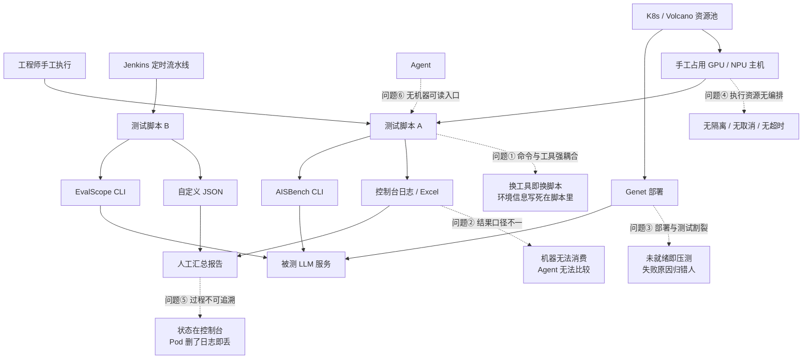
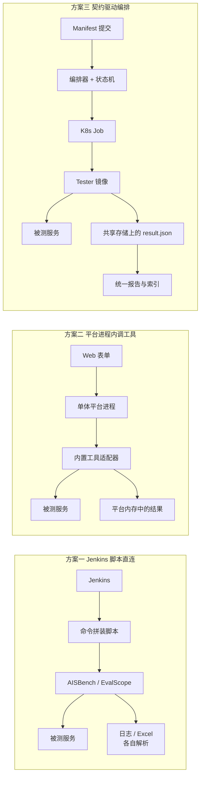
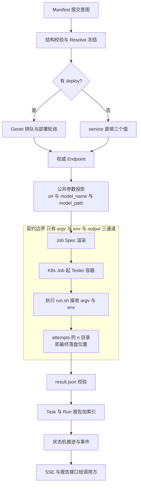
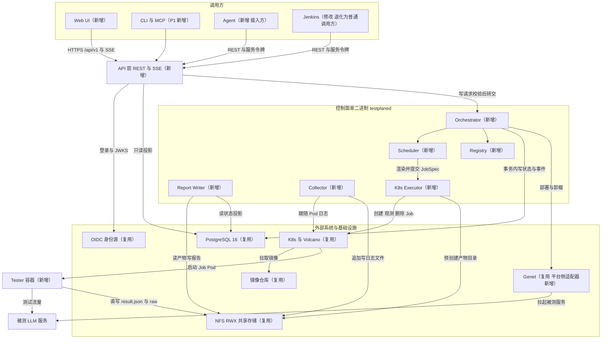
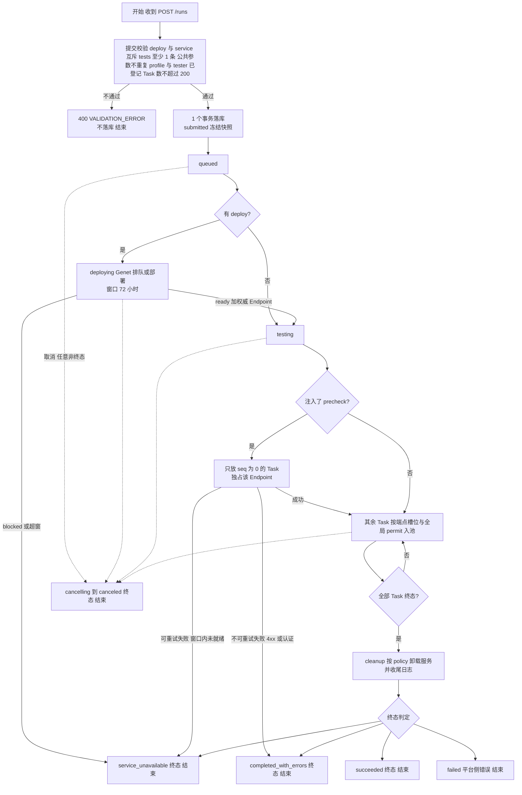
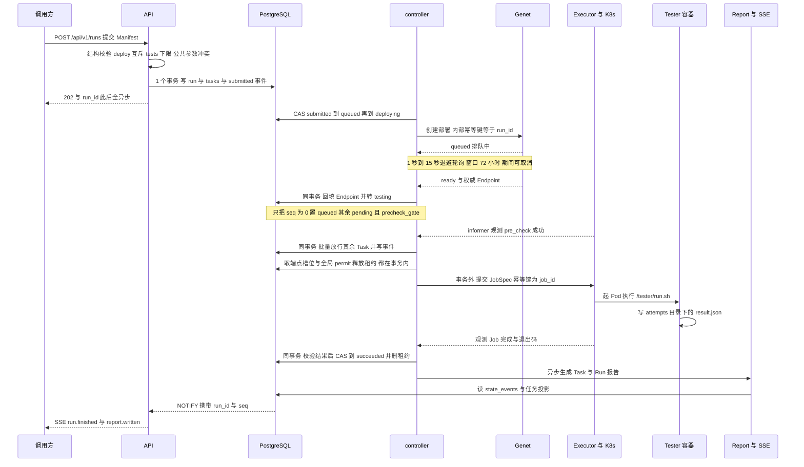
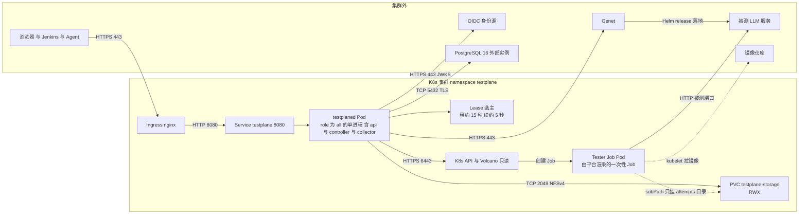

# TestPlane 总体设计

> **文档类型：** 平台总体设计说明（Overall Design）。不是需求文档，也不是实现方案。
> **效力：** 解释与索引性文档，**不新增设计裁决**。与 `design/ARCHITECTURE.md`（当前 v0.11）冲突时以 ARCHITECTURE 为准；与 `design/IMPLEMENTATION.md` 的 MVP 现状描述冲突时以该文 §15 为准。
> **读者：** 设计评审人、新加入的平台开发者、Jenkins / Agent / 下游集成方、SRE。
> **状态 / 日期：** P0 评审稿 · 2026-11-09。文中"当前落地"一律按 MVP 实际状态陈述，未实现的能力显式标注 P1。
> **覆盖：** 平台为什么存在、整体形态、控制面编排、状态与执行、产物与报告、安全与部署边界。
> **不覆盖：** Tester 的模板、规约、注册校验、`result.json` 产出规范等细节 —— 见姊妹篇 `docs/design/tester-design.md`（下称 **B 篇**）；表结构见 `design/views/03-data-view.md`，端点字段见 `design/views/07-api.md`。
> **一句话定义：** 给定服务部署参数或已有服务端点，执行标准化的 LLM 性能、精度等测试，产出机器可读、人可读的测试结果（ARCHITECTURE §1）。

**阅读顺序建议：** 评审看 §1 → §3 → §4.8；新开发者看 §4.4 → §4.6 → §5.2；集成方看 §5.1 → §5.4。

**记号约定：** 文中 `design/...`、`docs/design/...` 均为**仓库根相对路径**；`{run_id}`、`{task_id}`、`{n}`、`{pod}` 是**路径模板变量**（分别指 Run 标识、Task 标识、Attempt 序号、Pod 名），`r-YYYYMMDD-XXXX`、`t-XXXXXX`、`t-XXXXXX-aN` 是源文档既定的 ID 形态，都不是待填内容；`（ARCHITECTURE §x.y）`、`（04 进程视图 §2.1）` 为章节引用，不是超链接。

---

## 1. 背景与问题

### 1.1 当前情况

团队要对 LLM 服务做三类测试，覆盖的指标体系已经比较稳定：

| 测试类型 | 关心的指标 | 主要工具 |
|---|---|---|
| 性能测试 | TTFT、TPOT、吞吐、不同输入/输出长度与并发组合 | AISBench、EvalScope、自研压测脚本 |
| 精度测试 | 数据集评分、准确率 | AISBench、EvalScope |
| 稳定性 / 前缀缓存 SLA | 满足延迟约束的最大并发、最高输出吞吐 | 自研脚本（现封装为 `aisbench-sla`） |

资源与外部系统的现状同样明确：服务部署统一由 **Genet** 承担；算力在 K8s / Volcano 池子里；触发方是 Jenkins 定时流水线、工程师手工执行，以及正在接入的 Agent。

**但"一次测试"并不是一次点击，而是一条人工串起来的链。** 现在跑完一次完整测试，通常要走完下面七步：

1. 人先在 Genet 上按模型、卡数、PD 分离形态填写部署参数，提交部署，然后盯着队列等就绪；
2. 部署起来后，手工从 Genet 或运维群拿到服务地址与模型名；
3. 打开对应测试工具的文档，回忆或翻找这次要用的参数拼法，拼出一条命令；
4. 挑一台有卡的空闲机器，确认环境、依赖、镜像版本都对，把命令送上去；
5. 边跑边看控制台，判断"服务到底是起来了还是只是地址通了"；
6. 跑完把日志、Excel、自定义 JSON 收下来，手工整理成一份表格；
7. 关服务、释放机器，把结论口头或邮件同步出去。

七步里没有一步是"测试算法"本身的问题，全部是编排、衔接与记录的问题。这正是本平台要接住的部分。

### 1.2 存在的问题

1. **测试命令与平台耦合。** 每个工具一套 CLI、一套参数命名、一套依赖；换一个工具就换一套脚本，脚本里又混着集群地址、挂载路径与镜像名，导致同一份测试无法在别的环境复用。
2. **结果口径不一。** 报告是控制台日志、Excel、自定义 JSON 的混合物；没有统一的指标名、单位与统计量，机器无法消费，Agent 无法跨 Run 比较，人也只能靠记忆判断"这次比上次好还是差"。
3. **部署与测试割裂。** 服务"地址可解析"不等于"能出字"——Genet 返回 ready 之后仍可能因为 PD 未注册、权重未加载、鉴权配置错误而不可服务。现在经常在服务其实没就绪时就开始压测，白白消耗 GPU 与排队时间，还把失败记成了测试失败。
4. **执行资源无编排。** 机器靠手工占，多个测试互相污染（同一服务上并行跑两个压测，吞吐和延迟都不可信）；没有统一的取消、超时、重试，一个卡住的进程能占一整天。
5. **过程不可追溯、不可恢复。** 状态在人的脑子里或 Jenkins 控制台里；Pod 一删，日志就没了；"上周那次 4096 输入的 P99 是多少、当时跑的是哪个脚本版本"经常无从回答。
6. **Agent 无法发现能力。** 没有机器可读的能力目录，Agent 既不知道平台能跑什么，也不知道某个能力要填哪些参数，只能靠人把命令贴给它。

### 1.3 问题原因

| 现象 | 根因 | 缺的是什么 |
|---|---|---|
| 换工具就换脚本、换环境就跑不起来 | 测试逻辑与编排逻辑没有边界，脚本同时承担"怎么测"和"在哪测" | 一条清晰的**能力边界**：谁负责测试算法，谁负责起停与记录 |
| 每个工具的输出格式都不一样 | 跨边界交互没有可校验契约 | 一份全局唯一的**结果 schema** 与统一的执行入口 |
| 服务没就绪就开跑、失败原因归错人 | 部署与测试之间没有前置门 | 一个**强制的前置检查**与明确的终态语义 |
| 状态只在控制台里，重启即失忆 | 没有唯一状态源 | 一个**权威状态存储** + 显式状态机 |
| 多任务互相污染、无法取消 | 没有执行隔离与资源声明 | 容器级**执行隔离** + 声明式资源/并发约束 |

一句话概括：**测试逻辑与编排逻辑没有被切开，切开处也没有契约兜住。**

### 1.4 现状图

图 1-1 是当前的人工链路，虚线指向每一处问题的落点。



**读图说明：** 上半部分是"人 + Jenkins + Agent 三个入口分别拼命令"，中间是工具、部署与资源三条互不相识的路径，下半部分是三个人工汇总动作。

三处断点就是本平台的切入点：入口不统一（左）、部署与测试之间没有门（中）、结果与状态不落库（右）。

---

## 2. 目标与范围

### 2.1 目标

| # | 目标 | 可验收的判据 |
|---|---|---|
| G1 | **一次提交、异步跑完**：提交一份声明式清单（Manifest），平台负责部署、前置检查、编排、收集与清理 | `POST /runs` 返回 202，随后 Run 沿状态机走到终态，中途不需要人工干预 |
| G2 | **能力可扩展而不改平台**：接入新测试能力只新增一个 Tester 目录与镜像 | 新增 Tester 不需要改控制面代码、不需要改前端（ARCHITECTURE §11.4） |
| G3 | **结果可机器消费**：每次执行产出一份符合统一 schema 的 `result.json` | 结论字段固定、指标带 `unit` 与 `statistic`、多组参数靠 `labels` 区分 |
| G4 | **过程可追溯、可恢复**：状态与事件落库，控制面重启不丢状态 | 杀掉控制器后重启，`running` 的 Task 经对账恢复真实状态，不误判失败 |
| G5 | **部署与测试之间有门**：服务不可服务时尽早阻断 | Pre-Check 未通过时其余 Task 不启动，Run 终态为 `service_unavailable` |
| G6 | **资源可控**：端点级互斥、全局并发上限、超时、取消、重试 | 同一 Endpoint 上不会出现两个测量型 Task 并行；取消能真正删掉 Job |
| G7 | **AI Agent 友好**：能力目录、状态、错误码、报告都机器可读 | Agent 通过 `GET /testers` 读参数清单，通过 REST / SSE 提交与跟状态（MCP 属 P1） |

目标的**反面**同样重要：平台不追求"测得更准"（那是 Tester 与工具的事），也不追求"替人下结论"（§2.3）。

### 2.2 适用范围

- **测试对象：** 通过 OpenAI 兼容接口暴露的 LLM 推理服务；支持"平台拉起服务"（`deploy`）与"只测已有服务"（`service`）两种来源。
- **测试类型：** 性能、精度、稳定性 / 前缀缓存 SLA，以及自定义探活；具体算法由 Tester 决定，平台不设限。
- **执行环境：** 已登记的 K8s 集群与命名空间，通过执行环境配置（Execution Profile）引用；算力调度交给 K8s / Volcano。
- **调用方：** Web UI、Jenkins 流水线、Agent / 脚本（REST + 服务令牌），以及 P1 的 CLI / MCP。
- **规模假设：** 单个 Run 不超过 200 个 Task、平台全局并发默认 20（ARCHITECTURE §12.7）；"每日百级 Run"是容量规划假设，不是接口限制。

### 2.3 不包含的内容

以下为 ARCHITECTURE §13 的 Non-Goals，按"永久不做"与"当期不做"两档列出：

| 不做 | 档位 | 理由 |
|---|---|---|
| 不自研测试算法 | 永久 | 复用 AISBench、EvalScope 等现有工具 |
| 不做服务部署平台 | 永久 | 部署归 Genet，平台只调用 |
| 不自研底层调度 | 永久 | 复用 K8s / Volcano，平台只做端点级互斥与并发上限 |
| **不做门禁判定（Gate）** | 永久 | 平台只产出事实；是否达标由下游或 Agent 判断，避免把业务阈值固化进平台 |
| 不做 SSH / Docker 执行后端 | 永久 | 只有 K8s 一种 Executor；主机上直接跑属"平台外运行方式" |
| 不解析 Tester CLI、不校验参数、不解析原始产物 | 永久 | 测试语义属于 Tester（B 篇 §4.8.1 / §4.8.2） |
| 不托管数据集与模型 | 永久 | 路径是不透明字符串，平台不解析、不校验存在性 |
| 不承诺结果可复现 | 永久 | 只保证执行逻辑可追溯（记录 Tester 版本、参数快照、实际镜像 digest） |
| 不做多租户隔离 | 当期 | 对内单团队使用，RBAC 三角色已够用 |
| 不做自定义报表 / BI、拖拽式编排 | 当期 | 下游分析系统与 Manifest 已覆盖 |
| 独立 Task 提交（`POST /tasks`） | 当期未做 | MVP 未实现；P1 补 |
| MCP Server、CLI、Run 对比、指标索引 | 当期未做 | P1 范围（ARCHITECTURE §14.2） |

---

## 3. 方案对比与选择

### 3.1 可选方案

#### 方案一：Jenkins 脚本 + 集中触发

核心思路：**维持现有的命令拼装方式，只把入口统一起来。** Jenkins 保留为唯一触发器，新增一层参数化 Job 收拢参数，一个 Run 就是一次 Build，日志与产物靠 Jenkins 的归档能力保留；结果仍由各工具自己输出，再由流水线脚本做有限的格式转换。

这个方案并不荒谬：它对现有资产零迁移成本，Jenkins 本来就承担着定时与触发职责，短期内能让"统一入口"这件事落地。

#### 方案二：单体测试平台

核心思路：**把测试能力做进平台进程。** 平台内置各工具的适配器（进程内函数调用或子进程），提供参数表单、执行、结果解析与报告渲染，一个 Web 应用解决全部问题。用户填表单、点执行、看报告，体验最顺。

它同样有真实合理性：参数表单对人有明显价值，工具数量有限（三个左右）时，"改平台"和"写适配器"成本看起来一样。

#### 方案三：契约驱动的编排平台

核心思路：**平台只管编排，能力以容器封装的 Tester 提供，两侧靠契约耦合。** 提交声明式 Manifest；平台校验并冻结解析结果、按需调用 Genet 部署、把 Endpoint 投影成三个公共参数、为每个 Task 渲染 K8s Job Spec；Tester 镜像在 Job 里执行唯一入口 `/tester/run.sh`，接收 argv 与环境变量，把 `result.json` 直接写进共享存储的最终路径；平台校验结果、生成 Task / Run 报告、推进状态机并推送事件。

### 3.2 方案对比

| 维度 | 方案一 Jenkins 脚本 + 集中触发 | 方案二 单体测试平台 | 方案三 契约驱动编排平台 |
|---|---|---|---|
| 核心思路 | 统一触发，脚本照旧 | 平台内置工具适配与表单 | Manifest + Tester 契约 + K8s Job + 状态机 |
| 实现复杂度 | 低（几乎没有新组件） | 中（每个工具一套适配与表单） | 高（控制面、状态机、执行器、注册表、报告） |
| 性能 | 取决于脚本，无并发控制 | 进程内调用延迟低，但受平台进程资源限制 | Job 独立资源，20 并发可控；平台不参与数据面 |
| 可靠性 | 状态在 Jenkins 控制台，Pod / 机器丢了就没了 | 平台进程即单点，工具崩溃可能拖垮平台 | 状态落 PostgreSQL，控制器重启可对账恢复 |
| 扩展性 | 加工具等于加脚本与分支 | 加工具等于改平台代码并再发一版 | 加工具等于加一个 Tester 目录与镜像，平台不改 |
| 兼容性 | 与现有流水线完全兼容 | 需要迁移全部命令与结果格式 | Jenkins 退化为普通调用方，兼容期可并行 |
| 维护成本 | 脚本随时间腐化，无人敢删 | 平台与测试算法强耦合，每次工具升级都要动平台 | 契约稳定后平台几乎不动；成本转移到 Tester 作者侧 |
| 适用场景 | 工具极少、一次性任务 | 固定几种测试、内部用户少、追求上手速度 | 工具异构、要长期演进、要被 Agent 调用 |

### 3.3 方案对比图

图 3-1 只画一件事：三种方案下"数据从哪到哪"的路径差异。



**读图说明：** 三个 subgraph 是三条完全不同的数据路径，不是同一架构的三种样式。

方案一的路径止于脚本（端点对端点，无人记录）；方案二把工具塞进平台进程，测试流量与平台进程共享生命周期与资源；方案三把"跑"移到 Job、把"记"留在共享存储，平台进程只碰控制面。

关键差别在**失败域**：方案一失败即失控，方案二失败会连累平台，方案三的失败被限制在一个 Attempt 内。

### 3.4 最终选择

**选择方案三：契约驱动的编排平台。** 决定性原因有四条，每一条都直接对应一个方案的硬伤：

1. **测试能力演进快，平台必须稳定，所以把"怎么做测试"关进 Tester、平台只认契约。** 方案二里每接一个工具就要改平台、发一次版，工具升级与平台升级互相绑死；方案三下平台只认三个通道（argv / 环境变量 / 输出目录），新增能力是"加目录 + 加镜像"，控制面代码零改动（ARCHITECTURE §5、B 篇 §4.8.1）。
2. **异构依赖只能靠容器隔离，进程内插件扛不住。** NPU 驱动、CUDA / HDK 版本、几十 GB 的镜像、不同语言与 Python 栈，这些冲突在方案二的单进程里无法共存；方案三让每个 Tester 自带镜像，平台只负责把镜像交给 K8s。
3. **状态必须可恢复，所以 PostgreSQL 唯一权威，而不是 Jenkins 控制台或平台内存。** 方案一的状态在控制台里、方案二的状态在进程里，两者都随进程消失；方案三把状态机写入与业务写放在同一事务，控制器重启后按库对账（§4.8.1）。
4. **产物要能活过 Pod，所以直写共享存储的最终路径。** 方案一、二都没有"跑完仍然可下载"的保证（Pod 或容器一删就没了）；方案三让 `attempts/{n}/` 直接就是 `/workspace/output`，平台不搬运字节，"收集"退化为校验（§4.8.4）。

还有一条**辅助但不可忽略**的原因：**Agent 要能选能力。** 只有方案三同时提供了机器可读的能力目录（`GET /testers`，含参数清单与角色）与全局唯一的结果 schema，Agent 才能自己挑 Tester、拼参数、读指标（B 篇 §4.4）。

### 3.5 方案代价

选择方案三不是免费的，下列限制是**设计上接受的代价**，不是待修缺陷：

1. **强依赖 K8s 与"全节点可访问的 RWX 共享存储"。** 若把控制面部署到裸机或单机 Docker 上，这条设计不成立；存储不满足 RWX 时，"产物直落最终路径"退化为必须打包上传，而平台明确不提供该退化模式（ARCHITECTURE §6.8 第 7 条）。
2. **Tester 作者要承担镜像、CI 与独立运行能力。** 写一个 Tester 不止写脚本：要维护 `tester.yaml`、`run.sh`、Dockerfile、镜像发布，还要保证不给平台也能用 `docker run 镜像名 --p1=1 --p2=2` 跑出同样的产物。这是把复杂度从平台转移到了能力提供方（B 篇 §4.8.3 / §4.8.7）。
3. **平台不校验参数，参数错误在运行期才暴露。** UI 只有一个输入框，平台只做词法切分与公共参数追加；写错参数名的代价是"跑完才发现失败"，而不是"提交被拒"。因此参数清单必须准确，清单写错等于没有说明书（B 篇 §4.8.2）。
4. **平台不聚合指标、不判达标，下游要自己消费。** Run 报告只做组织与索引，不对跨 Task 指标做加减乘除；"这次是否达标"需要下游系统或 Agent 判断（§4.8.5）。
5. **平台看不到 Tester 内部进度。** 契约面只有退出码与 `result.json`，一个跑 40 分钟的 SLA 搜索在平台看来就是"`running` 中"；要看细节只能读 Tester 自己的日志与 `raw/`。
6. **无多租户。** RBAC 三角色（`viewer` / `operator` / `admin`）按团队粒度授权，不提供项目级隔离与配额分摊。

---

## 4. 技术原理与方案设计

### 4.1 核心原理

平台的核心是一条**"意图 → 事实 → 状态"的单向流水线**，测试语义始终留在 Tester 里：

1. **输入：声明式意图。** 调用方提交 Manifest，只描述"测什么、在哪跑、怎么部署或连哪个已有服务"，不描述"怎么测"。`args` 是一段 `--k=v` 字符串，不是命令。
2. **处理一：校验与冻结。** 平台做结构校验（`deploy` 与 `service` 互斥且必填其一、`tests` 至少 1 条、`args` 中不得出现公共参数、Execution Profile 与 Tester 必须已登记、Task 数不超过 200），通过后在**一个事务**里落库，同时冻结解析结果快照（Tester 名称 / 版本、镜像引用、参数原文、Endpoint 标识）。
3. **处理二：部署或接服务。** 有 `deploy` 时调用 Genet 拉起服务，按 1 秒到 15 秒的退避轮询，窗口默认 72 小时；`service` 时直接采用提交方填的三个值。两条路最终产出**同一个 Endpoint 对象**，因此下游逻辑只有一套。
4. **处理三：参数投影。** 平台把 Endpoint 投影成三个公共参数 `--url` / `--model_name` / `--model_path`，**追加到 argv 末尾**；Tester 只看到这三个参数，看不到 Endpoint 这个概念。
5. **处理四：渲染与执行。** 平台为每个 Task 渲染 Job Spec（镜像、固定 command `/tester/run.sh`、argv、env / secret_env、资源、超时、两类挂载），交给 K8s 起 Job；Tester 容器在 Job 里执行，把产物直接写进共享存储的 `attempts/{n}/`。
6. **输出：事实。** 平台校验 `result.json`（缺失 `RESULT_MISSING`、不合规 `RESULT_INVALID`），补齐 Task / Run 报告与索引，推进状态机，通过 SSE 推送状态事实与错误码。

**平台只传递事实，不解释测试语义**：它不知道 `--sla=ttft.avg:1200` 是什么意思，也不知道 125 ms 算好还是算坏。

| 平台负责 | 平台明确不负责 |
|---|---|
| 校验 Manifest 结构、冻结快照、渲染 Job、起停与超时、收集日志、校验结果、推进状态、写报告 | 解析参数语义、拼装工具命令、判断指标是否达标、聚合跨 Task 指标、解析原始产物、托管数据集与模型 |

状态转移表与不变量见 `02 逻辑视图 §2–§3`；表、列与索引见 `03 数据视图 §3`；端点与错误映射见 `07 API 视图 §3–§5`。

### 4.2 原理图

图 4-1 标出了唯一的契约边界：**边界之外是平台控制面，边界之内是 Tester 的执行面，两者只通过三通道说话。**



**读图说明：** 上半段（Manifest → Endpoint → 公共参数）是平台自己的控制面，不产生任何测试流量。

中间的 subgraph 是唯一跨边界的位置：平台只写 Job Spec，Tester 只读 argv / env、只写 output 目录，两侧都不知道对方的内部结构。

下半段（校验 → 报告 → 状态 → SSE）说明平台在测试结束后做的仍然是"记录事实"，而不是"判定结论"。

### 4.3 整体方案

**一个 Go 二进制（`api` / `controller` / `collector` 三种角色）+ PostgreSQL 16 作为唯一权威状态源 + NFS 产物直落最终路径 + K8s Job 作为唯一执行后端 + React SPA。** 控制面不留内存状态，所有推进由"数据库事务 + 事件 + 对账"驱动；测试能力以容器化的 Tester 提供，平台只认契约（IMPLEMENTATION §2）。

对应到五层结构（ARCHITECTURE §2）：Presentation 是 Web UI / CLI / MCP；Orchestration 是 Run / Task / Cleanup；Capability 是 Tester / Registry；Execution 是 K8s Executor；Integration 是 Genet / Endpoint / Artifact Storage / Identity。

方案的量化边界（ARCHITECTURE §12.7，均为可调初值）：

| 约束 | 取值 | 触发点 |
|---|---|---|
| 单 Run Task 数 | 不超过 200 | 超限拒绝，`RUN_TOO_LARGE` |
| 全局并发 Task 数 | 默认 20 | 超出停在 `queued`，`waiting_reason` 为 `global_limit` |
| 单 Task 执行时长 | 默认 4 小时，配置上限 24 小时 | 超时删 Job，`TASK_TIMEOUT` |
| Deploy 窗口 | 默认 72 小时 | 超窗转 `service_unavailable` |
| 单 Attempt 产物 | 10 GiB | 超限 `ARTIFACT_QUOTA_EXCEEDED` |
| Run 报告 | 不超过 20 MB | 超出则产物外置 |
| 状态查询延迟 | P95 小于 300 毫秒 | 非日志类接口 |
| 调度一次事务 | 小于 50 毫秒 | 超 40 毫秒记慢事务指标 |
| SSE 事件端到端 | 小于 1 秒 | 同集群部署前提 |

### 4.4 整体架构图

图 4-2 是平台的整体架构。**后缀标出本次变化**：`新增` 表示本次设计新建的组件，`修改` 表示职责或接口被重新定义，`复用` 表示沿用既有外部系统。



**读图说明：** 调用方向是**单向向下**：调用方 → API → Orchestrator / Scheduler → Executor → K8s → Tester 容器，没有任何反向调用；Tester 与平台之间唯一的"回程"是共享存储上的文件。

数据流有两条：**控制流**走 PostgreSQL（状态、事件、租约、注册表），**数据流**走 NFS（`result.json`、`raw/`、日志、报告），两者刻意不交叉——库挂了不影响已有产物可下载。

`新增` 集中在控制面、Web UI 与 Tester 能力单元；`复用` 是 Genet、K8s / Volcano、NFS、OIDC、镜像仓库这些既有能力；唯一的 `修改` 是 Jenkins —— 它不再是测试逻辑的宿主，退化为普通调用方（§3.4）。

### 4.5 组件说明

| 组件 | 作用 | 本次变化 |
|---|---|---|
| Web UI | 列表 / 详情 / 报告 / 日志 / 提交 / Tester 目录 / 环境；只做展示与操作，无 API 之外的私有状态 | 新增（MVP 6 路由） |
| API 层 | REST（`/api/v1`，50 个 operation）+ SSE + 鉴权 + 校验 + 读投影；无状态可水平扩 | 新增 |
| Orchestrator | 提交校验、Pre-Check 注入、Run 推进、`abort_run` 扩散、清理编排、终态判定 | 新增 |
| Scheduler | 候选选取、端点执行槽位（endpoint lease）互斥、全局并发 permit、超时看护、`waiting_reason` | 新增 |
| Store（PostgreSQL 16） | Run / Task / Attempt / 事件 / 租约 / 注册表 / Profile / 集群；唯一权威状态源 | 复用（既有 PG 能力），表结构新增 |
| Registry | 白名单目录扫描、15 条校验、`content_sha` 指纹、版本不可覆盖、`orphaned` / `retired` 标记 | 新增；controller 启动扫描并在每 10 分钟重扫（`RunRescan`，间隔小于等于 0 时只扫一次）；校验失败时 controller 拒绝启动，api 仅告警继续 |
| Executor（K8s Job） | 渲染 Job Spec、创建 / 观测 / 取消 / 删除 Job、记录实际镜像 digest | 新增（平台唯一执行后端） |
| Collector | Tester 与 Deploy Pod 日志跟随、按 Pod 落盘、重启与缺口标记、配额扫描 | 新增（MVP 由 executor 兼任采集） |
| Report Writer | 校验 `result.json`、生成 Task / Run `report.json` 与 `report.md`、产物索引 | 新增 |
| Genet Adapter | 部署、状态轮询、权威 Endpoint 获取、卸载（只走 Genet OpenAPI） | 新增适配器，Genet 本身复用；MVP 为 mock |
| Jenkins | 定时提交 Run / Task、查询状态、下载报告 | 修改：退出命令拼装与结果解析，降为普通调用方（REST + 服务令牌） |
| K8s / Volcano | 起 Job、调度 Pod、gang 与队列；平台**只读**队列与节点视图 | 复用 |
| NFS（RWX） | `storage-root/{run_id}/tasks/{task_id}/attempts/{n}/` 即最终落盘位置 | 复用（既有 NFS 能力） |
| Tester | 能力的唯一载体：镜像 + `tester.yaml` + `/tester/run.sh` | 新增（当前有 `endpoint-probe` 与 `aisbench-sla` 两个可运行实例） |
| OIDC 身份源 | 统一身份，三角色 RBAC；服务令牌与用户同权限 | 复用 |

### 4.6 关键流程图

图 4-3 把一次 Run 的主干、成功 / 失败 / 取消三条路径画在同一张图上。



**读图说明：** 三条路径共用一个入口与一套状态机：**成功路径**是 `submitted → queued → deploying 可选 → testing → cleanup → 终态`；**失败路径**按责任分成两支——服务没起来归 `service_unavailable`，平台或测试自身问题归 `completed_with_errors` / `failed`；**取消路径**可以从任意非终态进入 `cancelling`。

唯一被强制的顺序点是 `precheck_gate`：Pre-Check 未通过前，其余 Task 停在 `pending` 且 `waiting_reason` 为 `precheck_gate`；通过之后平台不再施加额外串行顺序，是否并行由 Tester 的 `endpoint_exclusive` 声明决定。

`POOL` 内部还有一段每个 Task 自己的循环：`queued`（等槽位）→ `preparing`（渲染 Job、预创建目录）→ `running`（Pod 已启动）→ 终态（校验 `result.json`、采日志、写 Task 报告）。这段循环在 §4.7 展开。

终态判定之后平台仍要写报告、发 `run.finished` 与 `report.written` —— 状态终态与产物就绪是两件事。

### 4.7 关键时序图

图 4-4 是正常路径的时序，重点是"202 之后全部异步"与三处门控。



**读图说明：** 三个门控点：**部署门**（Genet 侧排队可能数十小时，靠落库 + 事件表示，不占连接与 goroutine）、**服务门**（`ready` 只代表地址可解析，必须再过 Pre-Check）、**槽位门**（端点独占 + 全局 permit 决定谁先进 `preparing`）。

两处硬约束在图上可见：**Job 创建在事务外**（避免把 K8s IO 放进事务），而**状态写入、租约释放与事件同事务**（崩溃不会泄漏槽位）。

SSE 不参与业务推进：`NOTIFY` 在事务提交后发出，只带 `run_id` 与 `seq`，正文一律回查 `state_events`。

单个 Task 的执行细节（取槽位、`preparing → running`、终态与租约同事务）见 `04 进程视图 §2.2`；行锁与 advisory 锁顺序见 §3.1。

### 4.8 关键设计点

#### 4.8.1 唯一权威状态与显式状态机

**解决什么问题：** 一次 Run 涉及部署、多个 Task、重试、取消、清理，且控制器随时可能崩。状态如果散落在内存、K8s 对象或消息队列里，重启后就会出现"两个权威各说各话"。

**怎么做：** PostgreSQL 16 是唯一权威状态源，控制端无内存状态；状态只能经状态机服务写入，且**与业务写在同一事务**；所有转移用 CAS 实现，先落库者胜，冲突者记 `state_race_lost` 不覆盖；控制器用 K8s Lease 选主（租约 15 秒、续约 5 秒），新 leader 接管后先对账再调度；观测不到的状态走 `unknown` 四步复核（0 / 5 / 20 / 60 秒，总时长不超过 90 秒），**绝不因为看不到就判失败**。

**为什么不用 CRD 作权威：** CRD 会制造第二个权威源（CRD 与 PostgreSQL），对账逻辑要写两遍；平台也只需要普通 Job，不需要 Operator 模式。**为什么不用队列（Redis / Kafka）当状态：** 队列是"待办投递"，不是"当前状态"，重放与去重都要自己实现，等于多一个状态源加一个新的运维面（IMPLEMENTATION §3.3）。**为什么不用内存状态加定期快照：** 快照之间的转移必丢，"取消与自然结束的竞态以先落库者为准"这类规则根本无法表达。

#### 4.8.2 Tester 契约边界：只留三通道

**解决什么问题：** 平台与能力之间如果有多条交互途径（参数文件、元数据文件、平台 API 地址、sidecar 约定），每一条都会长出自己的兼容分支，最终平台必须理解测试语义。

**怎么做：** 契约面只有三样——**argv**（一段 `--k=v`，平台按词法切分后直接 exec，不经 shell）、**环境变量**（三个 `TESTPLANE_*` 元信息，独立运行时缺省 `local`）、**输出目录**（`/workspace/output`，必须产 `result.json`）。**没有 `/workspace/input`，没有参数文件，没有元数据文件**；公共参数由平台追加到 argv 末尾；取不到值时 Tester 用默认行为兜底。

**为什么不做参数文件、不做平台渲染模板：** 文件形态需要版本、需要 schema、需要兼容期，而它承担的只是"把字符串交给进程"这一件事；argv 天然可词法切分、天然不经 shell、天然可独立复现。**为什么不校验参数：** 一旦平台校验，平台就必须理解每个参数的类型与耦合关系，等价于把测试语义搬回平台；代价是错误在运行期暴露，这一点已在 §3.5 显式接受。**为什么必须有独立运行约束：** 如果 Tester 只能在平台里跑，任何契约缺陷都只能在集群里被发现，作者也无法本地调试；不给平台也能用 `docker run 镜像名 --p1=1 --p2=2` 跑通，是这条契约的验收方法。

> 三通道的完整规则、`tester.yaml` 字段语义与注册校验清单见 **B 篇 §4.8.1 / §4.8.2 / §4.8.4**。

#### 4.8.3 端点互斥与 Pre-Check 门控

**解决什么问题：** 同一服务上并行跑两个测量型测试，吞吐会被摊薄、延迟会被抬高，结论不可用；而"服务到底能不能出字"又必须在任何测试之前回答。

**怎么做：** 每个 Task 执行前按 `endpoint.key` 申请槽位（有部署时用部署标识，无部署时取 `url` 的规范化值，协议 + host + port，保证同一服务的不同写法仍互斥）；`endpoint_exclusive: true` 的 Task 独占该 Endpoint，**独占是单向压制**——非独占 Task 永远不能与任何独占 Task 并行；全局并发默认 20，超出时停在 `queued` 并带 `waiting_reason`。

Pre-Check **不是独立概念**，它就是 `role: pre_check` 的 Tester 组成的第一个 Task（`seq` 为 0），由 `precheck: auto` 注入，必须 `on_failure: abort_run` 且 `endpoint_exclusive: true`。它因此自动继承 Task 的全部能力：状态机、Attempt、产物目录、取消、独占、重试。

**为什么把 Pre-Check 做成 Task 而不是一个阶段：** 一个阶段意味着第二套状态、第二套日志与产物路径、第二套取消逻辑；做成 Task 后，`precheck_gate` 只是"第一个 Task 未成功前其余 Task 停在 `pending`"这一条调度规则，零新增概念。**为什么独占必须单向：** 如果允许"两个非独占并行、独占插入"的双向规则，同一 Endpoint 上就会同时存在测量型与非测量型 Task，"独占"这个词就失去意义。**为什么门控后不再施加串行：** 门控是唯一需要强制顺序的地方，其余顺序应交给声明（资源与互斥）而不是平台硬编码，否则提交者的并行意图无法表达。

> Pre-Check 类 Tester 的四条附加约束（探测位置、等待窗口、区分未就绪与不可重试、两种重试不混用）见 **B 篇 §4.8.6**。

#### 4.8.4 产物直落共享存储

**解决什么问题：** "先写容器本地、跑完再打包上传"在 Pod 被抢占、节点驱逐、容器 OOM 时直接丢失全部证据，而复盘恰恰发生在这类失败之后。

**怎么做：** `attempts/{n}/` 目录（即 `storage-root` 下按 `run_id`、`tasks`、`task_id`、`attempts`、序号逐层展开的那一层）以 **subPath** 挂到 `/workspace/output`，**它就是最终落盘位置**，平台不搬运任何字节；Attempt 之间互不可见（重试写新的 `attempts/{n}/`）；失败保留现场；目录由平台预创建（属主为运行 UID，权限 `0770`），Tester 仍应 `mkdir -p` 容忍缺失。由此"收集"退化为三件事：校验 `result.json`、补齐 Task / Run 报告、生成索引。

**为什么取消"打包上传"退化模式：** 它会在 Pod 被抢占时丢产物，也会让"产物直落最终路径"这个简化失效——一旦允许两种模式，所有读取端都要处理"产物可能还在容器里"的分支。**为什么必须用 subPath 而不是整卷挂载：** 整卷挂进容器等于让 Tester 可以读写其他 Run 的产物。**为什么日志也落盘：** Tester stdout / stderr 落到 `attempts/{n}/logs/`，Deploy 日志按 Pod 一份落到 `deploy/logs/{pod}.log`，边跑边写——Run 结束再 `kubectl logs` 时 Pod 可能已被回收或日志已被轮转。

#### 4.8.5 平台不做 Gate

**解决什么问题：** 阈值会变（不同模型、不同硬件、不同业务阶段的达标线不同）。如果平台内置门禁，每次阈值调整都要改平台、发版、回溯历史 Run 的判定口径，且历史结论会随阈值变化而"改写"。

**怎么做：** 平台只产出事实：Task 有状态与错误码，`result.json` 有指标与 `statistic`，报告做组织与索引而**不做跨 Task 数学聚合**；"是否达标"由下游系统或 Agent 判断。执行成功与指标达标是两件事：Tester 完整跑完但准确率偏低时返回退出码 0，**不得**把"指标不理想"映射为执行失败。

**为什么不是另一种做法：** 若平台判定达标，就必须定义阈值来源（Manifest？Tester 清单？平台配置？），任何一处都会把业务规则固化进平台；而且历史 Run 的终态会随阈值变化而失真，破坏可追溯性。把判定放在下游，代价是下游要自己消费指标（§3.5 第 4 条），收益是平台与业务阈值解耦。

### 4.9 异常处理

表中的错误码全部取自 ARCHITECTURE 附录 D 枚举；"可重试"指该码标 `retryable: true`，只有这类码才允许进入 Task 的 `retry_on` 白名单。

| 异常场景 | 影响 | 处理方式 |
|---|---|---|
| Genet 报 `blocked`，或部署超过 72 小时窗口 | Run 停在 `deploying`，一个测试都没跑 | Deploy 子状态落 `blocked`，错误码 `DEPLOY_BLOCKED`；Run 转 `service_unavailable`；平台不自动重试部署（该码不进 Task 的 `retry_on`），由提交方决定是否重提 |
| 平台调 Genet 失败（连接 / 5xx / 同名冲突 / 安装失败） | 拿不到 Endpoint，无法进入 `testing` | `DEPLOY_FAILED`（不可重试）；Run 转 `failed`；`detail.reason` 保留 Genet 原文 |
| K8s API 不可达 | 无法创建或观测 Job | `EXECUTOR_UNAVAILABLE`（可重试）；命中 `retry_on` 时回 `queued`；观测不到不判失败 |
| 镜像拉取失败 | Pod 处于 ImagePullBackOff，Attempt 失败 | `IMAGE_PULL_FAILED`（可重试）；按 `retry_on` 生成新 Attempt，历史 Attempt 不被覆盖 |
| Pod 挂载失败（FailedMount / FailedAttachVolume） | 容器起不来 | `MOUNT_UNAVAILABLE`（不可重试）；`detail.k8s_reason` 保原文；属运行期观测，不做提交期校验 |
| NFS 不可写 | 目录预创建失败，或产物写不进 | 预创建失败转 `EXECUTOR_UNAVAILABLE`（可重试）；`result.json` 读取区分"不存在"与 I/O 错误，后者重试 3 次才收口 |
| Tester 非零退出 | 该 Task 失败 | `TESTER_NONZERO_EXIT`（不可重试）+ stderr 摘要；是否重试只看 `retry_on` |
| `result.json` 缺失或不合规 | 退出码 0 但无有效结果 | `RESULT_MISSING` / `RESULT_INVALID`（不可重试）；Task 判 `failed`；不允许"没有结果却当作成功" |
| Task 超时 | 超过 `timeout_seconds` 被平台终止 | 删 Job 后报 `TASK_TIMEOUT`；Task 判 `failed`；`retryable` 按策略，默认不自动重试 |
| 取消与自然结束竞态 | 终态可能被后到者覆盖 | CAS 保证先落库者胜；后到者返回 0 行，只补 `exit_code`，记 `state_race_lost` |
| 控制器崩溃 | 状态推进暂停，K8s 上的 Job 继续跑 | 租约 15 秒过期后新 leader 接管，30 秒内对账拉平；`unknown` 走四步复核，不假定失败 |
| 注册扫描校验失败 | controller 无法确定能力目录可信 | controller 拒绝启动（fail fast）；api 仅告警、继续提供只读与转发，不写注册表 |
| 清理失败（删 Job / 卸载 release 失败） | 资源残留 | `CLEANUP_FAILED`，**不改变 Task / Run 结果**；写 `cleanup.failed` 事件并告警，对账循环重试 |
| 单 Attempt 产物超过 10 GiB | 可能打满共享存储 | `ARTIFACT_QUOTA_EXCEEDED`（不可重试）；collector 每 60 秒 `du` 扫描，超限即删 Job 并判该 Attempt 失败 |
| 全局并发或端点配额不足 | Task 停在排队 | `RESOURCE_EXHAUSTED`（可重试）+ `waiting_reason`（`slot_waiting` / `global_limit` / `queue_full` / `gang_pending` / `insufficient_resources`） |

两处口径需要点明：`DEPLOY_BLOCKED` 与 `DEPLOY_FAILED` 是 **Run 级**错误，发生在还没有任何 Task 运行时，因此**不属于 Task 的 `retry_on` 候选**；Task 的 `retry_on` 只接受任务级且 `retryable: true` 的码。

共性规则：故障不产生"猜出来的状态"——要么保持上一个已提交状态，要么落一个带错误码的终态，绝不因为观测不到就判失败。各类故障下"进行中的 Run / Task / Attempt 会怎样、恢复动作是什么"的完整对照见 `04 进程视图 §4`；P0 的单点与缓解见 `06 物理视图 §7.1`。

---

## 5. 使用方式

### 5.1 使用场景

| 场景 | 典型做法 | 现状 |
|---|---|---|
| 日常回归 | Jenkins 定时提交同一份 Manifest；平台按 Endpoint 互斥排队，跑完推 `run.finished` | 可用（Jenkins 作为普通调用方，无特权路径） |
| 新模型上线前的性能 + 精度 | 一份 Manifest 写多个 `tests[]`，精度类并行、性能类独占；报告按 `labels` 分组 | 可用 |
| 只测已有服务 | Manifest 用 `service` 块填三个公共参数，不触发 Genet | 可用（`POST /runs`；独立 `POST /tasks` 未做） |
| Agent 选能力并提交 | `GET /testers` 读参数清单 → 拼 `--k=v` → `POST /runs` → SSE 跟状态 → 取 `result.json` | 可用；MCP Server 与 CLI 属 P1 |
| 服务没起来时排障 | 看 `deploy.state` 与 `waiting_reason`；`GET /runs/{id}/deploy/logs` 按 Pod 取日志，缺口由 `gaps[]` 显式标注 | 可用（`queued` 必带原因，不可达不等于 0 排队） |
| 新增一个 Tester | 目录 + 镜像发布后，由 controller 周期重扫（默认 10 分钟）生效，或随平台镜像一起发布 | 可用（没有运行时上传入口，见 §5.4.3） |
| 失败续跑 | `POST /runs/{id}/retry` 新建 Run，复用 `succeeded` 的 Task，重跑其余 | 可用（复用校验 Tester 版本、镜像引用 / digest、参数快照、Endpoint 标识） |
| 主机上临时跑一次 | 不走平台：`docker run 镜像名 --p1=1 --p2=2`，产物结构与平台内一致 | 可用（属平台外运行方式，不产生 Run 记录） |

### 5.2 环境要求

| 项 | 要求 | 说明 |
|---|---|---|
| Kubernetes | 1.28 及以上，需要 Job / RBAC / Lease；Volcano 可选 | 命名空间启用 PSA `restricted`；Tester Job 一律 `automountServiceAccountToken: false` |
| PostgreSQL | 16，外部实例 | 唯一权威状态源；`max_connections` 不小于 200；平台不带库 |
| 共享存储 | 全节点可访问的 RWX（NFSv4），挂载到 `/storage-root` | 产物直落最终路径的前提；单挂载点建议 10 GbE |
| 镜像仓库 | kubelet 可拉取的仓库 | Tester 镜像由 CI 产出并发布，**任何运行环境都不 build** |
| Genet | 可调用的 OpenAPI 端点 + 凭据 | 部署 / 状态 / 卸载三项；MVP 默认 mock |
| 身份源 | OIDC / SSO，含 JWKS | 三角色 `viewer` / `operator` / `admin`；服务令牌与用户同 RBAC |
| 控制面资源 | 500m / 512Mi 请求，2 CPU / 2Gi 上限 | IO 型负载；P0 单副本 `--role=all` |
| 出站网络 | 镜像仓库、目标服务网段、K8s API、PostgreSQL、NFS、Genet、IdP | Tester Pod 默认拒绝互联网出站 |

### 5.3 部署拓扑图

图 5-1 是 P0 的部署拓扑：集群内是控制面与 Tester Job，集群外是 Genet、被测服务、身份源与镜像仓库。



**读图说明：** 网络依赖的方向很清楚：控制面同时向外连 PostgreSQL、NFS、K8s API、Genet 与 IdP，任一条断掉都有对应的降级语义（§4.9）；Tester Pod **不直连 NFS** —— NFS 由 kubelet 以 subPath 挂载，Pod 内只有 `/workspace/output` 这一个可写目录。

存储依赖是硬前提：控制面把 `/storage-root` 挂到自己身上做目录预创建与报告写入，Tester Job 用同一 PVC 的 subPath 挂载；两者必须落在同一份 RWX 存储上。

P0 只有一个控制面副本（`--role=all`），controller 与 collector 靠 Lease 单活，api 无状态——拆分只改启动参数与副本数，不改代码。

K8s 对象清单（Deployment / Ingress / PVC / NetworkPolicy / Lease / 运行期 Job）、端口与协议、RBAC 边界见 `06 物理视图 §1–§4`；单副本单点清单与升级顺序见 §7。

### 5.4 使用示例

#### 5.4.1 提交一个完整 Run

```yaml
run:
  name: qwen3-sla-daily

  deploy:                      # 与 service 互斥，必须二选一
    provider: genet
    parameters:
      model: Qwen3-32B

  precheck: auto               # 平台注入 role 为 pre_check 的 Task，seq 为 0

  env:                         # Run 级明文，注入该 Run 全部 Task
    LOG_LEVEL: info
  secrets:                     # 只填 Secret 引用，不回显
    ENDPOINT_API_KEY: endpoint/prod-qwen

  tests:
    - name: prefix-cache-sla
      tester: aisbench-sla
      version: "0.4.0"
      execution: { profile: k8s-npu }
      args: "--input_len=2048 --output_len=32 --data_num=160 --sla=ttft.avg:1200 --start=8 --max=256 --request_rate=0 --work_path=/tmp/aisbench-ws"
      on_failure: continue
      retry:
        max_attempts: 1
        backoff_seconds: 60
        retry_on: [IMAGE_PULL_FAILED, EXECUTOR_UNAVAILABLE]

    - name: perf-sweep-short
      tester: aisbench-sla
      version: "0.4.0"
      execution: { profile: k8s-npu }
      args: "--input_len=512 --output_len=128 --data_num=64 --sla=tpot.avg:30 --start=1 --max=64 --request_rate=0 --work_path=/tmp/aisbench-ws"
      on_failure: continue

  cleanup:
    policy: always
```

注意三点：`args` 里**不写** `--url` / `--model_name` / `--model_path`（由平台从 `deploy` 或 `service` 取值后追加到末尾，重复出现会被拒绝）；`version` 必须命中已登记的白名单组合；`on_failure` 只能取更严格者，不能弱化 Tester 自身的声明。

#### 5.4.2 提交与跟状态

```bash
# 提交（返回 202 与 run_id；平台不做提交幂等，重复提交会产生多个 Run）
curl -sS -X POST "$API/api/v1/runs" \
  -H "Authorization: Bearer $TOKEN" \
  -H "Content-Type: application/yaml" \
  --data-binary @run.yaml

# 只校验不落库
curl -sS -X POST "$API/api/v1/runs?dry_run=true" \
  -H "Authorization: Bearer $TOKEN" \
  -H "Content-Type: application/yaml" \
  --data-binary @run.yaml

# 查详情（deploy.state 与 waiting_reason 是一等字段）
curl -sS "$API/api/v1/runs/r-20261109-0001" -H "Authorization: Bearer $TOKEN"

# 订阅事件（Last-Event-ID 续传，越窗先收 resync_required）
curl -N "$API/api/v1/runs/r-20261109-0001/events" \
  -H "Authorization: Bearer $TOKEN" -H "Last-Event-ID: 0"

# 取结果与原始产物
curl -sS "$API/api/v1/tasks/t-000002/attempts/1/result" -H "Authorization: Bearer $TOKEN"
curl -OJ "$API/api/v1/runs/r-20261109-0001/files?path=tasks/t-000002/attempts/1/raw/perf.xlsx" \
  -H "Authorization: Bearer $TOKEN"

# 取消与续跑
curl -sS -X POST "$API/api/v1/runs/r-20261109-0001/cancel" -H "Authorization: Bearer $TOKEN"
curl -sS -X POST "$API/api/v1/runs/r-20261109-0001/retry"  -H "Authorization: Bearer $TOKEN"
```

#### 5.4.3 查能力目录与执行现场

```bash
# 只读目录：默认每个 name 只回最新版本；include_retired=true 回全部版本
curl -sS "$API/api/v1/testers?role=pre_check" -H "Authorization: Bearer $TOKEN"
curl -sS "$API/api/v1/testers/aisbench-sla/versions/0.4.0" -H "Authorization: Bearer $TOKEN"

# 平台槽位与 Volcano 队列（两类排队必须分开展示，不可相加）
curl -sS "$API/api/v1/queue-status" -H "Authorization: Bearer $TOKEN"

# 看作业与 Pod 的实际形态
kubectl -n testplane get jobs,pods -l testplane.io/run=r-20261109-0001
```

平台侧**不提供** `POST /testers`：不接受运行时上传，Tester 只能以"白名单目录 + admin 评审发布"的方式进入平台，来源是平台镜像内的 `/app/testers`（B 篇 §4.8.4）。目录更新由 controller 周期重扫感知（默认 10 分钟，`interval <= 0` 时只扫一次），或随平台镜像重新发布。

---

## 6. 总结

**问题不是"缺少一个测试工具"，而是"测试与编排没有被切开"。** 现状里一次测试要人工串起七步，其中六步是编排、衔接与记录：命令拼装、环境确认、就绪判断、机器占用、结果汇总、状态留痕。这些工作重复、易错、无法被 Agent 复用，也无法在事后回答"当时到底跑了什么"。

**方案的实质是选一个稳定的切分方式，而不是选一个功能更全的平台。** Jenkins 集中触发解决入口、不解决语义；单体平台解决体验、把异构依赖与演进速度的代价转嫁给平台自身；契约驱动的编排平台把"怎么做测试"关进 Tester、把"在哪跑、怎么起停、怎么记"留在平台，代价是强依赖 K8s 与 RWX 存储、且作者侧要维护镜像与独立运行能力。

**原理可以用一句话概括：意图进、事实出。** Manifest 是意图；平台负责校验、冻结、部署或接服务、把 Endpoint 投影成三个公共参数、渲染 Job Spec；Tester 在容器里按唯一入口执行，把 `result.json` 写到最终存储路径；平台校验结果、生成报告、推进状态机并推送事件。平台不知道 `--sla` 的语义，也不关心 125 ms 是好是坏。

**关键设计只有五条，全部围绕"失败时仍然可信"：** 唯一权威状态与显式状态机（重启可对账、竞态有裁决）、只留三通道的 Tester 契约（平台零测试语义）、端点互斥与 Pre-Check 门控（测量不被污染、服务不可用不浪费资源）、产物直落共享存储（证据活过 Pod）、平台不做 Gate（阈值与平台解耦）。

**边界同样明确：** 部署归 Genet，调度归 K8s / Volcano，测试算法归 AISBench / EvalScope 等工具（封装在 Tester 内），平台只编排、只记录事实。当前 MVP 已落地控制面 / API（50 个 operation）/ 状态机 / 编排 / 存储、K8s Executor、Registry、Web UI（6 路由）、OIDC / RBAC、Volcano 只读看板、失败续跑端点与部署镜像；Genet 在 kind E2E 中默认 mock（真实客户端与适配设计已留）；独立 Task 的 `POST /tasks`、MCP Server、CLI、Run 对比与指标索引属 P1。

---

## 附录：与 tester-design.md 的交叉引用

两篇是**同一次评审的一对文档**，且共用同一套一 / 二级编号：本篇（A）讲平台边界与编排，`docs/design/tester-design.md`（B 篇）把 A 里唯一的能力扩展点 Tester 展开。术语、状态名、路径与数字在两篇中一致；Tester 的内部细节只在 B 篇展开，本篇只引用不重复。B 篇的 §7 是它对本篇的反向引用。

### A 指向 B

| 本篇位置 | 指向 B 篇 | 说明 |
|---|---|---|
| §2.3 不包含的内容 | B 篇 §4.8.1 / §4.8.2 | "测试语义属于 Tester"的字段级依据：三通道与 `tester.yaml` 的边界 |
| §3.4 决定性原因第 1 条 | B 篇 §4.8.1 | 为什么只有 `/tester/run.sh` 一个入口、为什么三通道就够 |
| §3.5 代价第 2、3 条 | B 篇 §4.8.3 / §4.8.7 / §4.8.2 | 作者侧的构建与独立运行义务；参数清单为何不校验 |
| §4.4 架构图的 Tester 容器 | B 篇 §4.4 | Tester 目录 → Registry → JobSpec → 容器 → `result.json` 的架构图 |
| §4.5 组件表的 Registry 与 Tester | B 篇 §4.5 / §4.8.4 | 扫描与 10 分钟重扫、15 条校验、`content_sha`、`retired` 标记 |
| §4.6 的 Pre-Check 门控 | B 篇 §4.8.6 | Pre-Check 类 Tester 的四条附加约束与 `on_failure` 取更严格者 |
| §4.8.2 契约边界 | B 篇 §4.8.1 / §4.8.2 | 为什么禁止参数文件与 shell 拼装；为什么参数清单只是说明书 |
| §4.8.4 产物直落 | B 篇 §4.8.5 | `result.json` 必填项、`metrics` / `labels` / `statistic` 规范、退出码语义 |
| §4.9 异常表中的 Tester 侧错误码 | B 篇 §4.9 | `TESTER_INVALID`、`RESULT_MISSING`、`RESULT_INVALID` 等的触发条件 |
| §5.4.3 能力目录 | B 篇 §5.3 / §5.4.5 / §5.4.6 | `testers/` 随镜像发布、目录查询与在 Manifest 中引用 |

### B 指向 A

按 B 篇 §7 的对照表反向列出，本篇对应小节均已存在：

| B 篇位置 | 回指本篇 | 说明 |
|---|---|---|
| §2.2 适用范围、§5.4.6 | 本篇 §4.6 / §4.7 | 一次 Run 从提交到终态的编排细节（`precheck_gate`、槽位、取消） |
| §3.1 方案三、§4.4 架构图 | 本篇 §3.4 / §4.4 | 平台级选型理由与整体架构 |
| §4.1 数据流转 | 本篇 §4.1 | Job Spec 渲染、公共参数注入、Attempt 产物路径的完整链路 |
| §4.5 组件说明 | 本篇 §4.5 | 平台侧组件（Orchestrator / Scheduler / Store / Executor / Report）的职责与变化 |
| §4.8.6 角色与独占 | 本篇 §4.8.3 | 端点互斥、单向压制与 `precheck_gate` 的平台侧实现 |
| §4.8.5 结果归一化、§4.9 异常表 | 本篇 §4.9 | 平台侧异常（Genet、K8s、挂载、取消竞态）的处置 |
| §4.8.7 独立运行 | 本篇 §3.5 / §5.1 | 平台外运行方式与它带来的作者侧义务（不产生 Run 记录） |
| §5.2 环境要求、§5.3 部署拓扑 | 本篇 §5.2 / §5.3 | 集群、PostgreSQL、NFS、OIDC 的拓扑与容量前提 |

### 术语与数字的对齐口径

两篇共用同一份事实基线，以下项**不允许各写一套**：Run / Task / Attempt / Deploy 状态枚举与大小写口径（库与 API 用小写 token）；`waiting_reason` 六值；ID 形态（`r-YYYYMMDD-XXXX` / `t-XXXXXX` / `t-XXXXXX-aN` / `j-` 加 8 位十六进制）；产物路径 `storage-root/{run_id}/tasks/{task_id}/attempts/{n}/`；关键数字（单 Run 不超过 200 Task、全局并发默认 20、单 Task 默认 4 小时 / 上限 24 小时、Deploy 窗口 72 小时、单 Attempt 产物 10 GiB、Run 报告不超过 20 MB、状态查询 P95 小于 300 毫秒、调度事务小于 50 毫秒、SSE 端到端小于 1 秒）；错误码只取 ARCHITECTURE 附录 D 枚举，`DEPLOY_BLOCKED` / `DEPLOY_FAILED` 只出现在 Run 级。

发现源文件与本篇冲突时，以 `design/ARCHITECTURE.md` 为准并回写 ARCHITECTURE §0.5 的变更记录，不在两篇之间静默改语义。
