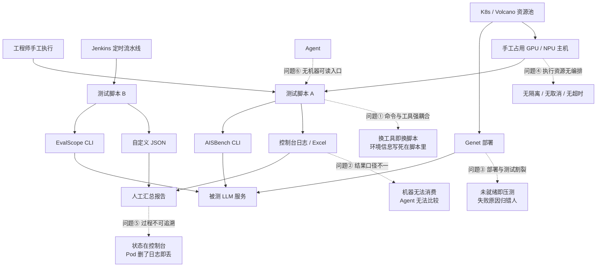
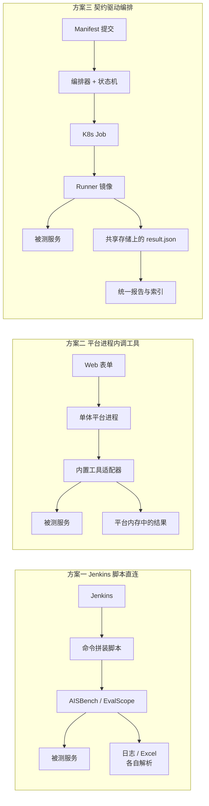
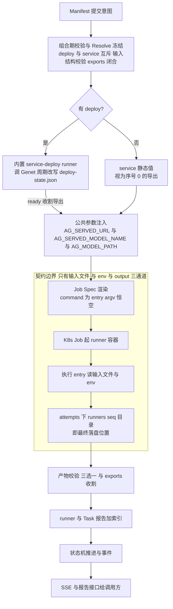
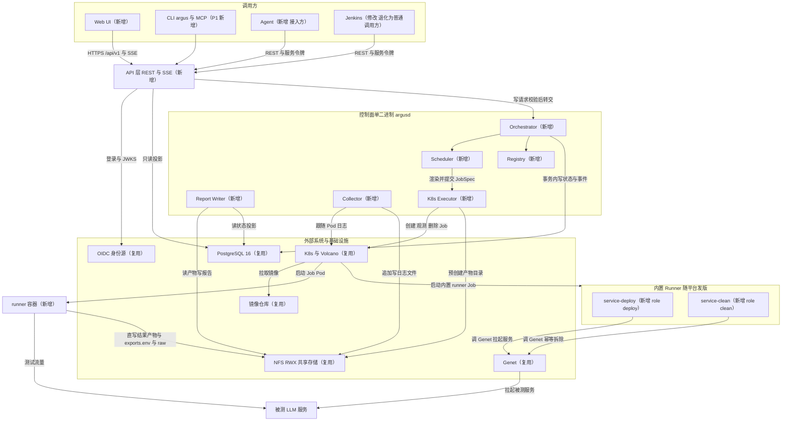
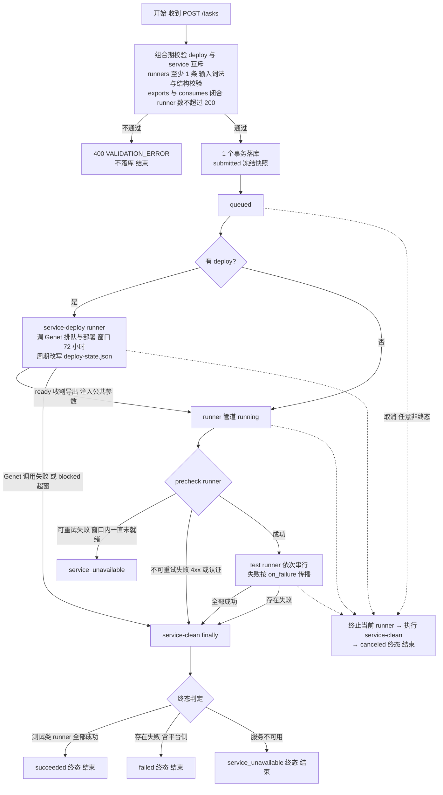
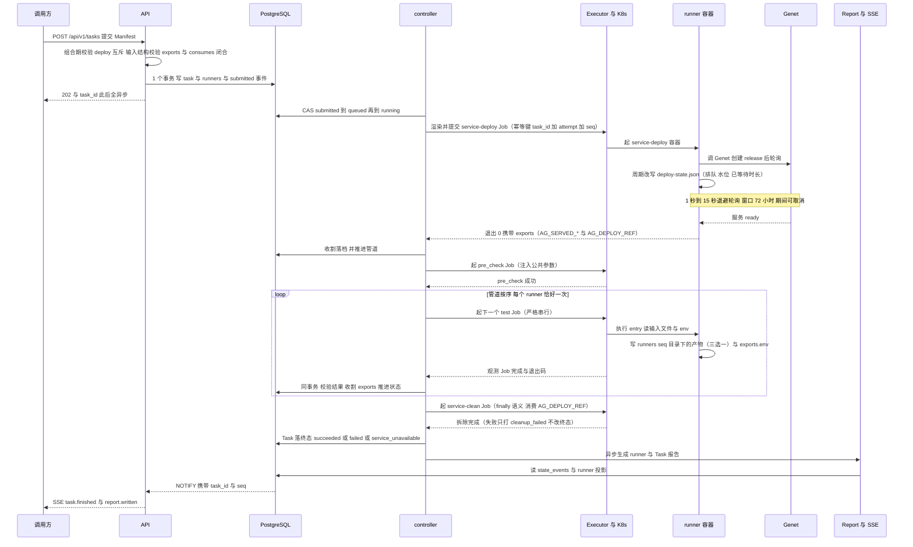
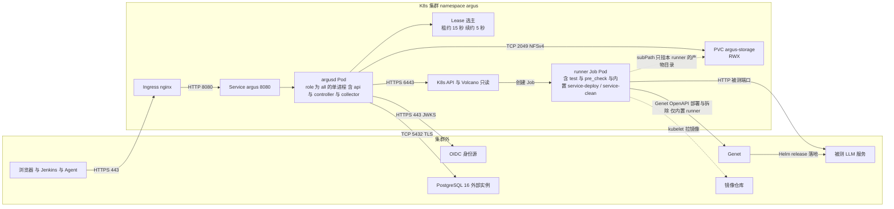

# Argus 总体设计

> **文档类型：** 平台总体设计说明（Overall Design）。不是需求文档，也不是实现方案。
> **效力：** 解释与索引性文档，**不新增设计裁决**。对应 [`design/ARCHITECTURE.md`](../../design/ARCHITECTURE.md) **v2.0**（Argus 更名与 Runner 化改造）；与 ARCHITECTURE 冲突时以它为准；与 `design/IMPLEMENTATION.md` 的 MVP 现状描述冲突时以该文 §15 为准（MVP 落地于 v1 术语，v2 更名随代码改造进行）。术语以根目录 [`GLOSSARY.md`](../../GLOSSARY.md) 为准。
> **读者：** 设计评审人、新加入的平台开发者、Jenkins / Agent / 下游集成方、SRE。
> **状态 / 日期：** P0 评审稿 · 2026-11-09（v2.0 术语与机制同步 · 2026-11-10）。文中"当前落地"一律按 MVP 实际状态陈述，未实现的能力显式标注 P1。
> **覆盖：** 平台为什么存在、整体形态、控制面编排、状态与执行、产物与报告、安全与部署边界。
> **不覆盖：** Runner 的模板、规约、注册校验、产物契约（三选一）与 `result.json` schema 等细节 —— 见姊妹篇 `docs/design/runner-design.md`（下称 **B 篇**）；表结构见 `design/views/03-data-view.md`，端点字段见 `design/views/07-api.md`。
> **一句话定义：** 给定服务部署参数或已有服务端点，按线性管道执行部署、探活与标准化评测，产出机器可读、人可读的测试结果（ARCHITECTURE §1）。

**阅读顺序建议：** 评审看 §1 → §3 → §4.8；新开发者看 §4.4 → §4.6 → §5.2；集成方看 §5.1 → §5.4。

**记号约定：** 文中 `design/...`、`docs/design/...` 均为**仓库根相对路径**；`{task_id}`、`{attempt_no}`、`{seq}`、`{pod}` 是**路径模板变量**（分别指 Task 标识、attempt 序号、runner 管道序号、Pod 名），`t-YYYYMMDD-XXXX` 是 Task ID 形态、`j-` 加 8 位十六进制是 Job ID 形态，都不是待填内容；`（ARCHITECTURE §x.y）`、`（04 进程视图 §2.1）` 为章节引用，不是超链接。

---

## 1. 背景与问题

### 1.1 当前情况

团队要对 LLM 服务做三类测试，覆盖的指标体系已经比较稳定：

| 测试类型 | 关心的指标 | 主要工具 |
|---|---|---|
| 性能测试 | TTFT、TPOT、吞吐、不同输入/输出长度与并发组合 | AISBench、EvalScope、自研压测脚本 |
| 精度测试 | 数据集评分、准确率 | AISBench、EvalScope |
| 稳定性 / 前缀缓存 SLA | 满足延迟约束的最大并发、最高输出吞吐 | 自研脚本（现封装为 `aisbench-sla`） |

资源与外部系统的现状同样明确：服务部署统一由 **Genet** 承担；算力在 K8s / Volcano 池子里；触发方是 Jenkins 定时流水线、工程师手工执行，以及正在接入的 Agent。

**但"一次测试"并不是一次点击，而是一条人工串起来的链。** 现在跑完一次完整测试，通常要走完下面七步：

1. 人先在 Genet 上按模型、卡数、PD 分离形态填写部署参数，提交部署，然后盯着队列等就绪；
2. 部署起来后，手工从 Genet 或运维群拿到服务地址与模型名；
3. 打开对应测试工具的文档，回忆或翻找这次要用的参数拼法，拼出一条命令；
4. 挑一台有卡的空闲机器，确认环境、依赖、镜像版本都对，把命令送上去；
5. 边跑边看控制台，判断"服务到底是起来了还是只是地址通了"；
6. 跑完把日志、Excel、自定义 JSON 收下来，手工整理成一份表格；
7. 关服务、释放机器，把结论口头或邮件同步出去。

七步里没有一步是"测试算法"本身的问题，全部是编排、衔接与记录的问题。这正是本平台要接住的部分。

### 1.2 存在的问题

1. **测试命令与平台耦合。** 每个工具一套 CLI、一套参数命名、一套依赖；换一个工具就换一套脚本，脚本里又混着集群地址、挂载路径与镜像名，导致同一份测试无法在别的环境复用。
2. **结果口径不一。** 报告是控制台日志、Excel、自定义 JSON 的混合物；没有统一的指标名、单位与统计量，机器无法消费，Agent 无法跨 Task 比较，人也只能靠记忆判断"这次比上次好还是差"。
3. **部署与测试割裂。** 服务"地址可解析"不等于"能出字"——Genet 返回 ready 之后仍可能因为 PD 未注册、权重未加载、鉴权配置错误而不可服务。现在经常在服务其实没就绪时就开始压测，白白消耗 GPU 与排队时间，还把失败记成了测试失败。
4. **执行资源无编排。** 机器靠手工占，多个测试互相污染（同一服务上并行跑两个压测，吞吐和延迟都不可信）；没有统一的取消、超时与重试，一个卡住的进程能占一整天。
5. **过程不可追溯、不可恢复。** 状态在人的脑子里或 Jenkins 控制台里；Pod 一删，日志就没了；"上周那次 4096 输入的 P99 是多少、当时跑的是哪个脚本版本"经常无从回答。
6. **Agent 无法发现能力。** 没有机器可读的能力目录，Agent 既不知道平台能跑什么，也不知道某个能力要填哪些输入，只能靠人把命令贴给它。

### 1.3 问题原因

| 现象 | 根因 | 缺的是什么 |
|---|---|---|
| 换工具就换脚本、换环境就跑不起来 | 测试逻辑与编排逻辑没有边界，脚本同时承担"怎么测"和"在哪测" | 一条清晰的**能力边界**：谁负责测试算法，谁负责起停与记录 |
| 每个工具的输出格式都不一样 | 跨边界交互没有可校验契约 | 一份全局唯一的**结果 schema** 与统一的执行入口 |
| 服务没就绪就开跑、失败原因归错人 | 部署与测试之间没有前置门 | 一个**强制的前置检查**与明确的终态语义 |
| 状态只在控制台里，重启即失忆 | 没有唯一状态源 | 一个**权威状态存储** + 显式状态机 |
| 多任务互相污染、无法取消 | 没有执行隔离与资源声明 | 容器级**执行隔离** + 声明式资源约束 + 串行拓扑 |

一句话概括：**测试逻辑与编排逻辑没有被切开，切开处也没有契约兜住。**

### 1.4 现状图

图 1-1 是当前的人工链路，虚线指向每一处问题的落点。



**读图说明：** 上半部分是"人 + Jenkins + Agent 三个入口分别拼命令"，中间是工具、部署与资源三条互不相识的路径，下半部分是三个人工汇总动作。

三处断点就是本平台的切入点：入口不统一（左）、部署与测试之间没有门（中）、结果与状态不落库（右）。

---

## 2. 目标与范围

### 2.1 目标

| # | 目标 | 可验收的判据 |
|---|---|---|
| G1 | **一次提交、异步跑完**：提交一份声明式清单（Manifest），平台按线性管道负责部署、前置探活、测试执行与 finally 清理 | `POST /tasks` 返回 202，随后 Task 沿状态机走到终态，中途不需要人工干预 |
| G2 | **能力可扩展而不改平台**：接入新测试能力只新增一个 Runner 目录与镜像 | 新增 Runner 不需要改控制面代码、不需要改前端（ARCHITECTURE §11.4） |
| G3 | **结果可机器消费**：每次执行产出结果产物（三选一：`result.json` / `result.html` / `result.csv` 至少其一，D-74） | `result.json` 结论字段固定、指标带 `unit` 与 `statistic`、多组参数靠 `labels` 区分；跨 Task 指标比较依赖 `result.json` |
| G4 | **过程可追溯、可恢复**：状态与事件落库，控制面重启不丢状态 | 杀掉控制器后重启，`running` 的 runner 经对账恢复真实状态，不误判失败 |
| G5 | **部署与测试之间有门**：服务不可服务时尽早阻断 | Pre-Check 未通过时后续 runner 不执行（`abort_task`），Task 终态为 `service_unavailable` |
| G6 | **资源与生命周期可控**：外接模式端点级互斥、全局并发上限、超时、取消；重试 = 整 Task 新 attempt 全量重跑 | 同一 Endpoint 上不会出现两个测量型 runner 并行；取消能真正删掉 Job；重试必含 fresh deploy |
| G7 | **AI Agent 友好**：能力目录、状态、错误码、报告都机器可读 | Agent 通过 `GET /runners` 读参数清单，通过 REST / SSE 提交与跟状态（MCP 属 P1） |

目标的**反面**同样重要：平台不追求"测得更准"（那是 Runner 与工具的事），也不追求"替人下结论"（§2.3）。

### 2.2 适用范围

- **测试对象：** 通过 OpenAI 兼容接口暴露的 LLM 推理服务；支持"平台拉起服务"（`deploy`，经内置 service-deploy runner 调 Genet）与"只测已有服务"（`service` 静态值）两种来源，两者互斥。
- **测试类型：** 性能、精度、稳定性 / 前缀缓存 SLA，以及自定义探活；具体算法由 Runner 决定，平台不设限。
- **执行环境：** 已登记的 K8s 集群与命名空间，通过执行环境配置（Execution Profile）引用；算力调度交给 K8s / Volcano。
- **调用方：** Web UI、Jenkins 流水线、Agent / 脚本（REST + 服务令牌），以及 P1 的 CLI（`argus`）/ MCP。
- **规模假设：** 单个 Task 不超过 200 个 runner、平台全局并发默认 20（ARCHITECTURE §12.7）；"每日百级 Task"是容量规划假设，不是接口限制。

### 2.3 不包含的内容

以下为 ARCHITECTURE §13 的 Non-Goals，按"永久不做"与"当期不做"两档列出：

| 不做 | 档位 | 理由 |
|---|---|---|
| 不自研测试算法 | 永久 | 复用 AISBench、EvalScope 等现有工具 |
| 不做服务部署平台 | 永久 | 部署归 Genet；平台连 Genet 调用都交给内置 service-deploy / service-clean runner（§9.1） |
| 不自研底层调度 | 永久 | 复用 K8s / Volcano，平台只做外接模式端点互斥与全局并发上限 |
| **不做门禁判定（Gate）** | 永久 | 平台只产出事实；是否达标由下游或 Agent 判断，避免把业务阈值固化进平台 |
| 不做 SSH / Docker 执行后端 | 永久 | 只有 K8s 一种 Executor；主机上直接跑属"平台外运行方式" |
| 不解析业务输入语义、不解析原始产物 | 永久 | 输入只做词法 / 结构校验（类型 + required，§5.4），枚举 / 范围 / 跨字段归 Runner；测试语义属于 Runner（B 篇 §4.8.1 / §4.8.2） |
| 不解析 exports 的含义 | 永久 | exports 只做 KV 透传与注入（§5.12） |
| 不托管数据集与模型 | 永久 | 路径是不透明字符串，平台不解析、不校验存在性 |
| 不承诺结果可复现 | 永久 | 只保证执行逻辑可追溯（记录 Runner 版本、输入快照、实际镜像 digest、exports 落档） |
| 不做多租户隔离 | 当期 | 对内单团队使用，RBAC 三角色已够用 |
| 不做自定义报表 / BI、拖拽式编排 | 当期 | 下游分析系统与 Manifest 已覆盖；管道拓扑是固定的线性形态 |
| 不做 runner 级平台重试、不做 DAG / 并行分支管道 | 当期（v2 裁决） | 抖动自愈归 entry；整 Task 重试已覆盖（ARCHITECTURE §7.8）；线性串行已满足评测场景（§7.1） |
| MCP Server、CLI（`argus`）、跨 Task 续跑（仅外接模式）、Task 对比、指标索引 | 当期未做 | P1 范围（ARCHITECTURE §14.2） |

---

## 3. 方案对比与选择

### 3.1 可选方案

#### 方案一：Jenkins 脚本 + 集中触发

核心思路：**维持现有的命令拼装方式，只把入口统一起来。** Jenkins 保留为唯一触发器，新增一层参数化 Job 收拢参数，一个 Task 就是一次 Build，日志与产物靠 Jenkins 的归档能力保留；结果仍由各工具自己输出，再由流水线脚本做有限的格式转换。

这个方案并不荒谬：它对现有资产零迁移成本，Jenkins 本来就承担着定时与触发职责，短期内能让"统一入口"这件事落地。

#### 方案二：单体测试平台

核心思路：**把测试能力做进平台进程。** 平台内置各工具的适配器（进程内函数调用或子进程），提供参数表单、执行、结果解析与报告渲染，一个 Web 应用解决全部问题。用户填表单、点执行、看报告，体验最顺。

它同样有真实合理性：参数表单对人有明显价值，工具数量有限（三个左右）时，"改平台"和"写适配器"成本看起来一样。

#### 方案三：契约驱动的编排平台

核心思路：**平台只管编排，能力以容器封装的 Runner 提供，两侧靠契约耦合。** 提交声明式 Manifest（嵌套 `task:` + `runners[]`）；平台做词法 / 结构校验并冻结解析结果、提交了部署描述时自动前置内置 service-deploy runner（调 Genet 拉起服务）、把 deploy 导出与静态 service 以 `AG_*` 环境变量注入、为每个 runner 渲染 K8s Job Spec；Runner 镜像在 Job 里执行 `runner.yaml.entry` 声明的唯一入口（exec form，argv 恒空），从输入文件与环境变量取输入，把结果产物（三选一，`result.json` 推荐）与 `exports.env` 直接写进共享存储的最终路径；平台校验结果、收割 exports、生成 runner / Task 报告、推进状态机并推送事件。

### 3.2 方案对比

| 维度 | 方案一 Jenkins 脚本 + 集中触发 | 方案二 单体测试平台 | 方案三 契约驱动编排平台 |
|---|---|---|---|
| 核心思路 | 统一触发，脚本照旧 | 平台内置工具适配与表单 | Manifest + Runner 契约 + K8s Job + 状态机 |
| 实现复杂度 | 低（几乎没有新组件） | 中（每个工具一套适配与表单） | 高（控制面、状态机、执行器、注册表、报告） |
| 性能 | 取决于脚本，无并发控制 | 进程内调用延迟低，但受平台进程资源限制 | Job 独立资源，20 并发可控；平台不参与数据面 |
| 可靠性 | 状态在 Jenkins 控制台，Pod / 机器丢了就没了 | 平台进程即单点，工具崩溃可能拖垮平台 | 状态落 PostgreSQL，控制器重启可对账恢复 |
| 扩展性 | 加工具等于加脚本与分支 | 加工具等于改平台代码并再发一版 | 加工具等于加一个 Runner 目录与镜像，平台不改 |
| 兼容性 | 与现有流水线完全兼容 | 需要迁移全部命令与结果格式 | Jenkins 退化为普通调用方，兼容期可并行 |
| 维护成本 | 脚本随时间腐化，无人敢删 | 平台与测试算法强耦合，每次工具升级都要动平台 | 契约稳定后平台几乎不动；成本转移到 Runner 作者侧 |
| 适用场景 | 工具极少、一次性任务 | 固定几种测试、内部用户少、追求上手速度 | 工具异构、要长期演进、要被 Agent 调用 |

### 3.3 方案对比图

图 3-1 只画一件事：三种方案下"数据从哪到哪"的路径差异。



**读图说明：** 三个 subgraph 是三条完全不同的数据路径，不是同一架构的三种样式。

方案一的路径止于脚本（端点对端点，无人记录）；方案二把工具塞进平台进程，测试流量与平台进程共享生命周期与资源；方案三把"跑"移到 Job、把"记"留在共享存储，平台进程只碰控制面。

关键差别在**失败域**：方案一失败即失控，方案二失败会连累平台，方案三的失败被限制在一个 runner 内——而整 Task 重试 = 新 attempt 全量重跑，历史不被覆盖。

### 3.4 最终选择

**选择方案三：契约驱动的编排平台。** 决定性原因有四条，每一条都直接对应一个方案的硬伤：

1. **测试能力演进快，平台必须稳定，所以把"怎么做测试"关进 Runner、平台只认契约。** 方案二里每接一个工具就要改平台、发一次版，工具升级与平台升级互相绑死；方案三下平台只认三个通道（输入文件 / 环境变量 / 输出目录），新增能力是"加目录 + 加镜像"，控制面代码零改动（ARCHITECTURE §5、B 篇 §4.8.1）。
2. **异构依赖只能靠容器隔离，进程内插件扛不住。** NPU 驱动、CUDA / HDK 版本、几十 GB 的镜像、不同语言与 Python 栈，这些冲突在方案二的单进程里无法共存；方案三让每个 Runner 自带镜像，平台只负责把镜像交给 K8s。
3. **状态必须可恢复，所以 PostgreSQL 唯一权威，而不是 Jenkins 控制台或平台内存。** 方案一的状态在控制台里、方案二的状态在进程里，两者都随进程消失；方案三把状态机写入与业务写放在同一事务，控制器重启后按库对账（§4.8.1）。
4. **产物要能活过 Pod，所以直写共享存储的最终路径。** 方案一、二都没有"跑完仍然可下载"的保证（Pod 或容器一删就没了）；方案三让 `attempts/{n}/runners/{seq}/` 直接就是 `/workspace/output`，平台不搬运字节，"收集"退化为校验与收割（§4.8.4）。

还有一条**辅助但不可忽略**的原因：**Agent 要能选能力。** 只有方案三同时提供了机器可读的能力目录（`GET /runners`，含参数清单与角色）与全局唯一的结果 schema，Agent 才能自己挑 Runner、填输入、读指标（B 篇 §4.4）。

### 3.5 方案代价

选择方案三不是免费的，下列限制是**设计上接受的代价**，不是待修缺陷：

1. **强依赖 K8s 与"全节点可访问的 RWX 共享存储"。** 若把控制面部署到裸机或单机 Docker 上，这条设计不成立；存储不满足 RWX 时，"产物直落最终路径"退化为必须打包上传，而平台明确不提供该退化模式（ARCHITECTURE §6.8 第 7 条）。
2. **Runner 作者要承担镜像、CI 与独立运行能力。** 写一个 Runner 不止写脚本：要维护 `runner.yaml`、entry、Dockerfile、镜像发布，还要保证不给平台也能用 `docker run 镜像 entry --params-file … --url …` 跑出同样的产物。这是把复杂度从平台转移到了能力提供方（B 篇 §4.8.3 / §4.8.7）。
3. **结构校验之外的参数错误在运行期才暴露。** 平台对 jsonl 输入做类型 + required 结构校验（提交被拒、报错带行号 + 字段名），但枚举、范围、跨字段约束仍归 Runner：写错取值的代价是"跑完才发现失败"。因此 `parameters` 清单必须准确，清单写错等于没有说明书（B 篇 §4.8.2）。
4. **平台不聚合指标、不判达标，下游要自己消费。** Task 报告只做组织与索引，不对跨 runner 指标做加减乘除；"这次是否达标"需要下游系统或 Agent 判断（§4.8.5）。
5. **平台看不到 Runner 内部进度。** 契约面只有退出码与 `result.json`，一个跑 40 分钟的 SLA 搜索在平台看来就是"`running` 中"；要看细节只能读 Runner 自己的日志与 `raw/`。
6. **无多租户。** RBAC 三角色（`viewer` / `operator` / `admin`）按团队粒度授权，不提供项目级隔离与配额分摊。

---

## 4. 技术原理与方案设计

### 4.1 核心原理

平台的核心是一条**"意图 → 事实 → 状态"的单向流水线**，测试语义始终留在 Runner 里：

1. **输入：声明式意图。** 调用方提交 Manifest（嵌套 `task:` + `runners[]`），只描述"测什么、在哪跑、怎么部署或连哪个已有服务"，不描述"怎么测"。`runners[].input` 是该 runner 的输入原文（按 `input_format`），不是命令。
2. **处理一：校验与冻结。** 平台做组合期校验（`deploy` 与 `service` 互斥且必填其一、`runners[]` 至少 1 条、exports / consumes 闭合且无重复 key、输入按 `input_format` 做词法 + 结构校验、Runner 必须已注册、runner 数不超过 200），通过后在**一个事务**里落库，同时冻结解析结果快照（Runner 名称 / 版本、镜像引用、输入原文、服务来源标识）。
3. **处理二：线性管道执行。** 有 `deploy` 时平台自动前置**内置 service-deploy runner**（调 Genet 拉起服务，周期改写 `deploy-state.json`，窗口默认 72 小时）；`service` 时静态值作为"序号 0 的导出"。两条路最终产出同一组公共参数，因此下游逻辑只有一套。之后按序执行 pre_check（`precheck: auto` 注入）与 test runner——Task 内 runner **严格串行**。
4. **处理三：导出与公共参数注入。** 平台收割成功 runner 的 `exports.env`（词法级），按管道序合并，以环境变量注入后续 runner；公共参数固定为 `AG_SERVED_URL` / `AG_SERVED_MODEL_NAME` / `AG_MODEL_PATH`。Runner 只见环境变量，不见 Endpoint 这个概念。
5. **处理四：渲染与执行。** 平台为每个 runner 渲染 Job Spec（镜像、`command` = `runner.yaml.entry`（exec form，argv 恒空）、`AG_*` 环境变量、凭据 `secret_env`、资源、超时、输入 / 输出 subPath 挂载），交给 K8s 起 Job；输入原文落盘 `/workspace/input`（只读），产物直写 `attempts/{n}/runners/{seq}/`。管道走完后（成功、失败、取消同理）执行内置 service-clean（finally 语义）。
6. **输出：事实。** 平台校验结果产物（三选一：全部缺失 `RESULT_MISSING`；仅 `result.json` 产出但不合法 `RESULT_INVALID`，D-74）、收割 `exports.env`（解析失败 `EXPORT_INVALID`），补齐 runner / Task 报告与索引，推进状态机，通过 SSE 推送状态事实与错误码。

**平台只传递事实，不解释测试语义**：它不知道 `{"concurrency":8}` 是什么意思，也不知道 125 ms 算好还是算坏。

| 平台负责 | 平台明确不负责 |
|---|---|
| 校验 Manifest 结构与输入（词法 / 结构级）、冻结快照、收割 exports、渲染 Job、起停与超时、收集日志、校验结果、推进状态、写报告 | 解析输入语义、拼装工具命令、判断指标是否达标、聚合跨 runner 指标、解析原始产物、解析 exports 含义、托管数据集与模型 |

状态转移表与不变量见 `02 逻辑视图 §2–§3`；表、列与索引见 `03 数据视图 §3`；端点与错误映射见 `07 API 视图 §3–§5`。

### 4.2 原理图

图 4-1 标出了唯一的契约边界：**边界之外是平台控制面，边界之内是 Runner 的执行面，两者只通过三通道说话。**



**读图说明：** 上半段（Manifest → 内置 deploy runner 或静态 service → 公共参数）是平台自己的控制面，不产生任何测试流量。

中间的 subgraph 是唯一跨边界的位置：平台只写 Job Spec，Runner 只读输入文件 / env、只写 output 目录，两侧都不知道对方的内部结构。

下半段（校验 → 报告 → 状态 → SSE）说明平台在测试结束后做的仍然是"记录事实"，而不是"判定结论"。

### 4.3 整体方案

**一个 Go 二进制（`api` / `controller` / `collector` 三种角色，v2 名为 `argusd`）+ PostgreSQL 16 作为唯一权威状态源 + NFS 产物直落最终路径 + K8s Job 作为唯一执行后端 + React SPA。** 控制面不留内存状态，所有推进由"数据库事务 + 事件 + 对账"驱动；测试能力以容器化的 Runner 提供，部署与拆除以内置 service-deploy / service-clean runner 承载，平台只认契约（IMPLEMENTATION §2）。

对应到五层结构（ARCHITECTURE §2）：Presentation 是 Web UI / CLI / MCP；Orchestration 是 Task / runner 管道 / exports 收割；Capability 是 Runner / Registry；Execution 是 K8s Executor；Integration 是 Genet（经内置 deploy / clean runner）/ Artifact Storage / Identity。

方案的量化边界（ARCHITECTURE §12.7，均为可调初值）：

| 约束 | 取值 | 触发点 |
|---|---|---|
| 单 Task runner 数 | 不超过 200 | 超限拒绝，`TASK_TOO_LARGE` |
| 单 Task attempt 数 | 默认 3 | 超出拒绝重试，`ATTEMPT_EXHAUSTED` |
| 全局并发 runner 数 | 默认 20 | 超出停在 `queued`，`waiting_reason` 为 `global_limit` |
| 单 runner 执行时长 | 默认 4 小时，配置上限 24 小时 | 超时删 Job，`RUNNER_TIMEOUT` |
| 部署窗口（service-deploy） | 默认 72 小时 | 超窗判该 runner 失败（`DEPLOY_BLOCKED`），Task 终态 `service_unavailable` |
| 单 attempt 产物 | 10 GiB | 超限 `ARTIFACT_QUOTA_EXCEEDED` |
| Task 报告 | 不超过 20 MB | 超出则产物外置 |
| 状态查询延迟 | P95 小于 300 毫秒 | 非日志类接口 |
| 调度一次事务 | 小于 50 毫秒 | 超 40 毫秒记慢事务指标 |
| SSE 事件端到端 | 小于 1 秒 | 同集群部署前提 |

### 4.4 整体架构图

图 4-2 是平台的整体架构。**后缀标出本次变化**：`新增` 表示本次设计新建的组件，`修改` 表示职责或接口被重新定义，`复用` 表示沿用既有外部系统。



**读图说明：** 调用方向是**单向向下**：调用方 → API → Orchestrator / Scheduler → Executor → K8s → runner 容器，没有任何反向调用；Runner 与平台之间唯一的"回程"是共享存储上的文件。

**v2 的关键变化在 Genet 一侧**：平台控制面不再直连 Genet——与 Genet 的全部交互发生在内置 service-deploy / service-clean 自己的容器里，它们也是普通 runner（由 Executor 起 Job、走同一套契约），控制面只读它们产出的 `deploy-state.json` 与 exports（ARCHITECTURE §9.1）。

数据流有两条：**控制流**走 PostgreSQL（状态、事件、租约、注册表、exports 落档），**数据流**走 NFS（`result.json`、`exports.env`、`raw/`、日志、报告、`deploy-state.json`），两者刻意不交叉——库挂了不影响已有产物可下载。

`新增` 集中在控制面、Web UI、Runner 能力单元与内置 deploy / clean runner；`复用` 是 Genet、K8s / Volcano、NFS、OIDC、镜像仓库这些既有能力；唯一的 `修改` 是 Jenkins —— 它不再是测试逻辑的宿主，退化为普通调用方（§3.4）。

### 4.5 组件说明

| 组件 | 作用 | 本次变化 |
|---|---|---|
| Web UI | 列表 / 详情 / 报告 / 日志 / 提交 / Runner 目录 / 环境；只做展示与操作，无 API 之外的私有状态 | 新增（MVP 6 路由） |
| API 层 | REST（`/api/v1`）+ SSE + 鉴权 + 校验 + 读投影；无状态可水平扩 | 新增 |
| Orchestrator | 提交校验、pre_check 注入、runner 管道推进（严格串行）、`abort_task` 扩散（到 clean 为止）、service-clean finally、终态判定 | 新增 |
| Scheduler | 候选选取、外接模式端点互斥（endpoint lease）、全局并发 permit、超时看护、`waiting_reason` | 新增 |
| Store（PostgreSQL 16） | Task / attempt / runner 执行记录 / 事件 / 租约 / 注册表 / Profile / 集群 / exports 落档；唯一权威状态源 | 复用（既有 PG 能力），表结构新增 |
| Registry | 白名单目录扫描、注册校验（entry exec form、`input_format`、exports / consumes 结构、`role: deploy` / `clean` 拒绝注册）、`content_sha` 指纹、版本不可覆盖、`orphaned` / `retired` 标记 | 新增；controller 启动扫描并在每 10 分钟重扫（`RunRescan`，间隔小于等于 0 时只扫一次）；校验失败时 controller 拒绝启动，api 仅告警继续 |
| Executor（K8s Job） | 渲染 Job Spec（`command` = entry、`args` 恒空数组）、创建 / 观测 / 取消 / 删除 Job、记录实际镜像 digest | 新增（平台唯一执行后端） |
| Collector | runner 与部署 Pod 日志跟随、按 Pod 落盘、重启与缺口标记、配额扫描 | 新增（MVP 由 executor 兼任采集） |
| Report Writer | 校验结果产物（三选一）、收割 `exports.env`、生成 runner / Task `report.json` 与 `report.md`、产物索引 | 新增 |
| Genet 交互 | 全部由内置 service-deploy / service-clean runner 承载（调 Genet OpenAPI）；平台不直连 Genet，只读 `deploy-state.json` 与 exports | v2 职责重划（MVP 为控制面内 mock 适配器，随代码改造迁移进内置 runner） |
| Jenkins | 定时提交 Task、查询状态、下载报告 | 修改：退出命令拼装与结果解析，降为普通调用方（REST + 服务令牌） |
| K8s / Volcano | 起 Job、调度 Pod、gang 与队列；平台**只读**队列与节点视图 | 复用 |
| NFS（RWX） | `storage-root/{task_id}/attempts/{n}/runners/{seq}/` 即最终落盘位置 | 复用（既有 NFS 能力） |
| Runner | 能力的唯一载体：镜像 + `runner.yaml` + entry；内置 service-deploy / service-clean / endpoint-probe 随平台发版 | 新增（当前有 `endpoint-probe` 与 `aisbench-sla` 两个可运行实例） |
| OIDC 身份源 | 统一身份，三角色 RBAC；服务令牌与用户同权限 | 复用 |

### 4.6 关键流程图

图 4-3 把一次 Task 的主干、成功 / 失败 / 取消三条路径画在同一张图上。



**读图说明：** 三条路径共用一个入口与一套状态机：**成功路径**是 `submitted → queued → running（管道：service-deploy 可选 → precheck → tests → service-clean）→ succeeded`；**失败路径**按责任分成两支——服务没起来归 `service_unavailable`（pre_check 窗口内未就绪，或 deploy `blocked` / 超窗），测试或平台自身问题归 `failed`（v1 的 `completed_with_errors` 语义并入 `failed`）；**取消路径**从任意非终态进入，先执行 clean 再落 `canceled`（finally）。

**没有独立的 `deploying` / `testing` / `cleanup` 平台阶段**（v2 取消）：部署就是管道第一个 runner 在跑（排队可见性由它周期改写的 `deploy-state.json` 承载），拆除就是最后一个 runner 在跑，探活就是注入的第一个测试类 runner（ARCHITECTURE §7.4）。

管道本身是**唯一被强制的顺序**：runner 严格串行，每个 runner 在一个 attempt 内恰好执行一次，失败按 `on_failure` 传播（`abort_task` 时未执行 runner 标 `SKIPPED`，传播到 clean 为止）；全局并发 permit 只作用于 Task 之间，端点互斥只在外接模式生效（§4.8.3）。

终态判定之后平台仍要写报告、发 `task.finished` 与 `report.written` —— 状态终态与产物就绪是两件事。

### 4.7 关键时序图

图 4-4 是正常路径的时序，重点是"202 之后全部异步"与三处门。



**读图说明：** 三处门：**部署门**（Genet 侧排队可能数十小时，可见性由 service-deploy 周期改写的 `deploy-state.json` 承载，平台没有 `deploying` 阶段，不占连接与 goroutine）、**服务门**（`ready` 只代表地址可解析，必须再过 pre_check）、**finally 门**（clean 在成功、失败、取消、超时四条路径全部执行；取消与超时也先 clean 再落终态）。

**v2 取代了 v1 的"门控 + 并发"模型**：Task 内 runner 严格串行，管道内没有槽位竞争；全局并发 permit 只作用于 Task 之间；端点互斥（endpoint lease）收窄为仅外接模式（多 Task 共享同一外部服务）生效（§4.8.3）。

两处硬约束在图上可见：**Job 创建在事务外**（避免把 K8s IO 放进事务），而**状态写入、exports 收割落档与事件同事务**（崩溃不会丢导出，也不会泄漏状态）。

SSE 不参与业务推进：`NOTIFY` 在事务提交后发出，只带 `task_id` 与 `seq`，正文一律回查 `state_events`。

单个 runner 的执行细节（输入落盘、`preparing → running`、终态与收割同事务）见 `04 进程视图 §2.2`；行锁与 advisory 锁顺序见 §3.1。

### 4.8 关键设计点

#### 4.8.1 唯一权威状态与显式状态机

**解决什么问题：** 一次 Task 涉及部署、多个 runner、attempt 重试、取消、清理，且控制器随时可能崩。状态如果散落在内存、K8s 对象或消息队列里，重启后就会出现"两个权威各说各话"。

**怎么做：** PostgreSQL 16 是唯一权威状态源，控制端无内存状态；状态只能经状态机服务写入，且**与业务写在同一事务**；所有转移用 CAS 实现，先落库者胜，冲突者记 `state_race_lost` 不覆盖；控制器用 K8s Lease 选主（租约 15 秒、续约 5 秒），新 leader 接管后先对账再调度；观测不到的状态走 `unknown` 四步复核（0 / 5 / 20 / 60 秒，总时长不超过 90 秒），**绝不因为看不到就判失败**。

Task 状态机只有一条主线与一个取消分支：`SUBMITTED → QUEUED → RUNNING → 终态（succeeded / failed / service_unavailable）`、`CANCELLING → CANCELED`；**没有独立的 `DEPLOYING` / `CLEANUP` / `PRECHECK` 平台阶段**（v2 取消）——部署排队可见性由 `deploy-state.json` 承载，管道推进就是 Task 的内部推进。runner 状态机 8 个状态，**`FAILED` 是终态、没有重试回路**（v2 取消了 v1 的 FAILED→QUEUED 自动重试）；重试 = 整 Task 新 attempt、全量重跑含 fresh deploy，历史 attempt 只追加不覆盖（ARCHITECTURE §7.8）。

**为什么不用 CRD 作权威：** CRD 会制造第二个权威源（CRD 与 PostgreSQL），对账逻辑要写两遍；平台也只需要普通 Job，不需要 Operator 模式。**为什么不用队列（Redis / Kafka）当状态：** 队列是"待办投递"，不是"当前状态"，重放与去重都要自己实现，等于多一个状态源加一个新的运维面（IMPLEMENTATION §3.3）。**为什么不用内存状态加定期快照：** 快照之间的转移必丢，"取消与自然结束的竞态以先落库者为准"这类规则根本无法表达。

#### 4.8.2 Runner 契约边界：输入文件 + 环境变量 + 输出目录三通道

**解决什么问题：** 平台与能力之间如果有多条交互途径（参数文件之外的元数据文件、平台 API 地址、sidecar 约定），每一条都会长出自己的兼容分支，最终平台必须理解测试语义。

**怎么做：** 契约面只有三样——**输入文件**（提交的输入原文经词法 / 结构校验后落盘 `/workspace/input/params.jsonl|yaml`，只读挂载，注入 `AG_PARAMS_FILE` 告知路径；平台对 jsonl 按参数声明校验**类型 + required**，报错带行号 + 字段名）、**环境变量**（元信息 `AG_TASK_ID` / `AG_RUNNER_SEQ` / `AG_ATTEMPT`，独立运行时缺省 `local`；公共参数 `AG_SERVED_URL` / `AG_SERVED_MODEL_NAME` / `AG_MODEL_PATH`，来源为 deploy 导出 XOR 静态 service）、**输出目录**（`/workspace/output`，test / pre_check 产结果产物**三选一**（`result.json` / `result.html` / `result.csv` 至少其一，不强求 `result.json`，D-74），可选产 `exports.env` 由平台收割）。**没有第四样**：没有元数据文件、没有平台 API 地址；`exports.env` 是 Runner 写、平台读的输出，不是输入通道。entry 由 `runner.yaml.entry` 以 exec form 数组声明，平台 exec 该数组，**argv 恒空、不经 shell**。

**为什么输入从 argv 改为文件（v2，取代 v1 的 argv 词法透传）：** argv 字符串无法承载结构化输入（"多组参数、每组一个 JSON 对象"），也无法在提交期校验；输入文件随 attempt 落盘（`attempts/{n}/input/`），"这次运行用了哪份参数"可审计、可复现；结构校验左移把"跑完才发现参数错"提前为"提交被拒"。边界没有松动：平台只做词法 / 结构校验，枚举、范围、跨字段语义仍归 Runner（ARCHITECTURE §5.4）。**为什么必须有独立运行约束：** 如果 Runner 只能在平台里跑，任何契约缺陷都只能在集群里被发现，作者也无法本地调试；不给平台也能用 `docker run 镜像 entry --params-file … --url …` 跑通，是这条契约的验收方法。

> 三通道的完整规则、`runner.yaml` 字段语义与注册校验清单见 **B 篇 §4.8.1 / §4.8.2 / §4.8.4**。

#### 4.8.3 线性串行管道与内置 deploy / clean runner

**解决什么问题：** 同一服务上并行跑两个测量型测试，吞吐会被摊薄、延迟会被抬高，结论不可用；"服务到底能不能出字"必须在任何测试之前回答；部署必须在测完之后被拆除——而且再晚也不能漏拆。

**怎么做：** Task 内 runner **严格串行（线性管道）**：`[service-deploy] → [pre_check…] → [test…] → [service-clean]`。部署模式下服务是本 Task 私有的，隔离由拓扑（私有服务 + 串行）保证，不再需要并发声明；`endpoint_exclusive` 收窄为**仅外接模式有效**（多 Task 共享同一外部服务时，独占声明让同 Endpoint 的其他 Task 排队，按 `AG_SERVED_URL` 规范化 host:port 识别）。`pre_check` 不是独立概念：`precheck: auto` 取注册表里唯一 `role: pre_check` 的 Runner，注入为第一个测试类 runner，必须 `on_failure: abort_task`。deploy / clean 由平台按提交配置**自动配对注入**（提交 `deploy` → 前置 service-deploy、追加 service-clean），用户不可注册（`role: deploy` / `role: clean` 注册拒绝）、不可手动添加。**clean 是 finally 语义**：成功、失败、取消、超时四条路径全部执行；失败只打 `cleanup_failed` 不改终态；平台崩溃 / 节点丢失导致 clean 未被调度时，用落档的导出重放（`argus clean --task <id> [--attempt <n>]`）兜底。

**为什么取消 runner 级并发与重试（v2）：** 串行让"谁在污染测量"这个问题不存在——管道里任何时刻只有一个 runner 在碰服务。runner 级重试则会让"失败后重跑这一个"与"服务状态已被污染"纠缠：跑过的服务带着 warm cache、残留连接与 KV cache 状态，重跑数字与全新部署不可比。因此**重试 = 整 Task 新 attempt、全量重跑含 fresh deploy**（ARCHITECTURE §7.8），attempt 只是计数与历史归组，重试结果的可信度优先于省下的部署时间。

**为什么把 deploy / clean 做成 runner 而不是平台阶段：** 一个阶段意味着第二套状态、第二套日志与产物路径、第二套取消逻辑；做成内置 runner 后，它们与 test / pre_check 共用同一套执行契约、状态机、产物路径与日志采集，平台只读它们产出的 `deploy-state.json` 与 exports，零新增概念（ARCHITECTURE §9.1）。

> Pre-Check 类 Runner 的四条附加约束（探测位置、等待窗口、区分未就绪与不可重试、探活等待与 Task 级重试不混用）见 **B 篇 §4.8.6**。

#### 4.8.4 产物直落共享存储

**解决什么问题：** "先写容器本地、跑完再打包上传"在 Pod 被抢占、节点驱逐、容器 OOM 时直接丢失全部证据，而复盘恰恰发生在这类失败之后。

**怎么做：** `attempts/{n}/runners/{seq}/` 目录（即 `storage-root` 下按 `task_id`、`attempts`、序号、`runners`、`seq` 逐层展开的那一层）以 **subPath** 挂到 `/workspace/output`，**它就是最终落盘位置**，平台不搬运任何字节；attempt 之间互不可见（重试写新的 `attempts/{n}/`，历史不被覆盖）；失败保留现场；目录由平台预创建（属主为运行 UID，权限 `0770`），Runner 仍应 `mkdir -p` 容忍缺失。输入原文也随 attempt 落档在 `attempts/{n}/input/`（只读挂载源）。由此"收集"退化为四件事：校验结果产物（三选一；`result.json` 产出时才做 schema 校验）、收割 `exports.env`、补齐 runner / Task 报告、生成索引。

**为什么取消"打包上传"退化模式：** 它会在 Pod 被抢占时丢产物，也会让"产物直落最终路径"这个简化失效——一旦允许两种模式，所有读取端都要处理"产物可能还在容器里"的分支。**为什么必须用 subPath 而不是整卷挂载：** 整卷挂进容器等于让 Runner 可以读写其他 Task 的产物。**为什么日志也落盘：** runner stdout / stderr 落到 `attempts/{n}/runners/{seq}/logs/`，部署 Pod 日志按 Pod 一份落到 deploy runner 产物目录的 `logs/`（`runners/{deploy_seq}/logs/{pod}.log`），边跑边写——Task 结束再 `kubectl logs` 时 Pod 可能已被回收或日志已被轮转。

#### 4.8.5 平台不做 Gate

**解决什么问题：** 阈值会变（不同模型、不同硬件、不同业务阶段的达标线不同）。如果平台内置门禁，每次阈值调整都要改平台、发版、回溯历史 Task 的判定口径，且历史结论会随阈值变化而"改写"。

**怎么做：** 平台只产出事实：runner 有状态与错误码，`result.json`（如产出）有指标与 `statistic`，报告做组织与索引而**不做跨 runner 数学聚合**；"是否达标"由下游系统或 Agent 判断。执行成功与指标达标是两件事：Runner 完整跑完但准确率偏低时返回退出码 0，**不得**把"指标不理想"映射为执行失败。

**为什么不是另一种做法：** 若平台判定达标，就必须定义阈值来源（Manifest？Runner 清单？平台配置？），任何一处都会把业务规则固化进平台；而且历史 Task 的终态会随阈值变化而失真，破坏可追溯性。把判定放在下游，代价是下游要自己消费指标（§3.5 第 4 条），收益是平台与业务阈值解耦。

### 4.9 异常处理

表中的错误码全部取自 ARCHITECTURE 附录 D 枚举；"可重试"指该码标 `retryable: true`——v2 中它只用于泄漏重放与告警分级，**runner 级没有自动重试**，重试 = 整 Task 新 attempt（`POST /tasks/{id}/retry`）。

| 异常场景 | 影响 | 处理方式 |
|---|---|---|
| Genet 报 `blocked`，或部署超过 72 小时窗口 | service-deploy runner 判失败，一个测试都没跑 | `DEPLOY_BLOCKED`（`detail.reason ∈ {blocked,timeout,…}`）；`deploy-state.json` 已留痕；Task 终态 `service_unavailable`；由提交方决定是否整 Task 重试 |
| service-deploy 调 Genet 失败（连接 / 5xx / 同名冲突 / 安装失败） | 管道第一步就失败 | `DEPLOY_FAILED`（不可重试）；Task 终态 `failed`（平台侧）；`detail.reason` 保留 Genet 原文 |
| K8s API 不可达 | 无法创建或观测 Job | `EXECUTOR_UNAVAILABLE`（可重试标记）；观测不到不判失败，对账恢复 |
| 镜像拉取失败 | Pod 处于 ImagePullBackOff，该 runner 失败 | `IMAGE_PULL_FAILED`；判该 runner `FAILED`，整 Task 重试走新 attempt（历史不覆盖） |
| Pod 挂载失败（FailedMount / FailedAttachVolume） | 容器起不来 | `MOUNT_UNAVAILABLE`（不可重试）；运行期观测，不做提交期校验 |
| NFS 不可写 | 目录预创建失败，或产物写不进 | 预创建失败转 `EXECUTOR_UNAVAILABLE`；`result.json` 读取区分"不存在"与 I/O 错误，后者重试 3 次才收口 |
| runner 非零退出 | 该 runner 失败 | `RUNNER_NONZERO_EXIT`（不可重试）+ stderr 摘要；按 `on_failure` 传播（`abort_task` 时未执行 runner 标 `SKIPPED`，到 clean 为止） |
| 产物三选一全部缺失（result.json / result.html / result.csv 均无） | 退出码 0 但无有效结果 | `RESULT_MISSING`（不可重试，D-74 重定义）；runner 判 `failed`；不允许"没有结果却当作成功" |
| `result.json` 产出但不合规 | 有产物但机器读不了结论 | `RESULT_INVALID`（不可重试，仅在 result.json 产出时适用，D-74）；runner 判 `failed`；`result.html` / `result.csv` 平台不解析内容 |
| `exports.env` 解析失败 | 下游注入可能被污染 | `EXPORT_INVALID`（v2 新增）；不收割，runner 判 `failed` |
| runner 超时 | 超过 `timeout_seconds` 被平台终止 | 删 Job 后报 `RUNNER_TIMEOUT`（v2 由 `TASK_TIMEOUT` 更名）；runner 判 `failed` |
| 整 Task 重试超出 attempt 上限 | 重试请求被拒 | `ATTEMPT_EXHAUSTED`（v2 新增，默认 3 次） |
| 取消与自然结束竞态 | 终态可能被后到者覆盖 | CAS 保证先落库者胜；后到者返回 0 行，只补 `exit_code`，记 `state_race_lost` |
| 控制器崩溃 | 状态推进暂停，K8s 上的 Job 继续跑 | 租约 15 秒过期后新 leader 接管，30 秒内对账拉平；`unknown` 走四步复核，不假定失败；若 clean 因此未执行，走重放兜底（`argus clean --task`） |
| 注册扫描校验失败 | controller 无法确定能力目录可信 | controller 拒绝启动（fail fast）；api 仅告警、继续提供只读与转发，不写注册表 |
| 清理失败（service-clean 调 Genet 失败） | 资源残留 | `CLEANUP_FAILED`，**不改变 Task 终态**；进重放清单，`argus clean --task <id> [--attempt <n>]` 用落档导出重放；周期自动重放属 P1 |
| 单 attempt 产物超过 10 GiB | 可能打满共享存储 | `ARTIFACT_QUOTA_EXCEEDED`（不可重试）；collector 每 60 秒 `du` 扫描，超限即删 Job 并判该 runner 失败 |
| 全局并发或外接端点配额不足 | Task 停在排队 | `RESOURCE_EXHAUSTED`（可重试）+ `waiting_reason`（`slot_waiting` / `global_limit` / `queue_full` / `gang_pending` / `insufficient_resources`） |

两处口径需要点明：`DEPLOY_BLOCKED` 与 `DEPLOY_FAILED` 发生在**内置 service-deploy runner** 上（管道第一个 runner），但它们直接决定 Task 终态（`service_unavailable` / `failed`，ARCHITECTURE §7.5）；`CLEANUP_FAILED` 发生在 service-clean 上，**永不改变终态**，只进重放清单。

共性规则：故障不产生"猜出来的状态"——要么保持上一个已提交状态，要么落一个带错误码的终态，绝不因为观测不到就判失败。各类故障下"进行中的 Task / attempt / runner 会怎样、恢复动作是什么"的完整对照见 `04 进程视图 §4`；P0 的单点与缓解见 `06 物理视图 §7.1`。

---

## 5. 使用方式

### 5.1 使用场景

| 场景 | 典型做法 | 现状 |
|---|---|---|
| 日常回归 | Jenkins 定时提交同一份 Manifest；外接模式下按 Endpoint 互斥排队，跑完推 `task.finished` | 可用（Jenkins 作为普通调用方，无特权路径） |
| 新模型上线前的性能 + 精度 | 一份 Manifest 写多个 `runners[]`（严格串行，行序即执行序），每个 runner 一个 `input`；报告按 `labels` 分组 | 可用 |
| 只测已有服务 | Manifest 用 `service` 块填三个公共参数，不注入 deploy / clean（无部署无拆除） | 可用（`POST /tasks`） |
| Agent 选能力并提交 | `GET /runners` 读参数清单 → 填 `input` → `POST /tasks` → SSE 跟状态 → 取 `result.json` | 可用；MCP Server 与 CLI 属 P1 |
| 服务没起来时排障 | 读 `deploy-state.json`（phase / 水位 / 已等待时长 / Pod 清单）；部署 Pod 日志在 deploy runner 产物目录按 Pod 取，缺口显式标注 | 可用（`blocked` 必带原因，不可达不等于 0 排队） |
| 新增一个 Runner | 目录 + 镜像发布后，由 controller 周期重扫（默认 10 分钟）生效，或随平台镜像一起发布 | 可用（没有运行时上传入口，见 §5.4.3） |
| 失败重试 | `POST /tasks/{id}/retry` 新 attempt 全量重跑（含 fresh deploy），历史 attempt 不被覆盖 | 可用（MVP 为 v1 `retry_of` 续跑形态；v2 全量重跑语义随代码改造对齐） |
| 主机上临时跑一次 | 不走平台：`docker run 镜像 entry --params-file … --url …`，产物结构与平台内一致 | 可用（属平台外运行方式，不产生 Task 记录） |

### 5.2 环境要求

| 项 | 要求 | 说明 |
|---|---|---|
| Kubernetes | 1.28 及以上，需要 Job / RBAC / Lease；Volcano 可选 | 命名空间启用 PSA `restricted`；runner 一律不绑定 K8s ServiceAccount（deploy / clean 对集群的操作全部经 Genet API，凭据走 Task 级 secret） |
| PostgreSQL | 16，外部实例 | 唯一权威状态源；`max_connections` 不小于 200；平台不带库 |
| 共享存储 | 全节点可访问的 RWX（NFSv4），挂载到 `/storage-root` | 产物直落最终路径的前提；单挂载点建议 10 GbE |
| 镜像仓库 | kubelet 可拉取的仓库（v2 namespace：`registry.dev.huawei.com/argus/…`） | Runner 镜像由 CI 产出并发布，**任何运行环境都不 build** |
| Genet | 可调用的 OpenAPI 端点 + 凭据（Open API Key） | 部署 / 状态 / 卸载三项，由内置 service-deploy / service-clean 调用；MVP 默认 mock |
| 身份源 | OIDC / SSO，含 JWKS | 三角色 `viewer` / `operator` / `admin`；服务令牌与用户同 RBAC |
| 控制面资源 | 500m / 512Mi 请求，2 CPU / 2Gi 上限 | IO 型负载；P0 单副本 `--role=all` |
| 出站网络 | 镜像仓库、目标服务网段、K8s API、PostgreSQL、NFS、Genet（内置 deploy / clean 的 runner Job）、IdP | runner Pod 默认拒绝互联网出站 |

### 5.3 部署拓扑图

图 5-1 是 P0 的部署拓扑：集群内是控制面与 runner Job，集群外是 Genet、被测服务、身份源与镜像仓库。



**读图说明：** 网络依赖的方向很清楚：控制面同时向外连 PostgreSQL、NFS、K8s API 与 IdP，任一条断掉都有对应的降级语义（§4.9）。**平台控制面不直连 Genet**：与 Genet 的交互发生在内置 service-deploy / service-clean 自己的容器里（它们也是 runner Job），控制面只读 `deploy-state.json` 与 exports（ARCHITECTURE §9.1）。runner Pod **不直连 NFS** —— NFS 由 kubelet 以 subPath 挂载，Pod 内只有 `/workspace/input`（只读）与 `/workspace/output`（读写）这两个目录契约面。

存储依赖是硬前提：控制面把 `/storage-root` 挂到自己身上做目录预创建与报告写入，runner Job 用同一 PVC 的 subPath 挂载；两者必须落在同一份 RWX 存储上。

P0 只有一个控制面副本（`--role=all`），controller 与 collector 靠 Lease 单活，api 无状态——拆分只改启动参数与副本数，不改代码。

K8s 对象清单（Deployment / Ingress / PVC / NetworkPolicy / Lease / 运行期 Job）、端口与协议、RBAC 边界见 `06 物理视图 §1–§4`；单副本单点清单与升级顺序见 §7。

### 5.4 使用示例

#### 5.4.1 提交一个完整 Task（部署模式）

```yaml
task:
  name: qwen3-daily

  deploy:                      # 与 service 互斥，必须二选一；平台自动前置 service-deploy、追加 service-clean
    provider: genet
    spec: |
      model: Qwen3-32B
      replicas: 1
      resources: { gpu: 8 }

  precheck: auto               # 平台注入 service-deploy 之后的第一个测试类 runner

  env:                         # Task 级明文，注入该 Task 全部 runner
    LOG_LEVEL: info
  secrets:                     # 只填 Secret 引用，不回显
    ENDPOINT_API_KEY: endpoint/prod-qwen

  runners:
    - name: accuracy-dataset-a
      runner: aisbench-acc
      version: "1.0.0"
      execution: { profile: k8s-npu }
      on_failure: continue
      input: |                 # 输入原文（jsonl，行序即执行序）；不写 url / model_name
        {"dataset":"/data/dataset-a","limit":100}

    - name: performance-sweep
      runner: aisbench-perf
      version: "1.0.0"
      execution: { profile: k8s-npu }
      on_failure: abort_task
      timeout_seconds: 14400
      input: |
        {"input":512,"output":128,"concurrency":1}
        {"input":512,"output":128,"concurrency":4}
        {"input":1024,"output":128,"concurrency":8}
```

注意四点：`input` 里**不写** `url` / `model_name` / `model_path`（由平台从 `deploy` 导出或 `service` 静态值以环境变量注入，重复声明语义归 Runner）；每行 `input` 会按 `runner.yaml.parameters` 校验类型与 required，不过即整单拒绝（`VALIDATION_ERROR`，报错带行号 + 字段名）；`on_failure` 只能取更严格者，不能弱化 Runner 自身的声明；**没有 `cleanup.policy`、没有 `runners[].retry`**（v2 取消）——有部署必有 clean（finally），重试 = 整 Task 新 attempt。

#### 5.4.2 提交与跟状态

```bash
# 提交（返回 202 与 task_id；平台不做提交幂等，重复提交会产生多个 Task）
curl -sS -X POST "$API/api/v1/tasks" \
  -H "Authorization: Bearer $TOKEN" \
  -H "Content-Type: application/yaml" \
  --data-binary @task.yaml

# 只校验不落库
curl -sS -X POST "$API/api/v1/tasks?dry_run=true" \
  -H "Authorization: Bearer $TOKEN" \
  -H "Content-Type: application/yaml" \
  --data-binary @task.yaml

# 查详情（runner 管道时间线与 deploy-state 是一等字段）
curl -sS "$API/api/v1/tasks/t-20261110-0001" -H "Authorization: Bearer $TOKEN"

# 订阅事件（Last-Event-ID 续传，越窗先收 resync_required）
curl -N "$API/api/v1/tasks/t-20261110-0001/events" \
  -H "Authorization: Bearer $TOKEN" -H "Last-Event-ID: 0"

# 取 runner 结果；打包下载全部报告与产物（D-56）
curl -sS "$API/api/v1/tasks/t-20261110-0001/attempts/1/runners/3/result" -H "Authorization: Bearer $TOKEN"
curl -OJ "$API/api/v1/tasks/t-20261110-0001/bundle" -H "Authorization: Bearer $TOKEN"

# 取消与整 Task 重试（新 attempt 全量重跑，含重新部署）
curl -sS -X POST "$API/api/v1/tasks/t-20261110-0001/cancel" -H "Authorization: Bearer $TOKEN"
curl -sS -X POST "$API/api/v1/tasks/t-20261110-0001/retry"  -H "Authorization: Bearer $TOKEN"
```

> 端点的字段级形态以 `design/views/07-api.md` v2 修订与 `server/api/openapi.yaml` 为准（更名随代码改造升级，路径按 ARCHITECTURE D-73：`/runs→/tasks`、`/testers→/runners`）。

#### 5.4.3 查能力目录与执行现场

```bash
# 只读目录：默认每个 name 只回最新版本；include_retired=true 回全部版本
curl -sS "$API/api/v1/runners?role=pre_check" -H "Authorization: Bearer $TOKEN"
curl -sS "$API/api/v1/runners/aisbench-perf/versions/1.0.0" -H "Authorization: Bearer $TOKEN"

# 平台槽位与 Volcano 队列（两类排队必须分开展示，不可相加）
curl -sS "$API/api/v1/queue-status" -H "Authorization: Bearer $TOKEN"

# 看作业与 Pod 的实际形态（标签 argus.io/*）
kubectl -n argus get jobs,pods -l argus.io/task=t-20261110-0001
```

平台侧**不提供** `POST /runners`：不接受运行时上传，Runner 只能以"白名单目录 + admin 评审发布"的方式进入平台，来源是平台镜像内的 `/app/runners`（B 篇 §4.8.4）。目录更新由 controller 周期重扫感知（默认 10 分钟，`interval <= 0` 时只扫一次），或随平台镜像重新发布。内置 `service-deploy` / `service-clean` 不走用户注册路径（`role: deploy` / `role: clean` 注册拒绝）。

---

## 6. 总结

**问题不是"缺少一个测试工具"，而是"测试与编排没有被切开"。** 现状里一次测试要人工串起七步，其中六步是编排、衔接与记录：命令拼装、环境确认、就绪判断、机器占用、结果汇总、状态留痕。这些工作重复、易错、无法被 Agent 复用，也无法在事后回答"当时到底跑了什么"。

**方案的实质是选一个稳定的切分方式，而不是选一个功能更全的平台。** Jenkins 集中触发解决入口、不解决语义；单体平台解决体验、把异构依赖与演进速度的代价转嫁给平台自身；契约驱动的编排平台把"怎么做测试"关进 Runner、把"在哪跑、怎么起停、怎么记"留在平台，代价是强依赖 K8s 与 RWX 存储、且作者侧要维护镜像与独立运行能力。

**原理可以用一句话概括：意图进、事实出。** Manifest 是意图；平台负责组合期校验、冻结、线性管道编排（内置 service-deploy / service-clean 调 Genet）、把导出与静态 service 以 `AG_*` 环境变量注入、渲染 Job Spec；Runner 在容器里按 `runner.yaml.entry` 唯一入口执行，把结果产物（三选一）与 `exports.env` 写到最终存储路径；平台校验结果、收割导出、生成报告、推进状态机并推送事件。平台不知道 `{"concurrency":8}` 的语义，也不关心 125 ms 是好是坏。

**关键设计只有五条，全部围绕"失败时仍然可信"：** 唯一权威状态与显式状态机（重启可对账、竞态有裁决、无 `DEPLOYING` 等中间平台阶段）、输入文件 + 环境变量 + 输出目录三通道的 Runner 契约（平台零测试语义、结构校验左移）、线性串行管道与内置 deploy / clean（测量不被污染、服务不可用不浪费资源、clean finally 不泄漏、重试必含 fresh deploy）、产物直落共享存储（证据活过 Pod）、平台不做 Gate（阈值与平台解耦）。

**边界同样明确：** 部署归 Genet（Argus 连 Genet 调用都交给内置 runner），调度归 K8s / Volcano，测试算法归 AISBench / EvalScope 等工具（封装在 Runner 内），平台只编排、只记录事实。当前 MVP 已落地控制面 / API / 状态机 / 编排 / 存储、K8s Executor、Registry、Web UI（6 路由）、OIDC / RBAC、Volcano 只读看板、重试端点与部署镜像（v1 术语，更名随代码改造）；Genet 在 kind E2E 中默认 mock（真实客户端与适配设计已留）；MCP Server、CLI（`argus`）、跨 Task 续跑（仅外接模式）、Task 对比与指标索引属 P1。v2 的更名与机制改造（输入文件、内置 deploy / clean、exports、attempt 上移、串行管道、API 路径）以 `design/ARCHITECTURE.md` v2.0 为准。

---

## 附录：与 runner-design.md 的交叉引用

两篇是**同一次评审的一对文档**，且共用同一套一 / 二级编号：本篇（A）讲平台边界与编排，`docs/design/runner-design.md`（B 篇）把 A 里唯一的能力扩展点 Runner 展开。术语、状态名、路径与数字在两篇中一致；Runner 的内部细节只在 B 篇展开，本篇只引用不重复。B 篇的 §7 是它对本篇的反向引用。

### A 指向 B

| 本篇位置 | 指向 B 篇 | 说明 |
|---|---|---|
| §2.3 不包含的内容 | B 篇 §4.8.1 / §4.8.2 | "测试语义属于 Runner"的字段级依据：三通道与 `runner.yaml` 的边界 |
| §3.4 决定性原因第 1 条 | B 篇 §4.8.1 | 为什么只有 entry 一个入口、为什么三通道就够 |
| §3.5 代价第 2、3 条 | B 篇 §4.8.3 / §4.8.7 / §4.8.2 | 作者侧的构建与独立运行义务；结构校验之外的参数错误为何运行期暴露 |
| §4.4 架构图的 runner 容器 | B 篇 §4.4 | Runner 目录 → Registry → JobSpec → 容器 → `result.json` 的架构图 |
| §4.5 组件表的 Registry 与 Runner | B 篇 §4.5 / §4.8.4 | 扫描与 10 分钟重扫、注册校验清单、`content_sha`、`retired` 标记 |
| §4.6 的管道与 pre_check | B 篇 §4.8.6 | Pre-Check 类 Runner 的四条附加约束与 `on_failure` 取更严格者 |
| §4.8.2 契约边界 | B 篇 §4.8.1 / §4.8.2 | 为什么业务输入走输入文件与 `AG_PARAMS_FILE`、为什么参数声明只校验到类型与 required |
| §4.8.4 产物直落 | B 篇 §4.8.5 | 产物三选一契约（D-74）、`result.json` 必填项、`metrics` / `labels` / `statistic` 规范、退出码语义 |
| §4.9 异常表中的 Runner 侧错误码 | B 篇 §4.9 | `RUNNER_INVALID`、`RESULT_MISSING`、`RESULT_INVALID`、`EXPORT_INVALID` 等的触发条件 |
| §5.4.3 能力目录 | B 篇 §5.3 / §5.4.5 / §5.4.6 | `runners/` 随镜像发布、目录查询与在 Manifest 中引用 |

### B 指向 A

按 B 篇 §7 的对照表反向列出，本篇对应小节均已存在：

| B 篇位置 | 回指本篇 | 说明 |
|---|---|---|
| §2.2 适用范围、§5.4.6 | 本篇 §4.6 / §4.7 | 一次 Task 从提交到终态的管道编排细节（串行、内置 deploy / clean、取消 finally） |
| §3.1 方案三、§4.4 架构图 | 本篇 §3.4 / §4.4 | 平台级选型理由与整体架构 |
| §4.1 数据流转 | 本篇 §4.1 | Job Spec 渲染、输入落盘、公共参数注入、attempt 产物路径的完整链路 |
| §4.5 组件说明 | 本篇 §4.5 | 平台侧组件（Orchestrator / Scheduler / Store / Executor / Report）的职责与变化 |
| §4.8.6 角色与独占 | 本篇 §4.8.3 | 线性管道、外接模式端点互斥与 clean finally 的平台侧实现 |
| §4.8.5 结果归一化、§4.9 异常表 | 本篇 §4.9 | 平台侧异常（Genet、K8s、挂载、取消竞态、泄漏重放）的处置 |
| §4.8.7 独立运行 | 本篇 §3.5 / §5.1 | 平台外运行方式与它带来的作者侧义务（不产生 Task 记录） |
| §5.2 环境要求、§5.3 部署拓扑 | 本篇 §5.2 / §5.3 | 集群、PostgreSQL、NFS、OIDC 的拓扑与容量前提 |

### 术语与数字的对齐口径

两篇共用同一份事实基线，以下项**不允许各写一套**：Task / attempt / runner 状态枚举与大小写口径（库与 API 用小写 token；Task 终态 `succeeded` / `failed` / `service_unavailable` / `canceled`，**无** `DEPLOYING` / `CLEANUP` / `PRECHECK` 平台阶段）；`waiting_reason` 六值；ID 形态（Task `t-YYYYMMDD-XXXX`、Job `j-` 加 8 位十六进制；runner 执行记录 = `(task_id, attempt_no, seq)` 三元组定位）；产物路径 `storage-root/{task_id}/attempts/{n}/runners/{seq}/`；关键数字（单 Task 不超过 200 runner、attempt 上限默认 3、全局并发默认 20、单 runner 默认 4 小时 / 上限 24 小时、部署窗口 72 小时、单 attempt 产物 10 GiB、Task 报告不超过 20 MB、状态查询 P95 小于 300 毫秒、调度事务小于 50 毫秒、SSE 端到端小于 1 秒）；错误码只取 ARCHITECTURE 附录 D 枚举（v2：`DEPLOY_BLOCKED` / `DEPLOY_FAILED` 只出现在 service-deploy runner 上并映射 Task 终态；`CLEANUP_FAILED` 不改终态）。

发现源文件与本篇冲突时，以 `design/ARCHITECTURE.md` 为准并回写 ARCHITECTURE §0.6 的变更记录，不在两篇之间静默改语义。
