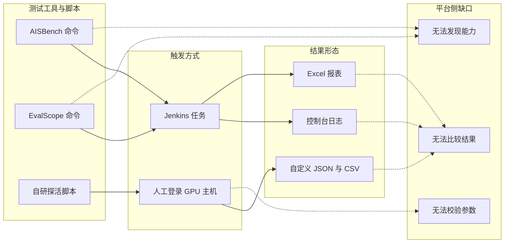
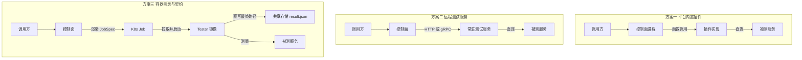
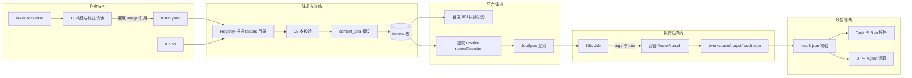
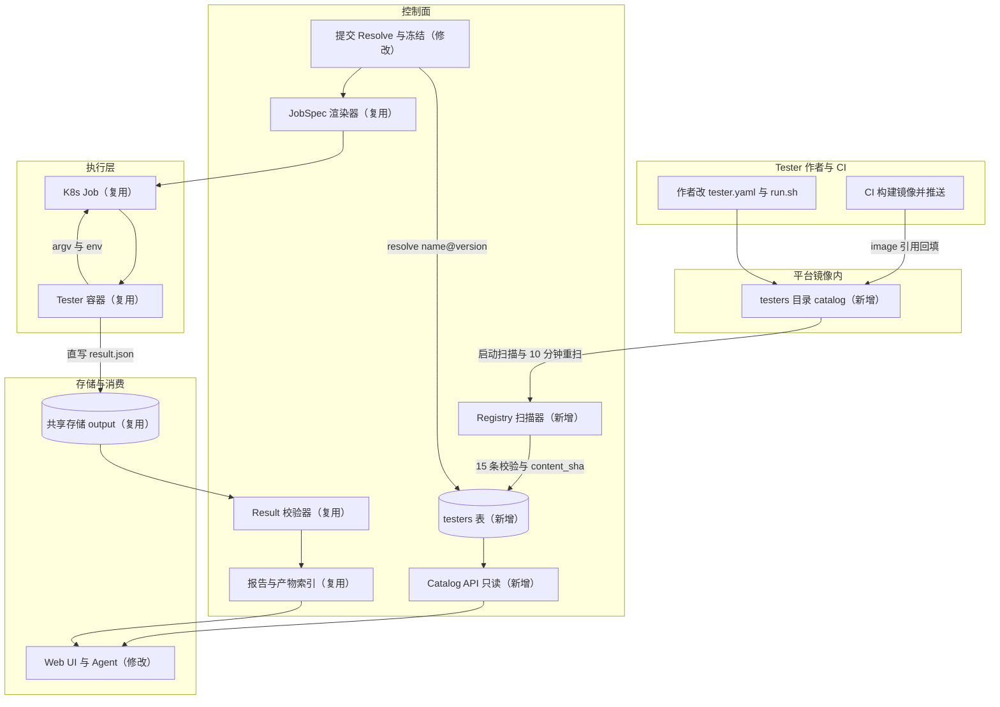
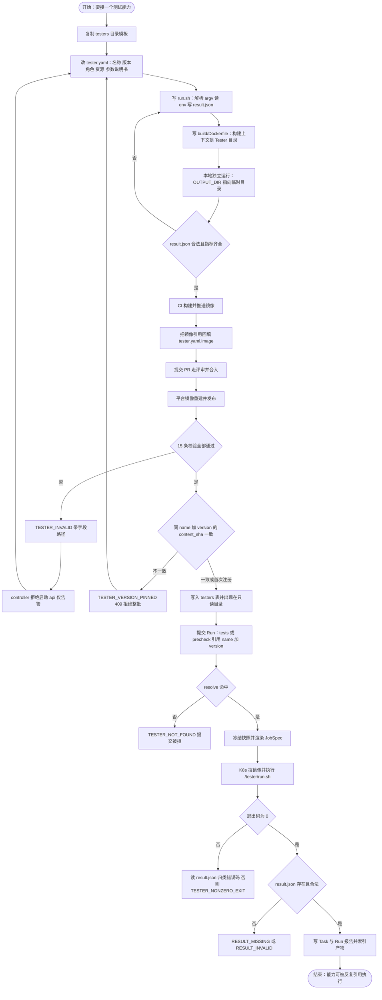
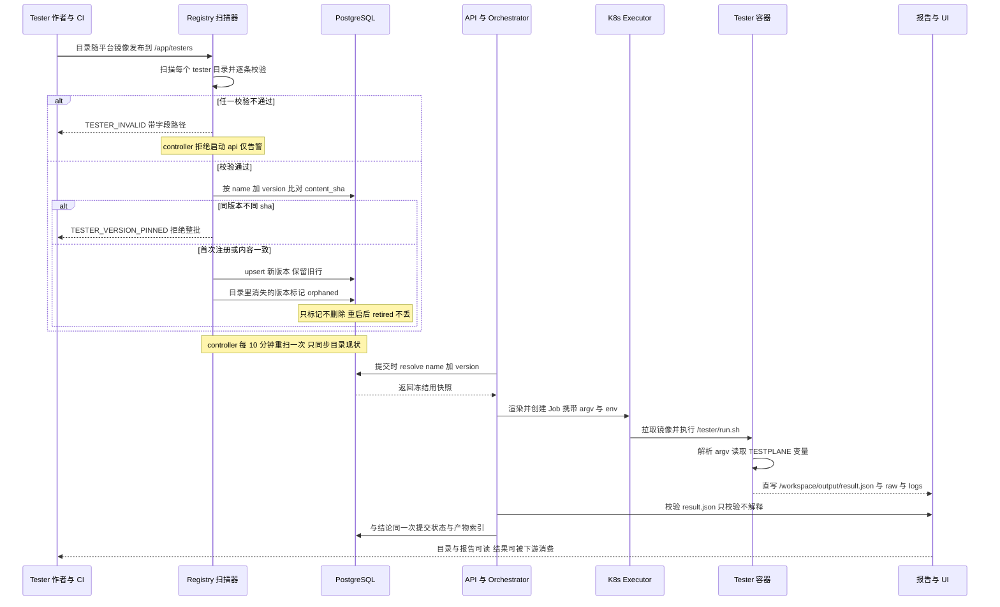
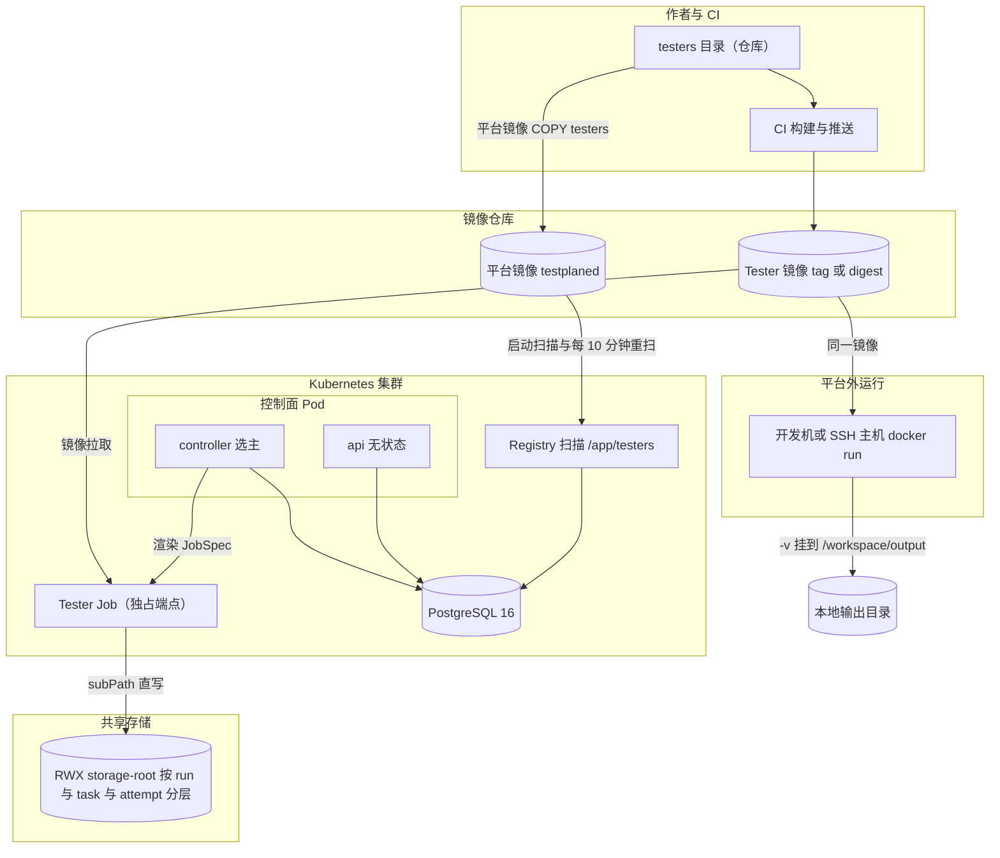

# TestPlane Tester 设计

| 项 | 内容 |
|---|---|
| 文档类型 | 子系统设计说明——Tester 的模板、规约、注册、执行与演进 |
| 效力 | **不新增裁决**。与 [`ARCHITECTURE.md`](../../design/ARCHITECTURE.md) 冲突时以它为准；本文只做展开、论证与落地细节 |
| 读者 | Tester 作者、平台评审、消费 Tester 目录与 `result.json` 的前端 / Agent 实现者 |
| 状态 / 日期 | 评审稿 v1.1（重建版）/ 2026-11-09 |
| 姊妹篇 | [`overall-design.md`](overall-design.md)（平台总体设计，同目录）。平台编排、状态机与部署细节以它为准 |
| 事实基线 | ARCHITECTURE v0.11 §5 全文、附录 A/C、§6.7 / §6.8 / §7.3 / §12.3 / §12.4；`design/impl/execution.md` §10；`server/internal/registry/` 与 `server/cmd/testplaned/main.go` 实现；`testers/` 现存两个实例 |
| 覆盖 | 能力封装边界、目录模板、契约三通道、参数清单语义、注册与版本、结果归一化、独立运行、使用方式 |
| 不覆盖 | Run / Task 状态机、调度与槽位、Genet 部署、报告聚合口径、Web 页面细节——见姊妹篇与 ARCHITECTURE |

本文所有"必须 / 不得 / 应该 / 可以"沿用 ARCHITECTURE §0.3 的强度约定；数字与枚举一律取自源文件，不做推算。库、API 与报告里的状态 token 统一小写（`succeeded` / `failed` / `skipped` / `queued` / `pending` 等），正文讲概念时可用大写。

---

## 1. 背景与问题

### 1.1 当前情况

**结论：Tester 已经是平台唯一感知"测试怎么做"的边界，但"怎么造一个 Tester"仍只写在代码与两个实例里，缺一份面向作者的完整说明。**

平台的核心职责里只有一条与测试算法有关：通过 Executor 在指定环境运行 Tester（ARCHITECTURE §1）。其余五条（拉起被测服务、Pre-Check 门控、按配置创建 Task、收集结果生成报告、按策略清理）都只依赖 Tester 的**外部行为**，不依赖它内部用了什么工具。这条边界在 ARCHITECTURE §5 已经钉死，本文把它展开成作者可执行的东西。

现存测试工具与它们的差异：

| 工具 | 典型入口 | 依赖形态 | 输出形态 |
|---|---|---|---|
| AISBench | `ais_bench ...`（0.2.0 起为镜像内真命令） | 官方 benchmark 基镜像、Python 栈、tokenizer / 权重路径 | 逐点落盘的 `sla_out/`、工具自写 `sla_summary.json` |
| EvalScope | `evalscope eval --datasets gsm8k --limit 100` | Python 栈 + 数据集 | 工具自己的评测结果文件与 stdout |
| 自研探活脚本 | 直接 `POST` 到 base URL 的 `/chat/completions` | 只需 bash / curl / jq | 由脚本自己决定 |

同一次回归里，这三类东西要被同一条链路串起来：部署（Genet）→ 就绪确认 → 性能 / 精度测试 → 结果收集。平台侧现状是：

| 事实 | 出处 |
|---|---|
| Tester 目录是平台镜像的一部分：构建时 `COPY testers/ /app/testers/`，镜像内 `TESTPLANE_TESTERS_DIR=/app/testers`；该变量仅开发 / 灰度覆盖 | `deploy/docker/server.Dockerfile`、`deploy/charts/testplane/templates/configmap.yaml` |
| 启动时扫描并校验一次；**校验失败的处理按角色分**：`controller` 角色拒绝启动（fail fast），`api` 角色只告警并继续启动 | `server/cmd/testplaned/main.go` Registry 初始化段 |
| `controller` 每 **10 分钟**重扫一次目录（`RunRescan`，随 controller 构造启动）；重扫失败只记 warning，不退出、不重建注册表 | `main.go` 的 `buildController`、`registry.go` `RunRescan` |
| 重扫**不是**注册 API：没有运行时上传，只把目录现状同步进库；同版本内容变化的判定仍走拦截逻辑，不会静默覆盖 | `registry.go`、execution.md §10 |
| 注册表已实现：15 条校验、`content_sha` 指纹（`sha256(规范化 tester.yaml + run.sh 字节)` 取前 16 位十六进制）、`orphaned` 只标记不删除且**标记落库** | `registry.go`、execution.md §10 |
| 目录 API 对外只读三个端点：`GET /testers`、`GET /testers/{name}`、`GET /testers/{name}/versions/{version}`；**没有** `POST /testers` | openapi.yaml `/api/v1/testers*` 段 |
| `registry.Register` 是内部 / 测试能力（只接收 `tester.yaml`，指纹只覆盖 yaml 本身），不构成"上传 Tester"的对外功能 | `registry.go` |
| 现存两个可运行实例：`endpoint-probe` 与 `aisbench-sla` | README 进度表、`testers/*/tester.yaml` |

现存两个实例的契约画像（写作时的真实取值）：

| 项 | `endpoint-probe` | `aisbench-sla` |
|---|---|---|
| `version` | `1.0.0` | `0.4.0` |
| `role` | `pre_check` | `test` |
| `on_failure` | `abort_run`（`pre_check` 强制） | `continue` |
| `concurrency.endpoint_exclusive` | `true` | `true` |
| `resources` | `cpu: "1"`、`memory: "256Mi"`、`gpu.count: 0` | `cpu: "2"`、`memory: "2Gi"`、`gpu.count: 0` |
| `entry` | `/tester/run.sh` | `/tester/run.sh` |
| 退出码语义 | 0 就绪 / 1 未就绪或不可达 / 2 参数错误 | 0 找到可行并发 / 1 执行失败 / 2 参数错误 |
| 独立运行产物 | `result.json` + `logs/probe.log` + `raw/last-response.txt` | `result.json` + `sla_out/**` |

也就是说：**契约已经跑通了两个形态迥异的 Tester（一个零依赖探活、一个封装完整压测工具）**，缺的是把这套做法写成可复制的模板与规约——这正是本文要补的。

### 1.2 存在的问题

**能力接入没有统一标准。** 接一个新工具时，"参数怎么进来、结果怎么写出去、失败怎么表达"没有可抄的模板，只能读平台代码或抄上一个 Tester 的脚本；平台侧一旦为某个工具加了特判（认它的 CLI 规则、认它的产物结构），下一个工具就会要求同样的特判，边界逐次失守。

**参数与结果不可机器消费。** 参数散落在各脚本内部（默认值写在脚本里、含义只存在于作者脑子里），结果形态从控制台日志到 Excel 到自定义 JSON 不等；消费方（Web、报告、Agent）要为每个 Tester 写一套解析，跨 Run 比较更无从谈起。

**前置检查被写成特例。** "服务到底起没起来"最常见的做法是在触发脚本里加一段 `curl` 轮询，或在平台里塞一个 `wait_for_ready` 分支：前者探测点在错误网络里（K8s ClusterIP 从触发方不可达），后者让 Pre-Check 与普通 Task 变成两套逻辑，`on_failure`、独占、超时都要各写一遍。

**执行环境渗透进测试脚本。** 挂载路径、需要的 K8s 权限、镜像里的目录布局被写死在脚本里，导致同一个 Tester 换一台机器就跑不起来；作者无法在本地验证"平台里会发生什么"，只能提交一次 Run 去试。

**版本不可追溯。** 同名目录里的 `run.sh` 被就地修改，历史 Run 报告上的 Tester 名称仍是那个名字，但"当时跑的到底是哪份代码"无从回答；镜像 tag 可变、yaml 没有指纹，`name@version` 无法承担"这就是那次执行逻辑"的证明。

### 1.3 问题原因

四条原因，逐条对应上面的问题：

1. **没有"能力单元"的封装边界。** 测试逻辑与编排逻辑没有一条明确的接缝，于是每接一个工具，接缝的位置都要重新谈一次；容器是把接缝钉死的最便宜手段——镜像即能力，`/tester/run.sh` 即入口。
2. **没有元数据与契约。** 平台要"发现能力、声明资源、解释参数、判定角色"，这些都不该靠读脚本正文来获得；缺一份结构化元数据，平台只能加特判。
3. **没有注册、版本与白名单。** 没有白名单就没有"谁能被执行"的答案；没有版本与指纹，就没有"当时跑的是什么"的答案；没有校验，坏配置要等到运行期才暴露。
4. **没有独立运行要求。** 一旦 Tester 只能在平台里跑，作者就无法在本地闭环验证，平台也就永远无法摆脱"每次调试都提交一次 Run"的循环。

### 1.4 现状图

图 1-1 画的是"没有这套规约时"一次 LLM 服务测试的真实路径：工具、触发、结果三段各自为政，虚线处正是平台接不上的三个位置。



实线是现状里真实发生的调用与产物，虚线是"平台想接但接不上"的位置：能力在工具侧不可枚举（G1），参数与命令在脚本里被拼装（G2），结果形不成同一口径（G3）。三者叠加的结果是——平台能"记录"一次执行，却无法"编排"第二次。

---

## 2. 目标与范围

### 2.1 目标

**结论：让"新增一个 Tester"成为一次纯增量的目录提交，平台代码零改动，且这次提交从注册到执行全程可校验、可追溯、可脱离平台复现。**

| # | 目标 | 验收口径 |
|---|---|---|
| G-1 | 新增 Tester 不改平台代码 | 目录通过校验后即出现在 `GET /api/v1/testers`，提交引用即可执行；平台仓库无对应改动 |
| G-2 | 契约面可枚举且只有三通道 | 平台向 Tester 传的东西只有 argv、三个 `TESTPLANE_*` 环境变量、`/workspace/output`；无参数文件、无元数据文件、无平台 API 地址（ARCHITECTURE §5.3） |
| G-3 | 注册可校验，坏配置不进运行期 | 15 条校验逐条给字段路径；`controller` 启动时任一不过即 `TESTER_INVALID` 并拒绝启动；`api` 只告警并继续（见 `main.go`） |
| G-4 | 版本可追溯、不可静默覆盖 | 同 `name+version` 同 `content_sha` 为 no-op；不同 sha → `TESTER_VERSION_PINNED`（409）并拒绝整批 |
| G-5 | 结果可机器消费 | 每个 Attempt 都有合法 `result.json`；`metrics[].name` 不编码维度，`unit` / `statistic` 必填，多组参数靠 `labels` 区分 |
| G-6 | 可脱离平台运行 | 只给 argv + 环境变量就能产出与平台内一致的 `result.json`；验收：`docker run IMAGE --p1=1 --p2=2` 能跑出结果 |
| G-7 | 平台侧零测试语义 | 平台不解析参数含义、不拼装工具命令、不校验参数取值、不判指标达标 |

目标之间是有关联的：G-7 决定了 G-2（不解释语义就没必要引入参数文件），G-2 决定了 G-6（输入只有 argv 和 env，脱离平台才可能同构），G-6 又反过来支撑 G-3（不能独立运行的东西在 CI 里也测不了）。

### 2.2 适用范围

**结论：本文管"作者怎么写、平台怎么收、执行时怎么调"，不管"平台怎么编排一次 Run"。**

- **适用**：`testers/` 下每个 Tester 目录（目录名 = `name`）的形态与内容；`tester.yaml` 全部字段语义；`run.sh` 的契约义务；注册扫描与版本同步；`result.json` 的归一化义务；独立运行与本地验证；目录 API 的读法。
- **读者立场分层**：Tester 作者按 §4.8.3 / §5.4 干活；平台评审按 §3.4 / §4.8.4 看边界是否被守住；Agent 与 UI 实现者按 §4.8.2 / §4.8.5 / §5.4 消费目录与结果。
- **落地状态（写作时）**：目录扫描（`controller` 启动 + 每 10 分钟重扫）、15 条校验、`content_sha`、`retired` 落库、只读目录 API、`result.json` 校验与报告索引均已实现（MVP）；MCP / CLI 消费目录属 P1，未做（README 进度表、ARCHITECTURE §14.2）。
- **与姊妹篇的分工**：一次 Run 的主干、Task 状态机、`precheck_gate`、槽位与并发、超时取消、报告结构，全部在 [`overall-design.md`](overall-design.md)（§4.6 / §4.7）与 ARCHITECTURE §6–§8；本文只在需要说清 Tester 义务时引用，不展开。

### 2.3 不包含的内容

| 不包含 | 原因与归属 |
|---|---|
| 测试算法与指标口径（TTFT 怎么算、SLA 怎么搜、精度怎么评分） | 归工具与 Tester 作者；平台与本文都不判"好不好" |
| 数据集与模型权重的托管、路径映射、内容指纹 | 路径是不透明字符串（ARCHITECTURE §10.4）；平台不解析、不校验存在性 |
| 平台编排与调度（Task 顺序、端点槽位、全局并发、Pre-Check 门控的实现） | 姊妹篇 §4.6 / §4.7 与 ARCHITECTURE §6–§7 |
| 部署（Genet / Helm release、Deploy 状态合成） | 姊妹篇与 `design/impl/execution.md` §9 |
| 运行时上传执行代码 | P0 明确不做；注册是"平台镜像内目录 + 启动扫描 + 周期重扫"，没有上传端点（§3.4 子决策二） |
| Tester 的 CI 平台化 | 构建方式"不做规范"（ARCHITECTURE §5.5）：写清构建上下文与命令即可，平台不读构建脚本 |
| 多租户与按团队隔离 Tester 目录 | 当前是单团队内部工具，无租户概念（ARCHITECTURE §12） |
| 平台对指标做数学聚合、判达标、发 Gate | 平台只组织与索引（ARCHITECTURE §13.1） |
| 参数表单渲染与参数校验 | 参数清单只是说明书（§4.8.2）；UI 只有一个输入框 |

---

## 3. 方案对比与选择

### 3.1 可选方案

**方案一：平台内置插件。** Tester 以"平台的一部分"存在——控制面用固定接口（编译期注册的函数，或由控制面 `fork` 的子进程）承载测试逻辑，镜像里不带测试工具，工具依赖装在控制面镜像里。它适合的场合很明确：只有一个测试工具、依赖与平台一致（同语言、无 GPU / NPU 驱动）、测试耗时短到不影响控制面。核心理由是"没有镜像、没有注册流程、没有网络跳数"，接一个工具就是加一个实现类。

**方案二：远程测试服务。** 每个测试工具暴露一个常驻的 HTTP / gRPC 服务，平台按地址调用、按协议取结果。它适合的场合是"能力已经以服务形态存在"——团队已有评测服务、多个平台共用同一套测试能力、服务侧自己负责伸缩与队列。核心理由是语言无关、可独立部署与扩缩容、平台侧只认协议。

**方案三：自包含容器目录 + 契约 + 白名单扫描（本文选中）。** 一个 Tester = 仓库里一个自包含目录（`testers/` 下以 Tester 名命名的目录）：`tester.yaml` 声明元数据、角色、资源、并发与参数说明书，`run.sh` 是唯一执行入口，`build/Dockerfile` 定义运行环境；CI 把目录构建成镜像并回填 `image`，平台启动时扫描目录、校验并写入注册表，提交时按 `name@version` 冻结，执行时由 K8s 拉起镜像并调用 `/tester/run.sh`，产物直写共享存储的最终路径。目录本身既是"能力清单"，也是**白名单**：目录里没有的东西，平台不会执行。

### 3.2 方案对比

| 维度 | 方案一：平台内置插件 | 方案二：远程测试服务 | 方案三：容器目录 + 契约 + 白名单（选中） |
|---|---|---|---|
| 核心思路 | 测试逻辑编进控制面，进程内 / 子进程调用 | 工具以常驻服务暴露，平台远程调用 | 目录即能力，镜像即环境，平台渲染 Job 调 `/tester/run.sh` |
| 实现复杂度 | 低（加实现类），但依赖装进控制面后镜像与升级复杂度回升 | 中（要写服务、要管服务生命周期、要定协议） | 中（目录模板 + 注册校验 + Job 渲染，但每部分只写一次） |
| 性能 | 无网络与镜像拉取开销；但测试与 API 争同一进程的 CPU / 内存 | 多一次网络调用；测试本身在服务侧跑，平台只等 | 有镜像拉取与 Pod 启动开销（秒级），测试本身不受控制面影响 |
| 可靠性 | 差：Tester 崩溃 / OOM 会拖垮控制面；无法按测试声明资源上限 | 中：服务崩溃不影响控制面，但平台要自己判"服务活着吗" | 好：Job `backoffLimit: 0`、资源由 `resources` 声明、失败即一个 Attempt 的失败 |
| 扩展性 | 差：每接一个工具就要改平台并重新发版；异构依赖（NPU 驱动、大镜像、不同语言）装不进同一镜像 | 好：加服务即可，语言无关 | 好：加目录即可，平台零改动；异构依赖靠镜像隔离 |
| 兼容性 | 与平台版本强绑定，工具升级要跟平台发版 | 与平台版本弱绑定，但协议要版本化 | 与平台版本弱绑定：契约只有三通道，`result.json` 有 `schema_version` |
| 维护成本 | 短期最低，长期最高（平台跟着每个工具升级） | 每个工具一套常驻服务的运维成本 | 每目录一套镜像与 CI；平台侧维护成本固定 |
| 适用场景 | 单工具、依赖与平台同构、测试短 | 能力已服务化、多平台共用、需要独立伸缩 | 工具异构、资源敏感、需要隔离与可追溯（本项目） |

### 3.3 方案对比图

图 3-1 只画一件事：**一次测试请求的数据路径**在三方案下差在哪里。



三段路径的关键差别在"测试逻辑跑在哪、谁给它资源上限、产物落在哪"：方案一跑在控制面进程里，方案二跑在平台外的常驻服务里，方案三跑在平台按声明渲染出来的 Pod 里。只有方案三能同时给出**资源上限（`resources`）**、**环境隔离（镜像）**和**产物直落最终路径（subPath）**这三件事，而它们恰好是本项目必须的三件事（异构依赖、GPU / NPU 独占、产物要能活过 Pod）。

### 3.4 最终选择

选中**方案三**。决定性原因不是"综合考虑"，而是下面六条里任意一条都足以排除另外两个方案：

1. **异构依赖只能靠镜像隔离。** 现存两个 Tester 的依赖形态已经完全不同：`endpoint-probe` 只需 bash / curl / jq，`aisbench-sla` 需要官方 AISBench 基镜像（自带 `ais_bench` 命令）与 tokenizer。方案一把它们装进同一个控制面镜像，等于把 NPU 驱动、几十 GB 的 benchmark 镜像绑到 API 进程上；方案二则要求每套依赖常驻一个服务。
2. **资源必须能按测试声明。** 性能测试要独占端点、要 GPU / NPU 节点；`resources` 与 `k8s` 白名单字段是唯一能表达"这个测试要 2 核 2 GiB、要调度到 accelerator 节点"的地方。方案一无法声明，方案二把资源问题推给服务侧，平台就失去了"这次测试实际占了多少"的事实。
3. **平台必须零测试逻辑。** 平台若认 AISBench 的 CLI 或产物结构，第二个工具就会要求同样的适配。方案三把"怎么测"关进镜像，平台只认 `/tester/run.sh`、三通道与 `result.json`（ARCHITECTURE §5.2）。
4. **注册必须是白名单，且可校验。** 方案二的"服务地址"没有天然的评审边界：任何能提供地址的人都能让平台调用。方案三的边界是仓库里的目录——目录进仓库要走 PR 与评审，扫描时再逐条校验（15 条），坏配置在**启动**就暴露而不是在运行期。
5. **版本与执行逻辑必须绑定。** 冻结 `name@version` + 镜像引用 + 参数快照，Attempt 再记 K8s 实际拉取的 digest，才能回答"当时跑的是什么"。方案一的版本等于平台版本，方案二的版本在过去部署里，都答不了这个问题。
6. **Tester 必须能独立运行。** 本地 `docker run IMAGE --p1=1 --p2=2` 就能跑出同一份结果，作者不必为验证提交一次 Run，平台也不必为调试提供"测试模式"。方案一需要整个控制面在本地，方案二需要服务在本地。

#### 子决策一：参数走 argv 词法透传，而不是 JSON 参数文件或平台渲染模板

选定"一段 `--k=v` 字符串，平台按词法切分后直接 exec，不经 shell"。三条替代路径都被否掉：

- **JSON / YAML 参数文件**：需要平台定义文件名、编码、版本与写盘位置，等于新增第四通道（ARCHITECTURE §5.3 明令禁止），还要定义"参数文件缺失怎么办"。它换来的唯一好处是结构化，而结构化的好处平台本来就不消费——参数语义只对 Tester 有意义。
- **平台按工具模板渲染命令**：这就是方案一的老路，平台重新开始解释语义，边界失守。
- **平台做参数校验 / 生成表单**：与"平台不校验参数"的裁决直接冲突（ARCHITECTURE §5.4），且校验规则要跟着每个 Tester 演进。

词法透传的代价是"平台无法在提交期发现参数错误"，收益是**没有第二套 schema**：作者只写一遍解析逻辑（`run.sh` 里的 `case`），平台只做切分。安全上它也更好——不经 shell 意味着 `;`、`|`、`$()`、通配符一律作为字面量，注入面收敛到"Tester 自己怎么解释参数"这一点上。

#### 子决策二：注册走目录扫描，而不是运行时上传 API

选定"平台镜像内 `/app/testers` + 启动扫描 + 15 条校验 + `controller` 每 10 分钟重扫"，并且没有 `POST /testers`。理由：

- **要校验的东西一半不在 yaml 里。** `run.sh` 是否存在、是否有可执行位、目录里有没有混进 K8s 清单、目录名是否等于 `name`——上传一份 yaml 无法覆盖这些，而它们恰恰是"能不能执行"的前提。
- **执行代码是镜像，不是 yaml。** 上传 yaml 也拿不到镜像；镜像必须由 CI 构建、推送、回填。既然如此，把"发布"这个动作放在 PR + CI 上，比放在一个 API 上更自然。
- **白名单的语义是"进过仓库才算数"。** 目录进仓库要走评审（ARCHITECTURE §12.3：Tester 注册仅 `admin` 且走评审），启动扫描只是把这份白名单读进库里。
- **启动校验的强度按角色分，是刻意的。** `controller` 是唯一会真正调度 Tester 的角色，注册表脏了它就拒绝启动（fail fast）；`api` 只提供只读目录与提交入口，注册表脏了告警即可，否则一个坏 Tester 会把整个控制面 API 拖到不可用。这条分工写在 `main.go` 里，不是部署惯例。
- **重扫是兜底，不是注册通道。** `controller` 每 10 分钟重扫一次目录（`RunRescan`），用来吸收"镜像内目录被替换 / 灰度目录挂载变化"这类运维动作；它没有写接口，也无法新增一个"仓库里不存在"的 Tester。

因此：**对外只有只读目录 API**（`GET /testers`、`GET /testers/{name}`、`GET /testers/{name}/versions/{version}`）。实现里的 `Registry.Register` 是内部 / 测试能力（只接收 yaml、指纹只覆盖 yaml 本身），**不是**对外端点；本文不把它包装成"上传 Tester 功能"。

#### 子决策三：结果走全局唯一 `result.json`，而不是每个 Tester 自带 schema

选定"`/workspace/output/result.json`，结构见附录 A，平台只校验不解释"。理由：

- **消费方只有一个契约。** 报告、UI、Agent、下游系统读的是同一份结构；如果每个 Tester 自带 schema，平台就必须为 N 个 schema 写 N 个适配器——这正是方案二也要付的代价（"结果仍要归一化"）。
- **目录不必再声明产物。** 因为产物契约全局统一，`tester.yaml` 才可能把 `outputs` 列为**禁止字段**（附录 C）：每个 Tester 再声明一遍既冗余，也没有消费方。
- **跨 Run 可比较。** 指标名不编码维度（禁止 `ttft_concurrency_8`），维度走 `labels`，统计量走 `statistic`，单位走 `unit`；只有这样"同一个指标在不同 Run / 不同 Tester 之间"才有可比性。

代价是**归一化的活落在作者身上**：工具输出的原始结构要由 `run.sh` 映射到附录 A，映射不出来的数就不写并在 `notes` 说明（`aisbench-sla` 的 README 里把这条写成"取不到就不写，不编数"）。

### 3.5 方案代价

选方案三不是没有成本。下面六条是**已接受的具体限制**，评审时应逐条确认它们仍然可接受：

1. **作者要维护镜像与 CI。** 每个 Tester 一套 Dockerfile、一次构建推送、一次 `image` 回填；平台与任何运行环境都不 build（ARCHITECTURE §6.2），因此"改一行 `run.sh` 就要重新发镜像"是常态。
2. **错误暴露得更晚。** 平台不校验参数取值（§4.8.2），写错的参数要等 Tester 跑起来才失败：非零退出 + `result.json.error`，最坏情况是白跑一次 GPU 时间。
3. **注册变更仍要重建平台镜像。** 目录被 `COPY testers/ /app/testers/` 打进镜像，所以**新增** Tester 或改目录内容的常规路径仍是"改仓库 → 平台镜像重建 → 重新发布"；10 分钟重扫能吸收"镜像内目录被替换 / 灰度目录变化"，但它同步的是目录现状，不是"往仓库里加了一个 Tester"。`TESTPLANE_TESTERS_DIR` 指向可写目录只是开发 / 灰度手段。
4. **平台看不到 Tester 内部进度。** 契约里没有"进度上报"通道，平台只知道 `running` 与最终 `result.json`；长测试的中间状态只能靠 Tester 写 `logs/` 与 `raw/`，由日志采集侧透出，不是结构化进度。
5. **目录版本与镜像 tag 需人工对齐。** 平台不解析镜像引用（ARCHITECTURE §5.6），`tester.yaml.version` 与镜像 tag 是否一致全靠团队约定与 CI；平台只能记下"引用是什么"与"K8s 实际拉了什么 digest"。
6. **Tester 不能声明超时、产物与依赖。** `timeout_seconds`、`outputs`、`requires` 都是禁止字段（附录 C）：跑多久是编排策略，产物契约全局统一，依赖注入是平台的事。作者会明确感到"想声明的三件事都不让声明"——这是边界的代价，不是遗漏。

---

## 4. 技术原理与方案设计

### 4.1 核心原理

**结论：Tester 是能力的唯一载体，平台是能力的编排者——一次执行的数据流只有四段：声明、注册冻结、渲染执行、结果归一。**

**① 输入：两处声明。** 作者侧声明在目录里（`tester.yaml` 的能力/资源/角色/参数说明书 + `run.sh` 的执行逻辑 + `build/Dockerfile` 的环境），CI 把目录构建成镜像并把引用回填 `tester.yaml.image`；提交侧声明在 Manifest 里（`tests[].tester` + `version` + `args` 一段字符串，或 `precheck: auto` 让平台注入 Pre-Check）。两处声明在提交时相遇：平台按 `name@version` 解析出唯一一份 `tester.yaml`，把它作为**快照**冻进 Task。

**② 处理：注册冻结。** Registry 扫描 `testers/*/` 根目录，逐条校验（15 条，失败即 `TESTER_INVALID` 并带字段路径），算指纹 `content_sha = sha256(规范化 tester.yaml + run.sh 字节)`——规范化指行尾统一为 `\n`（避免 Windows / Linux checkout 造成假变更），摘要取十六进制**前 16 位**作为库内 `content_sha`（`registry.go` 的 `contentSHA`）——按 `(name, version)` 落库。启动时这一遍由 `controller` 强校验（失败拒绝启动）、`api` 只告警；此后 `controller` 每 10 分钟重扫一次。同 `name+version` 同 sha → no-op；不同 sha → `TESTER_VERSION_PINNED`（409）并**拒绝整批**；目录里消失的版本只标 `orphaned` / `retired`，不删除。

**③ 数据流转：渲染执行。** 平台把冻结的 Tester 摘要与提交参数渲染成 Job Spec：`image` 原样透传（不解析 tag / digest）、`command` 固定 `["/tester/run.sh"]`、`args` = `args_raw` 词法切分后的数组 **+** 追加到末尾的公共参数（`--url` / `--model_name` / `--model_path`，值只来自 `deploy` 或 `service` 二者之一）、三个 `TESTPLANE_*` 与 `TZ` / `HOME=/tmp` 由执行层强制覆写、凭据走 `secret_env`、`resources` 生成 requests 与 limits、`/workspace/output` 以 **subPath** 挂到产物路径（记法见 ARCHITECTURE §8.1：在 `storage-root` 下按 `run_id` / `tasks` / `task_id` / `attempts` / 序号逐层展开）。K8s 拉起容器后，`run.sh` 收到的只有：一段 argv、几个环境变量、一个可写目录。

**④ 输出：结果归一。** Tester 必须写 `/workspace/output/result.json`（附录 A）。平台只在 `exit == 0` 时校验它：不存在或 0 字节 → `RESULT_MISSING`，非法或不合 schema → `RESULT_INVALID`（`detail.path` 到字段级）。`exit != 0` 时平台仍读 `result.json`，**只用于归类错误码**（存在、合法且 `error.code` 属于附录 D 则用它与其 `retryable`，否则回退 `TESTER_NONZERO_EXIT`）——非零退出即 Task `failed` 这件事本身不变。校验发生在落库之前，与结论同一次提交。随后平台写 Task / Run 报告并索引 `artifacts`（`result.json.artifacts[]` 与磁盘取交集，声明了但没文件只记 warning）。

这条链路里平台**没有一处**解释测试语义：它不知道 `--concurrency=[1,4,8]` 是什么意思，也不知道 `ttft` 与 `tpot` 哪个更重要，只负责让参数原样到达、让产物原样落盘、让结论可被索引。

### 4.2 原理图

图 4-1 是从"目录"到"报告"的一遍数据流；虚线框是契约边界，跨过它的只有三样东西（argv / env / output），平台与 Tester 各自在边界的一侧。



图里只有一条"下行"通道（渲染 JobSpec → argv / env）和一条"上行"通道（`result.json`），没有一个反馈回路是平台向 Tester 传平台概念——这正是"唯一入口 + 三通道"的可视化结果。注意 `image` 回填那一步在 CI 侧闭环：平台不参与构建，只读取 `tester.yaml` 里已经写好的引用。

### 4.3 整体方案

**结论：一个 Tester 就是一个自包含目录 + 一个 CI 产出的镜像；目录决定"能被执行什么"，镜像决定"执行时有什么"，`result.json` 决定"执行发生了什么"，三者由 `name@version` 与 `content_sha` 绑定。**

具体到落地：仓库里每个 `testers/` 子目录放 `tester.yaml`、`run.sh`、`build/Dockerfile`（推荐）、`run-local.sh`（可选）、`README.md`（推荐）；CI 以**Tester 目录**为构建上下文构建镜像、推送、把引用回填 `tester.yaml.image`；平台镜像构建时 `COPY testers/ /app/testers/`，`controller` 启动即扫描校验（失败拒绝启动）、`api` 只告警，校验通过的条目进 `testers` 表；`controller` 每 10 分钟重扫一次作为兜底；提交时按 `name@version` 解析并冻结；执行时由 K8s Job 拉镜像、调 `/tester/run.sh`、产物直写共享存储；校验 `result.json` 后写 Task / Run 报告并索引产物。整条链上平台代码不认识任何一个具体 Tester。

### 4.4 整体架构图

图 4-2 标出了组件与调用方向，并在每个组件后注明本次变化：`（新增）` 是本文配套的注册与目录能力，`（修改）` 是在既有提交 / API 链路上补的校验与投影，`（复用）` 是不变的既有设施。



读图时抓住三条边：`testers 目录 → Registry`（唯一入口的注册方向）、`提交 Resolve → JobSpec 渲染`（冻结后的下发方向）、`Tester 容器 → 共享存储 → Result 校验`（产物上行方向）。三条边之外没有任何"平台 → Tester"的调用，Tester 也看不到 `testers` 表或 Catalog API。

### 4.5 组件说明

| 组件 | 作用 | 本次变化 |
|---|---|---|
| `tester.yaml` | 唯一权威元数据：名称 / 版本 / 角色 / 失败策略 / 入口 / 镜像 / 资源 / 并发 / 参数说明书 / env 声明 / 受限 k8s | 新增（作为契约的唯一元数据源，替代"读脚本正文"） |
| `run.sh` | 唯一执行入口（容器内 `/tester/run.sh`），解析 argv、读 env、写 `result.json` | 新增（模板与契约骨架见 §5.4） |
| `build/Dockerfile` | 定义运行环境；构建上下文 = Tester 根目录 | 新增（构建方式不做规范，写清上下文与命令即可） |
| `run-local.sh` | 本地便捷封装：只 `docker run`、不 build；不是契约入口 | 复用（现存两个实例都有） |
| Registry 扫描器 | 扫描 `testers/*/` 根、15 条校验、算 `content_sha`、比对写库；启动 + 每 10 分钟重扫 | 新增（MVP 已实现） |
| Catalog Store | `testers` 表：spec + 指纹 + 来源 + `orphaned` / `latest` 标记 | 新增（`/testers*` 三个端点） |
| Resolve / 提交校验 | 按 `name@version` 解析、冻结快照、校验公共参数冲突与 env 必填 | 修改（在既有提交校验链上补 Tester 相关项） |
| Job 渲染器 | 把冻结摘要 + 参数渲染成 batch/v1 Job：镜像、命令、args、env、resources、subPath | 复用（渲染规则不变，输入来自注册表） |
| Result 校验器 | 校验 `result.json`（必填项、`statistic` 枚举、同名唯一），非零退出时归类错误码 | 复用 |
| 报告与产物索引 | Task / Run 报告、`artifacts` 索引、`result.json.artifacts[]` 与磁盘取交集 | 复用（不做指标数学聚合） |
| Catalog API / UI | `GET /testers`、`/testers/{name}`、`/testers/{name}/versions/{version}`；UI 展示能力与参数说明书 | 新增（只读；UI 只有一个参数输入框） |

### 4.6 关键流程图

图 4-3 是一条完整的生命周期：从"复制模板"到"结果被校验"，中间有三处会分支的判定（本地自测、注册校验、提交 resolve 与结果校验）。



流程里有两处"回到 B"的回边：本地自测不过要改脚本，注册校验不过要改元数据。这不是重复劳动——前者校验的是**执行逻辑**（作者自己能验证），后者校验的是**声明**（评审能验证），两者失败的原因不同。

### 4.7 关键时序图

图 4-4 把"注册"和"执行"放在同一条时间轴上：上半段发生在控制面启动与重扫，下半段发生在一次 Run 的 Task 执行时。两者的交接点是 `testers` 表（注册产物）与 `name@version`（执行输入）。



读图注意三处：`alt` / `else` 的两个失败分支都在**启动期**收口，且强度按角色分（`controller` 拒绝启动、`api` 告警继续），不会污染运行期状态；`orphaned` 的写入是"标记"而不是"删除"，所以重启后 `retired` 依然正确；平台对 `result.json` 的动作只有"校验"，没有任何一步是"解析成平台的业务对象"。

### 4.8 关键设计点

#### 4.8.1 Single Entry Point 与三通道

**解决什么问题。** 平台要"执行任意测试能力"，但不可能认识每个工具的命令行。只要允许第二条执行路径（比如"平台支持直接跑某工具的官方命令"），平台就会长出第二套语义。

**怎么做。** 每个 Tester 只有一个入口：容器 `command = ["/tester/run.sh"]`，`tester.yaml.entry` 必须等于 `/tester/run.sh`（校验第 4 条），平台显式写 `command` 而不依赖镜像 `ENTRYPOINT`。入口之外只有三样东西进来：**argv**（一段 `--k=v` 字符串按词法切分、支持引号、**永不经过 shell**）、**三个环境变量**（`TESTPLANE_RUN_ID` / `TESTPLANE_TASK_ID` / `TESTPLANE_ATTEMPT_ID`，独立运行时缺省 `local`）、**一个输出目录**（`/workspace/output`，可被 `OUTPUT_DIR` 覆盖，只有 output 没有 input）。凭据只走环境变量（Run 级 `env` 明文 / `secrets` 引用），不进 argv。

**为什么不是另一种做法。** 不做 shell 拼装：`sh -c` 意味着用户输入能改变命令结构（`;`、`$()`、通配符），平台等于对外提供任意命令执行；词法切分把注入面压缩到"Tester 自己怎么解释参数"。不设 `/workspace/input`：一旦有输入目录，就要定义文件名、编码、生命周期与"谁写谁读"，第三通道立刻变成第四通道。不传平台 API 地址：Tester 若能回调平台，它就能读到 Run 之外的平台状态，独立运行（§4.8.7）也就不成立了。

#### 4.8.2 `tester.yaml`：说明书，不是运行时配置

**解决什么问题。** Agent 与人需要知道"这个 Tester 能填什么、什么含义、什么单位、和谁耦合"；但平台一旦真的按这份清单校验参数，就要为每个 Tester 维护一套校验规则，还要在 UI 里生成表单——那是"平台内置插件"的思路（§3.1）。

**怎么做。** `parameters` 是纯文档语义：平台**不渲染、不校验、不生成表单**，UI 只有一个参数输入框。字段只有 `type` / `description`（必填、中文、含单位与取值范围与耦合关系）/ `default` / `enum` / `example` / `required` / `required_for`；顶层另有 `placeholder`（一段可直接抄的示例命令行，不含程序名）。三条硬约定：清单必须覆盖 Tester 实际接受的每个 `--key`（含公共参数，未使用但必须容忍的可以不列）；不引入 `provided_by` 之类字段表达"谁给值"（同一参数在不同场景来源不同，静态字段一定写不准，写进 `description`）；禁止"见文档""同上"这类机器不可消费的表述。

同时用**禁止字段**守住边界：`requires`（Tester 不声明对 Endpoint / 模型的依赖，只读 `--url`）、`timeout_seconds`（跑多久是编排策略）、`outputs`（产物契约全局统一）——三者出现即 `TESTER_INVALID`（校验第 7 条）。

**为什么不是另一种做法。** 不做参数校验：平台校验就意味着平台要有类型系统与默认值语义，而"参数错"最准确的判定者只有 Tester 自己；裁决的代价是错误暴露晚（§3.5 第 2 条），收益是平台不必随工具演进。不做表单：表单等于把说明书变成契约，参数一改就要改平台。公共参数为什么固定三个名字（`url` / `model_name` / `model_path`，`url` 是 OpenAI 兼容 base URL、不带 `/v1` 由 Tester 补）：Agent 靠这三个固定名字做通用拼装，出现 `base_url` / `model` / `model_dir` 这类变体，通用拼装就失效。

#### 4.8.3 模板与构建边界

**解决什么问题。** "Tester 里该放什么"如果含糊，作者就会把 K8s 清单、结果目录、凭据一起塞进来——而这三样恰好会让"可复用单元"变成"某个集群的部署脚本"。

**怎么做。** 目录职责固定：`tester.yaml`（必须）、`run.sh`（必须、可执行位）、`build/Dockerfile`（推荐，构建上下文 = **Tester 根目录**，命令是 `docker build -f build/Dockerfile .`，写在 Dockerfile 注释或 README 里即可，平台不读）、`build/scripts/`（可选，形态不限）、`run-local.sh`（可选，只 run 不 build）、`README.md`（推荐）、`tests/`（可选，不参与注册与调度）。明确不放：任何完整 K8s 清单（`deployment.yaml` / `job.yaml` / `pod.yaml` / `service.yaml` / `ingress.yaml` / `configmap.yaml` / `pvc.yaml` / `networkpolicy.yaml` 等，出现即校验第 15 条拒绝）、`results/` 与 `output/`、凭据与 `.env`。镜像只由 CI 产出：平台、SSH 主机、本地一律 `pull` + `run`，不在运行环境里 build。

**为什么不是另一种做法。** 不让 Tester 自带清单：清单会把集群名、命名空间、挂载点写进"可复用单元"，且平台再也无法保证 input / output 挂载契约（subPath、只读、权限）——特殊需求改用 `tester.yaml.k8s` 的白名单字段（`node_selector` / `tolerations` / `annotations` / `security_context{run_as_user,fs_group}`），平台字段（镜像、command、超时、挂载）优先且不可覆盖。不在运行环境里 build：一旦允许就地 build，"这次跑的是哪个版本"就不可追溯，而版本可追溯是 §3.4 第 5 条的前提。不规定构建方式：平台不读构建脚本，规定得越细，越容易和团队既有的 CI 打架。

#### 4.8.4 注册与版本

**解决什么问题。** 平台需要回答三个问题：这次能执行谁（白名单）、这次执行的配置合法吗（校验）、同名同版本为什么内容变了（版本钉死）。三者都不能靠"运行时再说"。

**怎么做（扫描与重扫）。** 来源与触发固定：平台镜像内 `/app/testers`（构建时 `COPY testers/ /app/testers/`，镜像 `ENV TESTPLANE_TESTERS_DIR=/app/testers`；该变量仅开发 / 灰度覆盖），只扫 `testers/*/` 根（`build/`、`tests/`、`run-local.sh`、`.local/` 不参与）。启动时扫描并校验一次，**失败处理按角色分**：`controller` 拒绝启动（fail fast），`api` 告警后继续启动——`controller` 是唯一真正调度 Tester 的角色，`api` 只是只读目录与提交入口，不该被一个坏目录拖死。此后 `controller` 每 **10 分钟**重扫一次（`RunRescan`，随 controller 构造启动；重扫失败只记 warning、不退出），`interval <= 0` 时退化为只扫一次。重扫只同步目录现状，不提供任何写接口。

> 与 execution.md §10 的"启动扫描一次、不做运行时更新（K-3）"并不矛盾：K-3 禁的是**运行时注册 API**，10 分钟重扫是运维兜底，用来吸收"镜像内目录被替换 / 灰度目录挂载变化"，两者都不允许"仓库里不存在的 Tester 被注册进来"。

**怎么做（15 条校验）。** 任一条不过即 `TESTER_INVALID`（400）并带字段路径：

| # | 校验项 |
|---|---|
| 1–2 | 目录名 = `name`；`name` 匹配 `^[a-z0-9-]{1,63}$`；`version` 匹配 `^\d+\.\d+\.\d+(-[0-9A-Za-z.-]+)?$` |
| 3 | `image` 非空（形态不限，不解析 tag / digest） |
| 4 | `entry` 必须等于 `/tester/run.sh` |
| 5 | `role ∈ {test, pre_check}`；`pre_check` 必须 `on_failure: abort_run` |
| 6 | `on_failure ∈ {continue, abort_run}` |
| 7 | 禁止字段 `requires` / `timeout_seconds` / `outputs` 出现即拒绝 |
| 8 | `k8s` 仅允许 `node_selector` / `tolerations` / `annotations` / `security_context{run_as_user, fs_group}`；`privileged` / `hostPath` / `hostNetwork` / 自定义 `image` 或 `command` 一律拒绝 |
| 9 | `resources.cpu` / `memory` 是合法 quantity，`gpu.count >= 0` |
| 10 | `concurrency.endpoint_exclusive` 为布尔；`pre_check` 必须 `true` |
| 11 | `mounts[].mount_path` 为绝对路径、不与平台保留路径冲突（`/workspace/output`、`/workspace/input`、`/tmp`、`/tester` 及统一共享挂载路径）、挂载点互不嵌套且不重复 |
| 12–13 | `parameters` 显式存在（可为空对象）且每项有 `description`；`env.*` 有 `required` / `secret` / `description`（`secret: true` 必须有 `description`） |
| 14 | `run.sh` 存在且有可执行位（Windows 上跳过执行位检查，NTFS 不存 POSIX 位） |
| 15 | 目录内不得有 `job.yaml` / `deployment.yaml` / `pod.yaml` / `service.yaml` / `ingress.yaml` / `configmap.yaml` / `pvc.yaml` / `networkpolicy.yaml` 等 K8s 清单（`.yml` 同禁） |

**怎么做（同步与版本）。** `content_sha = sha256(规范化 tester.yaml + run.sh 字节)`，库内取十六进制前 16 位：同 `name+version` 同 sha → no-op（不产生新版本行、不改已注册内容）；不同 sha → `TESTER_VERSION_PINNED`（409）并**拒绝整批**（不是只跳过这一条）；新版本只新增行、不覆盖旧行。整批一个事务，重复调用得同一 diff。目录里消失的版本标 `orphaned`（对外字段 `retired`，两者同义、都保留以兼容既有前端 / CLI），**只标记不删除**，且标记**必须落库**——否则进程重启后从库里读回来的行 `orphaned=false`，`retired` 会永远为 false（票 #60 真机回归修的正是这个缺口）。因此 `Load` 的顺序是**先水合再扫描**：先把库里已有行读进内存，`Scan` 才能判定"目录里已消失的版本"。

**保留与退役的口径。** 同名多版本并存是正常版本演进：新版本发布后旧版本仍在目录时，两行都是 `retired=false`，`GET /testers` 默认只回最高版本（`latest=true`）；旧版本目录被删（`version` 改了）→ 旧行 `retired=true`；整个 Tester 目录消失是同一规则的极端情形（该 name 的所有版本都 `retired=true`，默认列表里整个不出现）。`GET /testers` 默认每个 name 只回最新版本，`include_retired=true` 回全部；`latest` 的判定是"该 name 的最高版本（含 retired 行）"，注册表排序、API、CLI 共用同一份比较实现。

**为什么不是另一种做法。** 不做运行时上传（§3.4 子决策二）：上传拿不到 `run.sh`、可执行位与目录内容，白名单也失去"进过仓库"的含义。不做"同版本覆盖"：`name@version` 是历史报告的唯一锚点，允许覆盖等于允许历史被改写；要改就升版本。不做"删行"：删行会让历史 Task / Attempt 永久失去 Tester 元数据。不做"注册即生效"：坏配置在 CI 就该被拦住，运行期校验失败就让 `controller` 拒绝启动——带病运行比启动失败更难排查。

#### 4.8.5 结果归一化

**解决什么问题。** 同一份报告里会有来自不同工具、不同语言、不同产物结构的 Task；消费方（报告、UI、Agent、下游）只可能实现一次解析。归一化不做在 Tester 侧，就必然做在平台侧——而平台侧做就等于平台认识每个工具。

**怎么做。** `result.json` 必须产出（缺失 → `RESULT_MISSING`），必填字段：`schema_version`（当前 `"1.0"`）、`run_id`、`task_id`、`tester`（含 `name` / `version`，必须与注册表一致；`image_ref` 可选）、`status`（`succeeded` / `failed`，仅描述执行是否完成）、`started_at` / `finished_at`、`metrics`（允许空数组，但需在 `notes` 说明）。指标规范：`name` 用 `snake_case` 且**不得编码维度**（禁止 `ttft_concurrency_8`）；每个指标必须带 `unit` 与 `statistic`，`statistic` 只允许 `mean` / `p50` / `p90` / `p95` / `p99` / `min` / `max` / `sum` / `count`；多组参数靠 `labels` 区分；同一 `labels` 下 `name + statistic` 唯一。失败的 Attempt 也必须写 `result.json`（`status: failed` + `error{code,message,detail,retryable}`），`error.code` 只能取附录 D 枚举——自造码不会报错，而是被平台静默降级成 `TESTER_NONZERO_EXIT`，丢掉区分信息。

**退出语义。** `exit 0` = 执行完成（Task `succeeded`，指标是否达标不归平台）；非 0 = Task `failed`（错误码由平台按退出码与 stderr / `result.json` 归类）；超时 → `TASK_TIMEOUT`；取消 → `canceled`。**测试执行成功 ≠ 指标达标**：精度测试完整执行但准确率偏低，应 `exit 0` 并如实写指标；把"不达标"映射成执行失败会让"执行可靠性"指标失真。

**为什么不是另一种做法。** 不让每个 Tester 自带 schema（§3.4 子决策三）：N 个 schema 等于 N 个适配器。不在平台侧做一次"通用解析"：工具产物结构各异，平台侧解析必然退化成"认识 AISBench 的 xlsx 与 EvalScope 的 json"。不做指标数学聚合：Run 报告只做组织与索引（ARCHITECTURE §8.4），聚合会让平台对"结论"负责，而平台不判达标。

#### 4.8.6 角色、失败扩散与独占

**解决什么问题。** 三件事必须在 Tester 侧声明而不是平台侧推断：这个 Tester 是前置门还是普通测试（`role`）、它失败时要不要终止别人的 Task（`on_failure`）、它运行期间能不能和别人共享端点（`concurrency.endpoint_exclusive`）。靠"平台按 role 隐含 abort_run"这类隐含规则，看不见也校验不了。

**怎么做。** `role ∈ {test, pre_check}`；`on_failure ∈ {continue, abort_run}`，`pre_check` 必须 `abort_run`（校验第 5 条），声明缺失即拒绝注册。Manifest 的 `tests[].on_failure` 与 Tester 声明**取更严格者**：Tester 写 `abort_run` 而 Manifest 写 `continue` 属配置冲突，**提交阶段拒绝**（`VALIDATION_ERROR`），不静默降级。`endpoint_exclusive: true` 表示该 Task 执行期间独占该 Endpoint，同 Endpoint 上的**任何**其他 Task 都排队；`false` 允许与其他非独占 Task 并行，但**永远不能与独占 Task 并行**——独占是单向压制。性能类与 Pre-Check 必须为 `true`，精度类默认 `false`。

`pre_check` 另有四条只属于"前置门"的附加约束：探测必须发生在**实际测试能访问服务的网络里**（在控制端进程内探测没有意义，K8s ClusterIP 从控制端不可达）；等待窗口由 Tester 自己实现（`wait_timeout_seconds` / `retry_interval_seconds`），平台不提供 `wait_for_ready` 这类包装字段；必须区分"未就绪"与"不可重试"（5xx / 404 / 429 / 连接被拒 / 超时可继续等；4xx 请求错误、认证失败、DNS / TLS 错误、2xx 里包着 `error` 对象应立即失败并置 `retryable: false`）；**两种"重试"不可混用**——等待就绪是一次执行内的反复探测（不产生新 Attempt），Task 重试是 `tests[].retry` 判定失败后新建 Attempt。

**为什么不是另一种做法。** 不按 role 隐含 `abort_run`：隐含规则既不可见也不可校验，声明才可以。不让 Manifest 单方面决定：提交者会不自觉地弱化"探活没过就别测了"这条硬约束，取更严格者才守得住。不做"独占加锁"在调度器里各写一遍：端点互斥只允许一个实现（按 `endpoint.key` 申请槽位，有部署时用部署标识、无部署时取 `url` 规范化值），槽位状态必须落库、重启后恢复。Pre-Check 不做成平台的"就绪检查组件"：它必须和普通 Task 走同一条执行路径，否则探测网络、超时、取消、日志都要各写一套。

#### 4.8.7 独立运行

**解决什么问题。** 如果 Tester 只能在平台里跑，作者每改一行都要提交一次 Run 才能验证；平台也要为调试维护"测试模式"，而"测试模式"从来不是免费的。

**怎么做。** 独立运行是**一等约束**：只给 argv + 环境变量就能跑出与平台内一致的产物。五条具体要求——输入只靠 argv（含三个公共参数）、元信息可缺省（`TESTPLANE_*` 缺失时按 `local` 处理）、输出目录可被 `OUTPUT_DIR` 覆盖（默认 `/workspace/output`）、凭据走环境变量、产物自足（独立运行时同样产出合法的 `result.json`）；以及一条硬约束：**不依赖 K8s**——不调用 K8s API、不要求 ServiceAccount、不假设挂载来源。验收方法就一句：在没装 TestPlane 的机器上 `docker run IMAGE --p1=1 --p2=2` 能跑出 `result.json` 即为合规。

**为什么不是另一种做法。** 不提供"平台测试模式"：那会变成第二条执行路径，且无法验证真实镜像。不要求 `run.sh` 支持"从配置文件读参数"：那等于给独立运行开了第二套输入。不把 `TESTPLANE_*` 设为必需：一旦必需，独立运行必须先造三个假 ID，本地验证就多了一步无意义的仪式。

### 4.9 异常处理

| 异常场景 | 影响 | 处理方式 |
|---|---|---|
| `tester.yaml` 语法错误或必填字段缺失 | 该 Tester 不可用；整批扫描中止 | `TESTER_INVALID`（400），`FieldError{path,message}` 定位到字段；`controller` 拒绝启动、`api` 告警继续 |
| 目录名与 `name` 不一致 | 注册键与磁盘目录对不上，按目录引用会找不到 | `TESTER_INVALID`，`path=name` |
| `version` 不是语义化版本 | 版本比较与 `latest` 判定不可信 | `TESTER_INVALID`，`path=version` |
| `run.sh` 缺失或无执行位 | 容器里无法启动入口 | `TESTER_INVALID`，`path=run.sh`（Windows 上跳过执行位检查） |
| 出现 `requires` / `timeout_seconds` / `outputs` | 边界被突破：Tester 试图声明依赖、超时或产物 | `TESTER_INVALID`，`path=字段名` |
| `k8s` 里出现非白名单字段或 `privileged` / `hostPath` / `hostNetwork` | 越权渲染风险 | `TESTER_INVALID`，`path=k8s.*` |
| `mounts[]` 与保留路径冲突或互相嵌套 | 与 `/workspace/output`、`/workspace/input`、`/tmp`、`/tester` 打架，产物可能写错位置 | `TESTER_INVALID`，`path=mounts[i].mount_path` |
| 同 `name+version` 内容变化（`content_sha` 不同） | 历史报告会失去"当时跑的是什么" | `TESTER_VERSION_PINNED`（409），**拒绝整批**，要求升版本 |
| 某版本从目录消失 | 该版本不再可发现 | 标 `orphaned` / `retired` 并**落库**，不删除历史行；`include_retired=true` 可查 |
| 提交引用未注册的 `name@version` | Run 无法创建 | `TESTER_NOT_FOUND`（400），列表与文档同步给出可用版本 |
| `args` 里重复写了公共参数 | 两份值打架 | `VALIDATION_ERROR`（400），按词法切分后的 token 精确匹配判定 |
| Tester 声明 `required: true` 的 env 无来源 | 运行时才发现缺凭据，白跑一次 | `VALIDATION_ERROR`（400），提交阶段拒绝 |
| 参数取值错误（类型、范围、枚举） | Tester 无法执行 | 平台不校验：Tester **快速失败**，非零退出 + `result.json.error`（`VALIDATION_ERROR`） |
| 镜像拉取失败 | Pod 起不来 | `IMAGE_PULL_FAILED`（502，可重试，可进 `retry_on`） |
| Pod 挂载失败（`FailedMount` / `FailedAttachVolume`） | Tester 无输出目录或读不到 Profile 挂载 | `MOUNT_UNAVAILABLE`（502，不可重试），由 executor 观测 Pod 状态后报（运行期事实，非提交期校验） |
| Tester 非零退出且无可读结果 | Task `failed` | 先读 `result.json` 归类错误码；读不到或码不在附录 D → `TESTER_NONZERO_EXIT` |
| `result.json` 缺失或 0 字节 | 无结论 | `RESULT_MISSING`（500） |
| `result.json` 非法 / 不合 schema / 超大（技术上限 100 MiB） | 无结论或不可解析 | `RESULT_INVALID`（500，`detail.path` 到字段；超大时 `detail=too_large`） |
| 单个 Attempt 产物超过 10 GiB | 存储风险 | `ARTIFACT_QUOTA_EXCEEDED`（507，不可重试），删 Job 并判失败 |
| Task 超时（平台默认 4h、上限 24h） | 长期占用端点 | `TASK_TIMEOUT`（504），删 Job；Tester 不声明超时（禁止字段） |
| Tester 把凭据写进日志 | 凭据泄漏 | 平台**不做日志脱敏**（团队已显式接受该风险）：作者义务是不打印；处置靠轮换 Secret，不靠改 Manifest |
| Tester 试图写 `/workspace/output` 之外 | 写失败（根文件系统只读） | 平台侧不兜底；Tester 应只写 `$OUTPUT_DIR`，并对目录缺失自行 `mkdir -p` |

表格里所有错误码均取自附录 D；只有标 `retryable: true` 的码能进 `retry_on` 白名单，新增码必须同步更新附录 D。

---

## 5. 使用方式

### 5.1 使用场景

| 场景 | 谁 | 关键动作 |
|---|---|---|
| 新增一个测试能力 | Tester 作者 | 复制 `testers/endpoint-probe` 目录 → 改 `tester.yaml` 与 `run.sh` → 写 `build/Dockerfile` → 本地验证 → CI 发布（§4.6 图 4-3） |
| 本地调试 Tester | Tester 作者 | `OUTPUT_DIR=.local/out bash run.sh --url=...`，或用 `run-local.sh`（只 run 不 build） |
| CI 发布新版本 | `admin` + 评审 | 升 `version` → 构建推送镜像 → 回填 `image` → PR 合入 → 平台镜像重建 → 注册扫描可见 |
| Agent 查目录选能力 | Agent / 前端 | `GET /api/v1/testers?role=pre_check`，读 `parameters` 与 `placeholder` 自行拼 `--k=v` |
| 平台外独立运行 | 任何使用者 | `docker run IMAGE --p1=1 --p2=2`（§4.8.7 的验收方法即日常用法） |
| 同一能力并发多组参数 | 提交者 | 在 `args` 里给多组取值（如 `--concurrency=[1,4,8]`），或拆成多个 Task；分组结果靠 `result.json.metrics[].labels` 区分 |

### 5.2 环境要求

| 侧 | 要求 |
|---|---|
| 作者侧 | bash（`run.sh` 需 POSIX 兼容）、docker、镜像仓库推送权限、CI 触发权限；本地自测建议有 `jq` 与 `curl` |
| 运行侧 | Kubernetes 1.28+（Job / RBAC / Lease）、镜像仓库可达、全节点可访问的 RWX 共享存储（NFS）；性能类需要 GPU / NPU 节点与对应资源名（如 `nvidia.com/gpu`） |
| 容器内 | 以 UID 10001 非 root 运行、根文件系统只读；可写面只有 `/workspace/output`（PVC subPath）、`/tmp`（emptyDir，默认 256Mi）与只读 Profile 挂载；`HOME=/tmp` 由执行层强制设置 |
| 输出目录 | 平台预创建属主为运行 UID、权限 `0770`；Tester **仍应**容忍目录缺失并 `mkdir -p`（两边都要成立）；`OUTPUT_DIR` 必须可覆盖 |
| 网络 | Tester 需能访问被测服务；出站只放行镜像仓库与目标网段；不能调用 K8s API、不需要 ServiceAccount（`automountServiceAccountToken: false`） |

### 5.3 部署拓扑图

图 5-1 画两条路径：**平台内**（目录随平台镜像发布 → 注册扫描与重扫 → 渲染 Job → 拉镜像执行 → 写共享存储）与**平台外**（同一镜像 `docker run` 直接跑）。两条路径共用同一个镜像与同一份 `run.sh`，这是"独立运行"能作为验收手段的前提。



图里唯一的"分叉"是镜像的两个消费者：K8s 拉它跑 Job，人在开发机上 `docker run` 跑它。注册扫描只发生在集群内（读平台镜像里的 `/app/testers`），平台外运行**不经过注册**——这也解释了为什么独立运行必须不依赖 K8s：它跑的地方根本没有 K8s。

### 5.4 使用示例

#### 5.4.1 最小 `tester.yaml`

下面是一份能通过 15 条校验的最小骨架（`name=probe-skeleton`，示例对象，仅作模板；仓库内真实实例见 [`testers/endpoint-probe/tester.yaml`](../../testers/endpoint-probe/tester.yaml) 与 [`testers/aisbench-sla/tester.yaml`](../../testers/aisbench-sla/tester.yaml)）：

```yaml
name: probe-skeleton
version: 0.1.0
display_name: 骨架示例
description: |
  最小可用 Tester 的骨架：只验证 argv 透传、环境变量与 result.json 归一路径。
  接入真实工具时替换 run.sh 里的业务逻辑，其余字段含义不变。
role: test                    # test | pre_check；pre_check 必须 on_failure: abort_run
on_failure: continue          # continue | abort_run
entry: /tester/run.sh         # 必须等于这个值
image: registry.example.com/testplane/probe-skeleton:0.1.0   # CI 产出后回填

resources:
  cpu: "1"
  memory: "256Mi"
  gpu: { resource: nvidia.com/gpu, count: 0 }

concurrency:
  endpoint_exclusive: false   # 性能类与 Pre-Check 必须 true

parameters:                   # 文档语义：平台不渲染、不校验
  url:
    type: string
    required: true
    description: "OpenAI 兼容的 base URL，形如 http://host:8000/v1；不带 /v1 由 Tester 补全，末尾斜杠忽略"
  model_name:
    type: string
    description: "服务端模型名，即请求体 model 字段的取值；省略时 Tester 从 /models 推断并在 notes 标注来源"
  max_tokens:
    type: integer
    description: "探测请求的输出上限（token），默认 1；调大会变成一次真实生成请求"
    default: "1"

placeholder: |
  --url=http://10.0.0.10:8000/v1 --model_name=Qwen3-32B --max_tokens=1

env:                          # 只声明读取哪些变量，值由 Run 级 env / secrets 注入
  ENDPOINT_API_KEY:
    required: false
    secret: true
    description: "Bearer token，仅从环境变量读取；不提供时按无鉴权探测"
```

放进 `testers/probe-skeleton/`（目录名必须等于 `name`），同目录还要有 `run.sh` 与 `build/Dockerfile`。两点容易误解：`image` 的校验要求只有"非空"——平台不解析 tag / digest，也不校验镜像是否已推送、是否可拉取，拉不到是**运行期**的 `IMAGE_PULL_FAILED`；`parameters` 可以写成空对象，但字段本身必须存在，且每一项都要有 `description`（校验第 12–13 条）。

#### 5.4.2 `run.sh` 契约骨架

```bash
#!/bin/bash
# 唯一入口：/tester/run.sh。契约见 ARCHITECTURE §5.3 / §5.8 / §5.9 与附录 A。
set -uo pipefail          # 不用 -e：失败也要把 result.json 写出来
VER="0.1.0"
OUT="${OUTPUT_DIR:-/workspace/output}"
mkdir -p "${OUT}/logs" "${OUT}/raw" 2>/dev/null || { echo "无法创建 ${OUT}" >&2; exit 2; }

RUN_ID="${TESTPLANE_RUN_ID:-local}"
TASK_ID="${TESTPLANE_TASK_ID:-local}"
ATTEMPT_ID="${TESTPLANE_ATTEMPT_ID:-local}"
STARTED="$(date -u +%Y-%m-%dT%H:%M:%SZ)"; START="$(date +%s)"

URL=""; MODEL_NAME=""; MAX_TOKENS="1"
while [ $# -gt 0 ]; do
  arg="$1"; shift
  case "${arg}" in
    --*=*) key="${arg#--}"; key="${key%%=*}"; val="${arg#*=}" ;;
    --help|-h) echo "用法: run.sh --url=BASE_URL [--model_name=NAME]" >&2; exit 2 ;;
    *) echo "只接受 --key=value，收到：${arg}" >&2; exit 2 ;;
  esac
  case "${key}" in
    url)          URL="${val}" ;;
    model_name)   MODEL_NAME="${val}" ;;
    max_tokens)   MAX_TOKENS="${val}" ;;
    model_path)   : ;;      # 公共参数保留字：用不到也必须容忍
    *) echo "未知参数 --${key}" >&2; exit 2 ;;
  esac
done
[ -n "${URL}" ] || { echo "缺少 --url" >&2; exit 2; }

write_result() {   # $1=status $2=error.code $3=message
  local finished value
  finished="$(date -u +%Y-%m-%dT%H:%M:%SZ)"
  value=$(( ($(date +%s) - START) * 1000 ))
  jq -n --arg sv "1.0" --arg run "${RUN_ID}" --arg task "${TASK_ID}" --arg att "${ATTEMPT_ID}" \
        --arg ver "${VER}" --arg status "$1" --arg started "${STARTED}" --arg finished "${finished}" \
        --arg code "$2" --arg msg "$3" --argjson value "${value}" \
    '{schema_version:$sv, run_id:$run, task_id:$task, attempt_id:$att,
      tester:{name:"probe-skeleton", version:$ver},
      status:$status, started_at:$started, finished_at:$finished,
      metrics:[{name:"probe_latency", value:$value, unit:"ms", statistic:"mean", labels:{}}],
      error:(if $code == "" then null else
             {code:$code, message:$msg, detail:{}, retryable:false} end)}' \
    > "${OUT}/result.json" || exit 2
}

# 业务逻辑：这里换成真实测试；成功 exit 0，失败 exit 1 并写附录 D 的错误码
if curl -sS --max-time 10 -o "${OUT}/raw/models.json" -w '%{http_code}' "${URL}/models" \
   | grep -q '^200$'; then
  write_result succeeded "" ""
  exit 0
fi
write_result failed TESTER_NONZERO_EXIT "GET ${URL}/models 未返回 200"
exit 1
```

骨架里三处是契约要求、不能省：`OUTPUT_DIR` 可覆盖、缺省 `local` 的三元信息、失败也写 `result.json`。

#### 5.4.3 本地 bash 运行（不装平台）

```bash
cd testers/probe-skeleton
OUTPUT_DIR=.local/out bash run.sh --url=http://10.0.0.10:8000/v1 --model_name=Qwen3-32B --max_tokens=1
jq . .local/out/result.json     # 与平台内产物同构
```

仓库里现存的真实例子（`endpoint-probe`）：

```bash
cd testers/endpoint-probe
OUTPUT_DIR=.local/out bash run.sh --url=10.0.0.10:8000 --model_name=Qwen3-32B --wait_timeout_seconds=60
```

#### 5.4.4 `docker run`（独立运行验收）

```bash
export IMAGE=registry.dev.huawei.com/testplane/endpoint-probe:1.0.0   # CI 产出，不在这里 build
docker run --rm -u "$(id -u):$(id -g)" \
  -e TESTPLANE_RUN_ID=local -e TESTPLANE_TASK_ID=local -e TESTPLANE_ATTEMPT_ID=local \
  -e ENDPOINT_API_KEY="${ENDPOINT_API_KEY}" \
  -v /tmp/probe-out:/workspace/output \
  "${IMAGE}" \
  --url=http://10.0.0.10:8000/v1 --model_name=Qwen3-32B --wait_timeout_seconds=60
jq . /tmp/probe-out/result.json
```

`-u` 是为了让容器内 UID 与宿主目录属主一致（镜像默认 UID 10001；K8s 侧由 `fsGroup: 10001` 达成同一效果）。这条命令能在任何装了 docker 的机器上跑通，就是"独立运行"的验收。

#### 5.4.5 查询目录

```bash
BASE=http://127.0.0.1:8080/api/v1
TOKEN=...   # operator 或 viewer 令牌

# 1) 只要 Pre-Check 能力（agent 常用）
curl -sS "${BASE}/testers?role=pre_check" -H "Authorization: Bearer ${TOKEN}" \
  | jq '.items[] | {name, version, role, on_failure, latest, retired}'

# 2) 读参数说明书（文档语义，用于自己拼 --k=v）
curl -sS "${BASE}/testers/endpoint-probe/versions/1.0.0" -H "Authorization: Bearer ${TOKEN}" \
  | jq '{name, version, parameters, placeholder, concurrency, resources}'

# 3) 看全部历史版本（含已退役）
curl -sS "${BASE}/testers?include_retired=true" -H "Authorization: Bearer ${TOKEN}" \
  | jq '.items[] | {name, version, latest, retired, orphaned, content_sha}'
```

三个端点都只读：没有创建、没有更新、没有上传。`parameters` 只用于展示与提示，平台不会据此生成表单或校验提交。

#### 5.4.6 在 Manifest 中引用

```yaml
run:
  name: sla-smoke-20261109
  service:                        # 不部署：三个公共参数由平台从 service 注入
    url: http://10.0.0.10:8000/v1
    model_name: Qwen3-32B
    model_path: /models/Qwen3-32B
  precheck: auto                  # 注入唯一一个 role: pre_check 的 Tester（endpoint-probe 1.0.0）
  tests:
    - name: sla-search
      tester: aisbench-sla        # 必须在注册表里
      version: "0.4.0"
      execution: { profile: k8s-npu }
      args: >-                    # 平台只做词法切分；不要写 --url / --model_name / --model_path
        --input_len=2048 --output_len=32 --data_num=160
        --sla=ttft.avg:1200 --start=8 --max=256 --max_probes=12
        --work_path=/tmp/aisbench-ws --request_rate=0
```

两条容易踩的线：`args` 里出现公共参数会按 §5.4.1 被拒（`VALIDATION_ERROR`）；`version` 必须是已注册的精确版本，写错是 `TESTER_NOT_FOUND`。平台编排（Task 顺序、`precheck_gate`、槽位与超时）见姊妹篇 §5.1 与 §4.6。

---

## 6. 总结

**问题。** LLM 服务测试的工具、依赖与输出形态天然异构，而平台必须用同一套状态、报告与目录去编排它们。把"怎么做测试"留在平台里，每接一个工具就改一次平台；把"怎么执行"留给平台外，就失去隔离、资源声明与可追溯。

**封装方式。** 一个 Tester = 一个自包含目录 + 一个 CI 产出的镜像。目录是白名单（进过仓库才算数），镜像即能力与依赖（NPU 驱动、大镜像、任意语言都关进去），`/tester/run.sh` 是唯一入口。平台只认契约，不认识任何具体工具。

**契约与注册。** 契约只有三通道：argv（词法透传、不经 shell）、三个 `TESTPLANE_*` 环境变量、`/workspace/output`（只有 output，没有 input）。元数据只有一份 `tester.yaml`，其中 `parameters` 是说明书而非运行时配置，`requires` / `timeout_seconds` / `outputs` 被禁止。注册是"启动扫描 + 每 10 分钟重扫"的目录同步：15 条校验、`content_sha` 钉死同版本、`orphaned` / `retired` 只标记不删除且落库；校验失败时 `controller` 拒绝启动、`api` 只告警。

**关键设计。** 七个点决定这套东西能不能长期成立：唯一入口与三通道（把注入面收敛）、yaml 的文档语义（让平台不解释参数）、模板与构建边界（让单元可复用）、注册与版本（让白名单与历史可信）、结果归一化（让消费方只实现一次解析）、角色与失败扩散（让"探活没过就别测了"成为声明而非隐含规则）、独立运行（让作者不必为了验证提交一次 Run）。

**作者义务与边界。** 作者要维护镜像与 CI、把工具输出映射到附录 A、保证 `run.sh` 能在只有 argv 与 env 时跑起来、自己快速失败而不是指望平台校验参数。平台这边明确不做：不校验参数取值、不判指标达标、不聚合指标、不托管数据集与权重、不接受运行时上传、不提供参数表单。**Tester 是能力的唯一载体，平台是能力的编排者**——这句话既是本文的结论，也是评审任何新增 Tester 时的第一问。

---

## 7. 与 overall-design.md 的交叉引用

两篇是同一次评审的一对文档，术语、状态名、路径与数字完全一致。本文在下列位置依赖姊妹篇，阅读时按此跳转：

| 本文位置 | 指向 [`overall-design.md`](overall-design.md) | 原因 |
|---|---|---|
| §2.2 适用范围、§5.4.6 | §4.6 关键流程、§4.7 关键时序 | 一次 Run 从提交到终态的编排细节（含 `precheck_gate`、槽位、取消）由 A 篇展开 |
| §3.1 方案三、§4.4 架构图 | §3.4 决定性原因、§4.4 整体架构图 | 平台级选型理由与整体架构在 A 篇；本文只解释"Tester 这一层为什么长这样" |
| §4.1 ③ 数据流转、§4.9 产物相关行 | §4.1 核心原理、§4.8.4 产物直落共享存储 | Job Spec 渲染、公共参数注入、Attempt 产物路径与"收集退化为校验"的完整链路 |
| §4.5 组件说明 | §4.5 组件说明 | 同表中平台侧组件（Orchestrator / Scheduler / Store / Executor / Report）的职责与变化 |
| §4.8.5 结果归一化、§4.9 异常表 | §4.8.5 平台不做 Gate、§4.9 异常处理 | 指标达标判断归下游；平台侧异常（Genet、K8s、挂载、取消竞态）不在本文范围 |
| §4.8.6 角色与独占 | §4.8.3 端点互斥与 Pre-Check 门控 | 单向压制与 `precheck_gate` 的平台侧实现 |
| §4.8.7 独立运行 | §3.5 方案代价、§5.1 使用场景 | 平台外运行方式与它带来的作者侧义务（不产生 Run 记录） |
| §5.2 环境要求、§5.3 部署拓扑 | §5.2 环境要求、§5.3 部署拓扑 | 集群、PG、NFS、OIDC 的完整拓扑与容量建议 |

反向地，A 篇在讲到"能力扩展点"时指向本文：Tester 契约的字段级约束（§4.8.1 / §4.8.2）、15 条校验与 `content_sha` / `retired` 口径（§4.8.4）、`result.json` 归一化义务（§4.8.5）、模板与独立运行（§4.8.3 / §4.8.7）、示例（§5.4）均以本文为准。两边冲突时依次以 [`ARCHITECTURE.md`](../../design/ARCHITECTURE.md)、A 篇的平台级裁决、本文的 Tester 级展开为准；本文不新增任何平台级裁决。

（正文完）
