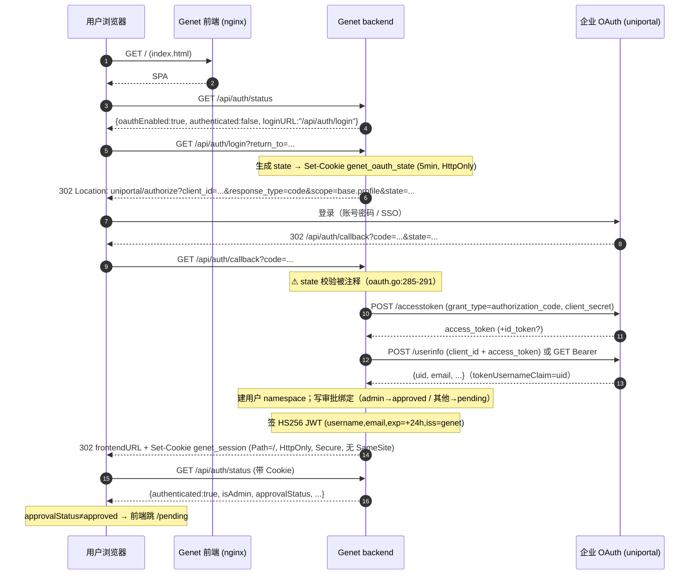
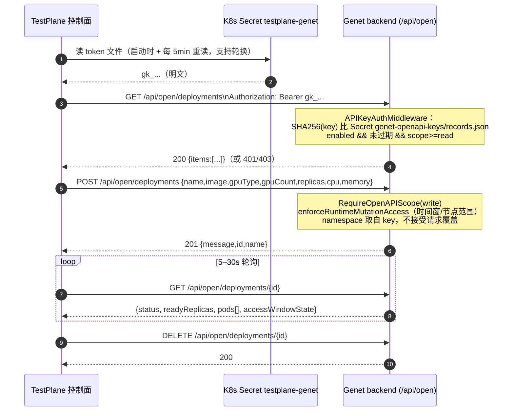

# Genet 的登录/鉴权机制，与 TestPlane 的接入方案

> 输入（只读数据）：`D:\Project\TestPalne\.data\genet`（genet 仓库克隆：Go 后端 `backend/`、React 前端 `frontend/`、`helm/`、`docs/`）、`D:\Vibe_Workspace\Pipline\E2E-Test.jenkinsfile`（真实调用方，Bearer `genet-api-key` 打 `https://genet.dev.huawei.com`）。
> 调研方式：只读代码 + 配置 + 测试，未运行 Genet、未连线上环境、未执行 git。

---

## 一句话结论

Genet **没有服务到服务的 client-credentials / PAT 体系**：它的浏览器侧是「企业 OAuth（华为 uniportal）→ 自己的 session JWT Cookie」，它的机器侧**只有一条**正规通道——`Authorization: Bearer <Open API Key>` 打 `/api/open/*`，key 由管理员在管理页创建、服务端只存 SHA256、绑定唯一 namespace；而 `genet-api-key` 就是这种 managed API key，走的正是 `APIKeyAuthMiddleware`。**TestPlane 控制面必须用 Open API Key（写进 Secret 文件），不要试图复用 Genet 的 OIDC 或会话；TestPlane 的 Web 用户应复用企业统一身份源而非 Genet，因为 Genet 当前部署 `oidcProvider.enabled: false`，且它的 OIDC Provider 只有两个硬编码 client、没有 client_credentials、userinfo 只回 `sub`。**

---

## 事实清单（带 文件:行号）

### A. 身份提供方

#### A1. 支持哪些 provider

| 问题 | 结论 | 证据 |
|---|---|---|
| GitHub / GitLab 专用 provider | **未找到**。README 声称支持，但代码里没有任何 provider 特化分支：没有 `api.github.com` / `gitlab.com` / `github.com/login/oauth` 这类端点常量，也没有 provider 名字分支 | `README.md:25`（宣称“内置 OAuth 支持（GitHub、GitLab、OIDC 等）”）vs `backend/internal/auth/oauth.go:104-148`（只有 `oidc` / `oauth` 两种模式）；对 `backend/` 全部 `.go` 搜 `api\.github\.com\|gitlab\.com\|github\.com/login/oauth\|oauth2\.google` → 命中 0 |
| OIDC（标准，自动发现） | 支持。`mode: "oidc"` 时从 `<providerURL>/.well-known/openid-configuration` 拉端点 | `backend/internal/auth/oauth.go:151-188`（`DiscoverOIDC`，拼接 `/.well-known/openid-configuration`）；`oauth.go:133-145` |
| 通用 OAuth2（手填端点） | 支持。`mode: "oauth"`，必需 `authorizationEndpoint` + `tokenEndpoint` | `backend/internal/auth/oauth.go:120-132`；`models/config.go:497-500` |
| 实际生产用的是哪一个 | **oauth 模式对接华为 uniportal**（不是标准 OIDC 发现） | `helm/genet/values.yaml:634` `mode: "oauth"`；`values.yaml:646-648` `https://uniportal.huawei.com/saaslogin1/oauth2/{authorize,accesstoken,userinfo}` |
| 本地账号（用户名/密码注册登录） | **未找到**。无 bcrypt、无 signup、无 users 表；唯一“本地”形态是 OAuth 关闭时的 dev 模式假身份 | 对 `backend/` 全部 `.go` 搜 `bcrypt\|RegisterUser\|localUser\|signup` → 命中 0；`auth/middleware.go:94-104`（dev 模式=`query ?user=` 或 `dev-user`） |

#### A1b. OIDC 配置项清单（`oauth.*` / `oidcProvider.*`）

| 配置项 | YAML key | 默认值 | 代码位置 |
|---|---|---|---|
| 开关 | `oauth.enabled` | `false` | `models/config.go:491`，默认 `config.go:1247` |
| 模式 | `oauth.mode` | `"oidc"` | `models/config.go:492`，默认 `config.go:1248` |
| **issuer** | `oauth.providerURL`（仅 oidc 模式） | `""` | `models/config.go:495`；values `http://localhost:8888/default`（`values.yaml:640`） |
| 授权端点 | `oauth.authorizationEndpoint` | `""` | `models/config.go:498` |
| token 端点 | `oauth.tokenEndpoint` | `""` | `models/config.go:499` |
| userinfo 端点 | `oauth.userinfoEndpoint` | `""` | `models/config.go:500` |
| **client_id** | `oauth.clientID` | `""` | `models/config.go:509`；values `genet_client_id`（`values.yaml:671`） |
| **client_secret** | `oauth.clientSecret` | `""` | `models/config.go:510`；values `genet_secret`（`values.yaml:672`） |
| **scopes** | `oauth.scopes` | `["openid","profile","email"]` | `models/config.go:513`，默认 `config.go:1261`；values 只有 `["base.profile"]`（`values.yaml:675-676`） |
| **回调地址** | `oauth.redirectURL` | `http://localhost:8080/api/auth/callback` | `models/config.go:511`，默认 `config.go:1259`；values `http://genet.dev.huawei.com/api/auth/callback`（`values.yaml:673`） |
| 登录后落地页 | `oauth.frontendURL` | `http://localhost:3000` | `models/config.go:512`，默认 `config.go:1260` |
| userinfo 取法 | `oauth.userinfoSource` = `endpoint`/`token`/`both` | `endpoint` | `models/config.go:503`，`oauth.go:438-486` |
| userinfo 方法 | `oauth.userinfoMethod` = `get`/`post` | `get` | `models/config.go:504`，`oauth.go:596-631` |
| 用户名字段 | `oauth.tokenUsernameClaim` | `preferred_username` | `models/config.go:505`；values 改成 `uid`（`values.yaml:665`） |
| 邮箱字段 | `oauth.tokenEmailClaim` | `email` | `models/config.go:506` |
| **role / group claim** | **未找到**。没有 `roleClaim` / `groupsClaim` 配置；`IDTokenClaims.Groups` 字段存在但**从未被填充** | `oidc/provider.go:77-85`（`Groups []string` 定义）vs `oidc/provider.go:845-858`（`generateTokens` 只填 Email/EmailVerified/PreferredUsername/Name）；`models/config.go:489-517` 全量字段清单里无 role 相关项 |
| session 签名密钥 | `oauth.jwtSecret` | `genet-jwt-secret-change-in-production` | `models/config.go:514`，默认 `config.go:1262`；values `genet-dev-jwt-secret-32chars!!`（`values.yaml:677`） |
| Cookie 域 / Secure | `oauth.cookieDomain` / `oauth.cookieSecure` | `""` / `false` | `models/config.go:515-516`；values `""` / `true`（`values.yaml:678-679`） |
| 作为 OIDC Provider 的开关 | `oidcProvider.enabled` | `false` | `models/config.go:521`，默认 `config.go:1267`；**values 里是 `false`**（`values.yaml:688`） |
| Provider issuer | `oidcProvider.issuerURL` | `""` | `models/config.go:522`；values `https://genet.dev.huawei.com`（`values.yaml:691`） |

#### A1c. 配置从哪来

| 事实 | 证据 |
|---|---|
| **只有 YAML 配置文件一条来源**，没有任何 `GENET_OAUTH_*` / `GENET_OIDC_*` 之类环境变量覆盖 | `models/config.go:1084-1115`（`LoadConfig` 只做 `os.ReadFile` + `yaml.Unmarshal`）；`models` 包完全不读 env；`backend/` 里的 `os.Getenv` 只用于日志级别/格式、`GENET_CONFIG`、`PORT`、`POD_NAMESPACE`、`KUBECONFIG`、CLI 下载目录（`cmd/api/main.go:50,54,91,283,357,748`；`internal/k8s/client.go:77`），没有一处涉及 oauth/oidc |
| 配置路径 | 环境变量 `GENET_CONFIG`，默认 `/etc/genet/config.yaml`（`cmd/api/main.go:91-95`） |
| Helm values → ConfigMap | `backend.config.oauth` / `backend.config.oidcProvider` / `backend.config.adminUsers` / `backend.config.openAPI` 渲染进 `genet-config` 的 `config.yaml` key | `helm/genet/templates/_helpers.tpl:123-136`（逐个 `toYaml`）；`helm/genet/templates/configmap-config.yaml:10-13` |
| 登录端点与静态资源的路由分层 | Ingress：`/.well-known` → backend，`/oidc` → backend，`/api` → backend，`/` → frontend | `helm/genet/templates/ingress.yaml:39-54, 95-109` |

#### A2. 授权码流程的具体路径与参数

| 环节 | 路径 / 参数 | 证据 |
|---|---|---|
| 登录入口 | `GET /api/auth/login`，可选 `?return_to=<url>`（写 cookie，5 分钟） | `cmd/api/main.go:399`；`auth/oauth.go:200-247` |
| 授权请求参数 | `client_id`、`redirect_uri=oauth.redirectURL`、`response_type=code`、`scope=<join(scopes," ")>`、`state=<32B 随机 base64>` | `auth/oauth.go:250-257` |
| state 存放 | Cookie `genet_oauth_state`（5 分钟，HttpOnly，Secure=CookieSecure，Path=/，Domain=CookieDomain） | `auth/oauth.go:227-235`；名字常量 `oauth.go:25-27` |
| 回调 | `GET /api/auth/callback`（必须等于 `oauth.redirectURL`） | `cmd/api/main.go:400`；`auth/oauth.go:265-384` |
| **state 校验** | **被注释掉了** —— 回调里实际不校验 state | `auth/oauth.go:285-291`（整段 `// 验证 state` 注释） |
| code 换取 token | `POST <tokenEndpoint>`，`grant_type=authorization_code` + `code` + `redirect_uri` + `client_id` + `client_secret`（form-encoded，非 Basic） | `auth/oauth.go:387-408` |
| 取用户信息 | 按 `userinfoSource` 决定：`endpoint`（默认，GET+`Authorization: Bearer` 或 POST JSON）、`token`（只解 JWT payload，**不验签**）、`both` | `auth/oauth.go:438-486`；不验签证据 `oauth.go:496-506` |
| 用户名取值顺序 | `preferred_username` → `name` → `sub`（claim 名可配） | `auth/oauth.go:327-333`，`oauth.go:519-582` |
| **成功后设置什么** | 只设 **一个 HttpOnly Cookie `genet_session`**，值是 Genet 自己签的 JWT；无 JWT 存 localStorage、无服务端会话表 | `auth/oauth.go:659-672`（签 JWT）、`oauth.go:361-369`（SetCookie） |
| 会话存储位置 | **无状态**：浏览器 Cookie 持有 JWT，服务端每次请求验签（`validateSessionToken`），无 session store / Redis / DB | `auth/middleware.go:46-59`、`auth/middleware.go:126-143` |
| 登录后跳转 | `oauth.frontendURL`，若带 `return_to` 则跳 `return_to`（**任意 URL，未校验同源**） | `auth/oauth.go:376-383` |
| 首次登录副作用 | 建用户 namespace/工作空间（`EnsureUserWorkspaceDir`）+ 写审批绑定记录（管理员→approved，其他→pending） | `oauth.go:340-350`；`auth/middleware.go:117-119`；`auth/approval.go:22-75` |
| 登出 | `GET /api/auth/logout`，只把 Cookie 置空（`MaxAge=-1`），**服务端不吊销 JWT**；可选 `?redirect=` | `cmd/api/main.go:401`；`auth/oauth.go:674-699` |
| 认证状态查询（公开） | `GET /api/auth/status` → `{authenticated,username,email,namespace,isAdmin,poolType,oauthEnabled,loginURL,approvalEnabled,approvalStatus,schedulingPolicy,policyStatus}` | `cmd/api/main.go:396`；`handlers/auth.go:31-45,61-137` |

#### A3. 服务到服务的鉴权方式

| 方式 | 是否存在 | 证据 |
|---|---|---|
| **client_credentials** | **不存在**。Genet 作为 OIDC Provider 只接受 `authorization_code` 与 `refresh_token` 两种 grant | `oidc/provider.go:638-649`（`switch grantType`，default 返回 `unsupported_grant_type`）；discovery 也自报 `grant_types_supported: ["authorization_code","refresh_token"]`（`provider.go:241`） |
| **Open API Key（managed API key）** | **存在，且是唯一的机器身份**。`Authorization: Bearer <key>`，只挂在 `/api/open/*` | `auth/apikey.go:20-74`；路由 `cmd/api/main.go:635-636` |
| PAT / 个人令牌 | 未找到（无 PAT 概念，无 `/tokens` 端点） | — |
| CLI 令牌（OAuth device/loopback + PKCE） | 存在，但要**先有浏览器**：`start→浏览器 complete→exchange` 拿 15 分钟 JWT + 30 天 refresh | `handlers/cli_auth.go:33-167`；`auth/cli.go:16-19,29-47` |
| 代理注入头 `X-Auth-Request-User` | **存在且无条件信任**（用来兼容 oauth2-proxy） | `auth/middleware.go:61-74`；`docs/ARCHITECTURE.md:151,157-159` |

**`genet-api-key` 在 Genet 侧到底怎么校验的（完整链路）：**

1. 请求进 `/api/open/*` 组 → `openAPI.Use(auth.APIKeyAuthMiddleware(config, k8sClient))`（`cmd/api/main.go:635-636`）。
2. 中间件先看开关：`config.OpenAPI.Enabled == false` → **403** `{"error":"Open API is not enabled"}`（`auth/apikey.go:31-35`）。当前 chart 是 `enabled: true`（`helm/genet/values.yaml:740-741`）。
3. 取 `Authorization` 头，必须以 `Bearer ` 开头且非空，否则 **401** `{"error":"Missing or invalid Authorization header"}`（`auth/apikey.go:37-49`）。
4. 拿明文 key 去 k8s 查：`k8sClient.FindOpenAPIKeyByPlaintext`（`auth/apikey.go:22-24`）。
5. 落到 **Secret `genet-openapi-keys`（namespace `genet-openapi`, data key `records.json`）**，反序列化成 `[]APIKeyRecord`（`k8s/apikeys.go:24-29, 40-59`）。
6. **比对方式：SHA256(明文) == rec.KeyHash，constant-time 比较**（`k8s/apikeys.go:454-472`）。注意不是环境变量、不是固定字符串、不是 Basic。
7. 记录必须 `Enabled && (ExpiresAt 为空 或 未过期)`，否则 401（`k8s/apikeys.go:474-486`）。
8. 通过后把 key 的身份写进 context：`openapiKeyID`、`openapiNamespace`（key 绑定的固定 namespace）、`openapiPoolType`、`openapiScope`、`username = record.OwnerUser`、Pod/GPU 配额（`auth/apikey.go:93-130`）。
9. 每个端点再按 scope 卡：`RequireOpenAPIScope(read|write)`，越权 **403** `{"error":"forbidden: insufficient scope"}`（`auth/apikey.go:76-91`；路由上逐条挂 `cmd/api/main.go:638-739`）。
10. 兼容旧静态 key：`openAPI.apiKeys` 里的明文在**启动时**被幂等迁移成 managed 记录（带独立 namespace/调度策略），请求路径**只认** managed lookup，绝不回退到控制命名空间（`k8s/legacy_apikey_migration.go:23-41`；`auth/apikey.go:16-19` 注释）。当前 chart `apiKeys: []` 为空（`values.yaml:744`）。
11. key 明文本身怎么生成/恢复：**`gk_` + 48 位 hex**（24 字节随机，`handlers/admin.go:1766-1772`）；记录 ID 才是 `ak_<unixNano>_<12hex>`（`handlers/admin.go:1774-1779`）。落库时 `KeyHash`+`KeyPreview(前 12 字符)`+`EncryptedKey`（AES-GCM，密钥=`sha256(openAPI.encryptionKey || oauth.jwtSecret)`）（`handlers/apikey_cipher.go:17-37,70-87`；`handlers/admin.go:1204-1222`）。

**真实调用方对照（`E2E-Test.jenkinsfile`）——它用的就是上面第 1–9 步的路径：**

| 事实 | 证据 |
|---|---|
| base 地址 `https://genet.dev.huawei.com` | `E2E-Test.jenkinsfile:16`（另一处 `:161`） |
| 凭据 ID 就是 `genet-api-key`（Jenkins `StringCredentials`，即“一个明文串”） | `E2E-Test.jenkinsfile:21-22`（`:159` 重复） |
| 用法就是 `Authorization: Bearer <cred.secret.plainText>` + `accept: application/json` | `E2E-Test.jenkinsfile:24-25`（`:164-165` 重复） |
| `curl -k`：因为它打的是自签证书 | `E2E-Test.jenkinsfile:24`；`helm/genet/values.yaml:1075` |
| 打的是读接口 `/api/open/registry/tree?limit=1000`（read scope 足够） | `E2E-Test.jenkinsfile:39` |
| 它**没有**任何登录/换 token 逻辑：没有 `/api/auth/*`、没有 `/api/cli/auth/*`、没有 Cookie | 全文只有 `Authorization: Bearer` 一种认证写法 |

---

### B. 会话与令牌

#### B4. Token 格式 / 签名 / 有效期 / 刷新 / 登出

| 用途 | 格式 | 签名 | 有效期 | 刷新 | 登出 | 证据 |
|---|---|---|---|---|---|---|
| 浏览器会话 `genet_session` | JWT（claims: `username`,`email` + `exp`,`iat`,`iss="genet"`） | **HS256**，密钥 `oauth.jwtSecret` | **24h**（`SessionDuration`） | **无**。到期只能重新走授权码 | 清 Cookie，**不吊销** | `auth/oauth.go:84-89, 658-672`；常量 `oauth.go:30`；`auth/middleware.go:126-143` |
| CLI access token `cli_access` | JWT（`username`,`email`,`sessionId`,`tokenType="cli_access"`,`iss="genet-cli"`） | HS256，同一 `jwtSecret` | **15 分钟** | 有：`POST /api/cli/auth/refresh`，refresh token 旋转 | `POST /api/cli/auth/logout`（吊销 refresh 记录） | `auth/cli.go:16-64`；`handlers/cli_auth.go:169-232` |
| CLI refresh token | **不透明随机串**（64 hex），服务端存 SHA256 | — | **30 天** | 每次 refresh 换新（rotate） | 同上 | `handlers/cli_auth.go:17,148-159`；`k8s/cli_auth_store.go:22-23`（Secret `genet-cli-refresh-sessions`） |
| OIDC Provider `id_token` | JWT，RS256，带 `kid`；claims 含 `email`,`email_verified`,`preferred_username`,`name`,`nonce` | RSA-2048，`oidcProvider.rsaPrivateKey`（留空则启动随机生成，**重启即换**） | **1h** | — | — | `oidc/provider.go:844-862`；`oidc/keys.go:28-45,131-138`；风险提示 `provider.go:138` |
| OIDC Provider `access_token` | JWT，RS256，只含 `iss/sub/aud/exp/iat` | 同上 | 1h | — | — | `oidc/provider.go:864-874` |
| OIDC Provider `refresh_token` | 不透明串，**进程内存 map**（重启全丢） | — | 24h | 旋转（旧的仍留在 map 里直到过期） | 未找到 revoke 端点 | `oidc/provider.go:49-51, 876-887`；`provider.go:156-189`（5 分钟清理 goroutine） |
| Open API Key | 不透明 `gk_<48 位 hex>`（= `gk_` + 24 字节随机，51 字符） | 不适用（服务端只存 SHA256） | 默认无限期，可设 `expiresAt` | **无**，只能重建/轮换 | 删除或 `enabled=false` | `handlers/admin.go:1766-1772`；`k8s/apikeys.go:454-486` |

补：`ValidateSession` 用 `jwt.ParseWithClaims` 默认选项，**只验 HS256 + exp**，不校验 `iss`/`aud`（`auth/oauth.go:701-719`）。

#### B5. Cookie 属性与 CSRF

| 项 | 值 | 证据 |
|---|---|---|
| `genet_session` name | `genet_session` | `auth/oauth.go:25` |
| Path | `/` | `auth/oauth.go:365` |
| Domain | `oauth.cookieDomain`（默认 `""` = host-only） | `auth/oauth.go:366`；默认 `models/config.go:1263` |
| Secure | `oauth.cookieSecure`（chart 里 `true`） | `auth/oauth.go:367`；`values.yaml:679` |
| **HttpOnly** | `true`（硬编码） | `auth/oauth.go:368` |
| **SameSite** | **未显式设置**（Go 不输出该属性 → 现代浏览器按 `Lax` 处理） | `auth/oauth.go:361-369`（`c.SetCookie` 无 SameSite 参数） |
| `state` / `return_to` cookie | `genet_oauth_state` / `genet_oauth_return_to`，300 秒，HttpOnly | `auth/oauth.go:26-27, 227-247` |
| OIDC Provider state cookie | `genet_oidc_state`，300 秒，HttpOnly，内容是 base64(JSON{client_id,redirect_uri,scope,state,nonce}) | `oidc/provider.go:26, 296-312` |
| **CSRF 防护** | **未找到**。后端无 CSRF token、无 `X-CSRF-Token` 校验、无 Origin/Referer 检查；唯一沾边的是 OAuth `state`，但回调校验被注释。业务写操作（`POST/PUT/DELETE /api/*`）只靠 Cookie，理论上可被跨站表单打 | 全仓 `grep -i csrf backend` **命中 0**；`auth/oauth.go:285-291`（state 校验注释） |
| CORS | `AllowOrigins: ["*"]` + `AllowCredentials: true` + 允许 `Authorization`/`X-Auth-Request-User`/`X-Auth-Request-Email` 头 | `cmd/api/main.go:369-375` |

#### B6. 角色 / 权限模型

| 层 | 模型 | 怎么判定 | 证据 |
|---|---|---|---|
| **应用角色** | 只有两种：`admin` / 普通用户。**没有 viewer/operator/admin 三级** | `IsAdmin`：`config.adminUsers` 白名单，逐项与 `username` **或** `email` 精确相等 | `auth/admin.go:12-31`；`models/config.go:119`；values 里是三个工号 `y00961166` 等（`values.yaml:729-732`） |
| **OIDC groups → role 映射** | **未实现**。ID Token 不填 `groups`，后端也不读 groups 做鉴权 | `oidc/provider.go:77-85` vs `provider.go:845-858`；`auth/admin.go:12-31` 里只有 username/email |
| 第二道闸：审批 | `approved` / `pending` / `rejected`，挂在 `UserPoolBinding` 记录上；`ApprovalGate` 拦非 approved 用户 | `auth/approval.go:119-183`；状态常量与错误码 `approval.go:15-20`；首登自动登记 `approval.go:22-75`；开关 `config.go:1388-1398`（OAuth 关闭时永不强制） |
| 第三道闸：资源池 | `poolType` = `shared` / `exclusive` / `baremetal`；决定调度策略、配额、可用节点 | `auth/apikey.go:105-108`；`handlers/auth.go:74-97` |
| 第四道闸：访问时间窗 / 节点范围 | 每个 subject（用户或 API key）一份 `SchedulingPolicy`（`nodeScope` + `accessWindow` + `allowedNodeNames`）；窗口外拒写 | `handlers/runtime_policy.go:25-44`；`schedulingpolicy/policy.go:55-70`；准入侧同款文案 `admission/webhook.go:696-698` |
| **哪些 API 要什么权限** | | | |
| 公开（无鉴权） | `/health`、`/api/config`、`/api/cluster/info`、`/api/cluster/gpu-overview`、`/api/cluster/devices/*`、`/api/cluster/queues`、`/api/auth/login`、`/api/auth/callback`、`/api/auth/logout`、`/api/auth/status`、CLI 下载、`/.well-known/*`、`/oidc/*` | `cmd/api/main.go:378-380, 395, 399-404, 421-424, 383-388` |
| 需要身份 + 审批 | 所有业务组：`/api/pods*`、`/api/statefulsets*`、`/api/deployments*`、`/api/images*`、`/api/history*`、`/api/workload-templates*`、`/api/helm*`、`/api/registry*`、`/api/model-browser*`、`/api/kubeconfig*`、`/api/cluster/storage-classes` | `cmd/api/main.go:425-429, 466-467, 478-479, 495-496, 503-504, 509-510, 520-521, 580-581, 589-590, 596-597` |
| 需要 admin | `/api/admin/*`（含 apikeys 管理、用户审批、节点池） | `cmd/api/main.go:600-601`；`auth/admin.go:33-58` |
| 需要 API key + scope | `/api/open/*`（read：GET；write：POST/PUT/DELETE） | `cmd/api/main.go:635-739`；`auth/apikey.go:76-91,132-143` |
| 注意 | 业务端点**不做 401**：`AuthMiddleware` 只填 context，缺身份时 username 为空，后续按空用户名派生 namespace（`user-`「幽灵」命名空间）继续执行，不是 fail-closed。真正的 401 只出现在 `RequireAuth`（仅被 `RequireAdmin` 调用）与 CLI/Open API 通道 | `auth/middleware.go:110-121, 164-174`；`handlers/request_context.go:88-92`；`k8s/naming.go:15-46` |

---

### C. 调用方视角

#### C7. 无浏览器客户端怎么调（最稳的一条）

**用 Open API Key 打 `/api/open/*`。** 理由：它是唯一为机器设计的通道（不依赖 Cookie、不依赖浏览器、不需要先做一次交互登录、key 可设过期、可只给 read scope、可用管理员随时删除）。

```bash
# 0) 准备：key 明文由 Genet 管理员在「管理页 → API Keys」创建（或历史静态 key 迁移而来），
#    形如 gk_1a2b3c4d5e6f...（gk_ + 48 位 hex，见 handlers/admin.go:1766-1772）
export GENET_BASE="https://genet.dev.huawei.com"
export GENET_API_KEY="$(cat /etc/testplane/genet/token)"   # 从 Secret 文件读，不走 env 明文

# 1) 冒烟：读接口（read scope 即可）
curl -sS --cacert /etc/testplane/genet/ca.crt \
  -H "Authorization: Bearer ${GENET_API_KEY}" \
  -H "accept: application/json" \
  "${GENET_BASE}/api/open/deployments"

# 2) 建服务（write scope；namespace 由 key 固定，请求里不要也不能指定）
curl -sS --cacert /etc/testplane/genet/ca.crt \
  -X POST "${GENET_BASE}/api/open/deployments" \
  -H "Authorization: Bearer ${GENET_API_KEY}" \
  -H "accept: application/json" \
  -H "Content-Type: application/json" \
  -d '{
        "name": "tp-run-20261105-0001",
        "image": "registry.dev.huawei.com/models/qwen3:32b",
        "gpuType": "NVIDIA A100",
        "gpuCount": 1,
        "replicas": 1,
        "cpu": "8",
        "memory": "32Gi"
      }'
# → 201 {"message":"Deployment 创建成功","id":"deploy-...","name":"deploy-..."}

# 3) 轮询状态（无 watch/SSE，必须轮询）
curl -sS --cacert /etc/testplane/genet/ca.crt \
  -H "Authorization: Bearer ${GENET_API_KEY}" \
  "${GENET_BASE}/api/open/deployments/<id>"

# 4) 删除
curl -sS --cacert /etc/testplane/genet/ca.crt \
  -X DELETE -H "Authorization: Bearer ${GENET_API_KEY}" \
  "${GENET_BASE}/api/open/deployments/<id>"
```

必需 header 只有两个：`Authorization: Bearer <key>` + `accept: application/json`（POST/PUT 再加 `Content-Type: application/json`）。**不要**指望 `X-Auth-Request-User`（那是给代理用的，见 D 段风险）。`--cacert` 而非 `-k`：当前 chart 用 `clusterIssuer: selfsigned-issuer`（`helm/genet/values.yaml:1075`），真实调用方 Jenkinsfile 用 `curl -k`（`E2E-Test.jenkinsfile:24`），生产应装 CA。

证据：路由与 scope `cmd/api/main.go:635-654`；请求体 schema 与示例 `backend/api/openapi.yaml:414-470`；响应 `openapi.yaml:3319-3333`；认证方案声明 `openapi.yaml:17-22, 2315-2319`。

#### C8. 浏览器里的人登录 Genet 的完整跳转链

```
人 → TestPlane/Genet 前端页面
  1. GET https://genet.dev.huawei.com/                      → frontend（ingress.yaml:103-109）
  2. 前端 GET /api/auth/status                              → {oauthEnabled:true, authenticated:false, loginURL:"/api/auth/login"}
                                                            （handlers/auth.go:133-135）
  3. 前端 window.location.assign("/api/auth/login")          （frontend/src/services/api.ts:50-56；App.tsx:44-46）
  4. GET /api/auth/login                                    → 302 到 uniportal authorize
     ?client_id=genet_client_id&redirect_uri=<oauth.redirectURL>
     &response_type=code&scope=base.profile&state=<32B>       （auth/oauth.go:200-262）
     同时 Set-Cookie genet_oauth_state（5min, HttpOnly）
  5. 用户在 uniportal 输账号密码 / SSO                       （外部系统，Genet 不参与）
  6. 302 回 /api/auth/callback?code=...&state=...
  7. Genet: POST uniportal /accesstoken（code+client_secret）→ access_token
                                                                 （auth/oauth.go:387-435）
  8. Genet: POST uniportal /userinfo（body 带 client_id+access_token+scope）
     或 GET + Authorization: Bearer                        → 取 uid/email
                                                                 （auth/oauth.go:584-656，values 用 post + uid）
  9. Genet: 建用户工作空间 + 写审批绑定（管理员→approved，其他→pending）
                                                                 （oauth.go:340-350；approval.go:22-75）
 10. Set-Cookie genet_session=<HS256 JWT 24h>; Path=/; HttpOnly; Secure
                                                                 （auth/oauth.go:361-369）
 11. 302 到 oauth.frontendURL（或 return_to）                   （oauth.go:376-383）
 12. 前端再 GET /api/auth/status → authenticated:true, approvalStatus
     pending/rejected → 前端跳 /pending；admin → 显示管理页
                                                                 （App.tsx:55-66；PendingApproval/index.tsx:38-39）
```

#### C9. API 前缀与错误形状

| 项 | 结论 | 证据 |
|---|---|---|
| 路径前缀 | 业务 API 全在 `/api`；机器通道在 **`/api/open`**；OIDC Provider 在 `/oidc`（`/oidc/authorize`、`/oidc/token`、`/oidc/userinfo`、`/oidc/jwks`）与根级 `/.well-known/openid-configuration` | `cmd/api/main.go:391, 635, 199-209`；`oidc/provider.go:196-217` |
| 成功响应形状 | 不统一：有的直接对象/数组，有的包 `{items:[...]}`，有的 `{message,id,name}` | `openapi.yaml:3319-3388`；`handlers/access_window.go:64` |
| **错误响应形状** | **`{"error": "<人类可读文案>"}`**（中文为主）。**没有**数字错误码、没有 `code` 字段、没有 RFC7807 problem+json | `auth/middleware.go:170`；`auth/apikey.go:39-71`；`handlers/runtime_policy.go:31-42`；`openapi.yaml:4398-4454`（`Error: {error: string}`） |
| 401 返回什么 | `{"error":"Missing or invalid Authorization header"}` / `{"error":"Invalid API key"}` / `{"error":"未授权：缺少用户信息"}`（OIDC 端点是 `{"error":"invalid_token","error_description":"..."}`） | `auth/apikey.go:39,46,61,71`；`auth/middleware.go:170`；`oidc/provider.go:905-908,924-927` |
| 403 返回什么 | `{"error":"Open API is not enabled"}`、`{"error":"forbidden: insufficient scope"}`、`{"error":"forbidden: admin access required"}`、`{"error":"当前不在资源访问时间窗口内","nextTransitionAt":"..."}`、`{"error":"节点 X 不在当前调度策略的有效节点范围内"}`、`{"error":"审批...","errorCode":"..."}` | `auth/apikey.go:32,85`；`auth/admin.go:50`；`handlers/runtime_policy.go:38-42,75`；`auth/approval.go:160-177` |
| **errorCode 枚举（唯一存在的枚举）** | `approval_pending` / `approval_rejected` / `approval_unavailable`（仅审批闸用，挂在 403/503 上；前端据此跳 `/pending`） | `auth/approval.go:15-20,144-177`；`frontend/src/services/api.ts:85-92` |
| 其他状态码 | 400（参数错）、404（`{"error":"Pod 不存在"}`）、409（冲突/有进行中的 commit）、424（Helm chart repo 未配置，`{"error":"Helm Chart 仓库未配置"}`）、500、503（审批状态不可用） | `handlers/openapi.go:286-299`；`handlers/helm.go:100`；`openapi.yaml:4410-4454`；`auth/approval.go:144-148` |
| 公开的探测端点 | `GET /health` → `{"status":"healthy"}`；`GET /api/config`（配额/GPU 类型/存储卷等）；`GET /api/cluster/info` | `cmd/api/main.go:378-380,395,421`；`handlers/config.go:28-49` |

---

### D. 给 TestPlane 的结论

#### D10. 两种调用方分别怎么鉴权

**现状前提（来自 TestPlane 自己的设计，必须对齐）**：设计已经把「Web 用户」和「Jenkins/Agent/CLI」分成两套（`design/views/07-api.md:29-34`），并已定下 `TESTPLANE_OIDC_*` 与 `TESTPLANE_GENET_BASE_URL/_TOKEN_FILE/_TIMEOUT`（`design/impl/web-and-delivery.md:350-354`；`design/impl/control-plane.md:867-870`）。本调研只补「对 Genet 那一跳」的答案。

| 调用方 | 对 Genet 用哪种 | 为什么 |
|---|---|---|
| **TestPlane 控制面 / CLI（服务端）** | **Genet Open API Key**（`Authorization: Bearer <key>`，打 `/api/open/*`） | 唯一为机器设计、无浏览器依赖、可轮换可删除的通道；且 `/api/open` 已覆盖 TestPlane 需要的 deployment 生命周期与 registry/helm 读接口（`main.go:645-654, 684-687, 694-739`） |
| **TestPlane Web 用户（浏览器）** | **不直连 Genet**。TestPlane 自己做 OIDC client，IdP 用**企业统一身份源**（华为 uniportal / 公司 OIDC），与 Genet 平级复用同一身份源 | TestPlane 的 API 是 `/api/v1/*`，与 Genet 的会话 Cookie 无关；把 Genet 当 IdP 会引入硬编码 client 白名单、无 groups、`enabled:false` 三重障碍（见 D10 备选 B） |

**方案 A（推荐）：控制面用 Open API Key + Web 用户复用企业 OIDC**

- TestPlane 控制面：`genet` 客户端只认一个 baseURL + 一个从文件读的 Bearer key；无 key 时启动即失败（fail fast，别静默降级）。
- TestPlane Web：`/auth/login` → 企业 OIDC（authorization code + PKCE）→ 自己的 `tp_session` Cookie（`HttpOnly; Secure; SameSite=Lax`），角色从 `groups` claim 映射。这正是 `design/views/07-api.md:31-34` 已经写下的。
- 两边**不共享令牌**：Genet 的 key 永远不出 TestPlane 服务端进程；浏览器永远拿不到 key。
- 取舍：**优点** 零耦合、Genet 侧只需管理员发一个 key；key 泄露只影响那一个 namespace；不需要 Genet 改代码。**代价** 要跟 Genet 管理员约定 key 的 namespace/pool/scope，且 key 的调度策略（时间窗/节点范围）会直接卡住 TestPlane 的部署（见风险 R6）。

**方案 B（备选，若公司要求"只认 Genet 一个入口"）：把 Genet 当 OIDC IdP**

- TestPlane 做 OIDC client，`issuer = https://genet.dev.huawei.com`，走标准 discovery（`oidc/provider.go:219-245`），`client_id/secret` 用 Genet 的 `oauth.clientID/Secret`（**没有动态注册**，只有白名单两个 client：`oidcProvider.kubernetesClientID` 与 `oauth.clientID`，见 `provider.go:283-290`）。
- 阻塞点（三条，任一都足以否掉）：
  1. **当前部署 `oidcProvider.enabled: false`**（`helm/genet/values.yaml:688`），端点在线上不存在；
  2. **没有 client_credentials**，浏览器无法做 S2S，控制面仍然要另找凭据（`provider.go:638-649`）；
  3. **`/oidc/userinfo` 只返回 `sub`/`name`/`preferred_username`，email 与 groups 都没有**（`provider.go:947-954`），`id_token` 有 email 但 **groups 恒为空**（`provider.go:845-858`）→ TestPlane 的 `viewer/operator/admin` 三级映射拿不到输入。
- 取舍：**优点** 用户只登一次 Genet。**代价** 需要 Genet 出改造（注册 client、补 groups claim、开 `oidcProvider`），跨团队排期；且把登录可用性绑在 Genet 上（Genet 挂 = TestPlane 不能登录）。

**方案 C（明确不推荐）：复用 `X-Auth-Request-User` 头**

- 代码无条件信任该头（`auth/middleware.go:61-74`），Ingress 也没有剥离注解（`helm/genet/templates/ingress.yaml:7-20` 只有 timeout 注解）→ 能直连 backend 的人可自封任意用户（包括 `adminUsers` 里的人）。
- 只有一种情况下可用：TestPlane 与 Genet 都在同一个可信网关之后，且网关**强制覆盖**这两个头。即便这样也建议先让 Genet 侧修。

**方案 D（不成立）：给 TestPlane 发一个 client_credentials 客户端**

- Genet 没有这个 grant（`provider.go:638-649`），也没有 client 注册表。要实现得改 Genet 代码，不属于"接入"。

#### D11. TestPlane 侧需要的配置项与 Secret

**环境变量（与现有设计同名前缀，只加 Genet 那一组）**

| env | 必填 | 含义 | 备注 |
|---|---|---|---|
| `TESTPLANE_GENET_BASE_URL` | 是 | Genet 根地址，如 `https://genet.dev.huawei.com`（不带 `/api`） | 已设计于 `web-and-delivery.md:354` |
| `TESTPLANE_GENET_TOKEN_FILE` | 是 | 存放 API key 明文的文件路径，如 `/etc/testplane/genet/token` | 设计明确"令牌用文件而非 env"（同上一行）；每 5min 重读以支持轮换 |
| `TESTPLANE_GENET_TIMEOUT` | 否 | 单次 HTTP 超时，默认 `30s` | 与 `TESTPLANE_DEPLOY_TIMEOUT=72h` 是两回事 |
| `TESTPLANE_GENET_CA_FILE` | 否 | 自签 CA 路径；不设则用系统信任链 | 对应 `helm/genet/values.yaml:1075` 的 selfsigned issuer |
| `TESTPLANE_GENET_NAMESPACE` | 否（建议要） | 该 key 绑定的 namespace，用于启动自检（`GET /api/open/deployments` 200 即认为 key+scope+可达都 OK） | namespace 由 key 决定，请求里无法覆盖（`auth/apikey.go:104`） |
| `TESTPLANE_OIDC_ISSUER` / `_CLIENT_ID` / `_CLIENT_SECRET` | 是（Web 登录） | 企业 IdP；`_CLIENT_SECRET` 来自 Secret | 已设计 `web-and-delivery.md:350` |
| `TESTPLANE_OIDC_SCOPES` / `_ROLE_CLAIM` | 否 | 默认 `openid profile email groups` / `groups` | 已设计 `web-and-delivery.md:351` |
| `TESTPLANE_AUTH_MODE` | 是 | `oidc`；`dev` 仅 dev | 已设计 `web-and-delivery.md:353` |

**Secret**

| Secret | key | 内容 | 消费者 |
|---|---|---|---|
| `testplane-genet` | `token` | Genet Open API Key 明文（`gk_...`） | 控制面，挂成文件到 `TESTPLANE_GENET_TOKEN_FILE` |
| `testplane-genet` | `ca.crt`（可选） | Genet 入口 CA | 控制面 |
| `testplane-oidc` | `client_secret` | 企业 IdP 的 client secret | 控制面登录流程 |

**不要存的东西**：Genet 的 `genet_session` Cookie、用户的 uniportal 密码、任何 `oauth.jwtSecret` / `oidcProvider.rsaPrivateKey`（这些是 Genet 自己的密钥，TestPlane 不该持有）。

#### D12 之外的落地注意（写给实现的人）

- 幂等：Genet OpenAPI **没有幂等头**（TestPlane 自己的 E-Q1 也记着这点，`design/impl/execution.md:452`）→ 创建重试前先用 `GET /api/open/deployments` 按 `name` 查一遍，别裸重试。
- 状态获取：OpenAPI 无 watch/SSE → 只能轮询 `GET /api/open/deployments/{id}`，字段 `status`、`readyReplicas`、`pods[]`、`accessWindowState`（`openapi.yaml:3335-3380`）。建议 5–10s 一次、指数退避到 30s。
- 命名：`id` 就是 Deployment 名，不是 UID（`openapi.yaml:3326-3333`），可以直接当幂等键用。
- 403 的两种语义要分开处理：「scope 不够」是配置错（不可重试），「时间窗关闭」是业务拒绝（可等待，带 `nextTransitionAt`）（`handlers/runtime_policy.go:38-42`）。
- `Warning` 头：observe 模式下 Genet 会回 `Warning: 299 Genet "accessPolicy observe mode..."`（`handlers/runtime_policy.go:27`），建议 TestPlane 记日志但不据此改行为。

---

## 时序/流程

### 流程 1：Genet 浏览器登录（现状）



### 流程 2：TestPlane 控制面调 Genet（推荐路径）



### 流程 3：三条身份链的关系

```mermaid
flowchart LR
    subgraph 人
      B1[浏览器] -->| authorization_code + PKCE | IDP[企业 OIDC / uniportal]
      IDP -->| id_token | TP[TestPlane 控制面]
      TP -->| tp_session Cookie | B1
    end
    subgraph 机器
      CI[Jenkins / CLI / Agent] -->| Bearer JWT (统一身份源签发) | TP
      TP -->| Bearer Open API Key | G[Genet /api/open/*]
    end
    subgraph Genet自己的链
      B1b[浏览器] -->| authorization_code | IDP
      IDP -->| access_token | G2[Genet backend]
      G2 -->| genet_session JWT Cookie | B1b
      G2 -.->| 可选,当前关闭 | OIDCP[Genet 内置 OIDC Provider /oidc/*]
      OIDCP -.->| RS256 id_token | K8S[K8s API Server]
    end
    TP -.->| 不在链上 | G2
```

> 关键：TestPlane 与 Genet **只在最后一条箭头（机器 Bearer key）上耦合**，浏览器侧的两条链互不相干。

---

## 给 TestPlane 的接入方案（推荐 + 备选 + 取舍）

| # | 方案 | Web 用户 | 控制面/CLI | 要不要自研 OIDC | 工作量 | 风险 | 结论 |
|---|---|---|---|---|---|---|---|
| A | **双通道分离**：Web 复用企业 IdP，控制面用 Genet Open API Key | TestPlane 自己做 OIDC client（企业 IdP） | `Bearer <Open API Key>` → `/api/open/*` | 要（但这就是 `07-api.md` 已定的设计） | 中（登录 + 会话 + CSRF + RBAC 本来就要做） | 低 | **推荐** |
| B | **单一身份源 = Genet** | TestPlane 做 Genet 的 OIDC client | 仍需 Open API Key（Genet 无 client_credentials） | 要（同 A） | 中 + 依赖 Genet 改造 | 高（`oidcProvider.enabled:false`、无 groups、client 白名单硬编码） | 备选，仅当公司强制 |
| C | **代理头透传** | 不需要（网关已认证） | `X-Auth-Request-User` | 不要 | 低 | 极高（头可伪造、无审计、可自封 admin） | 不推荐 |
| D | **client_credentials** | — | Genet 发 client_secret | 不要 | 需改 Genet | — | 不成立 |

### 推荐方案 A 的落地细节

1. **控制面只依赖 `/api/open/*`**：把 Genet 客户端收敛到一个 `internal/genet` 包，唯一出口函数 `do(method, path, body)`，统一注入 `Authorization` 与 `accept`，统一把 `{"error":...}` 映射成 TestPlane 的错误码。这也解决了 `design/impl/execution.md:334` 说的"契约未定，全收敛在 `genet/dto.go`"。
2. **key 用文件而非 env**：`TESTPLANE_GENET_TOKEN_FILE` + fsnotify/定时重读（`web-and-delivery.md:354` 已定），轮换时不用重启。
3. **启动自检**：`GET /api/open/deployments` 200 → ready；401 → `GENET_AUTH_FAILED`（不可重试，直接 CrashLoop 让 SRE 看见）；403 → `GENET_FORBIDDEN`（key 没权限/时间窗关闭）。
4. **不代理 Genet 的登录**：TestPlane 前端永远不出现 Genet 的登录页；如果产品上需要"点一下去 Genet 看详情"，用 `https://genet.dev.huawei.com/` 外链新标签即可（用户自己那份 Genet 会话独立）。
5. **Web 侧按 `07-api.md:31-34` 做**：`/auth/login` → 企业 OIDC（PKCE）→ `tp_session`（`HttpOnly; Secure; SameSite=Lax; Path=/`）+ 写操作 `X-CSRF-Token` 双提交。**这恰好补上 Genet 缺的两块**（SameSite、CSRF），说明 TestPlane 的 Web 鉴权必须自建，不能照抄 Genet。

---

## 需要的配置与 Secret（可直接抄进 chart）

```yaml
# values.yaml 片段（TestPlane 侧）
config:
  authMode: oidc                      # TESTPLANE_AUTH_MODE
  oidc:
    issuer: "https://<企业IdP issuer>" # TESTPLANE_OIDC_ISSUER
    clientId: "testplane"              # TESTPLANE_OIDC_CLIENT_ID
    scopes: "openid profile email groups"
    roleClaim: "groups"
    existingSecret: testplane-oidc     # key: client_secret
  genet:
    baseUrl: "https://genet.dev.huawei.com"   # TESTPLANE_GENET_BASE_URL
    tokenFile: "/etc/testplane/genet/token"   # TESTPLANE_GENET_TOKEN_FILE
    caFile: "/etc/testplane/genet/ca.crt"     # TESTPLANE_GENET_CA_FILE（可选）
    timeout: "30s"                            # TESTPLANE_GENET_TIMEOUT
    namespace: "genet-open-api-<team>"        # TESTPLANE_GENET_NAMESPACE：仅自检用
    existingSecret: testplane-genet           # key: token、ca.crt
```

Secret（`kubectl create secret generic` 创建，chart 不生成明文 —— 与 `design/views/06-physical-view.md:52` 一致）：

| Secret | key | 值来源 |
|---|---|---|
| `testplane-genet` | `token` | Genet 管理员在 Genet 管理页创建 API Key 后一次性拷出（形如 `gk_...`） |
| `testplane-genet` | `ca.crt` | `kubectl get secret genet-tls -n <ns> -o jsonpath='{.data.tls\.crt}' \| base64 -d`（或公司 CA） |
| `testplane-oidc` | `client_secret` | 企业 IdP 侧为 TestPlane 注册的 client secret |

---

## 未确认项与风险

### 未确认（必须去现场/找 Genet 团队确认）

| # | 未确认项 | 为什么重要 | 怎么确认 |
|---|---|---|---|
| U1 | **线上 `openAPI.enabled` 是否真的为 true** | 代码/values 显示 true（`values.yaml:740-741`），但 `false` 时所有 `/api/open/*` 直接 403（`auth/apikey.go:31-35`），TestPlane 全盘不可用 | `curl -i https://genet.dev.huawei.com/api/open/deployments -H "Authorization: Bearer x"`，看是 401（通了但 key 错）还是 403 `Open API is not enabled` |
| U2 | **线上 `oidcProvider.enabled`**（values 里是 `false`，`values.yaml:688`） | 决定方案 B 是否还有一线可能；若为 true，还要确认 issuer 可被集群外访问 | `curl https://genet.dev.huawei.com/.well-known/openid-configuration` |
| U3 | **现有 `genet-api-key` 的 scope / 绑定 namespace / 过期时间 / 调度策略** | write key 与 namespace 是 1:1，同一 namespace 只能有一个 active write key（`k8s/apikeys.go:287-308`、`88-90`）；如果 Jenkins 那条 key 已占用某 namespace，TestPlane 再申请同 namespace 的 write key 会失败 | Genet 管理页 → API Keys，看 `namespace`/`scope`/`expiresAt`；或问管理员 |
| U4 | **key 的时间窗/节点范围** | `write` key 建 Deployment 会被 `enforceRuntimeMutationAccess` 卡（`handlers/openapi.go:365`）；当前 chart 是 `observe` 模式（`helm/genet/values.yaml:145` `enforcementMode: observe`）所以暂时不拦，**改成 enforce 后会拦** | 看管理页 key 详情的 `schedulingPolicy`；确认 accessPolicy 模式 |
| U5 | **Deployment 的 `status` 枚举值**（OpenAPI 里是自由 string，`openapi.yaml:3344-3345`） | TestPlane 要做状态映射（`running`/`pending`/`failed`…），取值集合没文档化 | 实测创建一个 deployment，连续轮询记录 `status` 变化；或读 `internal/models/deployment.go` 的常量 |
| U6 | **创建 Deployment 的幂等语义** | 无幂等头（`design/impl/execution.md:452` E-Q1 未解），重试必重复建 | 实测同名 POST 两次的返回（409 还是覆盖） |
| U7 | **是否有 OpenAPI 侧的"删除后清理产物"** | TestPlane 需要 `cleanup.policy=delete`，但 OpenAPI 只有 `DELETE /deployments/:id`，没有 PVC/产物清理端点 | 确认 Genet 是否把 PVC 随 Deployment 删；否则要求补端点 |
| U8 | **`genet.dev.huawei.com` 的证书链** | `clusterIssuer: selfsigned-issuer`（`helm/genet/values.yaml:1075`）+ Jenkinsfile 用 `curl -k`（`E2E-Test.jenkinsfile:24`）→ TestPlane 默认 TLS 校验会失败 | `curl -v https://genet.dev.huawei.com/health`，看证书 issuer |
| U9 | **Genet 升级后 key 是否失效** | `encryptionKey` 为空时回退 `oauth.jwtSecret`（`handlers/apikey_cipher.go:79-87`）：换 jwtSecret 只影响"取回明文"，**不影响 hash 校验**（key 仍可用）；但若 admin 用了"重新生成 key"就真失效 | 与 U3 一起确认；轮换流程写进 runbook |

### 风险点（按严重度）

| # | 风险 | 影响 | 证据 | 缓解 |
|---|---|---|---|---|
| R1 | **`X-Auth-Request-User` / `X-Auth-Request-Email` 被无条件信任** | 能直连 Genet backend 的人可自封任意用户（含 admin），完全绕过 OAuth | `auth/middleware.go:61-74`；Ingress 无剥离注解 `helm/genet/templates/ingress.yaml:7-20` | TestPlane **绝不用**这条通道；建议向 Genet 团队报安全问题（改为仅在 `X-Forwarded-For` 来自可信网关时生效，或加 HMAC） |
| R2 | **OAuth 回调的 state 校验被注释** | 登录 CSRF / code 注入（攻击者可把自己的 code 塞给受害者，造成"登录为攻击者"） | `auth/oauth.go:285-291` | TestPlane 自己的 OIDC 实现**必须**校验 state+PKCE（`07-api.md:33` 已要求） |
| R3 | **业务 API 对未认证请求不是 fail-closed**，缺身份时 username="" → namespace `user-` | 边界行为怪异（可能读写一个"空用户"命名空间），不是干净的 401 | `auth/middleware.go:110-121`；`handlers/request_context.go:88-92`；`k8s/naming.go:15-46` | TestPlane 侧自己做严格 401；不要依赖 Genet 的"没身份就拒绝" |
| R4 | **无 CSRF 防护 + Cookie 无 SameSite + CORS `*` + credentials** | 跨站写操作（删 Pod、建 Deployment）可被构造 | 对 `backend/` 全部 `.go` 搜 `csrf` → 命中 0；`auth/oauth.go:361-369`；`cmd/api/main.go:369-375` | 同 R3；TestPlane Web 侧必须自己做 `SameSite=Lax` + `X-CSRF-Token` 双提交 |
| R5 | **会话 JWT 无法吊销**（无黑名单，登出只清 Cookie） | 泄露的 `genet_session` 在 24h 内一直有效 | `auth/oauth.go:674-699`；`auth/middleware.go:126-143` | TestPlane 不持有、不转发 Genet 会话；key 泄露走"删除 key"而不是"登出" |
| R6 | **write key 与 namespace 1:1，且受时间窗/节点范围约束** | TestPlane 与 Jenkins 抢同一 namespace 会失败（启用写 key 冲突检查）；enforce 模式下时间窗外建不了服务 | `k8s/apikeys.go:287-308`；`handlers/runtime_policy.go:25-44` | 为 TestPlane 单独申请 namespace + 独立 key；policy 设 `nodeScope=fullPool`、`accessWindow.enabled=false`（全天放行）；启动自检时读一次 policy 并记录 |
| R7 | **OIDC Provider 授权端点不校验 `redirect_uri` 白名单** | 若开启 provider，可被用作开放重定向 / code 泄露到任意域 | `oidc/provider.go:253-320`（只校验 client_id）；`provider.go:432-443`（原样跳回 `redirect_uri`） | 方案 B 之前必须先修；TestPlane 不要依赖它 |
| R8 | **OIDC Provider 的 RSA key 留空则每次启动重新生成** | 重启后所有 id_token/JWKS 失效，K8s OIDC 认证集体失效（与 TestPlane 无关，但影响共用集群） | `oidc/provider.go:131-139`；`oidc/keys.go:28-45` | 若启用，必须把 `rsaPrivateKey` 放进 Secret |
| R9 | **Genet 无 client_credentials / PAT**，机器身份只有 API key | TestPlane 无法"以某个真人身份"审计到 Genet，所有操作都记在 key 的 `OwnerUser` 名下 | `oidc/provider.go:638-649`；`auth/apikey.go:109-114` | 在 TestPlane 侧记 `run → genet key` 的对应关系与操作人，补审计缺口 |
| R10 | **错误响应无结构化错误码**（只有自由文案 + 三个 approval errorCode） | TestPlane 只能按 HTTP 状态 + 字符串猜原因，脆弱 | `openapi.yaml:4398-4454`；`auth/approval.go:15-20` | 在 `internal/genet` 里按 status+关键字做一次映射，映射表集中一处、可测；对 403 再区分"scope/时间窗/节点范围"三句文案 |
| R11 | **无 watch/SSE**，只能轮询 | 部署状态延迟 + API 压力 | `main.go:635-739` 无 stream 端点；`openapi.yaml:3335-3380` 只能 GET | 退避轮询（5s→30s）；对 `pods[]` 用 `GET /api/open/pods` 二次确认 |
| R12 | **Genet 侧 `redirectURL` 是 `http://` 而 `cookieSecure: true`** | 若 IdP 强制 https 回调，登录直接失败（配置自相矛盾） | `helm/genet/values.yaml:673,679` | 与 U2 一起确认；这是 Genet 自身配置问题，只需提醒 |

---

## 附：一页速查

| 我要… | 用什么 |
|---|---|
| 机器调 Genet | `Authorization: Bearer <Open API Key>` + `/api/open/*` |
| 人登录 Genet | `GET /api/auth/login` → 企业 uniportal → `/api/auth/callback` → `genet_session` Cookie |
| 判断 Genet 是否开了 Open API | 错 key 打 `/api/open/deployments`：401=开着（key 不对），403 `Open API is not enabled`=关着 |
| 拿 key | Genet 管理页 → API Keys（`POST /api/admin/apikeys`，需 admin 会话） |
| key 是怎么存的 | Secret `genet-open-api-keys` in ns `genet-openapi`，`records.json`，只存 SHA256 |
| 机器身份能不能 client_credentials | 不能，Genet 只有 authorization_code / refresh_token |
| 用户角色从哪来 | 静态 `adminUsers` 白名单（username 或 email）；无 groups 映射 |
| 错误长什么样 | `{"error":"<文案>"}`，个别 403/503 额外带 `errorCode`，取值只有 `approval_pending`、`approval_rejected`、`approval_unavailable` 三个 |
